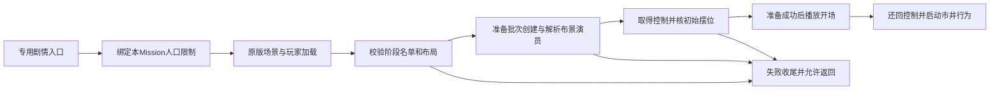
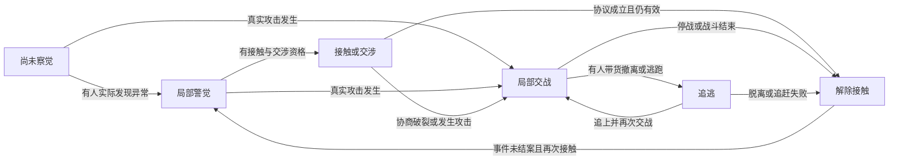

# 逆水寒511 · 总纲与实施计划

> **具体方案与实施记录。** 用户亲自维护的设计约束见[用户设计原则.md](用户设计原则.md)。更新：2026-11-17。原《城池剧情任务》和《玩法演示校验》的现行内容、验收要求与历史证据已融合到本文件，两份旧文档已删除，直接使用本总纲。

<a id="511-review"></a>

## 集中审阅区：玩法、方案与完成状态

**决定：本区用于审阅具体方案。** 后面的实施契约、数据维护和验收证据按章节折叠；提出修改时用S编号、P步骤或“需求§”编号定位。具体方案在本文件修改，用户手写的设计原则在[独立文件](用户设计原则.md)维护。

<a id="511-story-review"></a>

### 本次体验反馈核查（2026-11-16）

### 剧情与演出优化审阅（2026-11-17，能力清单已校正／重写未完成）

**结论：现有机制可以复用，剧情组织与对白仍须重排。**本次完整读取[用户设计原则](用户设计原则.md)，按人物处境、多路线攻略、三大能力、文案与对话结构四项逐条核对；不修改用户原文。正式源有9份、335个节点、368个选项、20处检定，数量与解析通过不代表达到《巫师3》《天国：拯救2》的文案质量。

| 优先级 | 当前问题 | 优化决定 |
|---|---|---|
| 1 人物处境 | 未解决的六场戏按编号轮转，走远换戏，退出恢复；同一演员的后续没有前事收尾条件 | 开场确定人物簇；按当前事情分流，明确结果、散场、真实到位后才开放后续 |
| 2 能力路线 | 当前实现由话术名称选择底层技能，误把威吓划到技巧 | 先列玩家能力，再按能力设计难题，最后归入武力、技巧（敏捷）、魅力；威吓归武力，不能沿用旧映射决定设计 |
| 3 任务经济 | 零活点对话即得50；钱路依赖解决保护费才能凑100 | 两件真实送货差事各50，给低技能玩家独立钱路；四家委托不强制全清 |
| 4 对话结构 | 五步关系容易变成问够话才派活；不同处境仍回统一菜单 | 当前事情→具体话题→专属回应→返回话题上层；接单只要求了解差事 |
| 5 文案因果 | 初见知道旧帮派经历、盘问未获知的押人事件、和平后声称打人；劝老周却检定小六 | 信息有来源，事实与实际做法一致，检定作用于真正被说服的人 |
| 6 通关后 | 到门内即取消剩余委托，阻断回访与支线交差 | 入城成功与支线分开；持牌回访，未持牌保留门禁与后果，债款继续记账 |

**开场：**老周与马横在柜台争执；玉娘与顾长生在台口争场地；大山独自在肉案旁，小六独自在墙边养伤；钱三顺、杜野分别留在自己的地点，铁头守门。两个没有共同成员的簇可以并存，声源按玩家所在区域调度；同一NPC只有一个当前事件入口。老周和马横的已验收柜台几何保持。

**后续：**保护费纠纷收尾后，老周才能谈收账与妹妹，马横才能离开柜台。大山请求处理砸摊问题后，才安排马横到肉摊对质；老周与小六的误会是另有起因的可选后续。老周发愁、大山关照伤势并入个人处境，不再轮播为第五、第六场戏。关闭对话、走远、停止播放都不等于解决事件。

**路线：**钱路提供无技能骰的付款办法；魅力用于劝说、调解与冒充；技巧包括潜行、扒窃、撬锁、钩索和绳索操作；武力用于威吓、真实战斗、击晕与搬运。序章在实际障碍中教这些能力，玩家可以跳过教学，也可以组合解法。十种过门操作是这些能力的不同用法；小六许可锁箱提供真实撬锁练习，不凭空增加锁侧门故事。

**审阅入口：**[具体事件、演出与对白调整](#511-story-design) · [多路线攻略目标稿](#511-story-walkthrough) · [实施顺序与验收](#511-story-status)。攻略在新版玩法实机通过后才能作为玩家正式攻略发布。本轮已改正式对白、能力检定与许可锁箱，并同步预览；多簇事件、真实送货与通关回访尚未完成，继续按§16.26实施；既有站位、按F介入、真实战斗、原生Quest与感知验收不重新列为故障。

**天气与时间通用能力（2026-11-17，详见§16.25）：**用户已确认即时调时可用，并在默认清晨雨天、无积雪及雨滴显示修复后反馈“成功了”。问题21已归档；按用户要求在[轮子索引](../rules/wheels.md)和[配置分卷](../rules/wheels.d/config.md#scene-environment)登记JSON入场环境、场景内控制、降水显示与恢复能力，后续同类需求直接复用。1.3及以上即时time／set仍拒绝，不能将本次实机成功扩大为新版即时调时通过。

**清晨雪天接入（2026-11-17，详见§16.24）：**按用户要求，第一次和第二次剧情入城均配置07:00下雪，雪量0.7、积雪系数0.75。阶段Environment由JSON维护，省略沿用原版；原版模型用本场小时重新计算完整光照，不修改战役时钟。布局版本11，三端各62项环境检查与隔离编译通过；用户已明确反馈“好 成功了”，确认清晨下雪生效，问题20已归档。新增`custom.story_probe environment`只读查询发布版本与场景实际小时／雨雪／积雪，预期matches=True；用途、副作用和维护命令见[归档问题20](用户反馈的问题清单-已解决归档.md#feedback-20)。

**站位与日常动作实施记录（2026-11-17，详见§16.22～16.23）：**用户已确认初始位置正常，13:10日志中老周与马横相距2.10米、方向180°／0°，争吵及退出对话后均不移位；当时点击马横的剧情入口仍待单独验证。其他人原地活动较少属于固定岗位编排，但另有开场早于Prep申请演员、工作动作在实机1.2.12不存在、顾长生保存的岗位高度未贴地三处故障，当时已修待验；本次用户已在清单标记验证。工作动作改为读取开场JSON，当前正式布局版本10。三个真实安装配置体检和隔离编译通过；问题18、19、10现已按用户主清单“已验证”归档，见对应错题条目。

**首遇质问实施记录（2026-11-17，详见§16.21）：**11月17日10:59～11:00实机只有门禁推回后的冒泡，未发起Brain拦问。源场景三级主门实际为empire_castle_gate_inner_l3／outer_gate，旧名称未命中；出生与质问职责点又使用了不同位置。现已统一门锚点和岗位，撤掉仅修出生的8米回落，补拒绝/申请日志；初次质问和拒绝重试服从JSON资格，不要求玩家持续迈步。85项真实源码运行检查和三版本隔离编译通过，当时原版开窗待实机验证；问题14现已按用户主清单“已验证”归档。

**用户已确认的全项目设计原则（2026-11-16）：**正式对话提示写目的、真实技能／属性及重要风险，保留双方数值与实际成功率，不预告NPC答复、成败剧情或未报价金额；明确行动和已报价交易说明确定代价，无检定同样有说明。动武／拘捕的对峙给真实迎战／束手就擒选择，每项有独立NPC回应，回应展示且对话结束后再执行所选结果；投降不假装战败、不留战斗请求。已固化到[CLAUDE.md铁律43／44](../../CLAUDE.md)、[对话设计规则十六／十七](../rules/dialogue-design.md#dialogue-option-hints)与[叙事认知边界](../rules/narrative-design.md#dialogue-hint-knowledge)，后续所有正式对话沿用。右下角非对话交互保持既有范围；各问题的实机验收继续逐项记录。

**守卫开场回应（2026-11-16）：**进入原版对话仍由NPC先说“通行文书。”；首遇和再次交谈的开场节点都提供“[说两句] 让一让，我要进城。”这一真实玩家回应，选择后守卫再拒绝或接入既有交涉分支。已经获准通行时改为“[走过去] 借过。”，守卫回应“……进去吧。”。仅修改门岗正式JSON，版本升为4；根EntryOption不注册玩家网关，该文本键在开场节点Options中复用。数据、中文审阅副本及负面自测通过；用户已在问题7确认通过，见已解决归档。

**决定：以[用户反馈的问题清单.md](用户反馈的问题清单.md)跟进未解决与待用户验证项。**2026-11-17用户将问题8、10、14、15、16、18、19标为“已验证”并要求归档，现已移入[已解决归档／错题集](用户反馈的问题清单-已解决归档.md)，统一为“用户已验证”；加上此前归档，共21项。主清单仅保留问题17“已解决待用户验证”。归档提供按症状索引、原因、现行修法、防回退要点、源码入口与复验方式，原问题和答复折叠保留。后文实施记录中的“未解决／待验证／不归档”、旧版本号和旧配置属于当时记录，不得覆盖最新用户标记或作为恢复旧实现的依据；不同能力、未完成设计及新版兼容也不得借归档冒充通过。

**问题9、10实施记录：**街头自愿参与的事件必须按F才进入对话，靠近只观看循环冒泡；成员、主持人与对白入口沿用数据，守卫岗位主动质问保留。正式对话每句按实际speaker/listener持续控制NPC身体朝向和注视，NPC之间说话也看向实际对方；冒泡仍由PerformanceAction负责。已补齐原版对话切模式误结束暂停演出的恢复缺口。日志与只读诊断可查询实际人物和身体偏角；眼睛和画面需用户验收。此前43项源码提取检查、正式数据及负面检查通过，1.2.12／1.3.15／Steam1.5.x隔离编译均0错误0警告；问题9用户已验证并归档，当时问题10因新增身体抽动保持“未解决”，现已按用户主清单“已验证”归档。已减少重复转向写入并增加连续采样，最新处理见下方反馈复核；HTML后置，轮子暂不登记。

**冒泡朝向最新裁定（2026-11-16）：**仅正在说话的NPC适用：listener在其身体前方120°扇形内，只更新SetLookAgent注视；扇形外才请求身体转身，避免扇形内来回挪动引发频繁转身。复用NpcSightSystem既有视野数学，抽出IsTargetInViewCone供原目击判断与冒泡共用；身体门槛用实际身体朝向，原目击仍用LookDirection并保留距离、高差和遮挡检查。正式对话保留逐句正对实际listener的规则。暂停/退出仍归还身体和注视。34项真实源码提取的视野／冒泡生命周期检查、正式体检及三版本隔离编译通过，冒泡画面已在问题6由用户验证；正式对话的待验记录见主清单问题10。

| 问题 | 继续处理或验证的内容 | 当前进度 |
|---|---|---|
| 8 布景 | 真实戏台、挂秤、肉案已由用户确认完成；五件明细、尺寸、支撑和旧占位证据并入[归档问题8](用户反馈的问题清单-已解决归档.md#feedback-8-scenery) | 用户已验证／已归档 |
| 10 朝向与身体抽动 | 重复写入已减少；持续抽动根因和新版画面仍需实机日志确认 | 未解决 |
| 14 守卫小队 | 每组独立职责区、选择/回执/重入、角色绑定已消费；多人实机待验 | 已解决待用户验证 |
| 15 出狱犯罪值 | 已补实际释放时结清当地势力犯罪值；数值与守卫行为待实机验证 | 已解决待用户验证 |
| 16 原版任务日志 | 主线已接入原版特殊Quest，线索真实展示后入日记；保存/归档界面待验 | 已解决待用户验证 |
| 17 通用感知 | 听声方向与岗位朝向互相覆盖已收口，保持原待验状态 | 已解决待用户验证 |
| 18 争吵站位与事件入口 | 事件1沿用初始点位/方向；点任一成员进入同一事件，窗口与恢复待实机 | 已解决待用户验证 |

**转向调试如何判断：**冒泡动作等引擎推进0.5秒后读取身体偏角，并说明“扇形内，只更新注视”或“扇形外，调用身体转向”。扇形内有身体偏角是正常结果，不要求每句冒泡都0度；正式对话仍以正对实际listener为目标。眼睛是否在画面中正确注视须观察。`custom.story_probe life debug off`关闭本次运行的屏幕消息，`custom.story_probe life debug on`重新开启；两者只改临时调试开关，不改剧情、财物或人物位置。永久开关为模块根`config.json`中的`ShowPerformanceFacingDebugMessages`。`custom.story_probe life facing pawnbroker`只读查询老周当前动作、listener、inBodyViewCone、bodyTurnRequested、fov与身体偏角，不改变位置/配置/剧情/财物。移动或战斗喊话仍走既有并联说话管线。

**实施时复核（2026-11-16）：**本轮补齐问题8/14/16的源码与数据；问题10继续修复朝向竞争，当时按用户要求保持未解决；本次已按新的用户验证标记归档。原版任务完成后由JournalLogsCampaignBehavior归档全文，活动Quest移除不代表日记丢失；1.3+采用SpecialQuestType，1.2.12采用IsSpecialQuest。线索真实展示才登记，刑期开始须实际收据，普通暂停不取消任务。岗位布局有明确源StoryGateSetup.json，正式定义拒绝时不能静默走旧城门脚本。只读资格不写身体，稳定朝向合同不因动画误差重建，身体声源保持期间Brain不把它转回岗位。

**实施时验证与边界：**64项实际岗位导演/锚点/主线日记/解析器运行检查、28项感知/工作租约检查、18项朝向辅助检查、41项战斗/刑期回归通过；5项日记负例和正式数据体检通过，中英各3806条，problems=0。同一测试程序解析并执行三份仅改JSON的守卫组变体；65项真实网格/碰撞引用、组合几何及生成器幂等检查通过。真实1.2.12、1.3.15、Steam1.5.7安装分别隔离编译0错误0警告，产物仅在Debug/offline，没有部署。原生身体、Brain边界、原版任务页/存档和菜单在运行测试中为替身；画面、脚底、多人开窗及读档继续待用户确认，不宣称实机通过。上述为实施时检查与验证边界；问题8/10/14/15/16现已按用户清单标记归档，仅问题17仍待用户验证；HTML后置，轮子暂不登记。

**本轮验收入口：**新增`custom.story_probe persona`只查询姓名/身份现场匹配与历史数量；刑期用`custom.story_probe status`只读查询。转向、岗位和布景命令的用途、时机、副作用与预期结果见[主清单](用户反馈的问题清单.md)及[反馈归档](用户反馈的问题清单-已解决归档.md)对应回答。用户裁定（2026-11-16）：先实机验证，固定刑期和演出转向接口暂不登记为通用轮子；复用既有NPC记忆、Brain、CombatManager与扣押系统。


<a id="feedback-check-design"></a>

### 问题4：检定设计（用户已验证，已归档）

决定：用户最新主清单已将问题4标为“已验证”，原文与答复已移入[已解决归档问题4](用户反馈的问题清单-已解决归档.md#feedback-4)。下方保留验证前的实施与检查记录，旧的“未解决／不归档”等措辞不再代表当前进度。潜行／翻墙额外骰属于此前记录的范围外设计事项，保持现有实现；正式对话沿用CLAUDE.md铁律43／44。

<details>
<summary>展开验证前的检定修复与检查记录（当前已归档）</summary>

问题4：
当前进度：未解决
用户问题：这里的我看不太懂，为什么每种手段的成功反馈会和势力数值有关,不符合预期吧。然后你这里也没写清楚每种方式对应的检定属性是什么，是确定性检定还是随机性检定。如果失败了，那么只会影响玩家本身和交互目标的好感或者其所在势力的好感吧，为什么会影响交互目标无关的人，很奇怪。
这里还有一个很严重的问题，就是lwn这个mod之前就针对玩家对话里面的检定的成功或者失败已经有了已个轮子，但是你这里好像是重新写的？我不太确定，你先理清楚之前已有的逻辑，看看设计逻辑上是不是要重新改下给我瞧瞧。
Agent回答：
核查结果：势力好感没有参与成功率计算。问题出在成功之后：ResolveApproach固定给“对应势力”加5，又找该势力的一名代表给他加5；守门人的扣分则固定记给铁头。代表可能没参加、没获知，副卫出面时也可能扣错人。你的因果要求应落实到实际交互对象，不能只因属于某势力就替别人加减关系。
现行十种手段逐项说明：
收买：对方对金钱的态度允许收取，并且实际足额转给对方100；这是确定的付款条件，没有随机骰。
威吓：随机检定。正式对话使用已有Threaten手段，比较玩家与实际守卫的流氓习气技能；失败进入守卫动武／拘捕的对峙，再选择迎战或束手就擒。
决斗：真实非致命战斗的胜负，没有额外过门骰。
冒充：必须真的穿合适行头并满足资格；选项为“施压”，使用已有Coerce手段比较双方实际流氓习气技能。失败不能开门，随后选择迎战或束手就擒。
击晕：复用KnockoutFlow，按双方活力与控制之和随机判定，再确认真实倒地；不是直接读剧情Force。失败按共享击晕系统处理。
绑住：按实际工具、命中和真实绑缚状态判断，不另外掷过门骰。
扛走：按实际控制、搬离守门位置和完成状态判断，不另外掷过门骰。
扒空武器后交涉：先完成扒窃浮标操作，Roguery影响浮标速度；全部武器槽确实为空后才允许交涉，不另掷过门骰。
蹲行潜入：真实蹲行穿门、未被看见，再随机比技巧；玩家取Roguery技能，对手取演员Guile。失败留隐患，不能把下一帧当新尝试刷成功。
钩索翻墙：真实拉拽越墙、未被发现、稳定落地，再随机比技巧；属性同上，本次失败结果锁定。
正式对话的随机检定现统一调用已有SingleRollResolver.SimpleCompute，不再用剧情Force/Guile/Charm计算概率；具体技能和预览见下方本次延伸修复。蒙面识破、潜行和翻墙的旧属性检定仍保留；其中潜行和翻墙是否保留额外随机骰仍待裁定。战斗胜负、付款与绑扛状态不增加对话骰。
本轮已修：删除过门成功固定给势力和代表各加5的结算；只对实际交互对象应用个人关系变化，副卫出面不扣铁头，无对象的潜行/翻墙不默认扣任何人。正文反馈实际对象、关系与天赋点；日志approach settled列actor、personalDelta与factionDelta=0。检定属性和随机性沿用上面逐项说明。任务完成等有实际利益依据的其他关系结算保留，不把所有关系系统一起清空。用户验收：分别找两卫交涉，核对关系变化目标与日志；没有参与的代表不应自动获益。用户确认：尚无；不归档。

修复前核查证据（2026-11-16）：511的RollCheck仅复用了SingleRollResolver.Roll的统一掷点判据，概率仍由AgentStatsHelper的属性比计算，未调用既有对话Compute／SimpleCompute。15:06:09旧日志中魅力20对50、概率20%、掷点11%、门槛80%的失败记录属于旧实现，不能作为下面新检定的运行证据。

用户确认（2026-11-16）：本次正式对话提示与迎战／束手就擒的设计原则已确认，用户要求更新全项目规则；现已写入CLAUDE.md铁律43／44及对话、叙事设计细则。此记录确认设计原则，各问题实机验收仍按当前进度逐项记录。

本次延伸反馈（2026-11-16，保留用户原意）：[硬闯]是不是威吓、是否凭空造检定；每个选项需要什么能力；原版是否支持悬停说明；[据理]到底有没有检定。用户随后裁定：无检定也要说明，用玩家语言；所有正式对话检定写实际能力依据，但不要预知NPC答复和剧情。右下角交互面板属于非对话，不加本次提示。
当前修复：
1. “硬闯”没有对话骰，改为“[动手] 今天这门我非进不可。”；“据理”没有骰，改为“[说明来意] 我妹妹在城里做工，我进去找她。”没有凭文案补检定。前者挑起守卫对峙，最终在迎战／束手就擒中选择；后者说明找人的目的，提示不提前泄露守卫拒绝。
2. 正式9份定义全部20个Check复用SingleRollResolver.SimpleCompute／Roll，技能唯一取SkillCheckSystem.MapTacticToSkill；Threaten／Coerce看双方流氓习气，Reason看双方战术，Plead看双方魅力。使用实际说话者，无Hero沿用默认技能50；无筹码概率为玩家技能÷双方技能之和×85%，钳制5%～95%，双方均0时取中性比率。选中后随机掷点一次，仍以掷点达到门槛成功，没有另造公式。
3. 全部305个无检定选项、20个能力选项已有正式HintKey／HintKeyZh。普通交谈写目的，例如“向守卫说明进城找人的缘由。”检定显示实际技能、双方值和成功率，再写“试图逼守卫让路，有引发战斗或被扣押的风险。”删除“成功放行／失败开战”、NPC将怎样回复、未报价的金额和隐藏关系把柄等预告。已经报价的交易保留确定金额和所购物品，迎战说明直接交战，投降说明接受扣押。
4. 提示继续走原版OnClickableCondition → HintText → OptionHint → HintWidget，回调返回true；悬停不执行效果、不耗随机数或强制骰。其他经DialogueInjector执行的意图检定也沿用实际对象和本次ActionParam，有出价或证据加成时说明。右下角击晕／偷窃、潜行／翻墙保持原范围。
5. 守卫已说“给我躺下！”／“找死！”／“给我拿下！”时，均提供迎战和束手就擒；每项有自己的NPC回答，答完关闭对话后执行所选行动。具体分支由JSON编排。首遇投降复用固定地图刑期，后续投降复用PlayerDetentionBehavior真实扣押；不制造战败回执，不留战斗请求。见下方迎战／投降修复记录。
验收：正常按F，在说明来意、问价、威吓、施压、说理和已报价付款上悬停，核对目的、技能依据和风险；NPC具体回应只在选择后出现。实际选择检定后只播报一次掷点对门槛，日志[StoryDialogueCheck]含resolver=SimpleCompute、实际目标及skill。
`custom.story_probe dialogue options`在正式NPC句已显示后使用：只读打印当前节点全部定义选项（包括被条件隐藏项）及检定依据；不移动、不改配置／剧情／财物、不掷骰或消费强制骰。实际可见项以原版条件过滤为准。
离线证据：44项共享检定／提示／解析器运行检查、9项原负例，以及24项扣押请求／转场／战斗运行检查通过；6条正式数据分支及2项非法扣押模式反例通过。正式数据problems=0，968处中文旁注一致；1.2.12／1.3.15／Steam三客户端隔离编译均0错误0警告。游戏世界、UI与俘虏API在运行检查中为替身，不能代替实机验收。
当前状态：对话部分已改，问题4整体仍未解决；非对话的潜行／翻墙是否保留额外随机骰仍待裁定。未经用户验证不归档；总纲开头与CLAUDE.md铁律43已按最新标准同步，HTML后置，按此前裁定暂不登记轮子。

#### 补充检定设计审阅记录

以下保留此前实施、证据与验收说明；本项尚未通过用户验证，当前状态以主清单为准。

**最新实施（2026-11-16）：**正式对话提示采用“目的＋实际能力依据＋重要风险”；不提前给NPC答复或成败剧情。普通说明来意写“向守卫说明进城找人的缘由。”威吓保留实际流氓习气、双方值与成功率，再写“试图逼守卫让路，有引发战斗或被扣押的风险。”未报价不泄露金额，已报价交易保留确定代价。该要求只管正式对话，右下角交互面板不变。

**动武后的选择已补（迎战／投降修复，待用户验证）：**“给我躺下！”／“找死！”／“给我拿下！”分别提供迎战和束手就擒，各接独立NPC回答；实际展示回应并结束对话后才提交所选行动。提前和重复战斗请求已去掉，副卫首遇入口已修；迎战沿用真实战斗回执，首遇投降沿用固定地图刑期，后续投降沿用真实扣押。投降不造战败、不残留待执行战斗，也不套用同城无关事件。24项源码运行检查、6条数据分支及2项非法参数负例通过；游戏宿主为替身，画面和刑期仍待用户实机。问题4仍未解决，迎战／投降分支也未记录用户实机验证通过；不归档。

决定：针对“硬闯／据理”延伸反馈，已修正式对话文案、技能和悬停提示；整项问题4仍未解决，保留非对话检定待裁定，用户未验证不归档。

- 首遇“[硬闯]”实际没有检定，直接开战，现改为“[动手]”；“[据理]”实际没有检定，接守卫拒绝，现改为“[说明来意]”。悬停分别说明真实战斗及扣押后果、普通交谈的目的；不凭文案补一个骰。
- 9份正式定义的20个Check已改用登记手段，技能唯一取`SkillCheckSystem.MapTacticToSkill`，概率统一调用已有`SingleRollResolver.SimpleCompute`，实际掷点调用`SingleRollResolver.Roll`。玩家和实际NPC比较同一真实技能，不再取策划Force/Guile/Charm。
- 原版可点击选项本来支持悬停：`OnClickableCondition`输出`HintText`，`ConversationItemVM.OptionHint`绑定原版`HintWidget`。已沿用该链，回调返回true；检定选项同行标实际技能，悬停显示双方值、成功率、尝试目的与重要风险。预览没有效果、随机数或测试覆盖消费。
- 无检定选项也必须说明确定动作：动手将直接开战，付款说明金额和所得，换装说明旧衣回行囊，接单／交差说明已知任务与约定报酬，打听／返回／离开说明话题及去向。9份正式定义305个无检定选项现已全部配置非空中英结果提示；不能仅写“普通交谈／不检定”，不能把报价阶段写成已经付款，也不承诺战斗必胜。正式体检新增缺HintKey即报错，负例已验证；963处中文旁注无缺失。只改提示数据与校验，不改变实际效果，悬停画面待用户验证；无新轮子，HTML继续后置。
- 本次文案修正（2026-11-16最新裁定）：9份正式定义全部305个无检定选项与20个能力选项，现用103个双语提示词条维护。删除“守卫会拒绝放行”等预知答复，删除“成功／失败”剧情清单和未报价金额、隐藏关系把柄。能力模板与真实概率保留，明确行动及已报价交易保留确定代价；普通问题只写打听话题。中文旁注968处一致，正式体检problems=0；提示更新逐份比对未改变剧情，迎战／投降分支改动见上方修复记录。


| 正式对话手段 | 已有枚举 | 实际主导技能 | 当前使用 |
|---|---|---|---|
| 威吓／喝止 | `Threaten` | 流氓习气（Roguery） | 门岗威吓、保护费喝止、屠户相关威吓 |
| 施压／点破 | `Coerce` | 流氓习气（Roguery） | 贵族行头施压、讨债、野贼对质 |
| 说理 | `Reason` | 战术（Tactics） | 对台领班、打手、寡妇的说理 |
| 劝求 | `Plead` | 魅力（Charm） | 劝儿子 |

决定（2026-11-16用户补充）：所有正式对话检定都必须写清实际依赖的技能或属性，不只处理威吓；右下角交互面板属于非对话交互，本次不加这些提示，潜行／翻墙等非对话判定也不改。511全部20个对话检定第一句明确“成功率取决于双方的{实际技能}技能”，随后显示你／对方的当前技能值、实际成功率、尝试目的和重要风险。威吓／施压取双方流氓习气，说理取双方战术，劝求取双方魅力。其他通过DialogueInjector执行的对话意图也接上原版悬停，预览和执行共用实际对象及ActionParam，Evaluate选定本次手段后沿用SimpleCompute；有出价或证据加成时额外说明。中英语言源同步，未修改胜率或效果。44项源码运行检查和9项负面检查通过，正式体检problems=0，968处旁注一致，1.2.12／1.3.15／Steam三版隔离编译均0错误0警告；原版世界与UI宿主为替身，画面仍待用户验收，不归档，复用已有轮子并按此前裁定暂不登记。

| 已有入口 | 成功率与属性 | 511当前使用范围 |
|---|---|---|
| `SingleRollResolver.Compute`（完整对话交涉） | `NegotiationState`给难度/开局优势，`SkillCheckSystem`给技能胜率，`NegotiationRegistry`给性格倍率；技能30%＋筹码70%，最终2%～95% | 当前未用；未定义完整谈判目标，不随意填一个目标 |
| `SingleRollResolver.SimpleCompute`（简版技能对比） | 玩家技能÷双方技能之和×85%＋筹码×15%，最终5%～95%；无Hero的NPC默认技能50；双方均0时中性比率0.5，本次补齐0÷0防线 | 正式对话全部20个Check，当前无额外筹码，按真实目标技能计算 |
| `StoryProbeDefs.RollCheck`（旧属性检定） | `AgentStatsHelper.ComputeOpposedSuccessRate`算0.5×玩家属性÷NPC属性，最终5%～95%；掷点仍交共享Roll判定 | 非正式对话的蒙面识破、潜行、真实翻墙仍保留；不再用于正式对话Check |

实际变化：同一技能20对50，正式对话从旧20%改为共享简版约24.3%；100对50约56.7%。技能越高影响胜率，不是固定技能门槛。选择后随机掷点一次，掷点达到`1−成功率`即成功；事前可看概率，事后仍只播掷点与门槛。

- 已实施：正式Check使用实际技能；未知手段、旧force/charm/guile字段和数值枚举不得进入正式数据。没有另造能力或概率公式；本次不额外引入性格、筹码加成。
- 保留：付款以真实足额转账为准，决斗以真实战斗胜负为准，绑扛看真实状态，击晕/偷盗走各自已有轮子；不能给每条真实行动再加一个统一对话骰。
- 需要你裁定：潜行/翻墙已经满足真实动作、未被发现和落地条件时，是否仍保留额外随机骰。当前失败锁定保留，不能逐帧重掷。
- 保留：关系只结算实际参与者，不把势力关系用于成功率，也不凭同势力给无关代表加减关系。

验收：正常按F检查首遇“说明来意／动手”的悬停，再检查真正威吓／说理的同行技能和悬停双方值、概率；实际选择后核一次结果及`[StoryDialogueCheck] resolver=SimpleCompute ... skill=...`日志。`custom.story_probe dialogue options`在NPC句已显示时只读打印当前节点全部定义选项（包括条件隐藏项），不掷骰、不消费测试覆盖、不移动、不改配置／进度／财物。实际可见项以原版条件过滤为准。

证据：36项实际源码运行检查、9项Python负面检查、正式数据与中文旁注检查通过；三客户端隔离编译均0错误0警告。原版世界／UI宿主为替身，悬停画面和新版运行日志尚待用户实机验证。HTML后置，按用户此前裁定暂不登记轮子。

</details>

### 本次修复与证据（问题11～13）

决定：按[反馈清单](用户反馈的问题清单.md)逐项进行游戏验收。14项目标/卡片运行检查与35项镜头/开场运行检查通过；镜头检查调用真实TaleWorlds.MatrixFrame.Slerp，原版场景与UI宿主仍为替身。三客户端1.2.12、1.3.15、Steam1.5.x隔离编译均0错误0警告，正式数据与负面检查、中文审阅副本检查通过。

决定：二次入城先平滑转到遮挡机位，之后创建布景和演员；准备Ready后才推进时间轴。相机由CameraService／SpringArmRig持有，首次引擎快照不随换镜头覆盖。退出先解冻，完整画面渐变回引擎眼高/视距，等解冻后4帧再写回方向和释放。BlendSeconds在StoryOpeningTimeline.json中控制，目前0.8秒；具体机位数值仍来自Camera.csv。

决定：配置名称按职责区分。旧StoryStage.json已改为StoryOpeningTimeline.json（开场时间轴）；旧StoryStageV2.json已改为StoryScenePlan.json（场景布局、岗位、行为、流程），StoryPoints.csv仍是点位来源。源码类名与内部Schema保持原口径。生成器、检查器和现行文档均使用新路径；旧历史描述以本段映射为准。

归档决定：问题8的戏台、挂秤与肉案组合已由用户确认完成，原独立布景核查清单完整并入[归档问题8的布景明细](用户反馈的问题清单-已解决归档.md#feedback-8-scenery)，引用统一跳转到归档，不再维护独立文件。问题10也已按用户最新清单“已验证”归档；此前单次0.3～0.4度采样只作为历史证据，不冒充持续稳定验证。问题11、12、13的既有归档保留，HTML后置。

<details>
<summary>此前反馈复核（2026-11-16，18:18日志之后；本轮实施前的记录）</summary>

以下是本轮实施前的状态与验收说明。现行实现、进度和验证结果以开头状态表、§16.20及反馈清单为准；其中重复纠偏、主线缺Quest、七件占位和岗位未消费等描述已被本轮实现替换。

- **问题8仍未解决。** 18:17:37.522日志已出现第二阶段准备ready，证明此前缺gate_entity的阻断本次没有复发；七件道具仍是桌、桶、地毯，不能当完整戏台、秤与肉案验收。
- **问题10仍未解决。** 已删除演出每帧清移动合同再重建朝向的冲突写入，冒泡与正式对话共用一份生命周期内的朝向记录。稳定方向不重发，身体偏离时最多每0.25秒纠正；原120°冒泡视野规则保留。新增`[FacingTrace]`逐秒记录真实目标编号/位置、双方位移、身体转动/反向次数、写入与模式切换次数、控制来源及Brain动作。最新旧版日志未开启诊断，新版是否消除画面抽动仍须实机。
- **问题14仍未解决。** 复用岗位选人、群组成员、Brain控制权和双卫战斗回执。通用“守护对象＋小组共享职责＋各自岗位”仍缺实际消费方；不为每个门复制宿主，也不另建第二个Brain。岗位Anchor/Facing、Rank、ReentrySec及MaxActive消费缺口照原待办保留。
- **问题15已修待用户验证。** 真正放人后结清关押地所属势力的原版犯罪值，放人失败/取消/仍在押不清，其他势力与释放后新罪保留；第二阶段同伴台词不再把已伏法说成仍被通缉。通行令牌与刑满结案继续是两个独立事实。旧版本已结束释放的存档不追溯清罪。
- **问题16仍未解决。** 四家委托已有原版Issue/Quest，但进城找妹妹主线没有原版Quest，HUD不能代替任务日志。新增`custom.story_probe quests`只对照剧情接单标志与实际活动Quest；主线日志、读档、取消/完成接入仍需实施。首遇强化与两阶段难度叙事解释仍按既有待裁定项处理。
- **验证证据：**15项实际朝向辅助源码检查、41项战斗/刑期检查、正式数据体检与负面自测通过；1.2.12／1.3.15／1.5.7隔离编译均0警告/0错误。收尾补齐crime／quests的命令登记，19项真实命令解析检查通过，覆盖直接输入、首参占位、大小写与后续参数；该修改后1.2.12隔离编译再次通过。原版Agent/菜单为替身；新DLL未部署，游戏抽动、犯罪值及守卫行为未实机验证。HTML按当前要求后置，按此前裁定暂不登记轮子。

**本轮验收指令（均写完整）：**

| 指令 | 何时用／看什么 | 状态影响 |
|---|---|---|
| `custom.story_probe life debug on` | 二次入城观察抽动前开启，随后自然看戏／按F交谈，日志应出现连续FacingTrace | 只开本次运行诊断；不写配置、不移动、不改剧情或财物 |
| `custom.story_probe life facing widow` | 抽动时查看宋玉娘实际冒泡目标；widow可换为实际演员ID | 只读动作/目标/偏角，不发声或推进台词 |
| `custom.story_probe dialogue trace` | 正式对话中核本句真实人物，散场后应facing=inactive | 只读，不改位置/配置/剧情/财物 |
| `custom.story_probe life debug off` | 采样结束关闭诊断 | 只关诊断，不改变正常朝向 |
| `custom.story_probe crime` | 自然服刑并点击出狱后应看到crimeRating=0.00；对照release crime settled日志 | 只读，不清罪、不跳刑期、不改剧情或财物 |
| `custom.story_probe quests` | 自然接单前后对照accepted与native任务ID，主线缺Quest会明确标出 | 只读，不补建、接受或完成任何任务 |

详细根因、已有调用位置与各项状态统一见[反馈清单](用户反馈的问题清单.md)，未经用户明确验证不归档。

</details>

### 给接手agent的开工说明（先读这一段）

**最新反馈实施见§16.20：**五件真实组合根、首遇Stage名单与岗位锚点/朝向、Rank/Trigger/ReentrySec/MaxActive、独立守卫组及主线原版Quest均已有消费链，不再当成未实施任务重复改造。问题8/14/16进入用户实机验证，问题10仍未解决；其余工程底座欠账按原范围保留。

**前一轮基础复验结论（2026-11-16，§16.14）：18项运行反例、30项解析/发布/人口标记检查、正式数据体检与既有负面自测全部通过；1.2.12与1.5.7隔离编译均0错误/0警告。Mission入口钩子、赎信物内容、节点资格/过期回调/失败会话、可逆事实与资金回滚已有修复。完整事务、稳定效果实例ID/作用范围、委托通用结算、空间准备和实机验收仍未完成。准备失败回退已在本轮撤掉，支撑、朝向、接触和完整布景仍待联验。详见§16.14。**
**本次补充：StoryStageV2已接入专用入场前重载，改岗位坐标后退出并重进即可读盘；坏新版保留旧版，无有效旧版则拒绝入场。43项检查包含真实加载器读盘/缓存/异常保留，两版隔离编译通过；新机制实机待验，详见§14.11～§14.12／§16.17。Cast/Tuning等其他缓存不属于本次自动重读范围。**
**最新对话裁定与实施（2026-11-16，§16.19）：**每次互动由NPC先开口；一句一节点，正文无人物前缀；显式`Speaker/Listener`接原版真实参与者。9份唯一JSON现为303节点、303条动作、632处中文旁注。连续NPC句用节点级`NextNode`与原版继续，玩家回应使用`Options`；`EntryActors`与全体`Actors`分开，防止第三人抢入口。旧付款/奖励所属节点与选项ID保持，收据不因拆句重发。源码与离线验证已改，游戏实机待验；P0-D其他欠账仍保留。§16.18为上一轮源合并时的132/240/461历史基准。
**可以开始测试：**先按[§14.10第一轮实机联调](#511-test-start)走首遇→真实败退→地图服刑2天→真实换装返回第二阶段→一个委托→过门→归还，再扩到V/D/T全套。2026-11-16最新实机已见首遇双岗，但站位偏到门的一侧，尚未通过空间验收；具体位置来源、改法和未消费字段见§14.11／§16.15。

- **先读规则与真实状态：**`AGENTS.md → CLAUDE.md → wheels.md`及命中分卷；读§0.6、§14.10及§16.14／§16.19。对话维护按需求§22，只改9份正式源；中文审阅字段不得删除，不再创建旧副本或运行已退役的迁移器。§16.11～§16.13保留原日期供追溯，不能把旧失败表当当前待办；保留已修代码与18项断言，不重造框架。
- **下一步优先补安全和数据底座：**准备失败回退本轮已撤掉，先实机验证其收尾；继续处理§16.14的完整交易/不可逆效果边界、独立稳定效果ID及剧情运行/事件范围防重；`quest_turn_in`移除角色专用数值与分支。已有节点资格、回滚、hazard和赎回修复不重复实施。
- **继续补P3/P4消费者：**Ready/Failed与跳过已有消费者；保留这些接线，补实际身体控制确认、支撑/朝向/形体/接触/通路，去掉旧台本扫描补生和第二份站位来源。会话已比较编号/对话/演员，仍须联验请求来源、取消/中断与真实入口结果。
- **岗位数据的下一步：**§16.20已补首遇Stage名单、Anchor/Facing与独立门区、Rank/Trigger/ReentrySec/MaxActive，并统一Brain申请和真实回执。保留现有消费链，下一步用同一DLL在游戏内验证一人/多人组、排序换执行者、跨组和失能接替；离线三份JSON变体已经实际执行，但不能替代多人站位、开窗及回岗的画面验收。
- **完成条件：**交付§0.6.4约定的诊断命令、同DLL两组JSON变体、D01～D08机制结果及源码/离线/编译/实机四栏证据；正文状态与HTML同步。未验证项明确保留，不能以“字段能解析”或“正常数据全绿”宣布基础改造完成。D03正式首遇双岗实机依赖后续P2/P4，本轮须区分机制绑定验证与正式双岗验证。
- **后续顺序：**P0-D安全/入口/契约/内容回归 → P2身份与双岗联验 → P3真实准备与空间 → P4通用流程/工作/群组 → P5异常/迁移 → P6完整可玩验收 → P7个人闭环。已有代码只修缺口；P0-D未通过前不把安全延期到P5。

**交付位置：**方案与验证结果统一写本总纲；代码沿用现有`Interaction/StoryProbe/`及对话/Planner扩展点；验收命令沿用`custom.story_probe`命令族。遵守项目的用户编译、产物隔离和git约定。本次交接说明无新轮子。

### 这段玩法要让玩家体验什么

- **能力 → 门槛 → 反馈：**用门路、身手、拳脚或钱过有代价的门槛，得到关系、工具与消息，再面对下一道门槛。
- **每个门槛至少两条路：**失败后能换办法；四家委托有和平与战斗解法，第二阶段城门有十种办法。
- **NPC不是按钮：**第一阶段先做到日常活动、可介入的群组纠纷和真实中断；最终P7完成每人自己的感知—决策—执行—复盘，玩家不介入也会有后果。

**范围：**在原版卡拉迪亚的吕卡隆（`town_ES4`、`empire_town_m`）验证城门序章。妹妹线索指向后续，本阶段不交付救出妹妹、完整都市开放世界或押镖玩法。

| 玩家流程 | 必须发生的事 | 当前状态 |
|---|---|---|
| 1.首遇城门 | 玩家＋两名登记守卫；两人站岗，由岗位AI动态选一人质问。这是单行道：讲理被驳回，只有硬闯能推进；离开对话只是关窗，剧情不走。硬闯后守卫临时强化，玩家必败被制服入牢 | 双岗已实机出现，站位曾偏到一侧；±1.2对称试调已落盘，新位置与重进入场重载待实机。换人接手与共享窗口未实机，§16.15～§16.17 |
| 2.败退与换装 | 只凭真实战斗结果判败；退出到地图等待菜单服刑两天，刑满真实穿旧衣面罩并回门外。原装备、修饰词和钱托管一次 | 已有地图刑期与换装/返回源码，存档和取消离线检查通过；实机待用户验证，首遇保护仍待定 |
| 3.第二阶段准备 | 玩家＋9名演员＋最多1名已有可用同伴，无人则旁白；沿用5件已验收布景。创建可同帧发起，实际就绪后才开演 | Ready/Failed与跳过已有消费；本轮按实际地面贴地，准备失败停演回菜单；完整舞台及R1～R7空间/控制未兑现，§16.14 |
| 4.市井与委托 | 开场人物簇决定当前入口；当前事件明确收尾才开放同一人的后续。按需要接差事，先帮忙后核事实也可交差 | 已有成员入口和真实结果；前事条件、多簇、自然收尾及新能力解法待实施，需求§6.6 |
| 5.过门结案 | 任一真实路线到门内即记入城成功，原财物按收据归还；支线保留，债款继续记账，持牌与无牌回访有区别 | 当前完成链仍取消活动委托；需迁移为入城与支线分开，十路逐项实机，需求§6.6～6.7 |

### 四家提供什么，玩家付出什么

| 委托人／组织 | 要办的事 | 可选办法与回报 |
|---|---|---|
| 老周／捉刀人 | 向收数人实收120，再回老周交款 | 说服或现有讨账链；归还债款后得30报酬、账本与经验 |
| 小贼／夜行会 | 让野贼退让 | 施压对质（流氓习气）或真实战斗；得绳与钩、撬锁包与经验 |
| 寡妇／流浪剧团 | 让对台领班让出场地 | 说理（战术）或真实战斗；得贵族戏服、身份资格与经验 |
| 屠户／码头帮叛逃者 | 让打手停止砸摊 | 说理（战术）或真实战斗；得刀与绳、磨刀石与经验 |

**奖励口径：**委托对应技能加40点经验，不保证升一级；过门另记1点待用天赋，天赋树未实现。属性道具可偷、使用和消耗链未实现；身份文书当前是资格，不是独立物品。


用户批注，下一次会话之前要回答：
这里的我看不太懂，为什么每种手段的成功反馈会和势力数值有关,不符合预期吧。然后你这里也没写清楚每种方式对应的检定属性是什么，是确定性检定还是随机性检定。如果失败了，那么只会影响玩家本身和交互目标的好感或者其所在势力的好感吧，为什么会影响交互目标无关的人，很奇怪。
**核查答复：**势力数值不参与检定概率。本轮已删除过门成功固定给势力及代表加5的结算；个人关系只给实际交互对象，无对象的潜行/翻墙不默认扣任何人。每种办法的属性、随机性和失败去向已逐项写入[问题清单的回答](用户反馈的问题清单.md)，以下为本轮源码行为，实机待你验证。

| 十种过门办法 | 门槛与代价 | 本轮成功反馈（待用户验证） |
|---|---|---|
| 1.收买 | 对方金钱态度允许收取，实际足额转给对方100；不掷骰 | 实际收款守卫−5；无势力自动加分 |
| 2.威吓 | Intimidate→武力随机检定；失败须应对对峙 | 实际交互守卫−20，犯罪/隐患 |
| 3.决斗 | 真实非致命胜负回执 | 实际交互守卫−20，犯罪/隐患 |
| 4.冒充 | 实际贵族行头＋资格＋Impersonate→魅力随机检定 | 实际交互守卫−5 |
| 5.击晕 | 真实击晕倒地 | 实际受害守卫−20，犯罪/隐患 |
| 6.绑住 | 真实绑缚状态 | 实际受害守卫−20，犯罪/隐患 |
| 7.扛走 | 真实控制与搬离状态 | 实际受害守卫−20，犯罪/隐患 |
| 8.扒空武器后交涉 | 真正取空全部武器槽，再另行交涉 | 实际交互守卫−5 |
| 9.蹲行潜入 | 实际从门外穿门、未被看见、技巧检定 | 无默认个人或势力关系变化；失败记隐患 |
| 10.钩索翻墙 | 有绳与钩、真实拉拽越墙、未被看见、技巧检定及稳定落地 | 无默认个人或势力关系变化；本次失败不能下一帧变成功 |

**通行权（2026-11-16 用户裁定，已落地）**：过门是一次性事件，**通行权是长期凭据**。
- 凭据 = 背包里那枚**城门通行令牌 `lwn_gate_pass`**（`ModuleData/items/story_props.xml`），不另设存档字段（背包由引擎自己存）；旧布尔 `GateOpened` 只作历史痕迹，不再当凭据。
- 发牌 = 只有「守卫正式放行」的两条路（贵族身份交涉，存档手段ID仍为charm；塞钱，ID为money）；正式冒充选项现用魅力属性，通行资格仍需真实行头。打晕、绑走、潜行、翻墙、硬闯**不发**——那是进去了，不是被允许。清单在 `StoryProbeTuning.json → Gate.PassItem / PassApproaches`。
- 持有令牌再进城 = 守卫直接放行（进场 `_gateOpen` 即为真）；令牌不可交易（`is_merchandise="false"`），弄丢了就等于没有通行权；`custom.story_probe reset` 会收回。
- 验收 = `custom.story_probe gate`（看持有/判定），`gate grant|revoke` 可强制制造两种状态。

**岗位职责区（2026-11-16，已落地最小版）**：拦问不再要求玩家踩进门轴 ±3 米窄带 ——
- 数据开关 `Trigger.PlayerInPostZone`：玩家进了**这名守卫自己的**感知半径（现 8 米）、门未放行、且还没走过去，就轮到他履职；旧口径 `PlayerInsideGate` 保留给旧数据。
- 进区后守卫每拍把视线目标设成玩家；`no sight` 日志改成带原因（`dist` / `height dz` / `facing dot` / `occluded`）。
- 越线推回改由**离玩家最近的守门人**（副卫也算）执行，并打 `[StoryGate] pushback by <谁> along/lateral`。
- 待实机确认：高差嫌疑 —— 门外出生点 z=69.35、城门 z=72.96（差 3.61 米），而通用视线判定的高度门槛是 3.0 米。

用户批注：
收买是不是就是你说的前路，自己发明‘钱路’这个词是想干嘛，能不能说人话。而且对收买这个行为的限制，在于对方对金钱本身的态度字段。
**核查答复：**这里指收买肯收钱的守门人，不是任意NPC的通用出口。当前零活只有对话结算、每次50并带战役小时冷却；保护费免付后的谢礼50只领一次。2026-11-17优化目标把钱路改为大山两件真实送货各50，不依赖解决保护费，详见需求§5.5／§6.6；目前未实现。当铺消息仍按买卖收费，屠户仍拒绝卖消息。

用户批注：
当前4m内请求对话、离开6m可重新接入，没有停留2秒条件。这个我又听不懂了，你没有说人话。
**核查答复（保留问题9已验收修法）：**靠近街头纠纷只观看，按任一成员的F才加入同一事件；退出不自动解决，再次介入仍按F，不要求走到6米外。守卫主动质问是岗位职责，保留。当前六场内容仍在正式数据；2026-11-17目标将个人发愁／关照并入个人处境，四场纠纷按前事结果与真实到位发生，详见需求§6.1～6.6。无限轮转不再是目标；掀肉案、抓领子、搬案板没有对应演出，不能说成已实现。

### 技术选择：哪些已定，哪些可以要求重做

**用户已定的底层要求：**复用真实`.xscene`，511专用场景不生成常规NPC；首遇两名守卫且质问者动态产生；具体演出与行为逻辑由无需编译的脚本/JSON控制。实现路径S1～S9可审阅调整；每NPC闭环本身是已定的进阶目标。

| 编号 | 决定与理由 | 改造状态／细则 |
|---|---|---|
| S0 | C#只提供原子和通用执行；数据定义谁参加、条件、步骤、分支与恢复。策划频繁改戏，同一DLL须能验证变体 | 18项运行反例已通过；完整事务、内容通用化及同DLL变体仍未通过，§0.6／§16.14 |
| S1 | 复用原版城镇上下文，在人物生成前绑定本次专用场景并限制全部人口来源；普通逛城与地牢继续正常 | **部分已落地，有首轮实机证据（1.2.12）**：早绑定＋阻止7类来源；马匹入口及1.3+打手/同伴/动物未覆盖，普通逛城/地牢未完整回归，§16.7／§16.9 |
| S2 | 真实Hero身份与本轮剧情、临时Agent身体分开登记；重开保留身份，不复制账目或奖励 | 已有Hero/存档基础；拆分与迁移未实施，§四 |
| S3 | 仅借用最多1名已有可用同伴；无人走旁白，不自动招人；统一查重、借用结束不移队 | 已改为借用已有同伴；身份/查重与全生命周期仍待联验，§四／§16.11 |
| S4 | Stage统一场景布局与阶段名单；静态布景从镜头时间轴移到进场准备，停止扫描台本补生 | v2布局与准备已接、旧同ID布景生成被跳过；从旧坐标迁入不等于空间重排完成，§四／§16.11 |
| S5 | 以真实高度图、城门城墙/建筑、身体与道具形状朝向设计；支撑、工作接触和通路均验证 | 工具/旧问题图已完成，新布局未验，§五 |
| S6 | 每人只有一个Brain（身体执行与控制仲裁）；日常、互动、群组、台本都申请控制。岗位AI选人，个人对话只让相关活动让位 | 指定对话/分支/多人成员/说话者与会话匹配已有；全局对话停演闸门仍待适配（§6.7），动态接手与中断待实机，§16.14 |
| S7 | R1～R7进场准备按真实结果推进；同帧创建允许，不能用固定小延迟代替就绪；跳过仍布齐，失败安全收尾 | Ready/Failed与跳过已有消费；初始化失败回退仍绕过闸门，Brain存在不等于取得身体控制，支撑/朝向/接触/通路未完成，§16.14 |
| S8 | 已注册能力才能进正式数据；未知字段/条件/原子拒绝发布。重载失败保留旧版，运行实例固定版本；改几何须重新入场 | 重复ID/非法整数与插入无关效果后的收据已修；独立稳定效果ID、作用范围、范围/引用闭合与迁移仍待完成，§16.14 |
| S9 | 感知→个人目标选择→Brain原子执行→结果复盘→再选择；本地决策为主，模型低频可选且有预算 | P7未实施；第一阶段先留真实接点，§十二／§十三 |

**当前下一步：按§16.14补完整事务、稳定身份、内容通用化和准备失败边界；同时可按§14.10开始实机联调定位问题。** 18项反例已通过；D01～D08、V01～V14与T0～T10证据未齐，P5/P6不能标完成。P7完整自治仍未实施。

**事件与NPC如何合作：**事件状态机管客观进度、合法转移和职责请求；NPC只根据自己感知/获知的消息判断怎样履职；Brain执行并返回真实结果，事件再核事实推进。给NPC职责不等于给秘密，不强刷全员动作；玩家在任何合法阶段都能介入，重复或迟到回执不能重复结算。押镖/劫镖仅作接口例子，P7先用511既有群组验证。

### 已完成、未完成与待裁定

| 类型 | 截至2026-11-16的事实 | 审阅时怎样理解 |
|---|---|---|
用户批注：
早就改成了门口双守卫，你这里还写单守卫剧情。
| 已有源码 | 首遇双守卫及动态质问人选、Brain演出租约、对话/真实战斗/通行、实际收付、归还与原生Quest修复 | 双岗生成有最新日志证据；硬闯已改登记守卫广播与共享回执；双卫协同实机待用户验证 |
| 已完成文档/工具 | 本总纲的整合、实施交接及用例设计；HTML只解读正式DesignData，展示俯视布局、人物对白与演出事件；真实高度图＋建筑＋演员道具投影工具、旧布局问题复核图，工具已登记轮子 | 文档/工具完成不改变游戏；当前图有重叠、高程与朝向疑点，不能批准为新布局 |
| 已修复／未完成 | 原8项＋新增8项＋资金回滚2项均通过；入口/赎回/会话匹配与准备消费已有修复；完整事务、通用结算、空间及P5/P6未完成 | 详见§16.14；18项通过只证明对应机制，不能冒称D01～D08全套通过 |
| 已有新增源码／数据 | 9份唯一对话源、632处中文审阅字段；总角色表10人，首遇2守卫、第二阶段9演员；7件第二阶段布景和旧30拍仍在 | 正式数据problems=0、43项解析/发布/人口/重进检查与18项运行反例通过；两版隔离编译通过；本轮对话、站位与第二阶段实机待验，§16.18 |
| 未验收 | P6：新架构V01～V14、玩法T0～T10、空间/浏览器及对应版本实机 | 单守卫人口限制有首轮实机证据；本次修复未实机，整体第一阶段未完成 |
| 最终进阶未实施 | P7：每NPC完整本地闭环与事件协调，另验A01～A05 | 第一阶段可没有完整自治，但§12.8接点必须有实际消费方 |
| 待你裁定 | 首遇教学强化/保命例外是否成为正式玩法，以及两次难度差异的叙事解释 | 保留现有验证设定；执行agent不擅自删保护或增无敌，仍须凭真实战斗判败 |
| 暂不交付 | 黑屏、老囚犯实体交接、真实侧门锁、属性道具可偷/消耗、冒充犯法/栽赃、后续寻仇与救妹剧情 | 单独细化后再排期，不能靠改预览措辞算完成 |

**第一阶段通过标准：**P0～P5（含§0.6对话补项）落地、P6逐项验证V01～V14、T0～T10和对话D01～D08；空间、控制、财物、身份及原生返回路径无未解决失败。源码、离线、用户编译、游戏实机四栏分别记录。**完整进阶另验P7及A01～A05，不能把第一阶段通过写成所有NPC已自治。**

**共同口径：**复用`empire_town_m`；首遇2名剧情守卫动态选1人质问，第二阶段9名登记演员及最多1名已有同伴；只允许阶段名单人物。十路保留，布景移至准备批次。当前v2已接入部分上述目标，但沿用旧30拍坐标，真实准备/空间与AI编排尚未通过；最终个人闭环仍属P7。

**维护规则：**[用户设计原则.md](用户设计原则.md)由用户亲自维护，Agent在相关工作前完整读取并逐条核对，不复制或修改原则正文。本文件是具体方案与验收记录的唯一维护处；改设计同时更新对应要求、集中审阅区和§十六状态，改数据/生成器后重生[玩法演示](逆水寒511-玩法演示.html)。两份旧需求/校验文档已删除，不再引用旧路径；原始核心文档保留原始材料，不新增另一套现行方案。发现矛盾须修原条款，不能用优先级把矛盾留着。

**交接规则：**其他agent不依赖任何模型或会话记忆；先读`AGENTS.md → CLAUDE.md`与命中轮子，再按§十四实施。已有P0/P1代码须保留复用；按2026-11-15用户要求，下一步立即处理P0-D。精确契约、实际消费方与正负校验一起交付后才迁正式数据，禁止把尚未实现的字段塞入运行JSON。

**查细节：**[当前30拍怎样执行](#511-sec-2) · [实施顺序P0～P7](#511-sec-9) · [独立实施与V/A/T验收](#511-sec-14) · [玩法与数据维护（需求§）](#511-requirements) · [实现状态与证据](#511-status) · [历史存档](#511-history)。[玩法演示](逆水寒511-玩法演示.html)只预览当前正式数据，设计原则与实施状态留在本总纲；[单张关卡图](../../Debug/offline/511-关卡俯视图.png)为旧布局复核，不证明实机空间合格。

---

<a id="511-sec-0"></a>

## 零、S0：策划数据决定具体逻辑，C#执行通用原子

<details>
<summary>展开本节实施要求与验收细则</summary>

### 0.1 C#与策划数据的明确边界

**决定：日常、个人互动、群组配合和开场演出，都由数据组合通用能力。** `StreetLifeDirector`与 `StoryStageRunner`只能读取和执行定义，不能自己成为藏着角色安排的剧本。

| C#提供的底层能力 | 策划脚本/JSON决定的具体内容 |
|---|---|
| 演员/道具生成与查重、位置求解 | 哪个阶段有哪些演员、道具、岗位与布局 |
| 移动到点、朝向、动作、台词、相机 | 谁移动到哪里、播什么、说什么、何时切哪个镜头 |
| 通用感知查询、触发订阅、活动请求与求值 | 哪些岗位具备行为资格，满足哪些条件时请求哪段流程，如何选择候选者 |
| 顺序、分支、等待、有限循环与并发配合执行 | 哪些步骤串行/同时执行、等什么结果、成功或失败进哪段 |
| Brain控制权申请、拒绝与释放 | 哪些演员参加一组、哪些成员必须到齐、打断后暂停/取消/改走哪段 |
| 原版对话、战斗、资源事务的受控调用 | 选哪棵对话树、何时交战、给谁哪些奖励、采用哪条剧情结果 |
| 生命周期、安全取消、真实状态限制 | 结束后回哪个岗位、恢复哪个日常流程、是否结束本场剧情 |

**禁止：**C#按 `blocker`、`pawnbroker`、某个事件编号或某个阶段写具体编排；禁止新增“铁头质问并让副卫观望”这样的整段专用复合原子。可以提供“请求一次拦问”的通用原子；自动质问由AI规则产生当前执行者，对象、对话入口和后续分支由数据与真实运行上下文绑定。

**自主AI规则与定时台本分开：**数据定义“哪些岗位可以做这件事、什么情况下做、候选者怎样竞争”，AI依据实际感知和状态决定谁发起。开场台本负责摆位、镜头等明确编排；正常质问不写成“第几秒某人必须开口”。把固定质问者搬进JSON仍不满足这项AI要求。

**边界说明：**条件和等待的通用解释器本身需要C#；“这段剧情采用什么条件、等待哪个事件”不写进C#。控制权失效、角色死亡、资源不足等底层结果真实返回，脚本决定合法的后续剧情；安全层始终不能被脚本绕过。

### 0.2 数据必须能表达流程，不能只有动作名与数字

1. **静态定义：**角色、阶段名单、位置、道具、岗位、工作点、台词键与机位引用。
2. **行为定义：**日常步骤、岗位AI规则、玩家/NPC交互入口、群组成员及角色绑定、触发条件、允许启动的状态、候选选择与冲突处理规则。
3. **流程定义：**顺序、条件分支、等待真实完成/事件、并发配合、带退出条件的循环、成功/失败/打断后的转向。
4. **运行状态：**流程实例编号、数据版本、当前步骤、等待对象、结果和参与者控制令牌只属当前Mission；存档只保留身份、剧情事实与已提交收据。Agent/GameEntity、控制令牌和动作游标不入存档。
5. **执行回执：**原子返回完成、失败、拒绝、取消或中断。移动要等实际到位，玩家对话要等实际结束，战斗要等现有真实胜负回执，不能用“等2秒”代替这些事实。
6. **原子注册：**名字、参数类型、适用对象、完成条件、可取消方式与真实失败结果有唯一注册表；新增字段/命令不允许写进正式数据后靠执行器猜意思。

先使用现有JSON体系，不引入需要编译的C#内容脚本。若后续采用其他策划脚本语言，也必须调用同一原子、查询与事件接口，不另写AI和资源结算。

### 0.3 先核已有执行能力，再补最小缺口

**决定：沿用现有Stage、Brain、相机与对话管线；通用条件优先适配已有求值器，流程推进扩展现有Stage。** 已核源码能力如下；“复用”指沿用能力和实现，不等于接口未经适配即可直接接上。

| 能力 | 已有接点 | 本计划怎么用、还缺什么 |
|---|---|---|
| 短时间轴与单发原子 | `StoryStageRunner.Begin/Tick/RunAtom` | 沿用Stage入口；把名单创建移入准备阶段，补原子注册、结果与严格校验 |
| 身体控制权 | `PerformanceAction.TryAcquire(Agent, ownerToken, onStopped)`；`CanControl/Release` | 直接复用租约；返回非null仍要等CanControl，不在持租约时再排同Brain移动 |
| 坐标走位与生命周期 | `MoveToPositionAction`；Brain现有动作入口 | 复用移动与避障；补禁止卡死瞬移的参数和到位/超时/中断结果，不复制移动系统 |
| 条件与位置引用 | `RuntimeWorldState.Evaluate(Condition, Agent)`、`RoleAgents/NamedPositions` | 薄适配阶段登记与流程上下文；`time_since/player_action`等依赖原执行器的查询逐项适配，未支持则拒绝。每个演员的规则计时独立，不能共享“连续成立”记录 |
| 顺序、等待、事件与多角色步进 | `PlanExecutor.Create(ownerAgent, plan, intentType, roleAgents)`、`WaitInlineState`、`NotifyDecisionEvent` | 已有按角色推进的游标和Brain生命周期；不等于已支持Stage原子、开场全员就绪或任意事件回执。抽取可共享的等待/事件能力接到Stage，不在同一身体上同时启动两套执行器；原Wait含偷窃犹豫独白，不能整体搬入演出等待 |
| 注册与分发 | `ActionRegistry.FindByCode`；`CommandManager.Register` | 既有动作继续走原登记和执行入口；Stage新增原子元数据在现有Stage定义处归口，诊断/校验从它派生。旧Story的handler和UI不搬进511 |
| 拦问、对话、战斗、资源与Quest | `event_story_intercept`、既有对话入口、胜负回执与资源/委托管线 | 复用真实行为；薄适配实际参与者、请求令牌与完成结果。不能把开窗和结算另写一份 |
| 岗位候选、工作点、准备与版本 | 当前没有满足本计划的完整实现 | 在现有宿主/Director/Stage接缝补小型通用机制，不创建第二套场景控制器或完整AI |

- P0以此表为起点核每个接口的参数、结果与取消方式；未核接口标为缺失，不能仅凭“已有Planner”承诺整套流程可用。沿用此前Stage接缝裁定，不整体迁移到旧领主大厅演出系统。
- Director降为按数据调度活动的服务，Stage降为按数据执行流程的服务；二者都不能写角色专属触发、加入、恢复分支。
- 不新增完整NPC大脑。执行器只推进步骤，角色身体仍由现有Brain和演出租约控制；外部不得直接操作私有动作队列。
- 当前 `At`时间轴适合短镜头，保留；行为、群组与交互需要真实条件/事件等待。需补齐这些通用语义，不能把复杂流程重新塞回C#。
- 字段和原子完成注册、实现及负面校验后才允许进入运行数据；文档中的能力要求不代表当前解释器已经具备。

发布后的定义只读；计时、条件曾成立记录、跳转与角色绑定放在运行实例中。复用Planner时，不能让其修改步骤条件的旧路径改写多个流程共用的发布定义。

### 0.4 同一份DLL必须能承受的内容修改

| 策划修改 | 只改哪类数据 | 不允许发生的事 |
|---|---|---|
| 让质问由视线、岗位、距离与可用状态决定 | 守卫AI规则、候选范围与选择规则 | 固定一个质问者，或按角色ID排除其他合格守卫 |
| 首遇增加第三名守卫 | Cast角色、阶段名单、岗位布局 | 改C#生成数量或循环名单 |
| 老周由擦桌改为候客/走动 | 日常流程、工作点和动作引用 | 为老周新增专用Tick分支 |
| 争吵从A先说改为B先说，加入第三人 | 群组角色和步骤 | 改C#交替台词逻辑或限定人数 |
| 玩家靠近才开演，换成办完委托才开演 | 触发条件和状态查询引用 | 改导演中的具体触发if |
| 被打断后回岗，改为结束纠纷 | 中断/结束分支与恢复目标 | 改C#事件编号专用收尾 |
| 镜头、站位、布景、动作、等待时间调整 | Stage、布局、Camera及台词动作数据 | 修改程序集才能观察新效果 |

这张表是验收要求，不是当前实现状态。基础能力已经存在时，任何一项还需要改C#才算该项未完成；确实新增底层能力才扩展代码。

### 0.5 重载与重播要可控

1. 编辑策划源文件；本地化等生成物仍通过既有生成器更新，不能为了重载绕过唯一源头。
2. 重载先解析并校验完整相关数据，再一次性发布新版本。失败保留当前有效版本，显示具体文件、流程、步骤与错误。
3. 当前Mission固定使用准备时的布局与演员身份版本；每个运行流程固定使用启动时的内容版本。重载后，只有与当前布局兼容的新流程能用新内容；正在执行的流程不混用新旧数据。
4. 兼容布局的台词、动作、镜头、顺序与行为规则修改，可在停止本方旧流程后用新版本重播或重新求值。奖励/财物收据按剧情运行编号保留，不能用新的演出实例编号绕过已提交记录。
5. 名单、模板、道具位置/Prefab/缩放、岗位或工作点几何改变，首版统一要求退出并重新进入剧情Mission；仅`reload`或`stage begin`不重布设。重进先按已有规则收尾，复用身份和本轮进度；不等于`reset`重开剧情。暂不增加同场删除重建命令。

**已实现范围（2026-11-16）：**`StoryStageV2`在专用城池剧情入口每次打开center Mission前重读并严格校验；场内既有布局保持原版，正式文件校验命令在场内只校验、不发布。尚未完成Cast/Tuning/旧Stage/对话跨文件的完整事务发布，也未完成首遇全部几何字段与Stage名单的消费；不能用这次加载器修复代表本节所有要求通过。
6. 必须能查询原子/条件/事件支持表、数据版本、角色绑定、当前步骤、等待原因与结果。策划不用读C#来猜某字段究竟有没有效果。

**重新进场的安全边界：**旧Mission在native实体有效时归还控制，场景销毁本场新建道具；新Mission再按新版名单创建。原场景已有实体始终只引用，不由重播移动或删除。暂停并固定旧版本的日常活动需要显式停止再启动，不能让一次活动中途换规则。

### 0.6 对话定义、触发与条件必须一起交给数据（P0-D，当前下一步）

**决定：对话本身也要按唯一身份、触发规则、条件、参与者与真实结果管理。** 旧门岗图曾为12节点、22选项；现在正式目录只有9份`*.dialog.json`，按稳定ID接定义/请求/会话，中文审阅副本完整保留。旧格式不再作为维护源或运行回退；完整事务、内容通用化等仍未完成。继续复用`DialogueInjector`、`StartConversation`、Brain与资源/Quest管线。本节同时列目标与实现；正式数据只可使用§0.6.5登记且有真实消费者的字段，不能把待实现契约当已生效。

#### 0.6.1 当前哪些已数据化，哪些仍写在代码里

| 项目 | 当前已有实现 | 剩余工作 |
|---|---|---|
| 对话/节点/选项身份 | 9份定义有稳定ID，整批重复DialogueId拒绝；插入无关效果不重复付款已验 | 效果仍靠同内容出现次序＋参数形成收据，无独立实例ID与完整作用范围，§16.14 |
| 触发/条件/入口 | 玩家player_talk与指定对话已接；Mission真实进入钩子已补，犯罪查FindOnGoing双源 | 请求来源/仲裁和动态守卫实际开窗须实机；不能只用诊断开窗证明 |
| 查询 | 三态条件已有；提交时当前节点/选项/目标资格已复核 | 参数范围/实体引用与通用本人查询仍不完整；can_see/knows尚未实现 |
| 参与者 | 请求有实际actor；事实收据带actor；流程核会话编号＋对话＋演员 | 资金/事件等完整收据范围、参与者绑定与窗口替换/取消须联验 |
| 节点与效果 | 进入/选择/结束接线已有；过期与失败会话拒绝、可逆事实/账目/资金回滚、hazard已修，18项通过 | 完整资源事务及开门/开战/强制败退等不可逆效果仍缺保障 |
| 内容迁移 | 9份正式源统一运行、HTML与检查；中文副本保留，旧9份与旧覆盖生成器退役；赎回付30＋首饰＋妹妹线索已补 | quest_turn_in仍走内容专用结算，money/errand等业务桥未退；源合并不等于业务全部通用化 |
| 重载和验收 | 43项解析/发布/人口/重进检查与18项运行反例、正式数据体检通过；重复ID整批拒绝 | D01～D08未完整覆盖，dialogue selftest未实现，同DLL变体与最新实机待验，§16.14 |


#### 0.6.2 身份、触发、条件与实例各管什么

| 层次 | 要明确的数据/运行信息 | 执行契约 |
|---|---|---|
| 对话定义 | 稳定对话ID、结构版本/内容版本、节点、入口规则与允许参与角色 | ID不从NPC或文件名推导；根ID全域唯一，节点与选项ID在定义内唯一，发布后定义只读 |
| 触发规则 | 规则ID、触发来源、目标对话ID、目的、启动条件、候选与排序、冷却/重入及取消处理 | 复用岗位/活动规则的感知与仲裁；对话引用规则，不再另算一套距离/视线。命中产生请求，Brain实际就绪且复核通过才开窗 |
| 入口规则 | 规则ID、允许的触发/目的、入口条件、优先序、目标节点 | 首遇/非首遇、交差/熟人等差异全部列成数据规则。先按优先序；并列用稳定规则ID决胜。无合法入口则返回拒绝原因，不回落到第一个节点假装正确 |
| 条件 | 启动、入口、节点准入、选项显示、动作提交的条件及查询引用 | 复用`Condition`的组合和`RuntimeWorldState`可用查询；剧情阶段、账目、资格与个人知识通过通用事实/查询适配。未知谓词、坏参数、角色缺失必须报错误或绑定失败，不能当真假继续执行 |
| 本次请求与会话 | 请求/会话编号、定义版本、触发来源与因果、遭遇/事件实例、实际说话者/听话者/参与者、选中入口、结果与取消令牌 | 替代孤立的全局`PendingEntryNode/CurrentNpcId`作为正式请求上下文；沿用原生单窗口互斥，不能串角色、串请求或消费迟到回调 |
| 效果与收据 | 稳定效果ID、实际付款/战斗/资源对象、前置复核、成功/失败结果、提交时机与去重范围 | 资源事务/真实战斗/Quest只调用既有管线。奖励防重仍按本轮/事件事实收据，不因换会话编号、重载或重播而重新发奖 |

**trigger与condition的分工：**trigger说明“本次因为什么来请求交谈”；condition说明“此刻是否允许、适合说哪段”。例如岗位AI先动态选出本次`questioner`并完成追近，再提出质问请求；入口规则按首遇阶段选`blocker_first`，按后续阶段选`blocker_open`。玩家自己按F是另一个触发来源，可按相同事实复用合法入口。启动时和实际开窗前均复核，触发命中不等于已质问。

**双守卫的绑定：**两人可以引用相同对话ID；本次实际质问者绑定为说话者，台词署名、动作、检定、收钱、战斗、记忆与强化/恢复都读取该角色。节点仍可叫`blocker_first`，名字只是稳定局部标识，不再决定执行者。确需铁头本人的剧情，可在数据显式声明其身份条件。现有中文辅助注释及署名文本的迁移须用既有本地化/注释生成工具，不把硬编码“铁头”带进副卫的最终显示。

**条件复核时机：**启动和开窗时选入口；到达节点前核准入；显示选项时核可见性；实际点击及每次效果提交前重核真实对象、资源、阶段与本人能知事实。界面重复查询只读状态，不累计等待时间或重复掷骰；有状态的连续成立计时由活动实例按Tick更新，不由显示回调推进。多人已知消息仍遵守§13.7，不能拿客观秘密自动解锁所有人的台词。

**空值与失败必须显式：**未配置可选条件表示无额外内容限制，通用身体/对话/资源安全检查始终存在；显式未知或坏条件拒绝发布。运行时查询错误取消本次效果并返回错误，`not`只翻转合法布尔值。所有选项失效时按数据定义的合法关闭/拒绝出口收尾，不能进不存在的入口或说一段不符合当前阶段的台词。

**原子与剧情效果的边界：**C#可以提供足额转账、申请对话、发起真实战斗、提交关系/事实等通用能力；“给负责质问者100，成功后按钱路开门并记指定关系/隐患”由数据组合。一次足额转账的原子性、原生Quest生命周期和物品守恒继续由共享机制保证，不能为拆原子而把事务拆成不安全的半笔。旧`PROBE`与`Requires`只作显式迁移输入，转成同一套新定义；新旧字段并存互斥，解释不完整就拒绝，不长期保留两套剧情规则。

#### 0.6.3 实施顺序与对话专项验收

1. **P0-D立即实施：**精确字段、严格发布、通用条件、触发/入口消费、实际参与者、原子效果及会话取消作为同一基础批次，步骤和交付见§0.6.4；不再把消费方拖到P4、把安全拖到P5。Stage的`Dialogue`参数须引用登记定义；`dialogue_open/dialogue_wait`实现并验证前仍不得进入正式流程。
2. **迁移现有内容：**先迁现有守卫质问/玩家主动交谈，再迁全部9份对话的交差/熟人入口与现有6起事件；事件内容按需求§6.1／§6.6整理为4场有前后条件的纠纷和个人处境。P0-D中移除固定入口选择、实际说话者上的隐藏`blocker`引用和文本求值副作用；P2/P4只接真实双岗名单与动态候选，不再补第二套对话框架。
3. **验收与后续：**P0-D当步跑D01～D08的机制用例并记录范围；D03的正式双岗实机依赖P2/P4，P6再跑全套玩法回归。P5处理其余活动与旧存档迁移；P7复用同一上下文，不另造模型专用对话。

| 用例 | 操作 | 必须看到的结果 |
|---|---|---|
| D01 ID与查找 | 同DLL下给同一NPC配置两段不同对话；改文件名保留定义ID；制造重复对话/节点/选项ID和悬空入口 | 合法请求按定义ID精确查找；非法重复/引用均拒绝，错误含文件及字段 |
| D02 触发/条件 | 只改数据，把首遇自动质问改为另一个已支持的触发；更改阶段/入口优先序；玩家再按F | 对应触发/入口随数据变化；无合法入口有明确拒绝，不回落第一个节点；不改DLL |
| D03 双岗绑定 | 让两守卫轮流满足岗位资格，并在同帧都合格时测试；副卫质问后付款或硬闯 | 一次只开一窗；实际说话者收钱/执行战斗并承担对应关系/恢复，不错误操作铁头；另一人继续合法岗位行为 |
| D04 坏条件与未知字段 | 加未知`Trigger/Condition`字段、未知谓词及`!未知谓词`、`gold>=坏数值`及取反、缺角色/查询 | 运行发布与离线检查均拒绝，取反不能放行错误；旧有效版本仍能用 |
| D05 可见与提交分开 | 选项显示后让钱不足、换下贵族行头、改变事件阶段，随后提交原选项 | 提交前复核失败；不扣半款、不发奖励、不播不符阶段的下一句；个人知识不泄漏 |
| D06 文本查询与防重 | 同一节点反复获取文本、重新打开、重播及存读档；模拟同一效果重复/迟到回执 | 取文本不转账/开战；真实进入/选择效果按声明提交一次，已提交奖励不因换会话而重发 |
| D07 取消与版本 | 排队请求中取消/死亡/被绑/受击；对话中重载新内容并故意坏重载 | 旧请求不能开新窗或释放新活动；当前会话固定旧内容版本，下一合法请求使用已发布版本；坏重载留旧版 |
| D08 原生兼容/预览 | 普通逛城、地牢、犯罪/投降入口与全部现有委托逐项复验；同步生成HTML | 原生入口不被剧情错误抢占或双注入；预览列明对话/入口ID、trigger/condition及当前支持状态，不能把拟定字段当已生效 |

#### 0.6.4 立即执行的P0-D：把基础机制贯通，之后再扩舞台

**决定：这是当前下一步，已有部分实现，完整改造未完成。** 保留新增定义、查询、请求和运行框架，按§16.14补剩余安全/契约/内容与验收；§16.11～§16.13只追溯修复依据。继续复用Stage、Brain、Planner、原版注入及资源/Quest管线。

**完成后的责任分工：**策划数据决定谁在什么情况下提出交谈、说哪段、选项何时可用、成功失败后的效果及恢复；C#只提供注册查询、请求仲裁、确定性执行和安全事务。玩法事件、岗位AI和以后NPC个人决策都提交同一种活动请求，不能各有一套固定入口和结算。

| 子步骤 | 具体工作与复用入口 | 当步交付和退出条件 |
|---|---|---|
| P0-D.1 定义与发布 | 扩现有对话数据入口；定义ID与演员/文件名分开，入口和选项有稳定ID；登记类型、单位、范围、引用及支持状态 | 精确契约与真实解析代码一同回填本节；未知字段、重复JSON键/ID、坏参数、悬空引用拒绝；坏重载保留旧版，实例固定其开始版本。正式数据与夹具发布分开 |
| P0-D.2 查询与请求 | 适配现有`Condition/RuntimeWorldState`；注册剧情事实、资源/Quest与本人知识查询；把`TickFirstAttempt`、`StreetLifeDirector`、台本请求与玩家主动交谈接入同一请求入口 | 数据配置条件组合与实体引用；`true/false/错误`分开，未知项不能被取反或短路掩盖；会话前复核。UI查询纯读，连续成立计时按实例Tick更新；不复制第二套距离、视线或个人记忆判断 |
| P0-D.3 入口与归属 | 替换`PendingEntryNode`和`PickEntryNode`；请求携带来源、目的、事件/遭遇、版本、参与者和取消令牌；仍由`StartConversation`唯一注入口收口 | 数据选择入口，无合法入口明确拒绝；同一遭遇请求去重、失败按数据退避、取消只处理本请求。原版犯罪/警戒/投降与剧情入口有明确仲裁，不能同时抢占或一概禁掉原版犯罪 |
| P0-D.4 效果与提交 | 为节点进入/玩家选择/会话结束提供真实生命周期回调；复用资源转移、战斗、Quest和持久收据；通用原子注册参数/结果/取消 | 文本读取无副作用；点击时重核钱、身份、阶段和角色；检定只掷一次，按数据路由。关键交易作为带收据的完整事务，不把付款和发奖拆成可半成功的裸序列 |
| P0-D.5 内容迁移与回归 | 9份唯一对话源、6起事件与守卫正式请求入口、中文旁注和HTML同源已完成，§16.18；继续清511正式路径的内容专用条件/结算分支并实机回归 | 同DLL只改数据能改变入口、条件、实际说话者/收款者、奖励数值及失败后果。旧业务桥按清单逐项通用化，不恢复旧JSON双源；非511原生注入/犯罪构建器继续兼容 |

**精确结构回填要求：**实施者在P0-D.1登记对话定义、入口规则、节点、选项、条件、效果和请求的完整字段表及JSON正例；必须写明可省略字段与显式`null`的区别。字段名以实际消费者为准，本节概念名称不等于已支持的JSON字段。角色引用统一绑定当次对象；条件、效果和Stage对话引用在发布时闭合，不能靠执行到那里才发现目标不存在。

**必须逐项迁移的消费点：**

- **已完成源收口：**旧`StoryProbeDialogue.Load`与缓存已移除；正式定义按稳定ID登记，`ValidateAll`只读检查9份正式文件，§16.18。完整参数/引用检查仍按本节补。
- **已接正式入口：**旧`PickEntryNode`已移除；宿主`StartStoryConversation`与事件加入经共同请求和`Entries`裁决。真实请求来源、动态绑定与中断联验仍待完成；“见过”由有来源的交谈/事件效果记录。
- `EvaluateTerm/RunCheck/Dispatch`：`blocker_disarmed`、`street_help_pending`、固定检定目标和固定收款人等改为带实体参数的查询/原子；明确实名铁头的内容仍可在数据显式引用他。
- 当前27类`PROBE`动作须逐项登记“通用能力、需传的数据、提交/失败/收据及迁移结果”。例如`bribe`不能保留铁头、100、钱路势力、关系扣分的隐藏组合；`errand/street_help_reward/give_disguise/turn_in`不能继续把具体奖励或事件编号放进C#。已有资源/Quest安全内核保留。
- `DialogueInjector.AddNodeNpcLine/RegisterDirectTransition/RegisterSkillCheckTransition`：前者条件/文本回调只能读；后两者提交回调必须接资格复核和结果路由。真正节点进入时机按原版API核实后接入，不能仅把`LazyNpcLine`副作用挪到另一个UI查询函数，也不能把“点击继续”误记为“已展示”。

**当步验收命令：**`validate/resolve/trace/status`已有命令接线；`validate`默认只跑1正4负夹具，未覆盖全部正式定义及跨文件引用；`selftest`尚未建立。以下是应达到的完整范围，不能把已有命令存在当作通过。

| 命令 | 必须能看见的结果 |
|---|---|
| `custom.story_probe dialogue validate` | 全部定义与跨文件引用；每个错误的文件/字段/ID；负例是否符合期望，意外通过返回错误 |
| `custom.story_probe dialogue resolve <dialogueId> <triggerId> [actorId]` | 按当前事实选出的入口、匹配/拒绝理由、实际角色；仅诊断，不执行效果 |
| `custom.story_probe dialogue trace` | 请求、会话、定义版本、来源/因果、入口、当前节点/选项、控制归属、提交结果和收据；每项可追溯实际对象 |
| `custom.story_probe dialogue selftest` | D01～D08机制正负例、文本重复读取零效果、提交前资源变化、取消/迟到回执、坏重载留旧、入口竞争及非511兼容；缺测试明确报未验证 |

**本批次通过标准：**不能只凭新字段解析或正常JSON全绿就标完成；必须提交同DLL两组数据变体、对应日志/结果及D01～D08四栏证据。机制级多演员绑定可用隔离夹具先验；正式首遇第二守卫及岗位资格仍等P2/P4实机验D03，不得提前宣称双岗完成。没有真实触发、提交和恢复消费者，P0-D保持未完成。

**排期变化：**P0/P1已有实现与本次修复 → **P0-D** → P2 → P3 → P4 → P5 → P6 → P7。D03正式双岗联验和其余场景活动迁移按依赖完成；对话的防重、取消、参与者与事务安全在P0-D接入当时就必须成立。

#### 0.6.4.1 P0-D.1 已回填的精确契约（2026-11-15）

**当前结论（2026-11-16独立复核）：D.1～D.5均有部分源码，9份新格式文件已生成；18项反例通过，完整P0-D未完成。** `story_dialogue/2`的解析器为`StoryDialogueDefs.cs`，运行期为`StoryDialogueRuntime.cs`；以下登记现有字段，剩余边界见§16.14。

**两种模式**：`Fixture` 允许引用「已登记、未实现」的条件/效果；`Formal`（正式数据）遇到未实现项直接拒绝。根层允许 `_` 开头的注释键，子层未知键一律拒绝；JSON 对象内重复键拒绝。

| 层 | 键（全部合法键，表外即拒） |
|---|---|
| 根 | `Schema`＝`story_dialogue/2`（必填）、`DialogueId`（必填，`^[a-z0-9_]+$`，**不从文件名/NPC 推导**）、`ContentVersion`（必填 int≥1）、`Participants`（必填≥1，角色名）、`Actors`（所有实名参与者）、`EntryActors`（必填，可占用入口与业务归属的演员，必须属于Actors）、`Triggers`（必填≥1）、`Entries`（必填≥1）、`Nodes`（必填≥1）、`EntryOption/EntryOptionZh`（停用网关的审阅资料）、`SkipVanillaOpening`（正式必须true：NPC先开场） |
| 触发器 | `Id`（唯一）、`Source`＝`player`/`post_ai`/`event`/`script`、`Purpose`（默认 `talk`）、`Conditions[]`、`Rank[]`（取值只有 `distanceToPlayer`/`npcId`，**末项必须是 `npcId`**）、`CooldownSec`≥0、`ReentrySec`≥0、`OnCancel`（默认 `release`） |
| 入口规则 | `Id`（唯一）、`Trigger`（必须存在）、`Conditions[]`、`Priority`（−10000~10000，默认 50）、`Node`（必须存在） |
| 节点 | `Id`（定义内唯一）、`Speaker`和`Listener`（必填，属于Participants/Actors；节点Speaker不得player）、`NextNode`（可选，连续NPC句，与Options互斥，禁止成环）、`TextKey/TextKeyZh`、`LineActions[]`、`Requires[]`、`OnEnter[]`、`Options[]` |
| 选项 | `Id`（**节点内唯一**）、`Speaker`（必填player）、`Listener`（必填NPC身份）、`PlayerKey/PlayerKeyZh`（只是文本，不做身份）、`Requires[]`、`Effects[]`、`Check{}`（可选：`Skill`＝charm/guile/force、`Target` 可空＝本次实际说话者、`Success` 必填节点、`Fail` 可空＝关闭；**与 `NextNode` 二选一**）、`NextNode`（可空＝关闭；非空必须存在） |
| 效果 | `Id`当前是动作token，并非稳定效果实例ID；`Params{}`允许登记键，尚缺完整类型/范围校验；`Commit`＝`on_enter`/`on_select`/`on_session_end`，`Receipt`＝`once`/`session`/`never`。效果身份与收据范围必须按§16.11补齐后迁数据 |

**条件谓词注册表**（支持状态以源码为准，参数漏检见§16.11）：`phase:<id>`、`disguised`、`noble`、`stripped`、`gate_open`、`stripped_disarmed`、`asked:<id>`、`reward:<id>`、`quest_accepted[@npc]`、`quest_done[@npc]`、`quest_turned[@npc]`、`gold>=<非负整数>`（也接受 `gold>=:<n>`）、`item:<id>`、`event_resolved:<n>`、`resolution:<id>`、`money_attitude:<open|covert|disdain>`（以上**已实现**；`stripped_disarmed` 查**本次实际说话者**）· `can_see:<角色>`、`knows:<事实>`（**仅契约**）。`!` 前缀取反；未知谓词不参与取反；部分数值/参数尚缺严格检查，不能宣称所有坏参数均拒绝。

**效果注册表**（`StoryEffectRegistry`中标为已实现；消费者与事务缺口见§16.11，注册标记不等于通过）：`mark{flag}` · `hazard{flag}` · `clue{clue}` · `resolve_event{event}` · `open_gate{route[,faction,delta,crime,hazard]}`（route 必填）· `force_defeat{}` · `pay{amount[,to,reason]}`（`to` 省略＝本次实际说话者；`reason=bribe` 记打点账）· `relation{faction,delta}` · `skill_check{skill[,threshold]}` · `give_item{item[,count]}` · `start_fight{[target]}`（省略＝本次实际说话者）。

**错误码**：`unknown_key` · `schema_mismatch` · `missing_field` · `wrong_type` · `bad_value` · `bad_range` · `bad_token` · `duplicate_id` · `duplicate_json_key` · `empty_collection` · `unknown_trigger` · `unknown_node` · `unknown_speaker` · `unknown_predicate` · `missing_param` · `bad_param` · `unimplemented_predicate` · `unknown_effect` · `unknown_param` · `unimplemented_effect` · `unstable_tiebreak` · `json_parse` · `empty_input`。

**夹具与期望**（`Dialogue/` 前缀 `DIALOGUE_`）：`DIALOGUE_OK_gate.json`（一份定义供两名守卫复用：2 触发器 / 2 入口 / 3 节点 / 3 选项 / 两种效果）必须 PASS；`DIALOGUE_BAD_unknown_field`（`unknown_key`）· `DIALOGUE_BAD_duplicate_option`（`duplicate_id`）· `DIALOGUE_BAD_dangling_node`（`unknown_node`）· `DIALOGUE_BAD_unknown_predicate`（`unknown_predicate`）必须 FAIL 且报对应码。

**已接线命令：**`dialogue tree`只读检查9份正式定义的严格解析和跨文件ID，`dialogue validate [file]`默认检查1正4负夹具，`dialogue status`查询发布集，`dialogue resolve <dialogueId> <triggerId> [actorId]`只读入口诊断，`dialogue trace`查询当前/最近会话；`dialogue selftest`尚未实现。命令返回和正式运行须各自验，不能替代D01～D08。

**D.2～D.5当前消费状态（2026-11-16独立复核）**

- 条件求值和稳定入口排序已有；`can_see/knows`仍未实现，正式数据不能引用。`stripped_disarmed`已读本次实际演员，但其他内容专用查询仍须通用化。
- 宿主自动质问、事件加入、诊断和普通玩家交谈已有新请求接线；普通玩家路径在TryInjectEarly建player_talk请求。Mission进入与犯罪双源查询已补，仲裁/动态绑定仍待实机；不能用控制台开窗替代玩家操作验收。
- 原8项＋新增8项＋资金回滚2项已通过；进入令牌、节点/目标资格、失败会话和可逆事实/账目回滚已有防线。完整事务与独立稳定效果ID/作用范围仍未完成，§16.14。
- 9份正式定义与普通入口已接；旧图读取、猜入口和运行回退已移除。赎信物已补物品/线索，HTML对白树直接读正式节点/选项/条件/分支，中文副本保留，§16.18。Quest/钱路等仍含具体内容结算，实机和同DLL变体仍待验。
- 现有命令可诊断定义、入口和会话；机制自测仍缺。完成标准继续按§0.6.4与D01～D08执行。


</details>

<a id="511-sec-1"></a>

## 一、先定玩家实际看到什么

<details>
<summary>展开本节实施要求与验收细则</summary>

1. **决定：沿用现有城镇场景。** 建筑、地形、城门、导航网格、光照和已有静态物件继续使用；按引擎场景名加载，不复制或修改原版 `scene.xscene`。
2. **决定：剧情入口进入的这一场Mission（一次场景运行），只有玩家与本阶段允许的演员。** 原版居民、商贩、守卫、贵族、自动跟班和自动生成的动物不进入。以后需要群众或牲畜，也必须在剧情名单中明确登记。
3. **决定：普通“在城里逛逛”保持正常城镇人口。** 限制只属于511专用入口创建的Mission，不清空战役人物、不删除城镇人口名单。
4. **决定：首遇生成两名剧情守卫，铁头与副卫分站门口两侧，两人都执行门岗AI，运行时由符合条件并取得拦问权的一人质问。** 副卫也是登记演员，不来自原版常规守卫生成。此次新增副卫只安排在首遇阶段；第二阶段仍沿用现有9名演员，可另带1名明确选中的玩家同伴。以后若第二阶段也需要副卫，调整阶段名单与验收人数。
5. **决定：地牢仍走现有原版地牢流程。** 本计划的城镇人口限制不套用到地牢；本轮不重新设计牢房人物与演出。
6. **决定：恢复控制后，演员可以正常对话、受击、被绑、倒地和参加真实战斗。** 演出让位于这些行为；角色不能为了保持舞台完整而无敌。
   **首遇验证设定的边界：**现有首遇临时强化与守卫保命保护单独记录在本文件§16.4的源码接入/复验记录，本次整理不删除该教学设定，也不将其当作普通演员规则。双守卫改造时，强化与恢复账目绑定实际质问者；正式玩法是否保留保护例外、两次难度差异怎样解释，仍属待定内容。无论采用何种设定，都只能根据真实战斗结果判败，不能由台本伪造落败。
7. **决定：场景内容准备好后才展示完整市井镜头。** 必需演员或布局失败时，恢复玩家控制、说明无法开始并允许返回；不展示半套舞台、不自动放回普通居民。

</details>

<a id="511-sec-2"></a>

## 二、改造前基准与要修正的具体问题

<details>
<summary>展开本节实施要求与验收细则</summary>

**本节§2.1～§2.7保留2026-11-14改造前源码基准，供核对已改入口；不是最新状态。** 最新实现和缺口直接看集中审阅区及§16.14；本节“当前”均指改造前时点。

| 项目 | 改造前源码行为 | 本计划目标 |
|---|---|---|
| 城镇人口 | 原版生成居民，再额外生成剧情演员 | 原版场景保留，常规人物在生成前被拦住 |
| 首遇守门 | 当前剧情只添加铁头1人 | 两名登记守卫共享岗位AI规则，运行时选择一名质问者 |
| 演员身份 | 创建真实Hero，角色ID映射存于可重置状态 | 保留真实Hero，身份登记与本轮进度分开 |
| 演员身体 | 当前Mission生成Agent，同Hero先查重 | 统一由演员登记与生成入口管理，同Hero最多1个身体 |
| 随从 | 无保存对象时自动招募本城流浪者，直接生成Agent | 选择已有玩家同伴，登记后查重生成，不自动招新人 |
| 站位 | Cast默认偏移与Stage台本各写一套 | 场景布局是唯一位置来源 |
| 道具 | 台本按相对坐标实例化7件桌、桶、地毯 | 道具登记与时间轴分开，可引用原场景已有物件 |
| 日常动作 | 动作名与台词列表，没有工作对象 | 动作需要工作对象时，引用具体道具和交互站位 |
| 演出控制 | 已使用Brain演出租约、共用相机服务 | 继续复用，补齐准备检查与离场处理 |
| 不支持的字段 | 存在读入但不生效的字段 | 明示支持范围；不支持的配置报错 |

**结论：保留现有演员、台本、导演、Brain、对话和委托管线，在入口和数据职责上修正；本轮不另写一套AI、任务系统或大型演出引擎。**

### 2.1 当前关卡生成的实际顺序（源码说明，不是待实施方案）

**结论：目前是“原城镇场景与普通人口 → 剧情宿主定位 → 按阶段添加演员 → 开场台本 → 市井导演”。** 当前没有一次指令就生成空白演员专用关卡的机制。首遇和第二阶段走不同路径；本次俯视图画的是第二阶段现有布局。

1. **开场入口：**城镇菜单项`lwn_story_probe_enter`调用`MenuConsequence`。首遇先显示背景询问，选择进入后调用`EnterTownCenter`；第二阶段直接调用该方法。它取得本城`center`，设置`EnterViaOption=true`，再调用`LocationEncounter.CreateAndOpenMissionController(location, null, null, "sp_outside_near_town_main_gate")`打开原版城镇Mission。场景建筑、地形与静态物件由原场景加载，不是这30拍重新建城墙。
2. **挂载与判定：**`MySubModule.OnMissionBehaviorInitialize`挂载既有`AgentAIController`和`StoryProbeMissionBehavior`。后者`AfterStart → Setup`消费入口标记，检查开关、目标城、`center`与阶段。当前没有在原版人口生成前进行S1所要求的拦截，所以常规居民/守卫等仍可能在场；下表不是全部城镇人口表。
3. **解算门区：**`ResolveAnchors`按实际`SceneName`查`StoryProbeTuning.json`的`Gate.Layouts`，读取门外出生与门中心，计算朝城门的单位方向、门外岗位与门内目标，然后把玩家传送到门外出生点。没有已登记布局会停止，不猜坐标。
4. **按阶段分路：**首遇`SetupFirstAttempt`只创建/复用铁头、恢复并设置首遇增强、站定并朝玩家，不自动运行这份市井台本。第二阶段`SetupSecondPhase`调用`StoryStageRunner.Begin("StoryOpeningTimeline")`进入下节的创建与演出流程。
5. **初始化日常与同伴：**第二阶段在`Begin`返回后检查Cast中的代表、守卫与委托目标；台本已安排摆位的角色跳过旧偏移补生。台本启动失败或名单未覆盖时仍走Cast旧偏移。随后`StreetLifeDirector.Begin`初始化日常/事件计时，`EnsureCompanion`另外生成同伴，再显示旁白。
6. **按帧执行与归还：**宿主先`_stage.Tick(dt)`推进台本，再`TickSecondPhase(dt)`。台本仍Active时，第二阶段不推进识破、战斗、通关与导演Tick；正常结束后释放演员演出租约、归还相机/玩家，才继续导演日常、事件、玩家接入和委托检测。布景保留到本次Mission结束。

**当前同伴的具体行为：**先找保存的`CompanionHeroId`；没有时找本城可用流浪者并自动招募，再直接`SpawnAgent`到玩家左后（后1.2米、左1.5米）。没有对象走旁白。它不在9名台本演员中，且这条生成链没有与演员一样的同Hero身体查重；K5只标请求点，不能承诺每次有人，也不能认为这9人就是全场人数。S3将替换这套选择/生成办法。

### 2.2 先创建演员，再执行摆位拍

**结论：0.5秒的`actor_place`主要是摆位、设朝向；演员早在`Begin`阶段就已经创建/复用。** 目前没有独立的`actor_spawn`时间拍。

| 连续步骤 | 当前执行内容 | 是否计入下面30拍 |
|---|---|---|
| B1 停旧演出 | `Stop("restart")`归还旧控制；保留本Mission道具字典 | 否 |
| B2 读台本与锚点 | `StoryStageDefs.Load("StoryOpeningTimeline")`读取/缓存`StoryOpeningTimeline.json`，稳定按At排序；解算player/gate/gate_inner及标签锚点 | 否 |
| B3 提前切镜头 | 找At≤0的第一条camera_cut，先执行`story_intro_back`，遮住首次创建演员；此时尚未冻结玩家 | 否；第1拍随后还会正式执行一次 |
| B4 确保演员存在 | `AcquireActors`扫描全部actor_*指令，按角色首次出现顺序去重；取各自第一条actor_place作为新身体初始请求位置 | 否 |
| B5 创建/查重 | `EnsureStageActor → SpawnNpc → EnsureStoryHero`先复用保存Hero，再查本Mission同Character的活Agent；没有才用AgentBuildData调用Mission.SpawnAgent；已有身体此时不挪位 | 否 |
| B6 申请身体控制 | 每人`PerformanceAction.TryAcquire`，由已有Brain决定接受/拒绝，整组失败就撤销本方已申请控制 | 否 |
| B7 等全员可控 | Tick等待每人CanControl，等待期间不推进台本、不冻结玩家；当前准备超时为3秒，超时Stop | 否 |
| B8 正式播放 | 全员可控后累加台本时间，逐条执行到期拍，摆位/播动作前再次核控制权 | 是 |

创建时新身体方向先用宿主Forward；0.5秒再执行台本Facing。图上箭头表达0.5秒摆位后的请求朝向，不保证引擎身体、动作根位移和实际落地完全一致。

### 2.3 当前30拍逐条清单

**时间含义：**At是全组准备好后的台本相对秒数，不是玩家刚进场景后的墙钟时间。到期指令在当前帧依次执行；同At按文件先后逐条执行，不是异步并行，也不等上一条动画播完。`Async=true`当前被读入但不参与调度。

**同帧的具体含义：**一条指令不是一帧。当前执行器在一次`Tick`（一次逻辑更新）里用循环执行所有到期指令，前一条调用返回就接下一条；正常路径不主动切帧。帧内仍有先后，后面的调用可以看到前面已经登记的演员/道具，不能把“同帧”理解成多个线程同时生成。

| 当前操作 | 连续调用的范围 | 需要分清的事实 |
|---|---|---|
| 9名演员创建/复用 | 同一次`Begin → AcquireActors`循环中连续发起 | 调用之间没有逐人等下一帧；Brain开始控制可能要后续更新，仍须等全组CanControl |
| 7件道具生成 | 0.20秒2件、0.24秒3件、0.28秒2件；每组在到期的同一次Tick内执行 | 目前有三组时间点，不能说7件必在同一帧生成 |
| 9名演员摆位 | 0.5秒到期时，在同一次Tick连续执行9条actor_place | 不为每个演员分别等待一帧 |
| 9名演员发起动作 | 0.7秒到期时，在同一次Tick连续发出9条actor_action | 发出动作调用同帧，不保证动画、原生资源与各角色全部就绪同帧 |
| 多个时间组到期 | 当前一次Tick跨过多个At时，按排序在该次Tick全部执行 | 例如台本时间从0.19到0.29秒，三组道具会在这一帧连续生成；不是精确时钟回调 |

**布设方案口径：**纯静态布设可以在一个准备批次中连续生成，不需要为了“顺序执行”给每件物体留一帧。后续只有测得单帧预算过大，或演出确实要求分时出现，才按数据分批；准备成功仍看真实回执，不靠0.04秒间隔或“调用完了”推定身体、资源、支撑面全部就绪。本节解释现有行为，本次绘图调整没有修改正式台本的三个生成时间点。

清单来源：[StoryOpeningTimeline.json](../../ModuleData/DesignData/StoryOpeningTimeline.json)。编号与`custom.story_probe stage list`一致，以下是2026-11-14核对的现有数据；修改台本后须重新核对。

| 索引 | At（秒） | 原子指令 | 对象、参数与实际作用 |
|---|---|---|---|
| 0 | 0 | `player_freeze` | 申请冻结玩家，按住原地 |
| 1 | 0 | `camera_cut` | 机位`story_intro_back`，锚点`player` |
| 2 | 0.2 | `prop_spawn` | `pawnbroker_desk` / `bd_table_a`；player，前6.8 / 右-5 / 上0米；Yaw=0° |
| 3 | 0.2 | `prop_spawn` | `pawnbroker_scale` / `bd_barrel_a`；player，前6.2 / 右-6.2 / 上0米；Yaw=0° |
| 4 | 0.24 | `prop_spawn` | `widow_stage_a` / `bd_table_c`；player，前8.6 / 右5 / 上0米；Yaw=90° |
| 5 | 0.24 | `prop_spawn` | `widow_stage_b` / `bd_table_c`；player，前8.6 / 右7.4 / 上0米；Yaw=90° |
| 6 | 0.24 | `prop_spawn` | `widow_carpet` / `carpet_empire_a`；player，前7.4 / 右6.5 / 上0米；Yaw=0° |
| 7 | 0.28 | `prop_spawn` | `butcher_block` / `bd_table_c`；player，前5.4 / 右8.5 / 上0米；Yaw=0° |
| 8 | 0.28 | `prop_spawn` | `butcher_barrel` / `bd_barrel_b`；player，前4.6 / 右9.8 / 上0米；Yaw=0° |
| 9 | 0.5 | `actor_place` | `pawnbroker`；player，前5.9 / 右-5 / 上0米；Facing=-1 |
| 10 | 0.5 | `actor_place` | `widow`；player，前9.4 / 右6.2 / 上0米；Facing=-1 |
| 11 | 0.5 | `actor_place` | `son`；player，前3 / 右-8 / 上0米；Facing=-1 |
| 12 | 0.5 | `actor_place` | `butcher`；player，前4.4 / 右8.5 / 上0米；Facing=-1 |
| 13 | 0.5 | `actor_place` | `blocker`；gate，前0 / 右0 / 上0米；Facing=-1 |
| 14 | 0.5 | `actor_place` | `thug`；player，前6.5 / 右-1.5 / 上0米；Facing=-1 |
| 15 | 0.5 | `actor_place` | `debtor`；player，前1 / 右-12 / 上0米；Facing=-1 |
| 16 | 0.5 | `actor_place` | `rival`；player，前9 / 右11 / 上0米；Facing=-1 |
| 17 | 0.5 | `actor_place` | `outlaw`；player，前-2 / 右-16 / 上0米；Facing=-1 |
| 18 | 0.7 | `actor_action` | `pawnbroker` → `act_bartender_wipe`；发起动作，不等待播完 |
| 19 | 0.7 | `actor_action` | `widow` → `act_play_celtic_harp_stand`；发起动作，不等待播完 |
| 20 | 0.7 | `actor_action` | `son` → `act_beggar_idle`；发起动作，不等待播完 |
| 21 | 0.7 | `actor_action` | `butcher` → `act_bartender_meat`；发起动作，不等待播完 |
| 22 | 0.7 | `actor_action` | `blocker` → `act_stealth_mission_guard_look_around_patrolling_cautious_1`；发起动作，不等待播完 |
| 23 | 0.7 | `actor_action` | `thug` → `act_bully`；发起动作，不等待播完 |
| 24 | 0.7 | `actor_action` | `debtor` → `act_bar_talk_to_2`；发起动作，不等待播完 |
| 25 | 0.7 | `actor_action` | `rival` → `act_argue`；发起动作，不等待播完 |
| 26 | 0.7 | `actor_action` | `outlaw` → `act_argue_soft_1`；发起动作，不等待播完 |
| 27 | 1.6 | `camera_cut` | 机位`story_intro_wide`，锚点`player` |
| 28 | 4 | `camera_return` | 归还演出相机 |
| 29 | 4.2 | `player_release` | 恢复本演出拿走的玩家控制 |

第29拍执行后，执行器`Stop("script end")`释放9名演员的本方演出租约并做安全归还。动作最终是否可播放仍以真实动作注册与游戏画面为准，清单代表发起调用。

### 2.4 每条指令实际能做什么

| 指令/机制 | 当前真实语义 | 当前限制 |
|---|---|---|
| `prop_spawn` | 按Id查本Mission道具字典；没有时检查Prefab并实例化 | 同Id重播只复用，不重新摆位/换Prefab；缺Prefab或实例化失败只记日志继续，因此“播完”不证明7件齐全 |
| `actor_place` | 要求持有CanControl；TeleportToPosition并写LookDirectionAsAngle | 是请求摆位；Z、实际身体朝向与动画影响仍须实机核对 |
| `actor_action` | 通过既有ForcePlayAction发起动作，restoreAfter=false | 不等待动作播完；演出租约收尾负责还姿态，不在未来用延迟回调抢回动作集 |
| `actor_say` | 持有控制后，通过SpeechChannel输出本地化文本 | 现有开场30拍没有此指令 |
| `camera_cut / camera_return` | 通过现有CameraService申请机位/归还 | 镜头失败会Stop；B3与第1拍同机位会调用两次 |
| `player_freeze / player_release` | 记录和归还本演出拿走的玩家控制 | 被绑、倒地等后来取得的真实控制优先，不能由台本擅自解锁 |
| `wait` | 仅打印Seconds日志 | **现在没有阻塞语义**；当前只通过后拍At安排间隔，不能写wait后宣称等动作/对话完成 |
| 未知Cmd | 打UNKNOWN日志并跳过 | 不是严格脚本校验，不能据此承诺分支、循环、完成事件或并发已支持 |

**位置公式：**`请求位置 = 锚点世界坐标 + Forward×Fwd + Right×Right参数 + (0,0,Up)`。Forward从门外出生指向门中心；右向量为`(Forward.y, -Forward.x, 0)`。player锚点固定为开场布局基准，玩家后来走动不带着道具走。

**锚点对应主图：**player=K1；配置门中心=K2；gate=K3=A5守卫岗位，已从门中心向外退3米；gate_inner=K4，门中心向内8米。idle/market标签锚点本台本没有消费。道具Yaw按执行代码是从世界+X向+Y计的角度，**不与布局Forward相加**；不能照字段注释把Yaw=0理解成面向城门。

### 2.5 首遇质问与演出台本的关系（当前实现）

**结论：首遇质问当前经Brain执行，但宿主固定选择blocker；尚不具备两名岗位候选的动态选择。** 靠近铁头3.5米内或尝试越门，宿主在非对话、Brain非演出/非战斗且拦问已重新允许时，发送`event_story_intercept(player, "blocker_first", onReady)`；Brain复用跟随、朝向与现有互斥，实际到位回执后宿主打开原版对话。失败会重新允许请求，离开8米可重新触发。

首遇不是“台本在第N秒让铁头说话”，也不是“门口两人中已由AI自行挑一个”。双守卫共享职责/候选/遭遇规则是S6后续方案；第二阶段识破目前也由宿主针对blocker检查。

### 2.6 演出之后谁安排NPC行为

**结论：Stage负责短开场，Director随后安排日常/市井事件；二者申请同一Brain的PerformanceAction，没有第二个NPC大脑。** Director.Begin在开场准备时已调用，但正常第二阶段Director.Tick要等Stage结束才开始计时；当前日常首次延迟2～10秒、事件首次延迟12秒、随机桥段首次延迟90秒，这些是导演自身时间，不能直接当成进场墙钟时间。

常驻动作/台词读取`StoryProbeCast.StreetLife`，事件演员与台词读取Events数据，数字读取Tuning。具体触发、轮转、玩家接入、反应及部分恢复流程仍写在Director/宿主C#中。**当前只有开场编排的一部分已经在JSON里，不符合S0要求的全部行为编排数据化；不能把本计划当成已经兑现。**

### 2.7 当前已有的查看与重播指令

先通过剧情入口进入相应城镇Mission；以下命令只用于当前舞台，`stage begin`不会自动重建首遇/第二阶段全部剧情，也不会完成S1人口隔离。

| 完整控制台命令 | 能看到/执行什么 |
|---|---|
| `custom.story_probe stage list` | 强制重新加载并列出0～29索引、时间与对象；当前运行实例不会随之整体换版 |
| `custom.story_probe stage status` | Active、拍数、下个索引、台本时间、锚点名 |
| `custom.story_probe stage anchor` | 提示从日志查看已解算锚点；日志含`[StoryStage] anchor`与XYZ |
| `custom.story_probe stage reload` | 清Stage缓存并重读；成功后下一次begin使用新台本 |
| `custom.story_probe stage begin` | 停旧演出后从B1重新执行开场；已存在道具按Id复用，不自动应用新道具位置/Prefab |
| `custom.story_probe stage only 9` | 单独请求第9拍；actor原子会停旧演出并申请短时控制，**不是从第9拍接着播完整台本** |
| `custom.story_probe stage skip` | 跳到末尾并归还演出控制；不会补执行未到期的道具/摆位拍 |

**验收边界：**本节是改造前源码与配置基准。最新源码消费及未完成项见§16.10／§16.11；旧生成流程不作为新架构现状或实机证据。

</details>

<a id="511-sec-3"></a>

## 三、S1：复用城镇Mission，在人物生成前限制人口

<details>
<summary>展开本节实施要求与验收细则</summary>

### 3.1 采用的入口

**决定：保留 `LocationEncounter.CreateAndOpenMissionController` → 原版TownCenter Mission的打开流程。** 它继续加载该城现有场景，同时保留战役位置、玩家生成、城镇对话、任务界面和离场返回所需上下文。

**决定：在原生人物生成入口，按本次Mission的剧情标记阻止常规生成。** 不采用“居民先出生，再逐个删除”；也不清空 `Location.GetCharacterList()`，避免修改战役层人口和任务引用。

取舍：独立裸场景更容易获得空场，但需要重新接回城镇、对话、离场等行为。原版城镇工厂在1.2.12组装了27个Mission行为，复制整份列表会产生新的版本维护责任。本方案保留这套组装，只限制人口来源。

### 3.2 标记必须早于原版生成

1. 专用入口先记录待开场请求：目标城、地点、阶段和本次运行编号。
2. 在 `MySubModule.OnMissionBehaviorInitialize` 中，在原版 `AfterStart` 生成前，把请求绑定到实际Mission实例。
3. 校验开关、目标城、`center`、实际场景名、阶段名单，以及LWN互动管线是否允许运行。原版入口不能取得该标记。
4. 所有生成限制只认“这个Mission实例持有演员专用标记”；不依赖尚未执行的 `StoryProbeMissionBehavior.AfterStart`，不依赖很快会被消费的 `EnterViaOption`。
5. 打开失败、目标不符或离场，废止待开场请求。取消/暂停后，当前Mission的人口策略仍保持到离场，不能突然补进居民。

**请求只绑定一次。** 记录打开中的城镇/地点与唯一请求编号，绑定完成即消费待请求；普通逛城、地牢或下一次Mission不能继承。打开前能完成的数据/场景检查先做；请求已经绑定但后续准备失败，则保留本场人口限制、在安全更新点收尾返回，不改为普通人口模式继续剧情。

### 3.3 必须覆盖的原生入口

| 来源 | 处理决定 | 已核实的入口与版本差异 |
|---|---|---|
| 初始居民、商贩、守卫等 | 阻止整批常规生成 | `MissionAgentHandler.SpawnLocationCharacters`，三份参考版本均存在 |
| 从其他区域走入的人 | 在排入生成流程前阻止 | `MissionAgentHandler.SpawnEnteringLocationCharacter`，三份参考版本均存在 |
| 原版自动同伴 | 阻止自动名单生成，交给本场演员入口 | 1.2.12的 `SpawnPlayer` 内调用 `SpawnCharactersAccompanyingPlayer`；1.3+需另查同伴行为，不能照搬旧方法名 |
| 打手或额外城镇人物 | 检查并限制补生入口 | 1.2.12有 `SpawnThugs`；新版本职责已经变化，按实际调用点接线 |
| 延迟生成 | 禁止常规人物进入延迟队列 | 1.3+有 `SpawnWanderingAgentWithDelay`；已有队列的执行路径也必须核对 |
| 马与家禽家畜 | 阻止自动生成 | 1.2.12在 `MissionAgentHandler`；1.3+迁到 `SandBoxHelpers.MissionHelper` 的对应方法 |
| 其他Quest/Mod直接生成的人 | 登记并诊断，不按外观猜身份 | `OnAgentCreated`仅登记待核对象；生成完成后核名单，异常在安全更新点停止剧情并返回，不在创建回调中退出Mission |

**实施纪律：**

- 保留原版玩家生成、原版控制器的其余生命周期。1.5.1还有 `OnAfterMissionLoadingFinished → OnInitialSpawnCompleted`，不能因跳过整个控制器而遗漏。
- 优先限制返回 `void` 的批量/排队入口。返回Agent的底层方法不能随便改为null；须核对调用者是否判空，避免上层解引用崩溃。
- 本剧情演员通过现有 `Mission.SpawnAgent` 生成，不依赖被拦住的常规居民生成器。
- 演员生成前先登记“本Mission、角色、预期Character/Hero、本次创建请求”；生成中的Agent匹配该请求，生成返回后确认唯一身体。1.2.12源码链是`CreateAgent → OnAgentCreated → BuildAgent → OnAgentBuild → SpawnAgent返回`；`OnAgentCreated`时Character已赋值，但身体、控制器和宿主字典尚未完整就绪。不能仅因字典中暂时没有它就判为名单外。玩家同样在生成完成后核身份；新版本逐项核回调顺序。
- 待核对象在`OnAgentBuild`及生成返回后完成登记，再于安全更新点检查。未登记/重复身体导致失败时先停本方活动、保留诊断，再收尾返回；不在原生生成栈内释放Mission，也不删除第三方人物。
- 停用批量生成会跳过其中的原版准备/模拟通知；实施前列出相关订阅者，检查现有剧情、活动Quest与城镇系统的依赖。需要的初始化只做针对性适配，不伪造“居民已经生成/模拟”的事件。
- 保留建筑中的静态人物雕像、装饰网格；若选定 `.xscene` 附带自动生成人物的场景脚本，需单独核查并在本Mission停用该生成来源，不能声称只拦上述方法就覆盖所有内容包。
- 原版区域通道若会绕开剧情门判定，入口接到现有剧情进度检查；玩家能正常退出本场，不用封死退出换取空场。

**入口方案的失败条件：**无法证明标记早于生成、存在无法拦住的人物来源，或保持原版上下文会强制补生常规NPC时，S1不算通过。改为专用Mission组装前，先重写本节并列清需复用的原版行为，不临时复制一整套框架。

</details>

<a id="511-sec-4"></a>

## 四、S2～S4：人物身份、同伴与布局分别归口

<details>
<summary>展开本节实施要求与验收细则</summary>

### S2：真实Hero保留，但不能随剧情重置丢失

**决定：现有9名演员继续使用真实Hero；新增副卫也沿用同一身份登记和查重机制。** 理由：现有财物、关系、原生Issue → Quest和存档引用已经依赖这些身份，改成纯临时模板Agent会扩大改造范围。阶段名单决定谁在当前Mission出现，不能把“本阶段2人/9人”误解为战役身份登记总数。

**决定：在现有 `lwn_story_probe` JSON存档中分成两个职责块，沿用 `MyBehavior.SyncData`。**

| 块 | 保存什么 | 重开剧情时怎么处理 |
|---|---|---|
| 演员身份登记 | 剧情ID、角色ID、Hero.StringId、身份来源、登记状态 | 保留；继续复用可用Hero |
| 本轮进度 | 运行编号、阶段、问答、委托、奖励收据、财物托管、完成事件等 | 先安全收尾，再按现有重开语义重置 |
| 当前Mission登记 | Agent、GameEntity、演员控制权、工作点占用、演出时间、启动检查结果 | 只在内存中存在，离场清理，不进存档 |

1. 用“剧情ID＋角色ID”查身份，用真实 `Hero.StringId` 查战役对象；不按中文名认人。
2. 重开前先停止演出、归还财物、取消本轮活动委托、恢复首遇技能；失败保留待收尾状态，不能先清账。
3. 重开复用Hero时，不能覆盖其全部钱和装备。若新轮需要债务人活动资金，按运行编号记一次实际发放收据，走现有资源入口；不能靠重复造Hero得到资金。
4. 换目标城也复用已登记演员，先结束旧轮及其Quest引用，再校验新城布局；不为每个城另建9人。
5. 身份失效时检查活动Quest、尚欠财物与相关引用。允许重建的角色才补建并更新登记；不能静默把活跃Quest指向一个新Hero。
6. 通关/放弃只结束本轮，保留演员登记。演员不再进场；不杀死或删除可能仍被存档引用的Hero。其战役内继续活动的实际情况纳入验收，不能把“未生成Agent”当成“Hero已退场”。
7. 旧档有 `SpawnedHeroIds` 时原样迁入登记，不创建新Hero。旧版已经丢掉的映射无法可靠恢复；不按名字扫全世界强行认领旧人物。
8. 当前`ResetAll()`会替换整个状态对象并丢掉`SpawnedHeroIds`。实施时明确拆分“新战役清全部”和“重开本轮保留身份”；`reset/abort`调用点逐一迁移，不能只增加登记字段而仍沿用旧清空方法。

### S3：同伴也进入统一演员登记

**决定：优先复用本剧情已经选定、仍属于玩家队伍且可用的同伴；否则从玩家现有成年、未受伤、非俘虏同伴中确定选1人。** 没有可用对象时走现有旁白，不自动招募本城流浪者。

- 同伴使用已有Hero，身份来源标为“借用玩家同伴”；剧情结束不会把他移出队伍。
- 同伴与普通演员共用Agent查重及登记，最多1个场景身体。
- 日常跟随优先复用原版 `FollowAgentBehavior`；演出期间由Brain申请控制，结束后恢复跟随。两套控制不能同时写身体。
- 原版自动同伴生成被限制后，只由本场登记生成选中的同伴；不偷偷带入其他队友。

### S4：每个场景只有一份布局

**决定：扩展现有 `StoryOpeningTimeline.json`，集中保存按实际SceneName区分的布局；台本只引用布局ID。** 人物表不再保存站位，时间轴不再重复保存道具与演员坐标。

| 现有文件 | 拟保留职责 | 拟调整内容 |
|---|---|---|
| `StoryProbeCast.json` | 角色身份、模板、能力、委托、日常表现、事件 | 移出 `OffsetForward/OffsetRight`；行为增加工作点引用 |
| `StoryOpeningTimeline.json` | 场景布局、阶段演员/道具名单、准备要求、开场时间轴 | 名单驱动生成；`actor_place`只摆已登记演员，开场静态`prop_spawn`迁入准备批次 |
| `StoryProbeTuning.json` | 等待、距离、节奏、检定等机制参数 | 场景专属门中心、出生点、宽度等移入布局；不保留第二份几何 |
| 对话JSON、语言XML | 当前对话流程和文本 | 保留演员身份ID；共用质问流程引用运行时发起者，不固定铁头；所需文本同步调整 |
| `Camera.csv` | 机位参数 | 继续作为唯一相机数据来源 |

**拟新增的布局结构，均须实施解析器与校验器后才有效：**

| 数据项 | 必填信息 | 规则 |
|---|---|---|
| 场景布局 | SceneName、布局版本、适用阶段、场景层/墙级适用范围 | 场景名与实际层必须匹配；墙级改变后不能沿用旧层的空间验收 |
| 锚点 | ID、来源、方向、是否必需 | 复用现有标签/实体；多候选须有明确选取依据；player布局基准固定为准备时出生点，不追随玩家移动 |
| 门区 | 门几何中心、内外方向、宽度、门内目标、门外出生点 | 门几何中心与各守卫岗位分开，供既有通行判定使用 |
| 演员站位 | 角色ID、锚点、局部偏移、朝向 | 普通站位和工作站位引用同一布局，不从玩家当前位置重新推 |
| 道具登记 | ID、已有实体引用或Prefab、位置/变换、支撑模式、占地依据、是否必需 | 两种来源二选一；已有实体按实际变换登记，不复制、不挪动；新增道具才消费布设变换 |
| 工作点 | ID、关联道具、道具局部站位、接触点、朝向、到达容差、占用人数 | 从道具最终变换解算，供开场与行为共同引用；不另存世界坐标副本 |
| 阶段名单 | 阶段、ActorIds、PropIds、必需/可选项、准备要求、台本选择 | 当前阶段的唯一创建来源；首遇/第二阶段均走它，台本和Director不能暗中补人 |

**生成与台本原子的职责：**

| 操作 | 新版语义与迁移要求 |
|---|---|
| 准备演员 | 宿主按阶段名单调用既有身份/查重入口；移除`AcquireActors`扫描actor_*创建名单和`SetupSecondPhase`的Cast偏移补生。台本删动作不影响谁在场 |
| `actor_place` | 只对当前名单中已存在、已获控制的演员摆位，引用布局站位/工作点；对象缺失直接返回失败，不隐式创建。开场初始站位由准备阶段完成；之后只有需要的演出摆位保留在台本 |
| 准备道具 | 原场景实体先解析引用；需要的新道具按PropIds连续创建，每ID每Mission一件。旧开场7条静态`prop_spawn`移入此步骤 |
| `prop_spawn` | 保留为受控的演出动态生成原子，但只能引用阶段已登记且声明为延后出现的道具；已经存在返回复用结果，不负责改坐标/换Prefab。不能再在时间轴内复制一份布局参数 |
| 日常与群组启动 | 只绑定已登记的演员、岗位与工作点；缺必需成员等待有限时间或失败，不走Cast旧偏移补生 |

当前基准是首遇2守卫、第二阶段9演员及7道具；这是内容验收基准，不是C#中的生成上限。可选项缺失按数据走旁白或省略相应表现；必需项缺失不开始依赖它的流程。

**首遇门岗拟配置：** `blocker`为铁头，新增守卫角色ID为 `gate_sentry`；两人分别引用两个独立岗位，同时绑定通用门岗AI规则。配置保存职责、感知/触发条件、候选选择规则与共用质问对话，不保存固定“主质问者”角色ID。

单人限制作用于一次拦问的执行槽位，不作用于守卫的永久资格。实际质问者由视线、负责区域、当前状态与数据定义的候选规则决定；另一人继续岗位活动，仍可在下一次合法遭遇或本次发起失败后的重选中接手。

例：`pawnbroker`引用布局中的老周站位；`pawnbroker_desk`登记桌子；`pawnbroker_work`引用该桌子的交互站位。开场摆人和日常回岗读取同一个工作点，修改桌子布局后不会有第二份旧坐标。

**场景名核对（2026-11-15）：**本机`SandBox/ModuleData/settlements.xml`中`town_ES4`的center四种墙级均为`empire_town_m`，与当前`Gate.Layouts`一致；旧需求引用的`town_comp_EN1/empire_town_g`属于另一座城，已更正文档。运行时仍核实际SceneName/墙级和布局版本，其他城或被内容包替换的场景缺布局则明确拒绝开始；配置匹配不等于空间验收通过。

</details>

<a id="511-sec-5"></a>

## 五、S5：布景要落在正确位置，演员要对着工作对象

<details>
<summary>展开本节实施要求与验收细则</summary>

1. **决定：先计算整份布局，再生成实体。** 缺角色、缺工作点、缺必需锚点、重复ID、引用成环均在开演前报错；不全部回落到玩家脚下。
2. **决定：按用途校验支撑面、导航与保留通路。** 复用 `V.GroundHeight`、`V.RayCastForClosestEntityOrTerrain`、`V.NavMeshFaceIndex`；演员脚下、工作站位和行走路径检查有效支撑与可达导航。静态桌桶/地毯按落地、叠放及占地要求检查，不要求每件道具原点都有NavMesh；一个点有导航面也不证明整段路径可走。
3. **决定：桥面、台面与多层结构按实际支撑面验证。** 道具须记录落地/明确高程模式、模型底部偏移与占地范围；不把所有模型原点直接放在地形高度。
4. **决定：检查演员间距、道具占地与玩家通行走廊。** 这是本场布局的轻量校验，不能宣称已有完整物理碰撞或自动导航烘焙能力。最终仍须实机走路与观察。
5. **决定：只在准备批次或明确的延后出现步骤生成新道具。** 沿用 `GameEntity.PrefabExists`和`Instantiate`；同ID重播复用当前Mission实体。改位置/Prefab按§0.5重新进场，不能把旧实体复用称为新布局已生效。
6. **决定：动态桌桶不会自动重建NavMesh。** 工作路线与通路必须绕开这些占地；有模型碰撞也要检查AI是否仍试图直走穿桌。
7. **决定：日常动作需要接触道具时，先走到工作点、转向，取得演出控制权后再播放。** 移动复用Brain的坐标移动行为；到达后重新验证对象和距离。未到位不播“擦桌”“切肉”等动作。
8. **决定：不适配当前道具的动作换成能成立的现有动作。** 不为掩盖对不齐无限传送人物，不承诺本轮制作专用动画或新模型。
9. **决定：工作点占用只存在于当前Mission。** 对话、受击、绑缚、倒地、事件起演、离场和生成失败均释放；多人不得争抢同一个工作点。

**工作流程的执行顺序：**申请工作点占用 → 释放本方日常姿态 → 通过Brain走到目标 → 核真实到位与道具有效 → 等本方移动动作退场/命令意图归还 → 申请Performance并等CanControl → 核距离/朝向后播工作动作。占用工作点只是保留站位，不代表已经控制身体；工作点与租约分别按运行令牌释放。

**移动轮子的必要适配：**现有`MoveToPositionAction.IsFinished`会在超时或中断时结束，动态卡死还可能在`OnEnd`瞬移。工作走位采用新增的“禁止卡死瞬移”参数，并将到位、超时、拒绝与中断分别返回；结束不等于成功到位。参数默认保持其他现有消费者语义，不能为511全局删除旧兜底。移动未完成或租约申请被拒时，释放本方工作点并按数据重试/退出，不在Performance占位后再等待同Brain移动。

### 5.1 本次已做的离线空间复核：现有布局不能判合格

**决定：关卡俯视图以目标场景的真实高度图为基准，按米制世界坐标绘制。** 不用示意地形代替真实地形，不用几个点的间距证明人物与道具不相交。

**本次产物：**一张[关卡俯视图](../../Debug/offline/511-关卡俯视图.png)，附同版[可放大打印的PDF](../../Debug/offline/511-关卡俯视图.pdf)与[空间复核数据及源文件校验值](../../Debug/offline/511-空间复核数据.json)。只有一个地图视口，城门、城墙、门洞、道路、建筑与全部点位在同一张图里；不再分三张图或三块地图。

**点位标注：**A1～A9为现有第二阶段演员，P1～P7为道具，K1～K5为玩家/门中心/岗位/目标/条件同伴。编号与姓名直接标在图形上或紧邻对应图形；只有拥挤的三处小道具保留短引线，不把名称拉到远处。同张图的资料区列出ID、请求XYZ、锚点与偏移、地形Z、朝向、开场动作/时刻或Prefab/尺寸/生成拍，以及已知问题；K3与A5是同一点。图中另外写明开场执行顺序及同帧执行规则。首遇双守卫尚未配置站位，不虚构第二守卫；原版居民与额外同伴的运行身份未取得，不能把图中名单当作全场人物快照。具体生成链见§2.1～§2.7。

| 本次核对项 | 实际结果 | 证据边界 |
|---|---|---|
| 地形来源 | `empire_town_m/terrain.bin`的HGHT高度段，16张129×129原始高度块 | 读取1.2.12参考场景；其他版本、内容包覆盖与实际运行来源须分别核对，不能凭同名保证相同 |
| 世界尺寸与分辨率 | 4×4节点，每节点200米；拼成513×513，覆盖800×800米，间距1.5625米 | 来自同目录`scene.xscene`；局部画面放大不增加地形采样精度 |
| 拼接与方向 | PNG校验通过，共享边高度差为0；282个源场景出生点作独立对照，高度差中位约0.020米 | 少数出生点位于铺装/平台或高处，不能要求它们都等于地形；这不是实机脚下高度验收 |
| 原场景主要建筑 | 叠加门楼、城墙、城内铺装道路、庭院围墙、房屋、粮仓与围栏；图内92种网格、201个网格实例 | 选定`civilian / level_1`作为明确的参考层；实际战役墙级尚未取得，不能称与当次实机完全相同 |
| 建筑变换与门洞 | 展开原版Prefab，合入场景`_index_`子节点覆盖，计算完整父子旋转/缩放；建筑上部投影与人物高度处截面分开绘制 | 截面取建筑根高程+0.3/+0.9/+1.6米；保留门洞，不把整楼凸包当阻挡。模型截面不能代替真实碰撞体或导航网格 |
| 道具形状与方向 | 用已有tpaccli导出的同名LOD0真实网格投影；旋转按当前C#实际矩阵算法计算 | 编译Prefab的子节点、根变换与碰撞挂接尚未取得运行快照，投影仍需核对 |
| NPC占地 | 图中标初始位置、朝向及半径0.45米的设计预留 | 预留不是实测Agent身体；角色实际身型、缩放、碰撞胶囊及动作空间尚未测量 |

**已发现必须重排的疑点：**

1. 老周的`bd_table_a`实测长约7.059米、宽1.521米、高0.804米；现有当铺桶的模型投影落进长桌范围。肉案与旁桶也存在投影重叠候选，不能按“小桌＋相邻桶”的想象审批。
2. 当前老周与屠户初始朝向都朝玩家，桌案原点却在其后侧；角度分别约139.7°、117.4°。工作朝向必须改为面向工作接触点，不能用“朝玩家”统一代替。
3. 7件道具当前请求的Z都为69.35米。真实地形在肉案处约70.127米、旁桶处约70.363米，分别相差约0.777米、1.013米；现有代码没有逐点校正支撑面。不能将成功实例化当成落地正确。
4. 地毯与桌案的俯视投影重叠不自动等于错误：铺在桌下可以成立。必须结合Z、实体形状与用途区分合理叠放、穿模和堵路，不能把所有投影交叉都报成碰撞。
5. 债务人、恶霸的当前站位与原场景`empire_castle_barn_a_l1`粮仓模型截面重叠，图中已用红圈标出。分别约为世界XY `(462.161,409.365)`、`(465.063,405.293)`；须核实际身体与碰撞后重排，不以“演员中心点与其他演员不重叠”判为合格。
6. 当前“门内目标”约为世界XY `(420.002,422.395)`，仍在参考门楼投影范围内；它只是现有配置判定点，不能据名称就认定已经进入城内街道。入城完成点应在实际门洞、内门开合与导航路径核实后确定。

**结论：此前只有配表/引用/动作接入检查，没有完成真实场景的三维离线预演或游戏画面对照。本次已补真实高度图、主要建筑/道路、结构截面和演员道具投影的离线复核，并实际检查出图；仍不能称空间位置已准确。** 不在审核阶段静默修改正式坐标掩盖这些问题。

### 5.2 高度图作底图，建筑与可站立面另行叠加

1. **来源先锁定。** 每份图记录场景名、游戏版本、原场景文件与高度数据校验值、配置版本；实际运行时再记录加载模块与场景来源。不同版本和内容包覆盖不能混用。
2. **坐标有固定解释。** 保存世界原点、X/Y轴、像素间距、高度单位与缩放；用场景多个已知点验证翻转/转置。绘图保持横纵等比例，展示坐标网格、尺度与等高线；不将世界+Y随意标为地理北。
3. **底图不冒充完整场景。** 真实高度图提供地形基准；墙、门、石板路、台阶、桥面等通过现有xscene/Prefab展开与真实网格叠加。父子变换、旋转、缩放和本场实际启用的civilian/城墙等级必须一致，不能把攻城专用层混进和平关卡。
4. **支撑面决定落地。** 使用现有地面/射线查询核对演员脚下及道具支撑点。台阶、桥面和多层平台保留实际高程；不能将地形高度强行覆盖到铺装之下。高度块采样不足以确认小台阶与桌面。
5. **静态地形离线读取优先复用已有工具。** 本次脚本读取已核实的Native容器格式；不支持的容器明确失败，改用已有`custom.export_heightmap 1`取得场景高度与元数据，不重新尝试已禁用的`GetTerrainHeightData`。

### 5.3 道具和演员按真实占地与动作空间摆放

1. **道具不是一个点。** 登记模型原点、完整父子变换、底部与顶部高度、视觉投影、物理体范围及朝向。包围盒只能做保守筛查；有孔洞、L形或复杂结构时检查实际形状，不用包围盒填死通路。
2. **视觉与物理分别核对。** 复用tpaccli网格/PhysicsShape导出；已有轮子确认视觉缩放不保证物理体同步缩放。记录真正挂载的物理体与变换，不能从网格名称猜它一定有碰撞，也不能把缩小后的外观当成缩小后的障碍。
3. **人物同样有体积。** 记录实际Agent身型、缩放及可取得的身体/碰撞尺寸；为站岗、转身、走位保留空间。未开放的运行接口写明未取得，用既有模型/骨骼工具和实机画面补验；离线临时设计预留显式标为假设，不能以假设通过最终间距验收。
4. **工作站位放在道具外侧。** 工作点相对真实道具坐标系定义：站在哪一侧、面向哪个接触点、脚下高度、伸手或工具应接触的范围。人物原点不能直接等于桌子原点；桌案、桶、墙与人员之间有明确净空要求。
5. **检查整段动作。** 待机不穿模不等于擦桌/切肉/转身不穿模。复用现有动画查看与骨骼测量工具核对关键帧、根位移、手/工具接触和身体扫过范围；动作、工作点与对象不匹配则改数据换动作/站位，不能靠瞬移或强制改身型遮掩。
6. **通路包括行走时的身体。** 不仅检查目标点，还检查到工作点及门口的路径、转弯和会车净空；动态物体没有自动NavMesh重烘焙，仍要核物理堵路与AI寻路差异。
7. **空间约束由数据定义，C#只执行查询和校验。** 接触点、工作侧、允许叠放、净空和动作选择写入策划数据；未知模型尺寸、物理体来源或身体参数保留“未核实”状态，不能默认通过。首版自动检查引用、支撑、导航、保守占地与距离；完整动画扫过范围、手/工具接触和复杂碰撞依靠已有工具及人工实机复核，不承诺一个命令自动证明全部三维空间正确。

### 5.4 怎样保证审核图与玩家肉眼观察能对上

**决定：用同一份布局数据、真实运行快照与游戏截图闭合验证。** 同源JSON只能保证内容定义一致，不能保证引擎实际摆出的身体与模型一致。

- **离线图：**读取真实场景、高度、模型、布局与动作，标出占地、方向、支撑高程和未核实项。本次已交付一张包含主要建筑/道路、门洞截面、全部点位编号及资料的关卡俯视图；实际碰撞/可站立面、人物身体和整段动画空间仍待核实。
- **运行快照：**拟新增`custom.story_probe layout snapshot`，记录实际Agent/GameEntity世界坐标与完整变换、可取得的身体/模型/物理体数据、支撑查询结果、场景层与数据版本；无法直接取得的项明确标记，禁止填入估计值冒充测量。沿用现有诊断入口，不另造场景控制系统。
- **差异图：**生成器叠加“数据要求的位置”和“引擎实际的位置”，检查地面修正、Prefab子节点偏移、动画根位移和朝向差异。不得重新手工抄一份坐标来制作通过图。
- **肉眼验收：**用现有相机服务取得同一机位的俯视、侧视和玩家视角，确认脚不陷地、道具不悬空、身体不穿模、手或工具碰得到对象、玩家/AI能走通。离线投影或包围盒不能替代这些画面。
- **版本有效期：**场景、Prefab、布局、演员模板/身型、动作或碰撞体改变，相关空间验收失效，重新生成图与对照；不沿用旧截图宣称新布局通过。

### 5.5 关卡设计图的交付标准

**决定：只有高度图和摆位点的图不予交付为关卡设计图。** 建筑与道路是判断岗位、视线、堵路和玩家体验的基础，必须在同一米制坐标下可读。

| 必须看得见的内容 | 本次交付状态 | 后续验收要求 |
|---|---|---|
| 城门、城墙、门洞、道路、相邻房屋和阻挡结构 | 已绘真实主要建筑、道路与门洞截面，全部在同一张主图 | 核实实际运行墙级、场景覆盖与门扇姿态；不能混画三套墙级或全部破损状态 |
| 高程、世界坐标、比例和方向 | 已绘真实地形、等高线、坐标轴与米制比例尺 | 补铺装/台阶实际支撑面；世界+Y不冒称地理北 |
| 可走与不可走的空间关系 | 已分开上部轮廓、结构截面、地形候选和设计入城路线 | 候选不等于可达；须核NavMesh、碰撞、人物净空与动态门。不得用全屋顶投影填死门洞 |
| 出生、岗位、工作区、演员/道具朝向和占地 | 已叠现有台本摆位、道具实测投影、人物设计预留与活动审核区 | 活动审核区仅供设计讨论，未写入AI规则；双守卫站位、演员身体和完整动作范围仍需落实 |
| 问题与未知项 | 已标粮仓重叠候选及布局、Z、朝向问题 | 不把未知项默认通过；审核后再改正式布局并复验 |

**本次来源选择：**1.2.12 Native的`empire_town_m`；主要建筑取世界X 396～482米、Y 390～460米范围，并给根实体筛选留30米边界。复用现有tpaccli导出和场景重建的Prefab→网格、父子矩阵流程，薄适配实例覆盖/场景层；不另造资产读取器，也不整城无预算重建。普通城镇入口的层选择已反编译核实为`GetCivilianUpgradeLevelTag(townUpgradeLevel)`，故本图明确写参考墙级，不能替玩家当前存档决定墙级。

**完成口径：**本次完成关卡基础空间图补绘及离线问题标记；舞台/AI实施、布局重排、实际身体/动作空间和实机可玩验收仍未完成。

</details>

<a id="511-sec-6"></a>

## 六、S6：演员行为继续走一个Brain

<details>
<summary>展开本节实施要求与验收细则</summary>

**决定：策划数据定义“什么时候安排哪场表现”，`StreetLifeDirector`只通用调度这些定义，`AgentBrain`负责“现在谁有权控制这个人”。** 角色、触发、步骤和恢复逻辑都读取数据，不另建角色AI控制器，也不在Director中硬编码具体剧情。

这是第一阶段的行为组织。S9进一步增加每名NPC的本地目标选择与结果反馈；届时Director仍管理场景活动与共享岗位/工作点，自主选择归演员个人，二者通过同一活动请求与真实回执接入Brain，不能演变成两个身体控制器。

### 6.1 三类活动，加一类会限制活动的真实状态

**决定：按日常、个人互动、群组协作组织行为。** 战斗、受伤、被绑、倒地等另外记录为真实状态，它们决定哪些活动还能执行。演出台本是一种安排活动的方式，不是与上述行为并行争夺身体的第四套AI。

| 类别 | 回答的问题 | 511例子 | 安排者与执行者 |
|---|---|---|---|
| 日常活动 | 没有别的事情时，这个人做什么 | 站岗、擦桌、切肉、候客、回工作点、同伴跟随 | 数据定义默认职责与步骤，Director调度；复用Brain移动、朝向、动作及原版跟随 |
| 个人互动 | 玩家或另一个人正在直接与他做什么 | 主动对话、自动质问、递钱、偷窃、绑缚操作 | 现有互动/对话/资源管线；需要动作时仍由Brain仲裁 |
| 群组协作 | 几个人共同完成什么，谁承担哪一步 | 两名守卫同岗、两人争吵、多人桥段 | 数据定义成员与配合，Director或Stage解释执行；每个参与者仍只有自己的Brain |
| 真实状态与危急反应 | 这个人当前还能做哪些事 | 战斗、被攻击、被绑、击晕、倒地、死亡 | 既有状态与战斗管线；阻止或中断不再适用的活动 |

**互动范围：**个人互动既包括玩家与NPC，也包括NPC与NPC的直接交涉。NPC之间的台词走既有SpeechChannel，不打开玩家专属原版对话面板；玩家接入时才进入现有玩家对话流程。

### 6.2 演出台本与这些行为的关系

1. **日常定义决定默认做什么。** 例如老周默认回到桌前工作，铁头默认守住岗位。
2. **群组定义决定参与者和配合方式。** 例如争吵由谁先说、谁回应、站在哪里、玩家靠近后跟谁谈。群组并不必然按秒执行；可以由到位、上一句完成或玩家介入等事件推动。
3. **台本决定剧情安排的顺序。** 它可以安排一个人的动作，也可以调度群组表现、镜头及明确的道具延后出现；初始静态布景由准备阶段完成。开场台本结束，不代表演员失去日常行为。
4. **实际身体控制仍交给Brain。** 台本或导演通过现有事件申请 `PerformanceAction`，取得 `CanControl`后才写站位和姿态。不得绕过Brain写身体。
5. **舞台数据与行为数据分开。** Stage保存阶段名单、布局和开场安排；Cast的StreetLife/Events保存日常和现有纠纷配合；对话数据保存选项、回答、条件和结算。它们引用同一个角色ID和工作点ID。
6. **台本涉及玩家对话时，交给现有对话系统并等待实际结果。** 将现有Director → 对话接入封装为通用请求与真实结束回执，供数据组合；未完成注册与实现前不得把新指令写进运行台本，不能用固定等待秒数假装对话已经结束。

### 6.3 同一个NPC如何让位

**决定：同一身体同一时刻只有一个有效控制者。** 不是日常、互动、群组和台本各自每帧都写一次动作。

| 冲突 | 处理决定 | 恢复方式 |
|---|---|---|
| 日常工作遇到个人对话/质问 | 释放本方日常姿态与工作点占用，由现有互动接手 | 对话结束后检查新状态，再选择回岗或参加后续事件 |
| 日常工作被安排入组/开演 | 导演先撤销自己持有的日常控制，再申请该组控制 | 演出结束后恢复默认职责；拒绝时不能释放别人的控制 |
| 群组表演期间玩家接入 | 暂停或结束本组表演，释放参与对话者；同组其他人转等待/合理日常 | 对话解决纠纷则结束本组；未解决且人员可用时重新申请，不盲目续播 |
| 台本/群组期间有人受击、被绑或倒地 | 按现有Brain机制中断；依赖此人的组不能继续假装完整 | 重新核对参与资格、剧情进度和工作点，允许恢复的才再申请 |
| 日常或演出期间开真实战斗 | 战斗管线接手，不为保住演出把人变无敌 | 战斗收尾后按真实结果选择回岗、散场、结算或离场 |
| 普通NPC对话期间其他演员无事 | 只暂停参与者和依赖他们的组，不冻结全场 | 其他演员继续自己的工作/站岗 |

**约束：**“真实状态限制 → 当前互动/战斗 → 已取得控制权的剧情或群组活动 → 日常”是设计上的让位关系；互动与战斗的切换继续由现有管线处理，不新增一张简单优先级表去强行覆盖对话、战斗和绑缚。

### 6.4 群组行为不等于同时锁住所有人

1. 群组登记参与者、各自职责、需要同步的步骤、结束/中断条件；只申请实际需要控制的成员。
2. 两人争吵属于强配合：双方都可参加才起演。一人不可用时等待有限时间或取消，不能让另一人对空气争吵。
3. 两人站岗属于松配合：共用门岗职责，但各自在自己的岗位执行日常。任一守卫取得质问权时，另一人按数据规则站岗或观察，不必持续申请双人演出租约。
4. 只有明确的共同表演片段才做整组起演确认。普通站岗、围观或候客不能长期占住全组Brain。
5. 不把任何一名成员的旧结束回调当作整个新组的释放指令；组运行编号、成员控制令牌与回执一起校验。
6. 群组进度与演员个人状态分别记录。完成的纠纷由现有 `ResolvedStreetEvents`保存，站岗/动作播放进度只属于当前Mission，不把完整Brain队列存进存档。

### 6.5 质问是岗位AI，发起者在运行时产生

**决定：两名守卫加载相同的质问行为规则，各自依据感知与职责提出活动请求。** 默认候选条件包括：负责当前门区、能看到玩家、通行条件触发拦问、本人存活可用且没有正在对话/战斗/被绑等状态；具体触发组合与候选排序由JSON定义。

1. **资格与时机由AI规则决定。** 原版视线/感知查询提供事实；通用规则求值器产生请求，不由台本按时间点名某个演员。
2. **同次请求只产生一名执行者。** 候选按数据规则选择，沿用 `ConfrontingBrain`与现有拦问接口保证身体和对话互斥。同帧多个候选的排序规则也必须明确，不能把字典遍历顺序当作智能选择。
3. **选择之后仍须实际接管成功。** 先撤销候选者由本调度持有的日常控制，再发送现有 `event_story_intercept`；到位回执与实际开窗结果分别确认。被拒绝、走不到、取消或状态变化时只释放本次请求，按数据规则重新评估可用候选；遭遇编号与请求令牌校验旧回调，不能让失败候选的迟到回执清掉新发起者。
4. **失败不记“已质问”。** 共享遭遇记录以实际开窗/对话结果更新，不以某个守卫提出请求更新。
5. **防重复属于一次遭遇，不属于一个人的永久开关。** 门岗组与玩家共享当前遭遇编号、持有者和是否已接入对话；质问结束后另一人不能下一帧对同一次遭遇再问一遍。何时可重新质问、冷却和重入条件由数据定义。
6. **对话绑定实际发起者。** 两名候选引用同一守卫质问定义；发起者作为运行时 `questioner`角色绑定，台词、动作、金钱接收和后续战斗都使用实际Agent/Hero。不能副卫开口却让铁头收钱或交战。
7. **剧情胜负绑定本次交战参与者与回执。** 首遇临时技能/血量、恢复备份与结果记录绑定实际执行者的Hero身份。玩家攻击另一名守卫仍有正常反应，但不能伪造当前质问者的剧情胜负。
8. **所有守门分支共用同一职责与绑定。** 第二阶段识破、通行、收钱、硬闯及Quest目标如需门岗角色，都从当次规则/事实取得参与者，不保留宿主或对话里固定`blocker`的隐藏分支。剧情要求某位实名角色时可以显式引用；“负责质问的守卫”必须使用实际执行者。

**数据职责如下；这些是拟实施契约，尚未新增正式JSON字段：**

| 数据/状态 | 保存什么 | 由谁决定 |
|---|---|---|
| 演员登记 | 两名守卫的身份、阶段出场资格 | Cast与阶段名单 |
| 岗位配置 | 各自站位、负责门区、引用的行为规则 | 场景布局与岗位数据 |
| AI行为规则 | 感知/触发条件、候选排序、重试与冷却、请求的共用流程 | 策划JSON，通用求值器执行 |
| 共享遭遇状态 | 玩家、门岗组、遭遇编号、当前请求令牌、持有者、实际开窗和结果 | 运行时记录真实回执 |
| 流程角色绑定 | 本次实际质问者 `questioner`及玩家，供台词、结算和镜头引用 | 候选仲裁成功后绑定 |

现有锁和拦问动作已经提供互斥执行入口；通用岗位规则、候选求值与共享遭遇登记仍属拟实施内容，不能宣称当前代码已经会动态选择两名守卫。

| 时机 | 取得本次质问权的守卫 | 另一名守卫 | 谁推进 |
|---|---|---|---|
| 进场准备 | 两名候选均按各自岗位生成，不预选质问者 | 同左 | 阶段名单与布局 |
| 开场完成 | 执行岗位日常与AI规则 | 执行岗位日常与AI规则 | 各自Brain与通用规则求值 |
| 玩家触发门岗条件 | 经候选选择和真实接管后转向/追近、开口 | 继续岗位活动，不抢同一次拦问 | 数据规则、现有互斥与拦问管线 |
| 玩家正在回答 | 原版对话及对应台词动作接管 | 按规则站岗/观察，不被冻结 | 对话管线与共享遭遇记录 |
| 玩家关窗离开 | 根据实际结果恢复自己的岗位 | 继续岗位活动 | 数据定义的结果分支与Brain |
| 玩家选硬闯 | 本次实际发起者进入既有首遇战斗，绑定真实胜负回执 | 是否参战由群组反应规则决定，不能按名字写死 | 数据规则与现有战斗管线 |

上表的“取得质问权的守卫”可能是铁头，也可能是副卫。台本可以引用运行时产生的 `questioner`执行后续镜头或表现，不能在脚本里重新把该角色替换成固定铁头。增加第三名守卫只扩展名单、岗位和相同AI规则，不新增角色专用质问函数。

### 6.6 运行时登记与诊断

**决定：在现有宿主/导演的运行时登记中补充活动信息，不新建第二个脑。** 至少能查看角色当前日常职责、活动类型、来源、组ID、工作点、现有身体控制者、让位原因和恢复目标；这些是可检查的活动记录，不能反向覆盖Brain实际状态。

对话结束、演出结束、战斗结束都先重新读角色状态和剧情进度，再恢复合理职责。不把受击前的坐标、动画和工作点占用原样强制写回。

1. 不增加一套遍历所有NPC的控制循环；只处理当前阶段登记的演员。
2. 只有租约 `CanControl`为真才摆位、写动作与限速；旧租约不能释放新持有者。
3. 日常工作恢复通过正常走位回岗；开场遮挡布置之外不瞬移演员回桌前。
4. 动作必须存在于NPC实际使用的动作集。继续复用现有动作检查器和 `custom.story_probe action`，不以“配置里有名字”判定可播放。
5. 本轮补齐“站岗、回工作点、到位播放、让位、恢复”这条行为链。完整昼夜作息、经济经营和跨城自主生活另行设计，不能把动作表称为完整生活AI。

### 6.7 个人对话期间，现有全场停演闸门需要适配

**当前缺口：**`PerformanceAction.CanControl/OnStart/OnTick`及Brain申请入口都检查全局`IsConversationActive()`；Director也在任何玩家对话期间跳过全部日常Tick。仅改Director的数据不能兑现§6.3“无关演员继续日常”。

**决定：在既有对话管线提供通用参与者查询，身体让位按参与者及活动依赖判断。** 参与者从真实对话Agent/接入登记取得；对话者停止自己的日常，其依赖组暂停或取消；无关演员不因这个全局布尔值失去租约。拦问开窗仍保留“同一玩家同时只有一场对话”的全局互斥，不能为了继续日常而允许两人同时开窗。

该适配同时核Brain、Performance和Director，角色ID不参与判定。原生对话模式是否限制无关Agent更新须实机核对；参与者无法确定时保守让位并明确诊断，不宣称已实现局部暂停。首轮验“玩家与老周对话时，门岗/屠户仍正常活动”，不能只看Director仍在计时。

</details>

<a id="511-sec-7"></a>

## 七、S7：进场准备、异常与重播必须有确定结果

<details>
<summary>展开本节实施要求与验收细则</summary>



**决定：准备与时间轴是两个阶段，首遇和第二阶段共用准备管线。** C#执行通用步骤；该阶段要创建谁、哪些对象必需、是否有开场、如何失败和起演后交给哪些行为均读数据。

| 顺序 | 连续执行的动作 | 进入下一步的条件 |
|---|---|---|
| R1 固定数据 | 校验阶段名单、布局/墙级、原子与引用，固定本场布局版本 | 角色、工作点、Prefab和机位引用合法；不能回落Cast旧偏移 |
| R2 遮挡准备 | 玩家身体就绪后，通过既有相机/玩家控制入口进入有限时长的准备表现 | 本方接管成功；失败不开始可见生成，安全归还 |
| R3 布景 | 解算固定锚点；绑定原实体；按名单连续创建新道具，解算支撑、完整变换与工作点 | 必需实体实际存在，支撑/空间检查通过；复用实体不换位置 |
| R4 演员 | 复用Hero/同伴身份，先登记创建请求，再查重生成Agent | 必需角色身体唯一且构建完成；请求返回不等于Brain已就绪 |
| R5 取得控制 | 对初始摆位/开场确实需要控制的演员整组申请Performance | 所需成员全部CanControl；拒绝/超时撤销本方申请 |
| R6 初始摆位 | 在遮挡准备中，按同一布局站位设位置/朝向，核实际落地、距离和依赖对象，记录准备结果 | 必需演员/道具均通过本轮准备检查；未知空间项保留待验，不能写最终验收通过 |
| R7 开演或交还 | 需要开场时才把时间轴置0；没有开场或已请求跳过则归还并启动岗位/日常 | 只给开场参与者保留演出租约，其余归还；Director不在准备成功前独立起演 |

**同帧规则：**R3/R4默认在各自同一次调用中连续发起生成；同步前置条件满足时可在同一Tick推进多步。Brain接管、物理/资源或实际摆位检查需要后续更新时停在等待态，不能假定“刚创建完”就是就绪。只有实测超预算才按数据限制批次数量/预算；不按每对象固定等一帧分割，也不保留三组微间隔作为准备保障。

1. **准备结果明确区分“加载中、可开始、失败”。** 记录步骤、配置版本、各对象结果和失败原因，等待均有超时/取消出口；不以某个固定秒数视为全部成功。
2. **准备时请求跳过只记意图，仍完成布设。** R6成功后直接交还并启动行为；准备失败仍失败，跳过不能绕过必需检查。开演后跳过仅停止本方表现，不补执行未到期的结算或依赖生成。
3. **普通重播复用同一布局、Agent和道具。** 撤销本方日常/旧演出，再核角色状态、重新申请开场控制和摆位；不重招同伴、不重建Hero、不复制布景。当前角色正战斗/被绑则拒绝，不强行还原开场。新布局按§0.5重进生效。
4. **准备失败不激活旧兜底。** 不启动Director或补生Cast人物；已创建的本场对象留待安全离场销毁，不在失败回调中删除别的系统实体。
5. **离场先收尾，后清托管引用。** 在Mission与native实体仍有效时释放本方演出、工作点和相机；销毁后只清内存，不再访问旧身体。
6. **加载或布景失败不清剧情债务。** 财物归还和Quest取消仍走已有安全收尾；补偿未完成时保留记录，不以返回地图掩盖半截结算。
7. **运行时人口检查覆盖整场。** 初始化完成、等待超过原版30秒通道检查周期、剧情事件、开关/暂停/通关之后，均不得出现名单外人物。

</details>

<a id="511-sec-8"></a>

## 八、S8：配置要有明确支持范围，旧数据一次迁移

<details>
<summary>展开本节实施要求与验收细则</summary>

1. **决定：新增配置版本。** 现有配置完整迁移到新版后运行；不长期保留两套位置优先级。
2. **决定：迁移以当前Stage请求站位为对照基准。** Cast旧偏移只交叉对照，差异列入报告；先保留旧请求的来源，再按§5.1问题重排形成待验新版布局。不能把已知错误坐标原样迁入后就判合格，也不能静默换成Cast旧兜底。
3. **决定：移除人物表的死字段 `Female`。** 性别继续由已验证模板决定；校验模板与角色要求，不新增一个无效“性别开关”。
4. **决定：简单开场保留 `At`时间轴，日常/互动/群组流程补齐通用顺序、条件、真实等待、并发配合与可退出循环。** 具体分支写入数据；`Async`、`group/sync`等旧无效字段不能假装生效，正式使用前须有注册、实现和检查。新未知字段直接校验失败。
5. **决定：等待必须产生真实等待语义。** 当前 `wait`只打印日志的实现不满足新流程要求；迁移时区分时间轴标记与等待动作，等待时间/原子完成/对话结束/战斗结果按对应事实推进并有超时出口。不能仅改文档就把当前 `Seconds`说成已经会阻塞。
6. **决定：布局和行为关系先离线检查，实际位置与接触效果再实机验。** 扩展现有 `Scripts/check_story_probe.py`；HTML生成器读同一份布局数据，但预览通过不等于游戏通过。
7. **决定：旧存档沿现有JSON入口兼容迁移。** 保存新版本号、迁移原角色ID映射、保留财物和奖励收据；反序列化失败不能用空状态覆盖尚欠账。

**时序契约：**短`At`轨道仍按到期时间和文件顺序执行立即原子，不能混入阻塞等待后又追赶所有过期拍。真实移动/对话/战斗等待放入顺序流程；步骤完成才推进其后续。并行分支明确参与者、全部/部分完成要求、超时和取消规则；同一身体两分支同时争控制时拒绝冲突。即时跳转/循环限制每Tick步数，无退出条件或超预算须报错，不能卡死主线程。上述语义注册后才迁入正式数据。

**存档边界：**`questioner`的Agent、候选请求、锁、工作点占用与当前台本游标不保存；实际参与者的HeroID、剧情阶段/门通行事实、对话与战斗结果、强化恢复备份和结算收据按运行编号保存。读档/重进先完成未归还强化与财物处理，再按当前合法阶段重新准备、重新求值AI，不续用旧Agent或旧租约。已完成的质问/纠纷不能因临时遭遇状态清空而重新扣款或领奖；旧固定blocker结果可迁为已发生事实，不能伪造另一名守卫参与。

</details>

<a id="511-sec-9"></a>

## 九、实施顺序与交付文件

<details>
<summary>展开本节实施要求与验收细则</summary>

| 步骤 | 改动范围 | 当步必须交付与通过的检查 |
|---|---|---|
| P0：确定最小数据与执行契约 | §0.3能力表、阶段名单/布局版本、原子与结果/取消定义、现有校验器 | 先满足两守卫/一个工作点的完整链，不等待所有流程能力一次写完；未知token拒绝，具体内容不进C# |
| P1：入口与人口 | `StoryProbeBehavior`、`MySubModule`及少量原生入口补丁；接上新版准备入口 | 先核正常玩家生成与名单过滤；此步不让旧Setup/Stage/Director补生路径继续运行。普通逛城/地牢正常，等待30秒无补生；完整开场验收依赖P2/P3 |
| **P0-D：当前下一步，先做数据底座** | §0.6.4；复用条件/Brain/对话注入/财物与Quest | 定义ID、trigger、condition、入口/参与者、原子提交/事务/收据、取消/版本及9份对话迁移一起完成；机制验D01～D08，不把基础消费拖到P4/P5 |
| P2：身份与阶段名单 | `StoryProbeState`、`EnsureStoryHero`、统一演员/同伴生成登记 | 首遇2守卫与第二阶段名单都从数据生成；创建回调不误判本方Agent；重进/重播/重开不增生Hero，不自动招募 |
| P3：统一布局、准备批次与空间重排 | `StoryStageDefs/Runner`、Cast/Tuning/Stage、现有绘图/HTML生成器与诊断 | 实施R1～R7；先验证双岗，再验证一人一桌工作点与全部市井布局。修§5.1疑点、导实际快照、同源出图并走通门区；跳过仍完整，改布局按重进生效 |
| P4：岗位、工作与群组行为 | Director数据调度、条件/等待适配、工作点占用、移动结果、对话参与者查询和活动登记 | 动态选择质问者；正常走位不瞬移；对话只影响相关活动；改变成员/步骤/触发/恢复分支不改C#，再迁全套既有事件 |
| P5：异常与迁移 | 现有取消、离场、读档及检查器 | 缺演员/缺Prefab/缺锚点/超时均安全恢复；旧账与Quest引用保留 |
| P6：实机验收 | 下表命令、镜头、空间、互动与返回流程 | 逐项记录实际结果；离线通过不能替代实机 |
| P7：最终进阶——NPC自主闭环（S9） | 复用感知、NPCProfile/记忆、ReactiveAgent、Planner与Brain，补本地目标选择、结果复盘、演出及玩法事件协调 | 按§12.9逐步接入；所有登记NPC均有个人闭环，无模型也能运行；§十三的事件接口先用511既有群组活动验证 |

**阶段边界：**P0～P6是第一阶段可玩验收；P7是用户新增的最终进阶目标。第一阶段不要求完成P7，但§12.8的身份、事实、活动来源、回执和控制接点必须成立，避免进阶时重写舞台与演员系统。

**逐步实施的约束：**P1～P3可在同一开发批次完成，但每步单独记录检查结果；入口尚未完整时明确拒绝开始玩法，不能展示空场并挂着旧剧情。两守卫开场、动态质问与安全退出先跑通，再扩展全套日常/群组。奖励、财物、Quest及关键离场收尾在首次接入相应原子前就做防重与取消检查，不等到P5才补。

实现继续归LWN，数据继续放现有 `ModuleData/DesignData/`。需要新增小型职责类时放现有 `Interaction/StoryProbe/`，命令仍放 `CampaignMode/Tools/StoryProbeCommands.cs`，不新建目录。补丁只做必要的生成限制，不复制TownCenter的27个行为。

**更新时机：**技术选择变更时同步本文件集中审阅区、相应要求和§十六状态；实施后更新正式数据与生成器、重生HTML，再凭证据推进功能状态。已有源码说明与当前配表保留各自状态，不能把文档一致当作实施完成。

</details>

<a id="511-sec-10"></a>

## 十、验收命令与通过标准

<details>
<summary>展开本节实施要求与验收细则</summary>

**下表新增子命令是拟交付要求，目前不能执行。** 返回文本纯英文；诊断命令支持首参占位。沿用 `custom.story_probe`命令族，每一步提供中间结果。

| 命令 | 状态 | 输出与通过标准 |
|---|---|---|
| `custom.story_probe reload` | 已有，拟增强 | 解析/校验后一次发布数据版本；失败保留有效版本并列错误，不把旧缓存半清空 |
| `custom.story_probe script validate` | 拟新增 | 原子、条件、事件、参数、流程和角色引用检查；未知token或无效等待直接报错 |
| `custom.story_probe script list` | 拟新增 | 当前注册的原子/条件/事件及参数、结果、取消语义，不把拟实现指令列为已支持 |
| `custom.story_probe script status` | 拟新增 | 当前Mission布局版本、发布内容版本、运行流程版本/实例、步骤、角色绑定、等待原因、结果与中断分支 |
| `custom.story_probe atom actor_action pawnbroker act_bartender_wipe` | 已有原子入口，拟补统一登记诊断 | 单发原子可观察实际结果；动作仍须通过实际动作集校验，不能以命令接受参数判定可播 |
| `custom.story_probe enter` | 已有，拟接新入口 | 专用场景加载原城地图，阶段演员名单准确 |
| `custom.story_probe population status` | **已有（P1，2026-11-15）** | Mission标记、阶段、允许名单、各原生来源被拦计数 |
| `custom.story_probe population verify` | **已有（P1，2026-11-15）** | 现场点名：player / 已登记演员 / 坐骑动物 / 名单外对象（含前10个）；普通逛城会注明"本场无剧情标记" |
| `custom.story_probe actors status` | 拟新增 | 角色ID → HeroID → AgentIndex、身份来源、所属运行；同Hero活动Agent最多1个 |
| `custom.story_probe actors verify` | 拟新增 | 登记缺失/失效、当前重复身体、重开前后身份变化；不修改Hero |
| `custom.story_probe behavior status blocker` | 拟新增 | 日常职责、当前活动、来源、控制者、组ID、让位原因与恢复目标；实际控制者与Brain一致 |
| `custom.story_probe intercept status` | 拟新增 | 候选者、触发事实、资格拒绝原因、排序依据、遭遇编号、请求持有者、实际开窗与结果；能解释为何由这一名守卫质问 |
| `custom.story_probe group status` | 拟新增 | 每组参与者、职责、配合步骤、就绪/暂停/结束原因；普通双人站岗不能显示为长期锁住双方的演出 |
| `custom.story_probe layout list` | 拟新增 | 实际SceneName/墙级、当前及待应用布局版本、锚点/站位/道具/工作点最终坐标与来源；几何修改提示重新进场 |
| `custom.story_probe layout verify` | 拟新增 | 自动检查引用、支撑/导航、可取得尺寸的占地/净空、距离和朝向；分别列失败、未知、待人工接触/动作/通路复核。自动通过不标完整空间验收通过 |
| `custom.story_probe layout snapshot` | 拟新增 | 导出实际变换、可取得的身体/模型/物理体、支撑查询、场景层和版本；未取得项写明，供俯视差异图复核 |
| `custom.story_probe work status pawnbroker` | 拟新增 | 工作对象、目标站位、到达距离、当前占用者、Brain控制状态 |
| `custom.story_probe work force pawnbroker` | 拟新增 | 固定观察“去工作点→转向→播动作”；演员正战斗/被绑时明确拒绝，不覆盖现有状态 |
| `custom.story_probe stage begin`、`custom.story_probe stage skip`、`custom.story_probe stage status` | 已有，拟补准备结果 | status列R1～R7、逐对象结果、控制就绪和等待原因；begin只重播兼容本场布局的内容，不重复创建；skip不跳过准备；失败恢复玩家控制 |
| `custom.story_probe life force pawnbroker 0` | 已有 | 固定一档日常动作，配合工作点观察接触效果 |
| `custom.story_probe action pawnbroker act_bartender_wipe` | 已有 | 检查实际动作集可播；仍须肉眼检查动作与桌子对齐 |
| `custom.story_probe status`、`custom.story_probe reset`、`custom.story_probe abort` | 已有，拟补登记摘要 | 重开/取消先结清财物与委托；身份登记保留；旧回调无效 |

### 必须覆盖的场景

- [ ] 首遇：玩家＋铁头＋副卫，两人分站门口两侧；无其他常规人物、自动同伴和动物。
- [ ] 从两侧靠近、改变视线/距离或使一名守卫不可用，两名守卫均有机会按相同AI规则取得质问权；不存在固定主质问者。
- [ ] 两人同帧符合条件时只一人取得拦问；失败可重选，实际开窗后另一人不会对同一次遭遇重复质问；对话期间无关演员继续日常。
- [ ] 对话、台词、递钱、硬闯战斗、临时强化与恢复都绑定实际发起者；攻击另一人不伪造本次剧情胜负，群组是否参战读数据规则。
- [ ] 第二阶段当前基准：玩家＋9名剧情演员＋至多1名登记同伴，7件新增道具各1份；修改名单后按配置数验，不把9/7写死在C#。
- [ ] 日间/夜间进入、停留超过30秒、触发区域通道和剧情事件，均无常规人物补生。
- [ ] 首遇败退退出场景，在大地图城镇等待菜单服刑两天；保存读档保留刑期，刑满真实换装并返回门外，不打开地牢或赠衣弹窗。
- [ ] 普通逛城、酒馆、领主大厅、其他城镇正常生成原生人物；返回剧情入口重新限制。
- [ ] 已有同伴在场、无同伴、选中同伴受伤/被俘/离队，均不重复生成、不招新人、不崩溃。
- [ ] 连续重播3次、退出再入、重开3轮、保存读档，角色HeroID保持可追踪，身体与道具不叠加。
- [ ] 准备期间立即跳过、低帧率一次跨多个时间点、演员延迟获得Brain、必需道具创建失败：均按真实准备结果推进，不因跳过/到时显示半套场景。
- [ ] 删除一条actor_action仍保留名单演员；名单外actor_place失败不补人；Stage启动失败不走Cast旧偏移或Director旧补生。
- [ ] 调整道具位置/Prefab/缩放或工作点后，reload报告待重进；普通重播不移动原场景实体，重进应用新版且保留本轮账目与身份。
- [ ] 工作点与道具对齐，人物不踩桌、不堵门；玩家和AI能绕过布景正常移动。
- [ ] 真实高度底图与场景建筑/支撑面同源；模型占地、Prefab子变换、演员身体/朝向和整段动作空间已核实，未知尺寸不能当作通过。
- [ ] 导出的实际位置/方向与布局要求可对照；俯视、侧视、玩家视角均无陷地、悬空、穿模和接触错位，版本变更后重验。
- [ ] 纠纷中一人正对话/战斗/被绑；工作时受击、对话；解除后恢复合理行为，旧回调不夺回控制。
- [ ] 走向工作点途中被打断、路径堵住或工作点被占：返回中断/超时/拒绝，无卡死瞬移、不播未到位的工作动作；移动与Performance没有同Brain互等。
- [ ] 玩家接入NPC双人纠纷时，仅相关组让位；其他人物继续日常；已解决的组不从旧台本时间点自动续播。
- [ ] 缺布局、缺必需Prefab、缺锚点、演员创建失败、Brain准备超时、镜头失败，均停止开演并安全恢复。
- [ ] 收账、赎镯、奖励、开门、通关、放弃、财物归还失败重试继续符合原有结算规则。
- [ ] 活动原版Quest与第三方生成人物的冲突可诊断；不偷偷删除它们，不把空场兼容性写成已通过。
- [ ] 本方创建Agent的OnAgentCreated回调不被误判；第三方/重复身体登记后在安全更新点失败退出，原生生成回调栈中不销毁Mission。
- [ ] 同一份DLL，只改岗位AI的候选/触发规则、首遇增至3人、日常换步骤、群组换成员与台词顺序，重载后实际生效；原2人版本的数据随时可恢复。无需逐个指定质问者。
- [ ] 同一份DLL，只改触发条件与打断分支，能改成委托完成才开演、被打断后结束而非回岗；C#没有角色ID/事件编号专属编排分支。
- [ ] 无效JSON/未知原子/缺引用重载失败，原有效流程继续使用旧版本；有效重载不把正在执行的流程拼成新旧混合。
- [ ] 重播与数据版本切换不重复发奖励、不重扣钱、不接走其他系统控制；实际等待未完成时不能进入下一步。
- [ ] 保存读档发生在副卫质问/交战/临时强化之后：实际HeroID和恢复账目保留，旧Agent/租约不续用；已结算事实不重复。不同守卫的条件持续时间不串用。

### 离线与版本验证

1. 扩展现有检查器，检查阶段名单、布局引用、字段支持范围、工作对象、动作可播和旧档迁移。负面样例须抓住名单外演员、双位置来源、无效工作点、未知原子/结果、无退出循环、等待混入At轨道、旧身份映射被重置等问题；生命周期与迁移用对应行为检查，不能仅靠JSON引用校验。
2. 继续跑原有剧情检查，保证对话、财物和Quest管线没有因本次布局改造失去引用。
3. 原生补丁目标必须核对1.2.12、1.3.15和1.5.x的实际宿主及方法。只存在于某一版本的方法按版本挂载；找不到目标不能让 `PatchAll`中断。
4. 编译交付归用户VS2022。必要的隔离语法验证沿项目既有规范执行，不写游戏bin。最终测试报告明确区分源码、离线、编译、实机状态。

</details>

<a id="511-sec-11"></a>

## 十一、审核重点与证据

<details>
<summary>展开本节实施要求与验收细则</summary>

| 编号 | 当前建议 | 源码现状与待实施部分 | 需要重做时改哪一部分 |
|---|---|---|---|
| S0 | 已定原则：数据编排、通用原子 | **Stage契约、原子注册表与严格校验已落地（P0）**；对话与流程有部分实现，真实生命周期/事务与分支消费未通过，§16.11 | 不能退回内容硬编码；同步流程、对话、重载与同DLL验收 |
| S1 | 原版城镇上下文＋本Mission生成限制 | **已实施（1.2.12 实机确认，2026-11-15）**：早绑定标记 + 拦 7 类来源 + `population` 诊断；1.3+ 打手/同伴/动物未接线 | 是否改专用Mission组装；人口和版本检查一起改 |
| S2 | 真实Hero＋独立身份登记 | Hero与查重已有；身份仍会随ResetAll丢失，需拆重置/迁移 | 临时模板替换的财物/关系/Quest/存档影响 |
| S3 | 借用已有玩家同伴，无人则旁白 | 已改为借用已有同伴；统一身份/查重与生命周期待联验 | 同伴来源、入队、生成及离场规则 |
| S4 | Stage唯一布局与阶段名单 | v2布局/准备已接、旧同ID道具拍跳过；完整归口、真实准备与空间待修验 | 布局归属、准备与原子语义，避免双源 |
| S5 | 工作对象、站位与分层空间验证 | 旧布局问题图已交付；重排、支撑、身体/动画与实机未通过 | 道具/动作表达、自动与人工验证范围 |
| S6 | 数据规则选人，单Brain执行活动 | 岗位/工作/局部让位已有；指定对话/前向分支和多人说话者已补，精确会话结果及取消/中断仍待验 | 活动规则、参与者绑定、移动结果与恢复 |
| S7 | R1～R7准备完成才开演 | Ready/Failed/skip已有消费者；本轮初始化失败改安全回菜单，完整控制/空间仍待验证，§16.14 | 准备表现、重播/重进、失败与离场 |
| S8 | 严格语义与一次迁移 | **v2 解析器已拒绝未知字段/原子/缺引用，发布失败保留旧版（P0，夹具验证）**；v2正式数据已接，但参数/跨文件ID及版本/事实迁移未完整通过 | 配置契约、弃用字段、旧账/强化与验收 |
| S9 | 最终进阶：每名NPC的感知—决策—执行—复盘闭环 | 感知/人格反应/执行/记忆接点已有；持续个人目标、无模型的本地选择和行为反馈尚未闭合 | §十二的个人状态与闭环、§十三的事件流转/职责/认知/玩家介入；首版最低接点仍须保留 |

**已查的项目依据：**[轮子索引](../rules/wheels.md)、[Brain及演出演员轮子](../rules/wheels.d/agent.md)、[相机轮子](../rules/wheels.d/camera.md)、[计划执行轮子](../rules/wheels.d/planner.md)、[既有Story命令轮子](../rules/wheels.d/story.md)、[记忆轮子](../rules/wheels.d/memory.md)、[模型调用轮子](../rules/wheels.d/llm.md)、[模型可选规则](../rules/llm-optional.md)、[叙事认知边界](../rules/narrative-design.md)、[AI接管分析](../../Knowledge/Agent_AI冲突解决与接管策略.md)、[原版同伴跟随](../../Knowledge/原版场景跟随系统分析.md)、[存档机制](../../Knowledge/存档机制深度解析.md)、[设计哲学](../rules/design-philosophy.md)。

**玩法事件补充依据：**[世界事件轮子](../rules/wheels.d/worldevent.md)、[存档安全轮子](../rules/wheels.d/save.md)、[原版任务系统分析](../../Knowledge/原版骑砍2任务系统分析.md)。已核`WorldEvent/EventStage/WorldEventPhase`、`WorldEventStore`的阶段/存储入口及`StoryProbeState.ResolvedStreetEvents`、`StreetLifeDirector`活动与中断入口；现有能力不能等同于通用押镖事件已实现。

**已核实的源码：** `StoryProbeBehavior.EnterTownCenter`、`StoryProbeMissionBehavior.SetupSecondPhase/EnsureStoryHero/SpawnNpc/EnsureCompanion`、`StoryProbeState.ResetAll/Deserialize`、`StoryStageRunner.Begin/AcquireActors/SpawnProp/PlaceVec`、`StreetLifeDirector`、`PerformanceAction`、`MoveToPositionAction`、Brain的演出/拦问入口、`RuntimeWorldState.Evaluate`、`PlanExecutor.Create/TickCursor/TryCreateSubAction`、`CommandManager.Register`及`VersionCompat`的地面/导航/射线封装。

**原版反编译证据：**1.2.12的`SandBox.dll`与`TaleWorlds.MountAndBlade.Mission`反编译，以及项目参考`Modules/1.3.15DLL/SandBox.dll`、`Modules/1.5.1DLL/SandBox.dll`。核实了TownCenter开场、人口方法迁移及1.2.12生成回调顺序；新版本同伴生成、回调顺序与全部补生调用点的完整追踪留在P1检查，不能当作已覆盖。实际目标版本从注册表MB2_PATH与对应Version.xml现查，不把某次激活值固定在计划中。

**四原则对照：**布置失败有明确反馈；恢复控制后保留玩家多种解法；所有在场人物都登记并接入现有互动；剧情方向仍由演员对话/事件与现有目标提示表达。演员减少后的空旷感通过站位、镜头和现有事件节奏调校；不自动补回不受控群众。

**舞台与AI已有部分新增实现，完整改造与验收未完成。** 最新状态见§16.10／§16.11；本节设计目标不因源码存在而自动通过。旧布局俯视工具已于2026-11-14登记到[地形轮子分卷](../rules/wheels.d/terrain.md)，不能作为新布局或游戏空间通过的证据。

</details>

<a id="511-sec-12"></a>

## 十二、S9：最终进阶——每名NPC都有感知、决策、执行与复盘

<details>
<summary>展开本节实施要求与验收细则</summary>

**目标：NPC能依据自己知道的情况和自身职责选择行动，遇到变化会调整，执行结果会影响下一次选择。** 第一阶段可以先完成受控玩法与演出；最终阶段必须让这种智能落实到行为，而不只是多说几句模型生成的台词。本节为架构方案，尚未实施。

### 12.1 每名NPC是自主个体，仍只有一个Brain

1. **决定：本玩法所有登记NPC都具有个人闭环。** 首批覆盖守卫、商贩、母子、债务人、恶霸等演员及借用同伴；以后加入的群众继承同一机制。当前范围是511场景，不在本计划中直接扩展全世界跨城模拟。
2. **决定：区分“身体”和“自主个体”。** Bannerlord的`Agent`是本场身体；自主个体由稳定身份、个人认知、当前目标、可用能力和结果反馈组成。重进场更换身体，不能丢失该保留的经历；模板群众可用临时身份，也不必为自治强造Hero。
3. **决定：Brain继续拥有身体和动作生命周期。** 个人决策提供活动请求，Planner把选定任务展开并推进，AtomicAction执行；感知、Planner、Director与记忆均不绕过Brain直接写身体。原生战斗、移动和跟随能力继续复用。
4. **决定：个人差异来自人设与数据。** 职责、关系、风险偏好、近期经历及当前处境影响可选行为；不为每个角色写独立C#思考循环，不用随机切动作冒充智能。

### 12.2 现有框架复用什么，闭环还缺什么

| 职责 | 已有依据 | 进阶需补齐的部分 |
|---|---|---|
| 感知现场 | `NpcSightSystem.CanAgentSeeTarget`、Brain事件/警戒、`RuntimeWorldState`查询 | NPC各自可见/可听/已获知的事实、来源和有效期；人物之间的局部感知目标不能只限玩家与同伴 |
| 个人差异与记忆 | `NPCProfile`、`AllNpcMemoryManager`、`SingNpcMemorySystem` | 将职责偏好、近期行为结果等接入可查询的结构化状态；人设文字不是现成的决策程序 |
| 本地反应 | `ReactiveAgent`已有事件→人格权重→反应动作 | 适配数据定义的目标/候选及持续活动，让即时反应与主动计划同源；现有职业默认表不等于完整自治 |
| 计划执行 | `PlanExecutor`、`ActionRegistry`、条件/等待及Brain生命周期 | 接入无需模型生成的本地计划模板；区别自主任务、玩家命令与演出，适配报告、暂停及结束语义 |
| 结果反馈 | 原子真实回执、`OnStepCompleted/OnFinished/OnAborted`、已有经历/记忆入口 | 统一结果和原因，核实际目标是否达成，再更新事实、冷却/失败记录并触发再决策 |
| 可选模型增强 | `LLMService`、`PlanReplan`、`AutonomyProposal` | 沿用调用与异步投递；原Replan偏随从命令，AutonomyProposal是需玩家批准的提议，不能直接当作所有NPC的自治循环 |

**决定：在既有接点补闭环，不另造完整AI引擎。** 本地计划模板与目标定义进入现有策划数据体系；不让现有C#职业表或`GoalTemplates`成为511具体生活逻辑的另一份源。新增条件、评分因子或原子能力仍按S0注册、实现、校验后才可用。

**执行器适配必须具体：**现有`order_execute_plan`默认进入玩家命令意图，并接随从报告/护栏与模型Replan。增加通用任务来源和执行上下文，区分玩家命令、自主任务、群组和受控演出；按来源选择已经登记的报告、暂停、归还和重规划策略。自主工作的完成不逐次向玩家报告，不因玩家离远就被叫回，也不默认触发模型；战斗、绑缚、离场与资源安全限制始终保留。同一活动只由一个执行器推进，Stage与Planner互相调用时明确移交，不重复驱动相同原子。

### 12.3 闭环怎样运行


1. **感知：只更新本人有渠道知道的事实。** 自己受击、看见玩家接近、听见附近争吵、收到别人转告、发现工作点被占，来源不同，可信程度和有效期分别记录。离开视线后的目标位置是“最后看见的位置”，不是持续读取全场坐标。
2. **决策：先排除不合法行为，再比较可行目标。** 按职责、紧迫程度、关系、风险、行动成本与近期失败选择；有硬性身体限制、前置事实缺失或资源不足时，不靠高分绕过。目标分数、拒绝原因可查。
3. **执行：选中方案后交给现有确定性管线。** 绑定实际对象、工作点及同伴；请求被接受后才运行，步骤完成看真实回执。自主计划、群组与台本仍只能有一方控制同一身体。
4. **复盘：把预期与实际结果相比。** 区分完成、拒绝、走不到、对象消失、被打断与失败；任务正常结束也须核目标是否达成。没有发生的动作不写成亲身经历，超时不能写成成功。
5. **反馈：复盘必须改变后续行为。** 路线暂时不通则暂避该方案，岗位/对象变化后重新考虑；被拒绝后冷却或换合法对象；威胁解除再评估回岗。默认都是本地规则，不向模型询问每次“接下来怎么办”。

**个人状态归口：**人设继续归`NPCProfile`；已知事实与重要行为结果在现有`SingNpcMemorySystem`扩展结构化记录，按稳定身份管理，不新建平行记忆库。当前目标、计划、候选排序、工作点/组绑定与短期重试状态挂在既有Brain/活动登记中，只属当前Mission。

**结构化记录至少表达：**事实或结果类型、涉及对象ID、获知渠道、时间/失效条件、可信程度、对应活动实例、实际结果与原因；目标表达完成条件、候选方案、允许中断/重试及最大等待。这里是拟实施契约，不是已经支持的新JSON字段。

**客观状态与个人认知分开。** 引擎真值供安全与结算校验，个人事实供目标选择和回应；“NPC以为成功”不能提交虚假完成，也不能把系统知道的全部剧情/玩家队伍信息注入NPC。现有SceneSnapshot的全场索引只作对象解析与安全检查，给决策和模型的视图必须先按本人知识过滤；缺渠道的消息不能靠读全局状态补齐。

### 12.4 本地决策为主，模型调用可选且有预算

1. **决定：日常闭环不依赖模型API。** 站岗、质问候选、走位、候客、回工作点、让位、受击反应、群组加入与常见失败恢复，使用本地条件和数据模板；完全关闭模型仍能完成进阶验收。
2. **决定：优先采用“选目标→选已有方案→绑定现场对象”。** 策划提供可执行方案及其前置/完成条件，通用机制按现场求值；先覆盖511可见行为，不先实现无限开放的行动搜索器。没有可行方案时等待、求助或退出，均有数据定义的合理结果。
3. **决定：保留当前目标，避免每次评分就换事做。** 配置最短持续时间、切换门槛、冷却与有界重试；危险/真实控制变化立即中断，普通小幅评分变化不让NPC来回走动或交替抢动作。相同输入、数据版本与随机种子可复现选择。
4. **决定：模型只增强复杂交谈、少见处境的候选方案建议及重要经历的语言总结。** 每NPC与场景整体分别限制触发频率、并发、请求量和token；决策请求与现有台词润色/记忆总结分别统计，预算耗尽继续本地行为，不让排队请求越积越多。
5. **决定：模型结果只是建议。** 必须经过原子词表、个人知识、阶段允许行为、对象/资源及计划严格校验；不能新增事实、改变通关规则或直接结算奖励。无配置、超时或无效结果均走已有本地方案；不自动给自主任务接上必调模型的Replan路径。
6. **决定：异步结果过期就丢弃。** 请求携带身份、Mission/活动实例、数据及事实版本；后台只用主线程已取得的快照，不访问native对象。回到主线程重新核有效性和控制权，离场、目标改变或已选新方案后，旧回复不能拉回NPC继续旧行为。等模型时继续安全的本地行为，不停住整个场景等回复。

### 12.5 策划塑造体验，NPC在允许范围内自主行动

**决定：策划控制职责、机会、约束与结果边界，NPC决定当前可行的行动。** 所有具体目标、评分规则、触发、候选与失败转向仍在脚本/JSON中。策划可以制作确定的开场，也可以制作允许不同演员、走位和回应的活动。

| 内容类型 | 策划定义什么 | NPC怎样参与 |
|---|---|---|
| 开场、关键受控片段 | 参与资格、步骤、时间、允许打断及失败转向 | 合法取得租约后按台本执行；仍接收真实状态变化，结束后重新评估个人目标 |
| 日常生活 | 职责、候选目标、工作对象、活动区、偏好及反馈 | 根据个人事实选时机、对象和方案，遇到变化调整 |
| 争吵、帮忙、守门等活动机会 | 触发事实、可承担的角色、加入条件、组规模与结束结果 | 本人提出/接受合法活动请求；共享资源与候选仲裁成功后配合，不预先点死所有人 |
| 玩家介入 | 现有互动入口、可用分支、资源/检定/结果规则 | 根据本人认知、关系和处境回应，执行后更新实际结果；不能绕过玩家选择强替玩家行动 |

**导演与个人决策的边界：**Director负责提出场景机会、协调岗位/工作点/群组并管理有限的演出窗口；个人决策负责自己的目标和活动请求。共享资源仲裁可统一调度，但不能从调度器给所有人广播同一份全知认知。双方使用同一活动来源、请求令牌与完成结果，身体由Brain最终仲裁。

**受控片段不切断闭环。** NPC在合法演出占用期间停止提出冲突行动，感知与重要结果继续登记；危急状态仍按既有管线打断。演出结束重新核事实、目标和参加资格，不强行续上旧坐标/动作；本场全部普通NPC不能为了演出一直保持占用。

**玩法不能被自主行为随机破坏。** 数据限定活动区域、离岗条件、可用财物与群组影响；不擅自离场、转移任务物件或消费剧情托管款。关键演员不可用时走既有失败/替代/稍后再来分支，并给玩家可理解的反馈；不无敌、不复活、不传送补齐，也不伪造任务完成。替代方案须符合真实Quest与身份引用，不能把别人的任务静默转给新演员。

### 12.6 复盘和记忆必须在无模型时仍能生效

1. **决定：行为反馈用结构化事实，本地立即消费。** 成功/失败次数、上次原因、对象与短期避让期限影响下一次选择；数据定义更新规则及上限。不存在“写了日志，但下次仍无条件重复”的假复盘。
2. **决定：长期叙事沿用现有记忆纪律。** `RecordDynamicMemory`当前实际写入历史，短期叙事记忆由既有模型总结管线提炼；不直接塞裸事件进`DynamicMemories`。本地反馈不等待该总结，也不从模型生成的概括中读取金钱、任务或胜负真值。
3. **决定：只保留值得记住的结果。** 动作每Tick、每次看见同一个人、普通姿态轮换不写一条永久记忆；按事件ID/收据去重、容量上限和有效期清理，复用已有经历记录，避免重复记两份。
4. **决定：保存稳定经历，重建临时行动。** Hero相关重要事实按现有记忆/存档入口保存；模板群众的临时状态随Mission释放。计划/租约/Agent/路径不入存档，读档后重新观察与选择。剧情重开清本轮遭遇与目标，角色长期记忆是否保留由数据明确，不能以丢身份实现“失忆”。
5. **决定：复盘是有界行为调整。** 本轮不做在线训练，不自动修改策划脚本，也不让经历无限抬高/降低角色属性。所有影响可解释、可诊断，影响玩法结算的事实仍以既有事务和Quest为准。

### 12.7 性能与感知范围

**决定：沿用AgentAIController的统一调度，NPC各有状态，不各建线程/每帧调模型。** 急危事件即时走现有Brain；普通决策事件驱动并辅以错开时刻的低频检查，动画/移动按既有Tick执行。重规划只在目标变化、方案失效或实际结果产生时发生，不能每帧重建计划。

人物之间感知按本场登记、距离/区域先筛，再复用视线查询；不建立全场每对NPC每帧射线矩阵。规划模板缓存只存不可变定义，个人计时/经历/候选不能共享；结果与日志均有容量限制。远处演员降低普通思考频率，但关键岗位与玩法事件不漏判；首轮记录单帧耗时、查询/规划次数、队列长度和模型请求，实际预算在测量后定值。

### 12.8 第一阶段必须留下的架构接点

**第一阶段可没有完整自主目标和复盘策略，但必须通过以下结构检查：**

- [ ] 身份、场景身体、个人记忆与临时活动分开；演员换Agent仍能绑定自己的身份，不新建平行人设/记忆库。
- [ ] 活动请求登记来源、参与者、目标/流程引用、运行令牌与结果；开场、日常、玩家互动、群组及后续自主活动都能使用同一入口。
- [ ] 玩法事件的流程事实与演员执行状态分开；活动能追溯事件实例和职责请求，阶段变化可只取消本方失效请求，真实互动/回执有因果关联并能防重，见§13.4～§13.6。
- [ ] 查询、事件、真实回执和释放机制可复用；完成/拒绝/超时/取消/中断有明确区别，可由后续决策消费。
- [ ] 剧情进度和NPC个人已知事实分开；局部感知可带对象、来源与时间，不能把全场剧情状态当作人人都知道。
- [ ] 明确当前控制者与下一次重新评估的时机；演出/对话/战斗结束后有归还通知，不强写一个永久日常动作覆盖未来目标。
- [ ] 现有行为数据与接口可以接入本地计划模板；关键玩法的正确性不依赖LLM，未来新增自治不会重新复制财物、Quest和身体控制管线。

只保留上述真实接口与记录，不往首版正式JSON添加尚无消费方的空“自治字段”。完整目标评分、行为反馈策略、群组自主协商与模型增强在P7实施；S6的岗位AI是最先验证这条方向的局部行为。

### 12.9 P7的实施顺序与进阶验收

| 子步骤 | 做什么 | 通过标准 |
|---|---|---|
| P7.1 个人事实与结果 | 接入局部观察、已知事实、统一结果和个人活动记录 | 能查每名NPC知道什么、从哪知道、刚才实际做了什么；无模型时结果立即更新 |
| P7.2 本地目标选择 | 先接门岗与一个工作岗位，再让所有登记NPC具有职责/目标与候选模板 | 可解释目标分数和拒绝原因；相同岗位也因实际处境作不同选择，陌生NPC默认定义可运行 |
| P7.3 执行与复盘闭合 | 将本地方案接到已有Planner/Stage与Brain，适配自主任务生命周期 | 执行失败能换合法方案、等待或退出；复盘实际影响下一次决策，无重复结算或卡死瞬移 |
| P7.4 群组、导演与玩法事件协调 | 接入活动提议、成员资格、共享资源、演出让位与恢复；按§十三接事件事实、职责请求、知识渠道和结果回传 | 先用511既有群组活动验证玩家提前/中途介入、成员失效、认知差异和重复回执；押镖作为架构例子，不自动增列新玩法交付 |
| P7.5 可选模型与完整验收 | 接入低频增强、预算/过期校验，验证所有演员和性能 | 模型关闭/断网/超时均不破坏闭环；语言建议不覆盖事实、剧情或真实控制 |

**拟新增诊断命令，均沿用现有命令族，当前不能执行：**

| 完整命令 | 要看到或验证什么 |
|---|---|
| `custom.story_probe behavior mind blocker` | 身份、人设/职责、本人已知事实及来源、当前目标、活动来源与实际控制者 |
| `custom.story_probe behavior decision blocker` | 候选目标/方案、评分依据、前置事实、拒绝/切换原因及下一次评估时间 |
| `custom.story_probe behavior trace blocker` | 最近一次感知→选择→请求→真实结果→反馈更新→下一次选择，含实例和数据版本 |
| `custom.story_probe behavior verify` | 全部登记演员闭环接入、重复控制、失效事实、重试/队列上限与待人工观察项 |
| `custom.story_probe behavior budget` | 本地查询/决策/规划次数与耗时；模型决策、润色、记忆总结请求分别计数及拒绝/过期原因 |

**进阶必须看到的真实行为：**

- [ ] 全部演员都能给出个人职责、认知、目标及结果反馈；不限于守卫或随从，NPC之间也能产生合资格活动。
- [ ] 完全关闭模型，连续运行与完成一轮511玩法；感知、决策、执行和反馈均生效，模型请求为0。
- [ ] 守卫只依据自己的可见范围/岗位事实选择质问或继续站岗；未目击者不能凭全局账目知道玩家秘密，转告后才获得对应认知。
- [ ] 工作点被占、道路阻塞或对象失效时，NPC选择合法等待/替代/退出；环境恢复后再评估，不永远重复失败或每次瞬移回岗。
- [ ] 同一遭遇重复失败会产生有界冷却/方案变化；结果可从trace对照，不能只有日志“我反思了”而行为不变。
- [ ] 玩家介入争吵、与一人对话、攻击或绑住一人后，相关活动按真实结果变化，无关人物继续合理生活；解脱后重新选择目标。
- [ ] 受控开场与关键片段仍按策划定义成立；自主活动不私自转移任务物件/托管款、不夺玩家控制、不使既有任务无反馈地永久卡住。
- [ ] 模型预算耗尽、网络失败、迟到回复、保存读档、重载和重进后，无旧计划夺身体、虚构成功、重复记忆或重复结算。
- [ ] 人数增加后感知/决策预算受控；演员不在同一帧集体重规划，闲置状态不产生无限日志/内存/模型请求。

**完成口径：**第一阶段验收只代表受控玩法可玩；只有P7覆盖所有登记NPC、无模型闭环和玩家体验检查均通过，才可称本玩法的NPC自主进阶完成。本次仅补架构方案，无新轮子实现。

</details>

<a id="511-sec-13"></a>

## 十三、S9补充：玩法事件状态机怎样与NPC自主闭环结合

<details>
<summary>展开本节实施要求与验收细则</summary>

**结论：押镖／劫镖适合用事件状态机，但它管世界流程与规则，不逐帧指挥每个NPC。** 事件保存“实际发生什么”；NPC保存“我知道什么、想做什么”；Brain负责“身体实际做成什么”。用职责请求、信息渠道和真实回执连接三者，不能靠进入某阶段给全员强刷动作和认知。

**范围：本节是进阶架构方案，尚未实施。** 押镖用来检验接口是否合理，不代表本计划新增一个完整的大地图押镖项目。P7.4先接511已有群组活动；完整押镖内容、跨场景模拟和对应验收另按实际需求排期。

### 13.1 事件、NPC、执行器与玩家任务各管什么

| 层 | 唯一负责的内容 | 押镖例子 |
|---|---|---|
| 事件实例 | 当前流程、参与关系、实际结果、合法跳转与结算记录 | 镖队已出发；一批货被搬走；交付已确认；协商是否仍有效 |
| NPC个人认知与目标 | 本人所知、人设/职责、当前选择和经验反馈 | 我看见前方有人拔刀；我负责护货；先报警还是掩护车队撤离 |
| 群组协调 | 分工请求、候选资格、共享对象与配合条件 | 谁有能力守货，谁能传警报；两人不能同时占用同一搬运位置 |
| Planner／Stage与Brain | 展开被接受的方案、仲裁控制权、执行及返回结果 | 走到掩护点、说话、交战；走不到或被打断须返回真实原因 |
| Issue／Quest及界面 | 向玩家呈现机会、已知进展、承诺及结算资格 | 接受劫镖约定、获得报酬条件；未接任务也能实际攻击或救援 |

1. **决定：同一事件只有一份权威进度。** Director、Quest和NPC通过已有入口提交操作/事实，由事件运行机制校验并更新；不各自维护一份能改胜负的阶段。
2. **决定：事件发生不依赖玩家先接Quest。** 玩家任务记录承诺和奖惩资格，不作为世界开始运转的唯一开关；拒绝或未接任务仍允许实际介入。
3. **决定：货物、战斗和人物状态以现有权威管线为准。** 事件引用实际库存、身体及事务结果，不另造一份可独立增减的货物账或生命值。
4. **决定：玩法事实与个人知识分别更新。** 事件实际进入交战，不代表后队已经知道，更不代表旁观者知道幕后势力；对外台词与提示都须经过知识筛选。

### 13.2 押镖用分层状态和并行活动，避免只有一条固定路线

**决定：主流程管生命周期，局部遭遇管接触过程，货物管实际结果。** 不把“有人交涉、另有人偷货、半数镖师掩护撤退”展开成几十个互斥大阶段。

| 维度 | 可由数据定义的状态/事实 | 为什么分开 |
|---|---|---|
| 主生命周期 | 筹备、进行、收尾、结案 | 整体是否还接受职责请求、是否仍有待处理结果 |
| 运送活动 | 待出发、行进、受阻、改道、已交付、放弃运送 | 交战时部分队伍仍可护送；不能全员被“战斗阶段”冻结 |
| 每次局部遭遇 | 未察觉、警觉、接触/交涉、交战、追逃、脱离 | 可以直接开战、交涉后反悔或脱离后再次接触；不同小组可处于不同状态 |
| 货物记录 | 原归属、实际保管者、位置/库存引用、数量、交付/损失/追回收据 | 暂时抢到不等于已经脱身或交差；部分损失不等于整批完成 |
| 参与关系 | 势力归属、事件职责、承诺、实际敌对/援助行为及其知情者 | 属于某势力、站在哪一方、谁知道这件事，不能合成一个全局“玩家阵营”开关 |

**下图是允许的遭遇路径示意，不是已经支持的状态名或正式JSON：**



- **决定：允许跳过阶段。** 筹备时偷货或行进中提前攻击，直接按真实事实进入适用分支，不等预定伏击点或完整播放谈判。
- **决定：胜负按目标事实判断。** 押运方可部分交付、追回后继续或弃货保命；劫镖方可带货脱身后交差、只抢到部分或空手撤退。队长倒地、台词播完、攻击原子结束均不自动判劫镖成功。
- **决定：一次脱离不自动结案。** 是否继续追回、超时、终止或另起后续事件由数据定义；已不可逆交付、消耗或结算的事实不能靠回到旧阶段恢复。
- **决定：结果可按各方分别成立。** 押运损失一部分、劫镖拿到一部分、玩家违约等同时记录；不只有一个全局“玩家胜利”布尔值。

### 13.3 策划数据定义流程，C#只提供通用机制

| 脚本／JSON要能定义 | C#提供什么 |
|---|---|
| 阶段与子流程、进入/退出、合法跳转、条件、冲突裁定顺序 | 通用状态求值、事件订阅、条件查询、主线程安全更新 |
| 每个阶段可提出哪些职责、候选者、加入/拒绝/退出及替代规则 | 活动登记、候选资格检查、群组/对象占用和取消 |
| 个人可用目标、计划模板、优先级因素、危险/失败转向 | 现有本地决策、Planner／Stage与Brain的通用适配 |
| 信息来源、发话对象、视听范围、命令渠道、转述与失效规则 | 真实观察/通信能力、知识过滤和记忆入口 |
| 玩家可用解法、检定、资源代价、结果与报酬条件 | 既有互动、检定、资源事务、Quest更新与本地化 |
| 超时、有界重试、离场处理、终态及待收尾事项 | 生命周期、回执防重、版本管理、保存恢复 |

**决定：不新增“执行整场押镖”或“某势力自动劫镖”的专用复合原子。** 先查已有原子、条件、事件和任务接点，缺通用能力才扩展；具体运输、伏击、分工、交涉与追回组合留在数据。也不把现有犯罪`EventStage`枚举硬加满运输阶段。

**决定：运行实例绑定有效定义版本。** 重载采用§0.5的发布规则；已有实例继续原版本，或显式安全停止后迁移。未知能力、无效引用、无出口等待/循环或两分支争同一身体，校验阶段拒绝；不能跳过缺步骤后宣称成功。

### 13.4 事件实例至少需要表达哪些数据

**以下是拟实施的数据职责，不是现有字段清单；正式字段与token在P0／P7对应能力注册后确定。**

| 内容 | 要保存/引用的信息 | 边界 |
|---|---|---|
| 身份与版本 | 事件实例ID、定义引用与版本、运行编号、当前修订号 | 定义是“这种玩法怎么运转”，实例是“这一次实际发生什么” |
| 当前流程 | 主阶段、各运送/遭遇子流程、进入时间与明确时钟 | 不用台本游标充当事件阶段；时间使用Mission或Campaign口径，不用真实墙钟混算 |
| 参与者与职责 | 稳定人物/组/势力ID、职责与承诺、退出/失效事实 | 同模板多人使用各自身份键，不能只用模板ID代表同一个人；不为每人强造Hero |
| 目标与物件 | 目的地、货物/库存/批次引用、真实交付/损失收据 | 布景箱子不因被播放搬运动作就自动变成真实货物；外观与库存绑定必须明确 |
| 因果与结果 | 来源操作/活动ID、回执ID、发生次序、分方结果、结算收据、待收尾项 | 只存必要事实与有界记录；完整逐Tick日志不进存档 |
| 场内外推进权 | 当前由实演或模拟推进、交接编号 | 每个活动只有一个推进者；与既有原版Party/战斗模拟也要明确责任 |

**决定：临时动作状态另归现有活动登记。** Agent、路径、身体租约、队列及Planner游标不入事件存档。事件可保存“某人已答应护货”的稳定事实，重进后重新建立当前合法职责请求，不续用旧身体控制。

**决定：在既有WorldEvent存储架构扩展通用玩法执行进度。** 犯罪发现/调查阶段与玩法内部阶段分别有明确入口和消费者；玩法进度仍绑定同一事件ID，不新建平行事件数据库。511只保存关联事件ID与本剧情确需的进度，Quest只保存玩家承诺/任务视图。

**实施前必须审计旧消费点：**现有`WorldEvent.IsActive`、`TransitionStage`、日更/过期、Director、序列化裁剪等均依赖旧阶段语义。通用玩法必须明确适用机制，不能被犯罪过期逻辑提前结案，也不能与模拟器重复施加后果；“能反序列化”不能代替这项接入检查。

### 13.5 阶段如何安全流转，怎样处理同帧变化

1. **决定：输入来自真实操作和结果。** 角色受击、货物事务提交、到达/交付确认、观察/传话、对话选择、活动失败等进入现有事件管线；发布了“去护送”的请求不等于护送已经完成。
2. **决定：回调先入队，在主线程安全更新点处理。** 核对事件/运行编号、来源活动、回执ID、发生次序和当前条件；后台模型只提供建议，不能改事件真值或在回调里访问native身体。
3. **决定：事实与流程先提交，再发外部任务。** 完成条件复核后更新阶段与必要收尾记录，标记本方旧请求是否失效；随后取消失效请求、释放本方占用，再发布合法新请求。外部动作回调仍入队，不递归推进整张图；每Tick限定求值/跳转次数。
4. **决定：取消只影响相关任务。** 镖队从交涉转交战，要撤销失效交涉/表现；仍合法的护货/撤离目标可继续。不能清所有NPC队列，也不能用整个事件每次修订号变化就推翻所有个人计划。
5. **决定：失效许可与个人知识分开。** 安全层可阻止旧请求继续操作已失效对象，但不会把隐藏原因灌进NPC脑中。NPC通过自身失败、观察、命令或转告重新评估；不能因全局暗中丢货便立刻跑向未见过的偷货者精确位置。
6. **决定：财物先以真实事务收据为准。** 走`AgentControlHelper`等既有资源管线；事务提交成功才记交付/抢得/报酬，失败保留未完成或待收尾。复用防重收据，不能先写成功再尝试扣款；也不能假定native动作和库存事务能够整体回滚。
7. **决定：同帧裁定尊重已经发生的事实。** 操作实际次序与收据先确定因果，数据再裁定同时成立的可选跳转。谈判成功回执与袭击同时到达，承诺生效前须重核停战条件；已实际交付的货不能因随后遭袭被回滚。优先级不能抹去真实攻击、死亡或转移。
8. **决定：过期计划回执不能推进旧阶段，真实副作用仍须对账。** 被取消任务的“步骤完成”通知不复活任务；取消前已经发生的伤害/财物转移须从权威管线补记，不能一并丢弃造成漏账。重入阶段、重复通知、读档重建均不重复领奖。
9. **决定：无法完成也有正常出口。** 角色拒绝、到不了、失去对象或超过等待上限，按数据选择替代、求助、延后或失败，并给玩家有来源的反馈；不靠瞬移、复活或补造货物维持预定结局。

### 13.6 事件发职责目标，NPC决定具体怎么做

**决定：事件提出“需要有人做什么”，个人闭环选择“我是否承担、现在怎样完成”。** 命令/承诺影响职责和代价，不能绕过真实身体限制；重要受控片段仍按§12.5申请有限演出控制。

| 职责请求例子 | 目标与完成条件 | NPC可根据个人事实选择的方案 |
|---|---|---|
| 押运护货 | 指定货物仍在本方保管并按条件到达/交付 | 随队护送、警戒、呼援、掩护撤离、请求改道；危险时按职责/风险决定是否弃货 |
| 劫镖夺货 | 实际取得允许的货物，完成脱身/交差条件 | 隐蔽接近、谈判威胁、偷取、战斗夺取；对方过强则求助或撤退 |
| 掩护同伙 | 指定伙伴或撤离活动达到安全条件 | 牵制已知威胁、守出口、报警；不能凭全知索引找到未发现敌人 |
| 追索失货 | 按合法范围追回对应批次，或确认追索失败 | 沿最后目击方向追、询问目击者、搜索/等待消息；不直接导航到隐藏保管者 |

**职责请求至少有：**来源事件/职责/请求ID、候选或实际参与者、本人获知的目标、适用阶段与前置、完成条件、允许方案、退出/失败结果、等待/重试界限及取消令牌。请求版本只在相关约束变动时失效，不因无关货物或旁观者更新而重建。

**请求必须经实际渠道被NPC知道。** 原本就受命押运的人知道职责和本方路线；临时呼援需有人喊话/传令，接收者可听见或接到对应信息才响应。群组协调器可统一仲裁名额和身体资源，不能借“发布目标”偷偷给每个人补入未获知的敌人、货物或秘密。

**完整闭环：**事件提出职责 → NPC获得相关信息并本地选择目标/方案 → 群组与Brain接受或拒绝 → Planner／Stage执行原子 → 返回真实结果 → NPC复盘更新个人事实/下次选择；事件同时据权威结果复核流程条件。一次原子结束与整个职责完成分别判断。

**危急反应与多事件冲突：**受击、绑缚、危险按现有Brain即时处理；日常、玩家命令、事件职责和演出竞争同一入口。通用安全限制不能被内容优先级覆盖，其他切换门槛由数据定义；暂不承担的职责返回原因并可有界等待/换人，不能让NPC同时护两批货或强抢其身体。

### 13.7 不同阶段NPC怎样既合理，又不全知

**决定：“表现正常”是行为符合本人信息与职责，不是全员同一帧知道同一件事。** 未知、误判、晚获知都可以是正常状态；系统须能解释其信息来源，并允许新证据修正。

| 真实发生的事 | 谁通过什么渠道知道 | 合理的知识与表现 |
|---|---|---|
| 劫镖同伙准备伏击 | 参加约定/接到命令的人 | 同伙知道约定与自己分工；镖师不知道，也不能自动提前规避准确伏击点 |
| 前方出现持械人员 | 有视线的前哨，或收到其提醒的人 | 前哨警觉/询问/报警；后队先护货，收到警报才获得相应风险认知 |
| 前哨被玩家攻击 | 被攻击者、实际目击者、听到喊声者 | 被攻击者知道攻击者；只听喊声者知道附近有危险，未必能确认谁动手 |
| 一批货被悄悄取走 | 偷取当事人、看见转移者；镖师之后点货发现缺失 | 劫镖者知道自己拿到什么；未见者暂不知道；盘点只证明缺货，不凭系统记录锁定玩家 |
| 同伙带货脱离后被截回 | 实际追回/目击者及收到其消息的人 | 已离远的劫镖者可能暂以为成功；再次交差须核实际货物，不能凭个人信念发奖 |
| 有人倒地、叛变或停战 | 自己经历/目击、收到可信通知的人 | 已知成员按职责调整；其他人到下一次观察/收到消息时再改，不强刷全场关系和台词 |

1. **决定：事实记录区分发生时间、获知时间、渠道、来源和可信度。** 转告可能迟到；最后看见的位置不会自动跟踪移动。本人认知版本改变触发再决策，与事件修订号不是同一个版本。
2. **决定：消息发送也有真实结果。** 报警者被打断、接收者听不见、信使没到，不能仍算全员获知；消息能否传到、怎样失效由数据定义并受真实能力约束。
3. **决定：现场安全与结算仍查真值。** 知识可过时，但移交前要核实身体/对象/库存；安全拒绝不会附赠秘密。亲自失败或查验后，更新自己能确认的事实。
4. **决定：对话、附近说话和可选模型读取同一份个人知识。** 按角色身份、已知事实、关系、职责与当前可用能力组装回应；无模型模板也接同一输入，不能说词还停留在上一阶段。
5. **决定：重要反馈立即本地生效。** 沿用§12.3／§12.6的结构化事实与记忆归口，不等模型总结才知道刚才失败；叙事历史仍按原记忆管线写入。

**交互也要复核，不能只在打开对话时查一次。** 每次实际选项/移交/停战提交前，重新核相关阶段、对象、本人可知内容和资源；等待选择期间发生袭击或缺货，原选项可失败、改为新的合法回应或被真实战斗中断。反馈只说明本人能知道的变化，不因为内部复核失败泄漏幕后信息。

### 13.8 玩家怎样随时介入

**决定：互动入口持续可用，流程观察玩家实际行为后选择合法分支。** “随时”不等于任意距离能对话、战斗中强开所有菜单，或任何操作无条件成功；资格、物理范围、检定、资源和后果仍真实成立。

| 玩家介入时机/做法 | 事件怎样接住 |
|---|---|
| 不接任务就靠近、搭话或抢货 | 正常入口查当前可用对象与知识；真实取货更新事实，奖励另查承诺/资格，不要求先点“开始劫镖” |
| 在伏击点之前动手 | 直接记录真实袭击和局部交战；取消失效伏击/交涉任务，其他组继续合法活动 |
| 跟镖队谈判时同伙动手，或玩家自己反悔 | 重核交涉条件，相关角色让位/战斗；已发生的承诺与攻击都有记录，不返回旧对白假装无事发生 |
| 潜偷一部分后离开，或后来归还/帮追回 | 按真实数量与渠道记录缺货/归还/追回；尚无证据者不能自动认人；允许补救但按数据保留应有代价 |
| 临时救镖师、攻击劫镖者、背叛原同伙 | 更新实际援助/敌对与知情者；NPC据本人信息及关系调整，承诺/违约经既有Quest规则处理 |
| 只与一名镖师对话 | 仅暂停该人及依赖他的本方活动；其余人物应继续合法行为，不能靠导演全场暂停实现方便的解法 |
| 离开、迟到或结案后返回 | 按明确时钟/离场规则推进；通过当事人、目击者或传闻获知变化；已结算事件不再重复奖励，普通互动仍可用 |

**局部对话须验证引擎边界：**现有Director／Performance的全场对话闸门要按参与者改造；原版对话模式自身对Mission、战斗与时钟的影响须实机核实，不能只删一个判断就宣称所有无关角色继续运行。若所用模式确实暂停整场，持续运行的交涉应优先复用已有附近说话/互动能力；不后台偷跑native场景来假装局部继续。

**玩家反馈要有渠道。** 报警呼喊、护货/撤离动作、当事人对话和现有任务日志共同说明局势；已知重要变化通过至少两种适用渠道可回顾，并复用事件通知冷却。玩家未获知的伏击计划、幕后势力和精确结果不能直接弹全知提示。

### 13.9 场内实演、场外模拟与存档如何衔接

1. **决定：同一事件实例可以换表现方式，不能双重推进。** 大地图与Mission切换时明确哪个机制负责运送、战斗和货物；复用原版Party/战斗模拟的部分不能由事件又算一次。此处是未来接缝要求，511当前不因此具备跨城押镖能力。
2. **决定：切换前先收拢事实，安全移交推进权。** 旧活动停止本方请求，核货物/人员/战斗收据并记交接编号，再绑定新场景身体或恢复合法模拟；同一批货不重发，同一人物不双生。交接失败保留可诊断的待恢复状态，不假定每次都能一帧完成。
3. **决定：离场不默认等于失败或永远暂停。** 策划定义继续模拟、有限等待、放弃/违约等规则和对应时钟；场内外交接不能跳过玩家仍在处理的库存事务或有效原版战斗。玩家重新进入仍有符合实际事实的介入窗口。
4. **决定：只保存稳定事实并重建临时执行。** 事件身份/版本、阶段/时钟、承诺、货物引用、已发生结果与收据保留；Agent、租约、动作队列、路径、请求取消令牌不存。读档重新核对象和职责，未完成补偿/财物收尾先处理，不能重演已付过的钱。
5. **决定：扩展现有存档入口与容量保护。** 遵守UTF-8字节预算、`SaveStringGuard`、有界记录及分池方案；活事件、Quest/扣押引用及待结算收据不可为裁剪而丢弃。新档/读档清理按已有生命周期接入，不新建另一套保存系统。

### 13.10 复用范围、实施顺序与验收

| 已有机制 | 本方案怎样复用 | 必须补的缺口 |
|---|---|---|
| `WorldEventStore`、Simulator、Director及通知/后果 | 同一事件身份、存储、发现/传播、后果与通知纪律 | 数据定义的玩法内部状态、子流程、多活动关联及单一推进入口；审计旧阶段消费点 |
| `StoryProbeState`、`StreetLifeDirector` | 511进度关联、群组机会、玩家加入及中断接点 | 当前已解决事件编号和单个活动标志不等于通用事件状态机；接统一职责/结果接口 |
| 原版Issue／`CommissionQuest` | 玩家接受机会、承诺、日志、交差及奖惩 | 从事件事实更新玩家任务，不用Quest状态替代世界真值 |
| Brain、Planner／Stage、原子与活动登记 | 同一身体入口、模板执行、真实回执、取消/释放 | 事件职责上下文、阶段许可及相关任务的失效/结果回传，沿用§12.2适配 |
| `NPCProfile`、`SingNpcMemorySystem`及感知 | 人设、个人事实/经历、目击与消息渠道 | 事件事实过滤、结构化即时反馈与认知版本，沿用§十二，不建平行记忆库 |
| 资源事务、犯罪事实/目击、现有存档防线 | 货物/金钱真实变动、责任与损失记录、保存安全 | 收据与事件关联；抢劫真值和谁知道嫌犯分开，不能按客观作案者给所有NPC定罪 |

**决定：按最小闭环实施，避免先造全套新事件引擎。** 第一阶段在§12.8保留实例关联、职责来源、真实事实/回执与取消接点；P7.1～P7.3完成个人闭环后，P7.4先选一个已有511群组活动，接“未接触→接触/协商→实际解决/中断”的数据流程与成员职责。验证通过再扩展并行遭遇；不得用一张文档把完整押镖、全部原版Quest或Campaign模拟都标成完成。

**拟新增诊断，沿用`custom.story_probe event`命令族；当前仅`list`／`force`已有，以下命令尚不能执行。** `escort_demo_01`是未来验收实例的示例ID，不是已经存在的事件；`knowledge`需扩展现有参数转发。命令返回纯英文，首参占位容忍沿用已有规则。

| 完整命令 | 应能检查什么 |
|---|---|
| `custom.story_probe event state escort_demo_01` | 数据版本、主/子流程、修订、推进者、货物权威引用、分方结果及待收尾项 |
| `custom.story_probe event trace escort_demo_01` | 操作/观察/回执→条件复核→阶段提交→取消/新请求→结果；含因果、重复/迟到处理原因 |
| `custom.story_probe event roles escort_demo_01` | 职责候选/承诺、已接受请求、实际控制者、拒绝/等待原因和完成条件 |
| `custom.story_probe event knowledge escort_demo_01 blocker` | 指定NPC确知、听闻、未知及其来源/时间；对照事件真值时可查认知越界 |
| `custom.story_probe event verify escort_demo_01` | 进度唯一源、许可失效、重复控制/结算、无出口等待、库存/收据对账与队列预算 |

**真实验收必须覆盖：**

- [ ] 玩家未接任务、提前动手、协商中反悔、潜偷、救援/背叛、离开再返回，均有合法行为与结果；不能只支持按提示顺序操作。
- [ ] 一组交涉时另一组可继续护货/隐蔽接近；同一身体和同一工作对象没有两个执行者，普通对话的局部继续须实机验证。
- [ ] 个人知识与行为可逐人核对；前哨目击、后队只听警报、不知情旁观者及失准消息各有合理表现；隐藏目标不被全知导航发现。
- [ ] 成员倒地、拒绝、走不到或控制权被合法占用，事件按数据恢复/替代/退出；无永久等待、复活、瞬移或伪造完成。
- [ ] 同帧攻击/交涉完成、取消前真实转移、迟到/重复回执和重入阶段，不漏记真实副作用，不复活旧计划或重复结算。
- [ ] 完全关闭模型，本地感知→目标/方案→执行→复盘与事件流转均成立；模型迟到不能改变货物、胜负或个人知识边界。
- [ ] 同一DLL改阶段条件、职责候选、传播与失败规则后可校验/重载；事件实例的生效版本清楚，C#无专属势力/角色/押镖分支。
- [ ] 完整押镖正式列入实施时，另实测部分抢得/交付、追回、双方退出、真实库存守恒、Campaign／Mission交接、存档恢复与重复交差；不能以511局部验证替代。

**审核结论：**事件管规则与结果、NPC管个人判断、Brain管真实执行；三者共享因果与回执，但不共享全知认知。这是架构成立的验收依据，不承诺未经实施验证的“完美结合”。本次仅修订计划，无新轮子实现。

</details>

<a id="511-sec-14"></a>

## 十四、独立实施交接与可复现验收

<details>
<summary>展开本节实施要求与验收细则</summary>

**决定：任何执行agent都按本节交接，不靠前一会话记忆补规则。** 本节把前述方案落实为实施入口、前置检查、作业顺序和验收用例，不另立一份技术方案。架构冲突须修改相应原条款及本节，不能只在交接记录里私改。

### 14.1 开工前读什么，怎样识别已经做过的内容

1. **先读规则。** 读项目根`AGENTS.md → CLAUDE.md`、轮子索引及本任务命中的分卷；读本总纲开头、§零、§九、§十、§十一和本节。P7还须完整读§十二／§十三。源码路径见§14.2，可点击跳转；不必从全部历史草稿重新推导。
2. **再核现状。** 读本文件§十六的最新状态及源码接入记录，查看工作区改动，并打开本步相关源码/正式JSON。§二和2026-11-14记录是基准；若源码已变，以实际代码/数据更新现状描述，不把旧缺口重复实现一遍。
3. **分别记四类证据。** 每步记录“源码实现、离线检查、用户编译、游戏实机”四栏。缺证据填`未验证`，条件不足填`阻塞：具体原因`；某一栏通过不能自动填满其余三栏。
4. **认清本轮边界。** 文档/工具、P0及P1部分接线已存在，P0-D/P2～P4新增实现也已落盘；§16.11记录的失败尚未修复，P5/P6/P7未完成。先核消费者及反例，不重造现有Stage、Brain、Quest和财物管线。
5. **处理待定项。** 首遇保护及叙事难度解释未定，不自行删保护或新增无敌。先完成不依赖该决定的人口、身份、准备和岗位工作；正式首遇验收保留待定项。新版本原生生成入口、对话模式是否暂停整场、实际支撑/墙级等属于技术实测项，执行者应查源码/反编译/实机并回填证据，不能当成已证实结论。
6. **完成可继续接手的记录。** 每次交接在本文件§十六中写明本步改了什么、验证到哪、剩余缺口和下一步；主任务未要求实施时只维护计划，不把下面步骤自动当成本轮代码授权。

### 14.2 改动落在哪些已有入口

**决定：先沿下表定位代码，再补小型通用适配。** 路径是现有源文件；新增小型职责类仍放已有`Interaction/StoryProbe/`目录，不能因换执行agent另建Brain、任务、事件或记忆框架。

| 工作 | 现有文件入口 | 实施时必须找到的接缝 |
|---|---|---|
| P1专用请求、早绑定与人口限制 | [StoryProbeBehavior.cs](../../ExampleModVS/ExampleMod/ExampleMod/Interaction/StoryProbe/StoryProbeBehavior.cs)、[MySubModule.cs](../../ExampleModVS/ExampleMod/ExampleMod/Core/MySubModule.cs) | `EnterTownCenter`发起请求；`OnMissionBehaviorInitialize`绑定实际Mission；按§3.3逐版本核原生生成入口及订阅者 |
| P2身份/身体/同伴 | [StoryProbeMissionBehavior.cs](../../ExampleModVS/ExampleMod/ExampleMod/Interaction/StoryProbe/StoryProbeMissionBehavior.cs)、[StoryProbeState.cs](../../ExampleModVS/ExampleMod/ExampleMod/Interaction/StoryProbe/StoryProbeState.cs)、[MyBehavior.cs](../../ExampleModVS/ExampleMod/ExampleMod/Core/MyBehavior.cs) | `EnsureStoryHero/SpawnNpc/EnsureCompanion`归统一登记；迁移`ResetAll/Deserialize`及`lwn_story_probe`保存，区分新战役与重开本轮 |
| P0/P3定义、准备与开场 | [StoryStageDefs.cs](../../ExampleModVS/ExampleMod/ExampleMod/Interaction/StoryProbe/StoryStageDefs.cs)、[StoryStageRunner.cs](../../ExampleModVS/ExampleMod/ExampleMod/Interaction/StoryProbe/StoryStageRunner.cs) | 扩定义与注册校验；`Begin/AcquireActors/SpawnProp`拆到R1～R7，移除扫描台本创建演员及旧补生 |
| P4岗位、工作与群组 | [StreetLifeDirector.cs](../../ExampleModVS/ExampleMod/ExampleMod/Interaction/StoryProbe/StreetLifeDirector.cs)、[StoryProbeDefs.cs](../../ExampleModVS/ExampleMod/ExampleMod/Interaction/StoryProbe/StoryProbeDefs.cs) | 数据规则求值、共享遭遇、工作点占用、日常/群组的实际参加及结果；计时按演员/实例独立 |
| P4身体控制与走位结果 | [AgentBrain.cs](../../ExampleModVS/ExampleMod/ExampleMod/AI/AgentBrain.cs)、[AtomicAction.cs](../../ExampleModVS/ExampleMod/ExampleMod/AI/Actions/AtomicAction.cs) | `PerformanceAction.TryAcquire/CanControl`、`MoveToPositionAction`及拦问事件；补真实结果和禁止卡死瞬移参数，不读写私有队列 |
| P4对话参与者与实际质问者 | [StoryProbeDialogue.cs](../../ExampleModVS/ExampleMod/ExampleMod/Interaction/StoryProbe/StoryProbeDialogue.cs)、[DialogueInjector.cs](../../ExampleModVS/ExampleMod/ExampleMod/Interaction/Dialogue/DialogueInjector.cs) | 正式定义/请求/会话上下文及`Entries`；实际`questioner`绑定；收钱/战斗/强化备份同步该身份，旧猜入口方法已移除 |
| P4/P7查询与计划 | [RuntimeWorldState.cs](../../ExampleModVS/ExampleMod/ExampleMod/Planner/RuntimeWorldState.cs)、[PlanExecutor.cs](../../ExampleModVS/ExampleMod/ExampleMod/Planner/PlanExecutor.cs)、[ReactiveAgent.cs](../../ExampleModVS/ExampleMod/ExampleMod/Planner/ReactiveAgent.cs)、[NpcSightSystem.cs](../../ExampleModVS/ExampleMod/ExampleMod/AI/NpcSightSystem.cs) | 薄适配条件/角色/位置/真实等待；一个活动只由一个执行器推进；自主任务不接默认玩家报告与必调模型Replan |
| P7个人事实与事件 | [SingNpcMemorySystem.cs](../../ExampleModVS/ExampleMod/ExampleMod/Memory/SingNpcMemorySystem.cs)、[NPCProfile.cs](../../ExampleModVS/ExampleMod/ExampleMod/Memory/NPCProfile.cs)、[WorldEvent.cs](../../ExampleModVS/ExampleMod/ExampleMod/WorldEvent/WorldEvent.cs) | 结构化本人知识/反馈；在既有`WorldEventStore`扩玩法进度，审计旧阶段/过期消费点，不复制库存和记忆库 |
| 每步诊断、版本与校验 | [StoryProbeCommands.cs](../../ExampleModVS/ExampleMod/ExampleMod/CampaignMode/Tools/StoryProbeCommands.cs)、[VersionCompat.cs](../../ExampleModVS/ExampleMod/ExampleMod/Core/VersionCompat.cs)、[check_story_probe.py](../../Scripts/check_story_probe.py) | 命令转发全部参数，诊断派生自真实登记；版本能力核实；扩已有检查器及负面自检 |

**正式数据入口：**`ModuleData/DesignData/StoryProbeCast.json`、`StoryOpeningTimeline.json`、`StoryProbeTuning.json`及`StoryScenePlan.json`、`Dialogues/*.dialog.json`；对话只有这一种维护源，相机仍由`Camera.csv`维护。具体职责沿§四S4，不因新增C#职责类复制一份人物/几何数据。生成页面仍改已有生成器重跑。

### 14.3 P0必须交付的最小契约

**决定：先把字段和接口写成可校验契约，再让P1～P4消费。** 下表固定必需语义，当前正式JSON尚不支持这些新增结构。执行者在P0把精确JSON键、类型、默认值、单位、合法范围、未知字段处理及正/负样例回填本节；没有完成该项不能凭文档里的自然语言往运行数据塞字段。具体名称可沿现有类型统一，含义和单一归属不能变。

| 契约 | 必须明确的输入/输出 | 必须拒绝或限制的情况 |
|---|---|---|
| 数据定义与发布 | 结构版本、内容版本、布局版本；解析候选→全量校验→一次发布；定义只读 | 不支持结构版本、未知键/token、缺引用、重名、引用成环；失败保留旧有效版本，不先清缓存 |
| 阶段与出场 | 现有阶段ID→演员/道具ID、必需/可选、布局及开场引用；首遇`blocker/gate_sentry`，第二阶段现有9演员 | 演员ID无Cast定义、名单外台本对象、可选对象被必需步骤隐式依赖；无同伴只能走明确旁白分支 |
| 布局与工作 | 实际场景/墙级、锚点、完整局部变换、支撑模式、工作对象/接触/容差/占用上限 | 两份几何同时生效、落地未知却判通过、工作对象不存在、到达容差或占用上限非法 |
| 行为规则 | 岗位资格、本人感知、阶段条件、候选排序、触发/重入/冷却、结果转向；最终并列用稳定身份键确定次序 | 字典顺序选人、共享持续成立计时、固定“主质问者”、数据优先级覆盖死亡/战斗/绑缚限制 |
| 流程步骤 | 步骤ID、原子/条件/事件引用、参与者绑定、成功/失败/拒绝/取消/中断/超时分支；每个等待须写时钟与上限 | `At`轨道混阻塞等待、无出口循环、即时跳转无限递归、两分支同时驱动同身体 |
| 活动请求 | 剧情运行ID、Mission绑定、活动ID/来源、内容版本、参与者、目标/流程、事件职责引用、取消所有者 | 字符串角色名代替实际参与者、同活动Stage/Planner双推进、离场旧请求继续写身体 |
| 执行结果 | 请求/步骤/参与者/版本、终止类型、原因、实际结果及相关事务收据；执行者到安全更新点消费 | 非null租约视为可控、`IsFinished`视为到位、开窗请求视为对话已结束、原子结束视为Quest完成 |
| 取消与收尾 | 所有者令牌、幂等释放、待归还清单；终态只提交一次 | 释放新活动或其他系统控制、超时写成功、清账后才归还、丢弃取消前已发生的真实财物/伤害 |
| 身份与保存 | 持久身份、剧情事实/收据、强化恢复备份；临时Agent/租约/工作点/游标另放Mission内存 | 重开丢Hero映射、借用同伴被招募/移队、存native对象、读档失败以空状态覆盖尚欠账 |

**原子结果的最低解释：**完成表示该原子的真实完成条件已成立；失败表示已经尝试但条件未达；拒绝表示资格/资源/控制不足，尚未开始；取消表示本方主动结束；中断表示真实状态或其他合法控制使动作无法继续。超时必须有独立原因及数据出口，不能映射为完成。是否成功完成整项职责另核目标事实。

**角色绑定的具体要求：**岗位选择得到的实际守卫保存为本活动`questioner`；其Agent/Hero、台词说话人、金钱收款人、战斗参与者与强化恢复对象必须一致。`blocker`只是已有实名演员ID，不再表示“任何当次质问者”。所有旧`GetAgent("blocker")`或固定Hero派发消费点逐一列入迁移表，保留确实要求实名角色的引用。

**P0最小样例：**一份两守卫名单与两个独立岗位、一份共用候选规则/质问流程、一份老周桌子与工作点/回岗流程；附未知token、名单外对象、双几何、无超时等待四类错误样例。正样例须能被新解析器读取并给出解算结果，不能只给伪代码。样例和自检夹具由已有检查器管理；负面用例在隔离副本中运行，不破坏正式数据或玩家存档。

#### 14.3.1 P0 已回填的精确契约（2026-11-15 落地）

**决定：结构版本号 `story_stage/2`；下表的键就是全部合法键，表外出现即拒绝。** 正式 `StoryOpeningTimeline.json`（v1，30 拍）**本轮不动**，v2 只以夹具形式存在，P3 才迁移。

- **两种校验模式**：`Fixture`（夹具）允许出现「已登记、运行时还没实现」的原子——否则契约没法先定；`Formal`（正式数据）遇到未实现原子**直接拒绝**。
- **注释键**：只有根层允许 `_` 开头的键（如 `_comment`）；子对象里出现未知键一律报错。
- **路径规则**：夹具放 `Debug/PlanExamples/STAGE_*.json`（不进发布包、不被运行时加载）；选角参照 `ModuleData/DesignData/StoryProbeCast.json`，夹具模式额外并入 `STAGE_CAST_two_guards.json`（`gate_sentry` 正式表里还没有，P2 才加）。

**根对象**

| 键 | 类型 | 必填 | 默认 | 规则 |
|---|---|---|---|---|
| `Schema` | string | ✅ | — | 必须等于 `story_stage/2` |
| `ContentVersion` | int | ✅ | — | ≥1，发布版本号 |
| `Scene` | string | ✅ | — | 场景名（如 `empire_town_m`），P3 与运行时 `SceneName` 对照 |
| `WallLevel` | string | ✅ | — | 记录用；实际墙级 P3 实机核，不靠它判通过 |
| `Layouts` | map<布局ID, 布局> | ✅ | — | ≥1 |
| `Stages` | map<阶段ID, 阶段> | ✅ | — | ≥1 |
| `Behaviors` | map<规则ID, 行为规则> | 可空 | — | 岗位AI规则 |
| `Flows` | map<流程ID, 流程> | 可空 | — | 顺序/分支/等待定义 |
| `Beats` | array<台本拍> | 可选 | — | 只放开场镜头与玩家控制，初始摆位归准备批次 |

**布局**：`Version`(int ≥1)；`Anchors`(≥1)；`Gates` / `Props` / `Standing`(可空)。
**点位不在 JSON 里**：点位表 = `ModuleData\DesignData\StoryPoints.csv`（2026-11-16 用户裁定：结构固定，放表里更好维护），运行时与离线校验都直接读它。
（兼容：JSON 内联 `Points` / 旧 `WorkPoints` / `Posts` 仍可读，供夹具使用；正式数据不要再写。）

| 对象 | 键与规则 |
|---|---|
| 锚点 `Anchors` | `Source`：`tag`/`entity`/`player`（必填）；`Value`：string[]，`tag`/`entity` 必填≥1，`player` **禁止**写；`Pick`：`first`（默认）/`nearestToPlayer`；`Required`：bool 默认 true |
| 门区 `Gates` | `Center`/`Outside`/`Inner` 各为点（`Anchor`+`Fwd`/`Right`/`Up`，单位米）；`HalfWidth`>0 米（必填）；`InsideMeters`≥0；`OutsideMeters`≥0 |
| 道具 `Props` | `Id` 必填且布局内唯一；`Source`：`prefab`/`existing`。`prefab` 必填 `Prefab`+点；`existing` 必填 `EntityTag`≥1，且**禁止**写 `Anchor`/`Fwd`/`Right`/`Up`/`Yaw`/`Scale`（按场景实际变换登记）；`Yaw` 度默认 0；`Scale` 默认 1（0.01~100）；`Support`：`ground`/`fixed-up`（必填）；`Footprint`＝[宽,深] 米，两个分量都 >0（必填）；`Required` 默认 true |
| **统一点位（CSV 表）**（岗位与工作点已合并，2026-11-16） | 存于 `ModuleData\DesignData\StoryPoints.csv`，**12 列固定**：`Id,Scene,Layout,Role,Anchor,X,Y,Z,Dir,Action,MaxOccupants,ArriveTolerance`。`Scene` = 点位所属场景（坐标是场景相关的，换场景不通用）；`Layout` = 该场景里的哪套布局（如 `gate_outer` 首遇 / `market_square` 第二阶段）；`Role` = 纯备注（post/work/spot，代码不做判定）。本文件只消费 `Scene` 与自身顶层 `Scene` 相同、且 `Layout` 匹配的行；同一 `Layout` 写在别的 `Scene` 下会报 `scene_mismatch`。`Anchor` **留空** = `X/Y/Z` 是**绝对世界坐标**；`Anchor` **非空** = `X/Y/Z` 是**相对该锚点的 Fwd/Right/Up**（锚点必须在该布局里）。`Dir` = 朝向：`-1` = 面朝玩家（首遇即面朝门外，哨兵值不是角度），`0~360` = 绝对角度。`Role`（post/work/spot）只是备注；`Action`/`MaxOccupants`/`ArriveTolerance` 只对工作点有意义。值里禁止出现半角逗号（铁律 24）。 |
| 站位 `Standing` | `Actor` 必填；`Point`（旧名 `Post`/`WorkPoint` 仍可读）/ `Anchor` **二选一**。**朝向归点位**：引用了 `Point` 就不要再写 `Facing`（解析期直接报错）；只有"自由站位"（写 `Anchor`+`Fwd`/`Right`）才在站位上写 `Facing`（默认 −1） |

**阶段**：`Layout` 必须存在；`Actors` 必填≥1 且去重、全部在选角表；`Props` 必须是本布局登记过的道具；`OptionalActors`/`OptionalProps` 可选；`Opening` 默认 false，**全文件最多一个 true**；`Prep`＝`SkipAllowed`(默认 true) + `ActorReadyTimeoutSec`(默认 3，0.1~600)。

**行为规则**：`Kind` 必填，P0 只接受 `post`；`Posts`≥1（必须在所声明每个阶段的布局里存在）；`Stages`≥1 且都存在；`Perception`＝`RequiresSight`(默认 true)+`RangeMeters`(米 >0)；`Trigger`＝`PlayerInsideGate`(默认 true)+`MaxPerEncounter`(默认 1，1~16)；`Cooldown`＝`RetrySec`(默认 3)+`ReentrySec`(默认 8)，都 ≥0；`Rank`≥1，取值只有 `distanceToPlayer`/`npcId`，**最后一项必须是 `npcId`**（并列要有稳定身份键，不许用遍历顺序）；`Flow` 必须存在；`MaxActive` 默认 1（1~8）。

**流程**：`Roles`可选，值只接受`candidate`、`player`或选角表ID；`$角色`必须已声明。`Args`中字符串/数字/布尔值按注册表类型校验，不能把对象转成字符串蒙混通过；数字须有限，`StopMeters`≥0、`Seconds`>0；其余参数字符串非空。`Steps`≥1。每个步骤：`Id` 唯一；`Atom` 必须已登记；`Actor`（原子要求绑定时必填）；`Args` 的键必须在原子参数表内、必需参数齐全；`Wait`＝`Kind`(原子声明的等待类型)+`TimeoutSec` **必须 >0**；`OnFail`/`OnTimeout`/`OnReject`/`OnCancel`/`OnInterrupt` 只能是终态令牌（`release`/`retry`/`reselect`/`end`）、`next`、或**本流程后面**的步骤 ID；**每个步骤必须写 `OnCancel`**。P0 **不支持循环**：任何回跳都报错（循环结构要等 P5 显式登记）。

**台本拍**：`At` 秒 ≥0 必填；`Cmd` 必须已登记；其余键按原子白名单（如 `camera_cut` 只收 `Case`/`Anchor`/`Fwd`/`Right`/`Up`）。三条硬规则：① `prop_spawn` **不得**携带位置/朝向/缩放（几何只有布局一份），且 `Id` 必须在开场阶段道具名单里；② `actor_place`/`actor_action`/`actor_say` 的 `Actor` 必须在开场阶段名单且在选角表里；③ `actor_place` 的 `Post`/`WorkPoint`/`Anchor` 三选一且必须存在。

**原子支持表**（唯一登记处 = `StoryAtomRegistry`）

| 原子 | 参数 | 需要演员 | 等待语义 | 运行时已实现 |
|---|---|---|---|---|
| `player_freeze` / `player_release` | — | — | — | ✅ |
| `camera_cut` | `Case` | — | — | ✅ |
| `camera_return` | — | — | — | ✅ |
| `prop_spawn` | `Id`,`Prefab` | — | — | ✅（v2 限制见上） |
| `actor_place` | `Post`/`WorkPoint`/`Anchor`+偏移+`Facing` | ✅ | — | ✅ |
| `actor_action` | `Action`,`Async` | ✅ | — | ✅ |
| `actor_say` | `TextKey` | ✅ | — | ✅ |
| `wait` | `Seconds` | — | — | ❌ 只打日志，没有阻塞语义 |
| `actor_move` | `To`,`StopMeters` | ✅ | `arrival` | ❌ 契约已定，运行时未写 |
| `dialogue_open` | `Dialogue` | ✅ | `dialogue_open` | ❌ 同上 |
| `dialogue_wait` | — | ✅ | `dialogue_end` | ❌ 同上 |

**错误码**（`script validate` 与离线检查器共用同一套）：`unknown_key` · `schema_mismatch` · `missing_field` · `wrong_type` · `bad_range` · `bad_length` · `bad_value` · `bad_token` · `bad_field` · `duplicate_id` · `empty_collection` · `unknown_anchor` · `unknown_prop` · `unknown_workpoint` · `unknown_post` · `unknown_gate` · `unknown_layout` · `unknown_stage` · `unknown_flow` · `unknown_cast_actor` · `actor_not_in_roster` · `prop_not_in_roster` · `dual_geometry` · `multiple_opening` · `no_opening_stage` · `wait_no_timeout` · `missing_branch` · `unknown_branch` · `backward_branch` · `unknown_atom` · `unimplemented_atom` · `unknown_param` · `unstable_tiebreak` · `json_parse` · `unknown_role`。

**P0 夹具清单**（`Debug/PlanExamples/`，两边校验器共用）

| 文件 | 内容 | 期望结果 |
|---|---|---|
| `STAGE_OK_two_guards.json` | 正样例：2 名门岗 + 2 岗位 + 1 工作点 + 1 条共用规则/流程 + 4 拍开场 | 夹具模式 PASS；正式模式必须因 `unimplemented_atom` 被拒 |
| `STAGE_CAST_two_guards.json` | 选角参照（只比正式表多 `gate_sentry`） | — |
| `STAGE_BAD_unknown_token.json` | 台本用了未登记原子 `actor_fly` | FAIL `unknown_atom` |
| `STAGE_BAD_roster_missing_actor.json` | 台本给名单外演员排动作 | FAIL `actor_not_in_roster` |
| `STAGE_BAD_dual_geometry.json` | 同一道具布局写一次、台本 `prop_spawn` 又写一次坐标 | FAIL `dual_geometry` |
| `STAGE_BAD_wait_no_timeout.json` | 流程步骤有 `Wait` 但没有 `TimeoutSec` | FAIL `wait_no_timeout` |

**P0 明确不做**：循环与并发组、事件状态机字段、演员个人感知/记忆字段（P7）、门区内外方向与支撑/导航实测（P3/P5）。这些没有对应键，写进数据会被拒绝——这是有意的，不是遗漏。

**已交付范围补充：**本节已实现的是Stage v2布局/流程结构校验，`Dialogue`目前仅为原子参数声明；它没有实现§0.6的对话根ID、触发/入口规则或严格对话发布。对话补项必须独立落地并验D01～D08，不能用Stage夹具通过代替。

**本次新增负例（§16.9）：**`STAGE_BAD_empty_atom_args.json`→`unknown_param`；`STAGE_BAD_duplicate_step.json`→`duplicate_id`；`STAGE_BAD_unknown_role.json`→`unknown_role`；`STAGE_BAD_role_type.json`、`STAGE_BAD_arg_type.json`→`wrong_type`。原有4负例保留，共1正9负。重复JSON键也拒绝；步骤ID不得与`release/retry/reselect/end/next`重名。

**验收命令**：`custom.story_probe script list`（原子支持表）· `custom.story_probe script status`（当前发布版本＋上次校验）· `custom.story_probe script validate`（1正9负逐一对期望；缺夹具或意外通过返回错误）· `custom.story_probe script validate <文件名>`（夹具只校验；正式文件合法才发布，失败保留旧版）。


### 14.4 按什么顺序实际改

**决定：排期仍以§九P0～P7为准，下面只写每步作业与退出条件。** 不等待P5才补取消和财物安全；每次首次接某个原子时就验真实结果、防重和释放。

| 步骤与依赖 | 实施作业 | 本步结束前必须看到的证据 |
|---|---|---|
| P0，无前置代码改造 | 完成§14.3字段/接口、原子支持表及最小正负样例；扩现有检查器 | 对同一缺陷，运行校验与离线校验都拒绝；错误定位到文件/字段/流程/步骤；正式未支持项仍拒绝 |
| P1，消费P0的阶段/入口契约 | 先记录专用请求，绑定Mission后再限制原生批量/排队生成；废止请求所有出口；旧Setup尚未迁完时明确拒绝启动 | 专用入口标记早于第一个常规生成入口；玩家构建正常；普通逛城/地牢未持标记；补生来源计数可查 |
| **P0-D，当前下一步；复用P0/P1** | 按§0.6.4完成D.1～D.5；实际消费方、严格校验及同DLL内容迁移一起交付 | D01～D08机制证据与两组数据变体；正式双岗D03随后联验。不先扩舞台/加剧情内容 |
| P2，依赖P0/P0-D；与P1接通 | 拆身份/本轮/本场；迁旧Hero映射；创建前登记请求、生成后认领Agent；同伴借用并查重 | 首遇3个允许身体含玩家，第二阶段10或11个；Hero复用，身份来源可查，创建回调无误报 |
| P3，依赖P1/P2 | 几何只读Stage布局，迁出7条静态生成拍，接R1～R7；先双岗再一人一桌、最后全部演员 | 正常、准备期跳过、重播、重进和必需项失败均有逐对象准备结果；新布局空间问题通过真实快照/画面逐一消除 |
| P4，依赖P0-D/P3及所用通用原子 | 门岗规则/共享遭遇→工作走位/占用→个人对话让位→最小群组→按需求§6.1／§6.6迁当前内容，落实4场纠纷的前事、散场与个人处境；消费实际参与者与回执 | 两名守卫轮流符合资格时各可开口；没有双开窗；工作不瞬移；无关演员继续；内容修改只改数据 |
| P5，随P1～P4持续完成 | 逐入口验取消/离场/坏数据/旧回调；旧存档迁移；财物、强化备份与Quest待收尾保存 | 错误重载留旧版本；取消不抹债务；新旧存档读入不增生身份/不重发；坏旧档明确报能力边界 |
| P6，依赖P0～P5 | 用户编译的对应版本DLL上执行§14.6、§14.9的T0～T10及§十检查 | 用例逐项有版本、数据、操作和结果证据；失败/未验证保持未完成；第一阶段接点检查成立 |
| P7，第一阶段成立后 | 按P7.1～P7.5逐级接个人事实、目标、执行反馈、既有群组事件、可选模型 | §14.7及§12.9验全部登记NPC；现有511事件先验证，不把押镖示例新增成已交付内容 |

**实施前先核两条易漏路径：**停掉`AcquireActors`扫描后，`SetupSecondPhase`与Director不能兜底补生；改动态守卫后，通行/识破/钱路/战斗/强化及恢复不能仍偷偷用固定铁头。完成前在本文件§十六记录所有消费点及迁移结果。

### 14.5 如何跑离线校验与生成同步

**以下是当前已有的完整PowerShell命令；两条检查应独立记录退出码，0才通过。** 首条检查现有正式数据，第二条验证既有负面检查能力。新版字段、生命周期和迁移规则必须随P0～P5补入现有检查器/行为检查；当前通过不证明这些新能力已经实现。

```powershell
python -B -X utf8 "H:\SteamLibrary\steamapps\common\Mount & Blade II Bannerlord\Modules\LivingWorldNpcs\Scripts\check_story_probe.py" --module "H:\SteamLibrary\steamapps\common\Mount & Blade II Bannerlord\Modules\LivingWorldNpcs" --scene empire_town_m
python -B -X utf8 "H:\SteamLibrary\steamapps\common\Mount & Blade II Bannerlord\Modules\LivingWorldNpcs\Scripts\check_story_probe.py" --selftest
```

**改数据或生成器后，按下列顺序生成预览。** 两条是写页面的命令；生成后核本地链接、页面内ID/跳转、脚本语法和脚本内HTML注释字面量，再做生成块对照；连续重生内容不变。只改说明文档也要核总纲入口链接。

```powershell
python -B -X utf8 "H:\SteamLibrary\steamapps\common\Mount & Blade II Bannerlord\Modules\LivingWorldNpcs\plans\逆水寒511\tools\gen_story_preview.py"
python -B -X utf8 "H:\SteamLibrary\steamapps\common\Mount & Blade II Bannerlord\Modules\LivingWorldNpcs\plans\逆水寒511\tools\gen_cast_html.py"
```

**负面校验必须覆盖：**未知字段/原子、缺角色/工作点/Prefab、重复ID、引用成环、名单外步骤、双位置来源、At混等待、无退出循环、同身体并发；行为检查另外覆盖拒绝/超时冒充成功、重复/迟到回执、取消后旧控制释放新活动、重开丢身份及坏档覆盖债务。每例说明故意改坏什么、预期拒绝/保留什么、实际错误或行为结果；不能只有“加了断言”没有执行证据。

**版本验证：**按§3.3分别核1.2.12／1.3.15／1.5.x生成入口和补丁挂载；实际目标现查注册表及`Version.xml`。用户VS2022编译的DLL才作为实机交付。隔离语法检查须遵守CLAUDE的输出/obj隔离及显式目标路径规则，不能覆盖游戏bin。某版本无运行环境则记“源码/编译已核、该版本实机未验证”，不借其他版本结果代替。

### 14.6 第一阶段实机用例：操作、通过和失败怎么判断

**决定：每条用例都单独记录，不能以“一轮基本正常”代替。** 开始前保存可恢复的验收存档，记录实际游戏版本、DLL校验值、数据/布局版本、场景/墙级及本次运行ID；如核模块来源，直接读最新引擎日志`Command Args:`。不得拿正式玩家存档做破坏性注入。

**命令状态：**`enable/goto/stage begin/stage skip/status/reset`等入口已有；`population status|verify`及`script list|status|validate`已实现；`actors/layout/work/intercept/group`及§0.6.4的`dialogue`诊断仍待实现。现有`reload`也须完成严格发布增强才能用于V10。新增诊断缺失，本用例记未完成，不能换成手工猜测通过。

| 用例及依赖 | 可重复的操作 | 通过标准／失败信号与证据 |
|---|---|---|
| V01人口，P1～P3 | 从首遇存档执行`custom.story_probe enable`、`custom.story_probe goto`，从专用菜单入场；执行`custom.story_probe population status`与`custom.story_probe population verify`；观察至少60秒，跨一次区域通道 | 玩家＋两守卫；名单外0，无自动同伴/动物；阶段/来源与拦截计数可查。若某来源检查周期更长则覆盖其周期后复查，不能刚进门就通过 |
| V02身份/同伴，P2/P3 | 第二阶段分别用有/无合格同伴存档进场；执行`custom.story_probe actors status`与`custom.story_probe actors verify`；重播3次、退出重进、`custom.story_probe reset`重开3轮，再存读档 | 第二阶段玩家＋9演员＋0或1同伴；同Hero最多1活Agent，映射可追踪；不招流浪者、不移出借用同伴、不覆盖原装备钱；重进后7件道具不重复 |
| V03真实选人，P4 | 用门岗数据使一侧岗位对当前玩家位置合格，另一侧不合格；安全重进，观察`custom.story_probe intercept status`；再交换两侧实际视线/职责条件重试 | 两名守卫都能成为实际质问者，诊断给资格/排序/持有者；让两人同帧合格仍只一窗。同一次已开窗遭遇不连续重复问；不能用强制指定角色命令代替AI选人 |
| V04钱/战斗绑定，P4/P5 | 在验收副本第二阶段名单中加入副卫及岗位，让副卫实际取得质问；走现有收买链核收款Hero，再恢复首遇档由副卫质问并硬闯 | 对话、收款、交战和首遇强化/恢复均指实际参与者；另一人受击不能伪造本次败退。双岗第二阶段仅作绑定测试，恢复正式第二阶段9演员基准；保护正式取舍仍待定 |
| V05准备/重播，P3 | 分别正常进入、准备未结束时`custom.story_probe stage skip`、准备完成后连续3次`custom.story_probe stage begin`；观察`custom.story_probe stage status` | R1～R7真实结果可查；跳过仍完整布设；只有就绪才开演/交还；身体/道具/财物不重建重结算。延迟Brain或超时用隔离的生命周期样例验证，不凭固定等待判成功 |
| V06空间，P3/P4 | 执行`custom.story_probe layout list`、`custom.story_probe layout verify`、`custom.story_probe layout snapshot`；工作前执行`custom.story_probe work force pawnbroker`与`custom.story_probe work status pawnbroker`，观察完整动作；玩家走出生→门洞→门内及工作点周围 | 同源俯视图/实际快照/俯侧玩家视角相符；桌桶墙人物不穿叠，脚下支撑有效，工作手部接触合理，玩家及AI能走通；未知尺寸/支撑和仅自动检查通过不能填最终空间通过 |
| V07工作中断，P4/P5 | 工作途中搭话、攻击或绑住演员；让工作点被合法占用或实际路径受阻，再解除；查`custom.story_probe behavior status pawnbroker`与`custom.story_probe work status pawnbroker` | 返回拒绝/超时/中断真实原因；未到位不播工作动作，无卡死瞬移；占用和本方租约释放，恢复后重新选择；不解他人绑缚或锁，不等同Brain互等 |
| V08局部对话/群组，P4 | 与老周交谈，观察无关门岗与屠户；用`custom.story_probe event force 1`起已有群组，接入其中一人，再在未解决/已解决两种状态结束对话；查`custom.story_probe group status` | 只有参与者及依赖组让位；无关者身体/动作实际继续；未解决时核资格后恢复，已解决不重起。原生模式若停整场，记录失败并按§6.7/§13.8适配，不能只凭Director计时通过 |
| V09失败/取消，P1～P5 | 在隔离数据副本逐一制造必需Prefab/锚点/演员缺失、控制超时、镜头失败；在准备/演出/工作期间分别`custom.story_probe abort`或安全离场 | 对应层拒绝/失败可定位；不开半套舞台、不走旧补生；本方相机/控制/占用释放；待财物/Quest收尾保留。第三方/重复Agent通过隔离回调用例核安全更新点退出，不在原生栈销毁Mission |
| V10版本发布，P0/P5 | 改兼容动作/台词/顺序后`custom.story_probe reload`并查`custom.story_probe script status`；原运行实例继续旧版本，安全停旧再启动；再注入无效JSON重载；最后改几何 | 内容只在明确的新实例生效；错误候选不替换旧版本；几何报告待重进，普通重播不改原实体，重进新布局并保留本轮账目/身份；半清缓存或混版本即失败 |
| V11内容数据化，P0～P5 | 同一DLL仅改数据：首遇3守卫、规则条件/候选、老周日常步骤、群组人数/接话顺序、触发及中断出口；先校验，再按内容重启/几何重进规则分别观察 | 每项实际生效，C#无新增角色/事件专属分支；角色/对象注册合法。完成后恢复正式2守卫/9演员/7道具基准并复查，三守卫只是验收变体 |
| V12迁移/复归，P2/P5 | 在有合法旧映射、尚欠财物、活动Quest、实际副卫强化恢复备份的存档分别重开/读档/归还失败后重试；离场后再启动新活动并模拟旧回执到达 | 旧HeroID及事实保留；未结清不假完成；奖励/款项/债款不重复；旧回执不能释放新活动，取消前真实副作用不漏账；坏旧档无法恢复项明确标记 |
| V13原版边界，P1/P6 | 普通逛城、酒馆、领主大厅、其他城、真实地牢分别进入/返回，再从专用入口入场 | 普通入口人口/对话/返回正常；地牢转场不受城镇过滤；专用标记不串场。不具备第三方兼容测试条件则保留未验证，不声明全部Mod兼容 |
| V14玩法回归与进阶接点，P6 | 完整执行§14.9的T0～T10、§0.6的D01～D08和§十清单；按§12.8逐项检查身份、请求来源/因果、本人知识、真实回执及控制释放 | 十路、四家委托、对话身份/触发/条件、原生日志、钱/装备归还、受击/取消/读档继续正确；接点有真实消费方。P7未实现可第一阶段通过，但不能称全部NPC已自治 |

**迟到/重复/同帧用例的方式：**采用已有隔离开发夹具或行为检查，在真实“发请求→撤销/新请求→投递旧回执”路径重现；报告原/新请求ID、所有者、事实及收据前后值。涉及native动作的部分仍补实机。不得新增可任意伪造胜负或财物的正式玩家命令来制造通过证据。

### 14.7 P7进阶怎样另行验收

**决定：P7另记完成，不与第一阶段混在一个勾选框。** 沿§12.9推进，先门岗/一处工作，再覆盖全部登记NPC，最后用已有511群组检验事件协调。

| 用例 | 操作与证据 | 必须成立的结果 |
|---|---|---|
| A01无模型闭环 | 完全关闭模型，从新进场连续运行至少10分钟并完成一轮玩法；查`custom.story_probe behavior verify`、`custom.story_probe behavior budget`和逐人`mind/decision/trace` | 全部登记NPC有感知→选择→执行→反馈→下一次选择的真实链；模型请求0，关键玩法不中断 |
| A02反馈与知识边界 | 让同一工作/请求真实失败，解除障碍再观察下一选择；分别设置目击者、只听喊声者及不知情者 | 失败产生有界冷却/替代，恢复后再评估；本人知情来源可查，无准确隐藏目标或全知台词；个人状态不相互串用 |
| A03事件协同 | 选一个实际已有511群组活动接事件实例，记录真实实例ID；分别提前攻击、中途搭话、成员不可用、重复/迟到回执；用§13.10命令替换其中示例ID查询 | 唯一事件进度、合法职责/取消、局部本人知识与真实回执一致；无双身体控制/结算或永久等人；只证明此活动，不证明完整押镖 |
| A04模型建议与预算 | 开启受限增强，核超时/断网/预算用尽；请求未返回即切目标/离场，再接迟到回复；分别统计决策/润色/总结 | 本地闭环继续；建议不能改真值/收据/隐藏知识；过期回复丢弃，无无限队列。只在可配置验收环境中测试，不修改玩家凭据 |
| A05保存/扩员/性能 | 保存读档、重载重进；仅以数据增加演员，记录帧耗时、查询/规划次数及队列/记忆容量 | 稳定经历保留，临时计划重建；不每帧/全员同时重规划，预算与队列有界；测量后在数据写明采用阈值及测试人数，不能无测量宣称性能通过 |

### 14.8 怎样写验收报告，什么情况下才算完成

**决定：本文件§十六维护结果，§零～§十五维护要求。** 每条记录至少包含下列信息；本次均未执行新增舞台用例，不能预填`通过`。

| 字段 | 必填内容 |
|---|---|
| 对应要求与状态 | P步骤、S裁定、V/A用例ID；源码/离线/编译/实机分别写通过、失败、未验证或阻塞 |
| 本次版本 | 游戏实际版本、DLL校验值、数据/布局版本、场景/墙级、剧情/Mission/活动实例ID；模型关闭/开启及预算状态 |
| 如何复现 | 前置存档/阶段、完整操作与命令、验收变体及恢复正式数据步骤 |
| 预期和实际 | 人数/身份/控制/位置/回执/资源前后值或具体观察；失败原因，不能只写“OK” |
| 证据 | 对应日志区段、检查输出及退出码、快照、同版画面；产物放已有`Debug/offline/`，文档用可点击链接 |
| 未完成与下一步 | 明确缺功能、待定选择或缺环境；恢复/清理已执行到哪，下一步应修改哪个入口并重验哪些用例 |

1. **源码完成：**相关通用能力与数据消费已落盘，旧路径已迁移/停用；新增命令能读真实中间状态，非空壳；§零的同DLL内容修改成立。编译/实机未验仍保留未验证。
2. **第一阶段完成：**P0～P5改造、V01～V14、§14.9的T0～T10与§十适用项有对应证据，关键空间/身份/财物/控制没有未解决失败；待定首遇正式保护若仍阻碍正式验收须明确保留，不能宣称全部定稿。每个版本独立记录通过范围。
3. **进阶完成：**P7.1～P7.5与A01～A05覆盖全部登记NPC，§十三在实际接入的事件上成立；完整押镖未排期部分继续写未实施。
4. **改动使旧证据失效：**布局/模型/身体/动作变更重验空间；原生入口/对话模式/控制变更重验人口与局部让位；身份/存档/奖励变更重验迁移和结算；只重验受影响范围及必要回归，不机械重跑所有无关测试。
5. **交付最后更新状态：**更新本总纲开头完成情况、§十一现状、§十六的逐步记录及§十五需求对应条款，重生HTML并核链接。旧事实保留日期和历史标识，不能改写旧记录伪装早已实施。

<a id="511-gameplay-tests"></a>

### 14.9 玩法复验T0～T10（已有源码与新版改造均须核）

**范围：**以下玩法命令是现有入口；最新实机均未通过。先按§14.6核新版架构，再以本节覆盖玩家流程，两套用例职责不同。运行原版卡拉迪亚、不挂世界观内容包；不可用调试结算代替真实十路验证。

#### 玩法A. 四步进游戏

```
custom.story_probe enable
custom.story_probe goto
```

1. `custom.story_probe enable` —— **打开开关**。`config.json` 里 `StoryProbeEnabled` 默认是 `false`（故意默认关，免得影响正常游玩）。不开的话城镇菜单不会出现「入城（玩法测试）」，硬进场景日志会打 `skipped: disabled`。**只在本次游戏有效**；想永久开就改 `H:\SteamLibrary\steamapps\common\Mount & Blade II Bannerlord\Modules\LivingWorldNpcs\config.json` 里的这个字段。
2. `custom.story_probe goto` —— **纯代步**，把主队瞬移到目标城的城门位置（`MobileParty.MainParty.Position2D = GatePosition`）。**不会**帮你进城；你已经在城门口的话这条可以不打。

然后：**从地图正常进城 → 城镇菜单点「入城（玩法测试）」**。

#### 玩法B. 哪些城能用（不是随便哪座城）

| 条件 | 说明 |
|---|---|
| ① 目标城 = **`town_ES4`（吕卡隆 Lycaron，帝国城镇，center 场景 `empire_town_m`）** | 写在 `config.json` 的 `StoryProbeSettlementId`；运行时 `custom.story_probe city <id>` 可改 |
| ② 入城地点必须是 **center**（城门 / 市中） | 酒馆、领主大厅不加载；地牢仅在真实败退后的 Jail 阶段接管 |
| ③ 必须从城镇菜单那一条进 | 原版「在城里逛逛」**永远不加载**序章（故意的，不是 bug） |

**目前只配置了已核对的吕卡隆门区**：方向由源场景主门与门外出生点固定，门内目标不再选任意守卫刷新点。其他中心场景没有已核对的门区配置时停止序章，不猜一个目标点判通关；换城必须先核场景并补门区数据。⇒ **先只在吕卡隆测**。

#### 玩法C. 测试清单（已有源码复验；新架构验收见总纲）

日志在模块根 `Debug/StoryEngine_RuntimeLog.txt`。验收同时看画面、控制与账目，日志只能证明对应分支执行过。

| # | 操作 | 必须确认 |
|---|---|---|
| T0 | `custom.story_probe status`、`custom.story_probe where`、`custom.story_probe dialogue` | 当前阶段、玩家和守卫实际位置；固定门区配置有效；对话数据检查无问题。 |
| T1 | 首遇走近守卫，先讲理被驳回，再硬闯 | 先质问；讲理被驳回；关窗离开不入牢也不推进。硬闯真实战斗，血量未至致命门槛不按时间或命中数倒地。 |
| T2 | 败退后等待自动地牢入场，拒绝/接受换装 | 玩家实际在牢内；拒绝仍留牢；接受实际穿旧衣面罩后自动回门外。 |
| T3 | 观看、跳过、重播演出；对演员说话或攻击 | 玩家移动、跳跃与攻击恢复；演员可被打断；重播不叠布景，不解除后来取得的绑缚状态。 |
| T4 | 接委托，用和平检定和真实战斗各完成一遍 | 目标与活动原版Quest核对；原任务日志更新；交差台词与做法相符；物品、经验、钱不重复发。 |
| T5 | 新版验两件真实送货各50、支付100、留支线回访；另验免付谢礼和赎镯。当前旧零活＋谢礼仅作改造基准 | 实际交付才付款；谢礼只一次；债款不作收入；赎回补发不重复扣钱；入城不取消未清支线。 |
| T6 | 强制技巧失败/成功，实际蹲行穿门或钩索越墙落地 | 背后站着或只升高两米不通过；翻越本次失败不变成功；被看见不通过。 |
| T7 | 换下面罩/贵族衣；击晕、绑、扛、扒空武器再交涉 | 按实际装备与状态判断；开门不传送被控制的守卫；扒空后仍需交涉。 |
| T8 | `custom.story_probe disable`或`custom.story_probe restore`，再`custom.story_probe enable`并入场 | 暂停保留阶段、委托、奖励和已解决事件；原物归还；不会重复教学或后台反复取消。 |
| T9 | 有活动委托时`custom.story_probe abort`、`custom.story_probe reset`、`custom.story_probe phase first`或换目标城 | 先归还，再取消原生委托，再清本轮状态；失败保留债务与重开请求。 |
| T10 | 通关、存档读档、重复进入 | 实际到门内目标且归还完成才Done；装备修饰词不丢、收入保留、无重复结算。 |

#### 玩法D. 诊断边界

- 决定：不在目标城或不从专用菜单进入时不加载。用 `custom.story_probe status`、`custom.story_probe where`、`custom.story_probe life status`、`custom.story_probe stage status` 核对状态。
- 决定：未知门区显示本地化提示并停止，不用猜出来的目标点替代验收。
- 决定：旧版部分归还的坏存档无法重建原件记录；本轮用新托管存档验证，不宣称旧坏档完整迁移。

<a id="511-test-start"></a>

### 14.10 现在怎样开始第一轮实机联调（2026-11-16）

**决定：先走一条完整流程，定位入口、人口、准备、对话和财物问题，再扩到全套验收。** 本轮离线防线通过，可以开始联调；P0-D/P3仍有明确缺口，跑通一条路线不能宣布P6完成。建议第一轮预留20～30分钟，遇到阻断就在该步停下留证据。

**指令阅读规则：**每条指令都在下方解释作用、使用时机、状态影响和结果；先读解释再执行。标为查询/检查的命令不推进剧情；标为改变状态的命令只在对应步骤执行，跳过/重播/恢复/重开不属于每轮必打命令。

#### 1. 测试前置与进场

- 使用原版卡拉迪亚战役，目标吕卡隆`town_ES4`，center场景`empire_town_m`；世界观内容包不参与本轮基准。模型不是玩法前置。
- 使用用户VS2022编译的对应客户端DLL。2026-11-16现查注册表`MB2_PATH`为1.2.12客户端，Steam主目录为1.5.7；两版结果分开记。隔离验证DLL不作为实机交付。
- 保留一份尚未开始本轮序章、尚未托管财物的测试存档，记录战斗/便服装备及修饰词、背包和钱数。已有序章存档先读`status`，不直接`reset`清状态。
- 游戏内用`Alt + ~`打开控制台。仅当原生控制台提示作弊模式要求时才使用下方可选设置，先记原值。

| 完整指令 | 作用、时机与状态影响 | 应观察的结果 |
|---|---|---|
| `config.cheat_mode 1` | **可选设置：**数字1表示开启作弊模式；仅在命令被作弊模式限制时使用，会改变该设置，不会直接推进511剧情 | 受限命令可执行；测试后恢复原值。原值为0时用`config.cheat_mode 0`关闭；若原来已为1则保持 |
| `custom.story_probe enable` | **开启玩法：**入城前使用，打开本次游戏运行的511开关；不会传送、生成演员或清除进度，不写入持久配置 | 返回enabled；重新进入目标城镇菜单后能看到专用入口 |
| `custom.story_probe city` | **查询目标城：**不带参数只显示目前配置的城市，不改城、不传送、不取消剧情 | 应为`town_ES4`（吕卡隆） |
| `custom.story_probe status` | **查询剧情：**显示阶段、各角色步骤、线索/交谈计数及是否有活动场景；进场前用于确认测试存档状态，不改变剧情 | 首次测试应处于FirstAttempt；大地图中mission为none |
| `custom.story_probe script validate` | **检查舞台解析器：**入场前测试既有正确/错误Stage样例是否按预期接受或拒绝；更新诊断报告，不替换正式布局、不生成场景、不推进剧情 | `mismatches=0`；只证明样例校验通过 |
| `custom.story_probe dialogue validate` | **检查对话解析器：**不带文件参数时测试1份正确、4份错误样例；更新诊断报告，不开对话、不扣钱、不发奖 | `pass=1 fail=4 mismatched=0`；`FAIL(expected)`是错误样例被正确拒绝 |
| `custom.story_probe layout verify` | **检查正式布局绑定：**校验并确保v2布局发布，打印场景、版本、阶段/布局数量与解算资料；不生成布景、不摆人、不推进剧情 | published场景应为`empire_town_m`；大地图时mission为map。不是空间/碰撞通过证明 |
| `custom.story_probe goto` | **移动主队：**仅在大地图中使用，把主队直接挪到当前目标城城门；会改变主队位置，省去赶路。不会进城、进入剧情或跳过阶段 | 返回moved to吕卡隆；之后仍须正常进城并点专用菜单 |

**预期：**开关开启，目标城`town_ES4`；Stage夹具`mismatches=0`，对话夹具`mismatched=0`。对话输出的`FAIL(expected)`表示负样例被正确拒绝，不是测试失败。`layout verify`绑定`empire_town_m`；在大地图时它只核数据，不证明几何。`goto`只把主队送到城门，不会进入剧情。

**随后正常进城，在城镇菜单点「入城（玩法测试）」。** 已在城镇菜单时，`enable`之后先离开再进入以刷新菜单。原版「在城里逛逛」用于后续普通人口回归，不加载511。

**失败标准：**命令未知说明本次运行没有提供该接口；校验非零、目标不是吕卡隆或没有专用菜单时不继续。`city <id>`会取消/重开旧流程并改目标，不是传送，首轮只用只读的`city`。不以`enter`返回的“OK entering”证明已入场。

#### 2. 首遇两守卫与真实交谈

入场后使用以下查询，不会补生或挪动人物：

| 完整指令 | 作用与状态影响 | 应观察的结果 |
|---|---|---|
| `custom.story_probe where` | **查询现场位置：**查看门外出生点、门区/目标及实际角色位置；不传送、不改布局 | 判断玩家、守卫是否处于正确门区，配合现场画面看 |
| `custom.story_probe population status` | **查询人口限制：**显示本Mission是否带511专用标记、人口生成拦截计数；不删除或生成NPC | 专用入口应有有效标记；普通逛城应无此标记 |
| `custom.story_probe population verify` | **现场点人数：**统计活跃玩家、已登记演员、动物/坐骑、名单外人物；不增删人口、不推进剧情 | 首遇`player=1 cast=2 mounts_animals=0 unregistered=0 guard=ACTIVE` |
| `custom.story_probe layout snapshot` | **查询配置与现场演员：**列各阶段名单/站位引用及演员实际位置；必要时加载发布布局数据，不移动角色，也不生成图片文件 | 当前阶段名单齐全、位置和画面对应；另一阶段MISSING不直接判失败 |

**预期：**`FirstAttempt`、实际场景正确；人口为`player=1 cast=2 mounts_animals=0 unregistered=0`且`guard=ACTIVE`。画面确有两名守卫站岗，没有常规城镇人群；出生点、城门方向与现场一致。`population verify`自身标明`roster=not_checked`，因此必须同时看实际人数和`layout snapshot`，不能只看“OK”。

走近门岗，观察AI只让一人质问，另一人继续站岗；先讲理被驳回，再关窗退出——不能自动开战或入牢，剧情也不推进。窗口结束后再实际走近/按F交谈，核对入口与人物。随后查询：

| 完整指令 | 作用与状态影响 | 应观察的结果 |
|---|---|---|
| `custom.story_probe intercept status` | **查询门岗AI：**显示岗位规则、最近选人/请求结果、活动流程以及会话/定义状态；不指定谁质问、不强制开窗。无活动宿主时可能加载发布布局数据 | 实际质问者与画面/会话相符，只有一场有效质问 |
| `custom.story_probe dialogue status` | **查询已发布对话：**显示运行时定义集及最近校验/解算报告，不开窗、不结算，也不等于检查全部运行行为 | 真实对话请求加载后有9份定义；对话前未加载不直接判失败 |
| `custom.story_probe dialogue trace` | **查询会话轨迹：**显示当前或最近会话编号、演员/节点、已提交效果与临时事实；不执行轨迹中的效果 | 用于核对谁说了什么、哪个效果实际提交，以及是否重复扣发 |

**预期：**真实交谈后发布集有9份对话定义；轨迹记录实际会话/演员、当前或最近节点及已提交效果。反复读文本、讲理和关闭窗口不能重复发奖励/扣款或双开窗口；另一人不能沿用前一人的个人认识标记。动态换人接手另按V07/D03验证，首轮看见两人不等于此项通过。

**失败标准：**缺守卫、名单外人口、固定一人之外永远无法接手、未开口就打人、不断重开窗口或轨迹演员与画面不符。先记录，不能用`spawn`补生或`talk`强制开窗把失败修饰为通过。

#### 3. 硬闯→真实战败→地牢→第二阶段

从质问选硬闯，正常战斗：保持距离/格挡期间不能按计时或命中次数自动判败；只有实际血量达到致命门槛后才进入败退。等待自动转场，不手动点地牢菜单。

**预期：**玩家确实进入牢内安全点；拒绝换装留在地牢，接受后本人实际穿旧衣/面罩，随后自动回城门外。记录没收与托管结果。

**失败标准：**人在走廊/大地图却弹“牢内换装”、没败就转场、拒绝却转第二阶段、换装没落到本人身体或转场卡住。`phase second`与`strip`都是牢内诊断操作，不能用来代替这条真实链路。

#### 4. 第二阶段的准备、控制和空间

自动返回第二阶段后逐项查询：

| 完整指令 | 作用与状态影响 | 应观察的结果 |
|---|---|---|
| `custom.story_probe status` | **查询剧情阶段：**确认真实转场后的阶段和活动宿主，不切换阶段 | 第二阶段已进入且mission活动 |
| `custom.story_probe population verify` | **再次点人数：**此时核第二阶段活跃人口，仍不增删人物 | 玩家1，剧情演员9，允许另有最多1名已登记既有同伴；动物/名单外均0 |
| `custom.story_probe layout prep` | **查询准备批次：**显示Ready/Pending/Failed、7件布景/9演员数量与逐项原因；这条命令不开始准备、不催完成、不生成道具 | 最终应`OK: ready second_meet props=7 actors=9`；无批次/失败都需查原因 |
| `custom.story_probe layout snapshot` | **再次查询演员站位：**把当前阶段角色实际位置与配置引用对应；不重新摆位 | 当前名单齐全，准备后与演出后比较是否被旧台本挪走 |
| `custom.story_probe stage status` | **查询开场播放：**显示是否活动、总拍数、下一拍编号和播放时间；不开始/停止演出 | 正常开场播放时active=True，结束后active=False；此状态不证明控制已归还 |
| `custom.story_probe work status` | **查询工作点：**有工作执行器时显示现场工作状态，并附配置工作点；无执行器时只显示数据，必要时加载发布布局。不强制回岗、不播放工作动作 | 核对真实工作状态与画面；只打印配置或no_active_mission不能证明工作已运行 |
| `custom.story_probe group status` | **查询市井群组导演：**显示导演的当前活动/参与者与状态；不强制触发事件、不改变演员行为 | 和画面中的活动相符；第一阶段尚无导演与第二阶段导演缺失须区别 |

**预期：**第二阶段有9名剧情演员，允许最多1名已登记的既有同伴；人口`cast`因此为9或10，动物与名单外人物均0。总角色表10人不表示第二阶段要生成10名剧情演员，副卫属于首遇名单。准备应最终显示`OK: ready second_meet`、`props=7 actors=9`，不显示`FAILED`、`placement_failed`、必需项missing或`prep unavailable, fallback layout`。

**同时肉眼核对：**7件布景确实存在且只有一套；人和桌/桶/地毯不重叠、不悬空/陷地，站位与朝向合理，动作接触物体，通往城门的路径能走通。`ready`目前只检查部分数据/对象/Brain/间距，不能代替这些空间判据；`layout snapshot`打印多阶段配置，另一阶段人物显示MISSING不直接判错，以当前阶段名单核。

开场结束后实测移动、跳跃、转镜头和攻击；下表中的跳过/重播是后续专门测试，不是首轮必须执行：

| 完整指令 | 作用、时机与状态影响 | 应观察的结果 |
|---|---|---|
| `custom.set_controller` | **只查玩家控制归属：**不带参数只报告状态，不切换控制，不解除冻结/捆缚 | 无其他接管状态时应为`Controller=Player`；仍须实际走跳/转镜头验证输入 |
| `custom.story_probe stage skip` | **改变播放状态：**专门测跳过或开场卡住时使用；准备期先当场判定准备，再停止开场并释放本演出控制/相机。不会清剧情，不代表通关，也不能强解其他系统的捆缚/倒地 | 查询prep及实际操作恢复；命令即使前缀OK，`prep=failed`仍是准备失败 |
| `custom.story_probe stage begin` | **改变播放状态：**仅在第二阶段已正常进入、需要测重播时使用；重开旧30拍台本，会申请演员/镜头控制，并可能摆位/补生。不会替代真实败退/入牢链 | 播放后控制归还，布景不叠加、奖励不重复；当前旧台本补生/站位是待修边界 |

**失败标准：**准备失败后仍演、没有准备批次却旧布局继续、演员准备后被旧台本挪到另一套位置、布景重复、工作/群组持续报错或结束后操作锁住。此类结果记P3/P4失败；不强制切Player后当正常成功。

#### 5. 一家委托、一次财物结算与过门

先任选一家，实际F交谈接委托，和平或真实战斗完成，回原委托人交差。核原版任务日志、实际物品/经验/钱与台词；再交谈不能重领奖励。首轮自然掷骰，失败换合法办法；强制检定留到后续分支测试并注明用途。

**建议补一条赎信物回归：**按当铺对话获得相应消息、备足资金后支付30；记录钱前后差、实际新增首饰、妹妹后续线索和`dialogue trace`。再交谈不应重复扣30/发首饰。收据是完整交易的一部分，不能只看线索或“已付钱”文本。

**当前钱路基准：**一次零活50＋保护费免付的单次谢礼50支付100；赎信物资金另算。2026-11-17目标改为两件真实送货各50，无需解决保护费，见需求§5.5／§6.6；实施后用新流程验收，不将同一笔100花两遍，最终仍实际到达门内目标。

**预期：**足额转账后才通行；到门内且原物/尚欠钱及活动委托收尾完成才`Done`。比较初始记录：原装备与修饰词恢复，后来取得的物品保留，原钱加回，途中实际收入/支出如实保留；重复进入不能重复归还。

**失败标准：**付款但无物/无线索、没交差却有奖、未开门却通关、到目标就Done但财物仍欠、重复扣发、原修饰词丢失。先止于对应步骤，不能用`resolve`或调试`goal`制造通过。

#### 6. 留证据、失败收尾与后续扩测

- 每步记录版本、操作、前后状态、具体失败与发生时间；优先保留`status/where/population/layout prep/dialogue trace`中和本步有关的输出及现场画面。
- 运行日志绝对路径：`H:\SteamLibrary\steamapps\common\Mount & Blade II Bannerlord\Modules\LivingWorldNpcs\Debug\StoryEngine_RuntimeLog.txt`。重点找`[StoryProbe]`、`[StoryPrep]`、`[StoryStage]`、`[StoryDialogue]`，下一次启动前保留本次相关区段。
- 引擎启动证据在`C:\ProgramData\Mount and Blade II Bannerlord\logs\rgl_log_<pid>.txt`的`Command Args:`。模块未生效时先查这里的实际列表，不能靠模块文件夹存在推断。
- 卡在演出先记录，跳过作用见上表。归还/重开命令按下表选择，不能作为正常流程通过证据。

| 完整指令 | 作用、时机与状态影响 | 应观察的结果 |
|---|---|---|
| `custom.story_probe restore` | **暂停并归还：**需要结束当前测试、恢复托管财物时用；停止本轮运行/待转场，归还原财物和守卫技能。成功后保留剧情阶段/事实/活动委托，标记暂停；不会重置到首遇 | 返回restored且实际钱/装备恢复；Pending表示尚欠归还，保留记录继续处理 |
| `custom.story_probe abort` | **放弃并允许重新开始：**只在决定丢弃本轮测试进度时用；先归还，再取消活动委托，成功后清本轮状态回首遇。不会自动传送/入场，不是关闭开关 | 成功后可重新从专用入口开始；Pending时不能当已重开 |

- 首条链路通过后，继续T3/T8/T9/T10的受击/跳过/暂停/取消/读档，再四家和平/战斗与十路；最后V01～V14、D01～D08及同DLL数据变体。普通逛城/酒馆/大厅/地牢按V13回归；P7按A01～A05单独验收。
- `custom.story_probe dialogue selftest`尚无实现；`dialogue validate`默认只验1正4负夹具，`dialogue tree`仍读旧图，`layout verify`只核数据绑定。以上命令不能替代运行机制与实机验收。

### 14.11 首遇守卫站位在哪里改，怎样确认生效（2026-11-16）

**决定：先区分门区基准和岗位偏移，不能只说“位置都在JSON”。** 当前首遇确实读两份JSON，但锚点/朝向仍有未消费字段；本次已按用户要求实施岗位对称微调，真实门洞对齐仍待实机复核。

| 数据位置 | 当前实际作用 | 修改范围与限制 |
|---|---|---|
| `StoryProbeTuning.json → Gate.Layouts.empire_town_m.Gate/Outside`及`Gate.OutsideMeters` | 门中心/玩家门外出生点；由Outside指向Gate算Forward；门外守卫基准点＝门中心退OutsideMeters（目前3米） | 是整体门区/通行方向基准，不能为挪某名守卫随意改；会同时影响出生、门内目标与通行判定 |
| `StoryPoints.csv`（`ModuleData\DesignData`，12 列含 `Scene`） | post_a/post_b（`Scene=empire_town_m, Layout=gate_outer`）的 X/Y/Z 是相对 `guard_spawn` 的偏移；Standing 的 `Point` 把 blocker 绑 post_a、gate_sentry 绑 post_b | 点位唯一来源；`Anchor` 空 = 绝对坐标，非空 = 相对偏移；`Dir` 就是朝向（-1 = 面朝玩家） |
| `StoryProbeCast.json`中的`FirstMeetOffsetForward/Right` | 正式v2未解出站位时才作为首遇后备偏移 | 当前日志已发布v2，不应在这份后备配置里调位置期待正式站位改变 |

**编辑文件的完整路径：**`H:\SteamLibrary\steamapps\common\Mount & Blade II Bannerlord\Modules\LivingWorldNpcs\ModuleData\DesignData\StoryScenePlan.json`。本机1.2.12模块目录为指向该目录的junction，是同一份数据。本文件的首遇`gate_outer/first_meet`是保留的源配置；`Scripts/gen_story_stage_v2.py`只生成第二阶段并保留首遇部分。第二阶段的生成内容按生成器/旧源表修改，不手改生成块。

**调整前不对称的具体原因：**post_a.Right＝0、post_b.Right＝2.4，两岗相距2.4米，但中点位于基准点右边1.2米。旧配置实机日志两人初始位置约为`(430.999,422.127,72.96)`和`(431.058,424.526,72.96)`，与这个计算吻合。

**已实施的对称试调（不是已验收的最终坐标）：**post_a.Right已改为`-1.2`，post_b已改为`1.2`，保留两人间距2.4米，让整组中点回到当前基准点。ContentVersion与gate_outer.Version均升为2，方便确认新布局；Fwd仍为0。单位为米；Fwd正数朝城内、负数朝城外，Right正数表示面向城内时的右侧，Up是竖直偏移。基准点若本身不准，或实际门轴与Forward不一致，对称不代表已经和真实门洞完全对齐。

```json
"Points": [
  { "Id": "post_a", "Role": "post", "Gate": "main_gate", "Anchor": "guard_spawn", "Fwd": 0, "Right": -1.2, "Facing": -1 },
  { "Id": "post_b", "Role": "post", "Gate": "main_gate", "Anchor": "guard_spawn", "Fwd": 0, "Right": 1.2, "Facing": -1 }
]
```
也可以完全不用 Anchor，直接给绝对世界坐标：`{ "Id": "gate_post", "Role": "post", "Pos": [428.0, 422.2, 72.96], "Facing": 180 }`。

**修改生效的方法（源码已修，实机待验）：**保存StoryStageV2，退出当前场景回城镇菜单，再从511专用入口重新进入。`EnterTownCenter`在旧Mission结束、登记本次人口标记和创建演员之前调用`StoryV2Data.Reload`，首遇和第二阶段均会读盘。当前场内不重新摆人；正式文件的`script validate`在场内只校验、不发布。修改有效则采用新版；无效/缺文件/读盘异常时保留旧有效版并报告原因，首次没有有效版则拒绝入场。

**运行版本前提：**本次改了C#加载机制，正在运行的旧DLL不会自动获得它；实机测试须在已加载用户VS2022产物的进程进行。该机制加载后，后续只调岗位JSON用退场重进即可，不需要每次重启游戏。`custom.story_probe reload`仍用于既有Cast/Tuning/旧Stage/对话缓存，不是本次StoryStageV2的生效步骤；本次不保证其他文件也随入场自动重读。

| 完整指令 | 在何时用、作用和影响 | 判断方法 |
|---|---|---|
| `custom.story_probe script status` | 每次专用入场后查询实际发布布局版本、来源文件、模式及加载器最后报告；只读，不移动、重新发布、结算或改进度 | 正式来源为上述StoryStageV2、mode=Formal、当前contentVersion=2；loader应为published v2。rejected表示仍用旧版，不能只凭有版本号认定新数据生效 |
| `custom.story_probe intercept status` | 入场后查询岗位候选/排序、最后加载报告和对话状态；不强行选人、开窗、传送或结算。若尚未加载数据，允许首次初始化 | 可见published/deferred/rejected及保留版本；选人资格/排序用于确认谁实际接手，不能把固定人物手动开窗当AI通过 |
| `custom.story_probe where` | 入场后、走近触发质问前查询门区基准与实际人物位置；不移动人物 | 区分门中心、BlockerPos基准与实际守卫；质问追近后的位置不是初始站岗位置 |
| `custom.story_probe layout snapshot` | 同时打印配置站位引用与现场角色位置；不重新摆人，必要时加载布局 | 对照首遇两个角色和画面；同时核脚下支撑、门墙避让、朝向与通路 |

**尚需实施的底层缺口：**首遇按注册Anchor真正解算场景对象及朝向，消费岗位/Standing的Facing；岗位相对真实门坐标系布设，门区与布局避免双份真值；首遇生成名单收归Stage，取消与Cast.FirstMeetGuard的双来源。单文件校验失败保留旧版和专用重进入场重载已有源码/离线验证，仍须实机；跨文件一致发布未完成。现有代码把未知锚点当BlockerPos、固定朝玩家，不符合“字段实际消费”的验收要求。

### 14.12 StoryStageV2整份结构与岗位、演员、行为的关系

**决定：`Points` 是“位置和职责所在的点位”，不是人物名单（2026-11-16 起岗位 Post 与工作点 WorkPoint 合并成同一种）。** `post_a`/`post_b` 只是稳定点位 ID；真正把两位守卫放上去的是 `Standing` 的 `Actor` ↔ `Point` 对应。改点位坐标会移动分配到它的演员，改 `Standing` 会换站岗的人；两件事不能混为一个字段。

**当前首遇引用链：**

```text
Stages.first_meet → Layout="gate_outer"
  Layouts.gate_outer.Points.post_a ← Standing: Actor="blocker", Point="post_a"
  Layouts.gate_outer.Points.post_b ← Standing: Actor="gate_sentry", Point="post_b"
  Behaviors.gate_question → 岗位候选post_a/post_b，阶段first_meet
    感知/门区条件/稳定排序/MaxActive=1 → 本次实际questioner
    Flows.gate_question_flow → dialogue_open → dialogue_wait → 按回执/失败出口收尾
```

| 数据层 | 白话含义 | 当前配置与维护用途 |
|---|---|---|
| Schema / ContentVersion / Scene / WallLevel | 文件格式、内容修订号、使用的场景与墙级 | 当前story_stage/2、内容v2、empire_town_m、墙级2；版本号用于确认加载，不会代替实际读取与校验 |
| Layouts | 场地字典：每个场地有哪些参照物、门、道具、岗位和站位安排 | gate_outer为首遇门外；market_square为第二阶段市井。不表示先画哪个就先执行哪个 |
| Layout.Anchors | 可引用的空间基准 | 例如guard_spawn声明找tag，gate_entity声明找城门实体；“声明合法”不等于首遇已使用实体坐标，见下表 |
| Layout.Gates | 门中心、内外目标、宽度和门区范围 | main_gate是门ID；首遇实际门区还由Tuning驱动，不能将这里当成已归口的唯一门几何 |
| Layout.Props / Points | 道具登记 + 统一点位（岗位/工作点合并；位置可以是绝对坐标、锚点偏移或挂道具旁） | 例如桌子与桌边工作点；登记和演出时间轴分开，不能重复生成 |
| Layout.Posts / Standing | 有哪些岗位；谁在哪个岗位/工作点/显式位置 | post_a给blocker，post_b给gate_sentry。相同岗位定义可换演员，人物身份不由岗位ID决定 |
| Stages | 本阶段用哪套布局、哪些演员/道具，是否开演及准备等待要求 | first_meet声明2演员；second_meet声明9演员/7道具。**首遇实际生成仍读Cast.FirstMeetGuard**，Stage.Actors未完全归口 |
| Behaviors | 日常/岗位/群组行为的触发资格和选择规则 | gate_question声明两岗候选、距离/视线、门区、冷却、排序及并发数。当前有动态候选与单活动实现，仍有未消费字段和宿主前置，见下方缺口 |
| Flows | 行为被选中后执行哪些原子、等待什么真实结果、失败怎么退出 | gate_question_flow把运行时candidate绑定questioner，打开gate_interrogation对话并等结束；具体对白、触发条件和节点由独立对话定义管理 |

**Posts字段逐项解释及首遇实际消费：**

| 字段 | 设计含义 | 当前实现 |
|---|---|---|
| Id | 岗位稳定ID，供Standing与Behaviors引用 | 已按ID查岗；post_a名字本身没有“门卫”魔法 |
| Gate | 这个岗位负责哪扇门，例如main_gate | 引用合法性会校验；首遇候选门区仍读宿主/Tuning，尚未按本字段独立选门 |
| Anchor | 站位从哪个已登记空间基准算起 | **首遇仅player用PlayerAnchor，其余都用BlockerPos**；guard_spawn未在此路径真正按tag解算，不承诺改Anchor名就会换基准 |
| Fwd | 相对基准沿Forward前后偏移，单位米 | 已消费；当前Forward由Tuning的Outside指向Gate，正数朝城内、负数朝城外 |
| Right | 相对基准沿右向偏移，单位米 | 已消费；面朝Forward时负数向左、正数向右。当前-1.2/+1.2围绕BlockerPos对称 |
| Up | 可选竖直偏移，默认0米 | 已进入坐标计算，但引擎落脚/真实支撑不能由这个数字保证，不用抬Up掩盖支撑错误 |
| Facing | 契约为朝向角度；-1表示面朝玩家，Standing也可声明 | **首遇固定朝玩家，未消费岗位/Standing的Facing**；目前改成90/180不能据此认为会转身 |

**演员身份仍在Cast中：**blocker/gate_sentry的模板、名字、身份和首遇资格来自StoryProbeCast，Agent是本场身体，不能从Posts直接生成一个人。首遇实际生成用FirstMeetGuard，随后才按Standing查岗位偏移。因而仅往Stage.Actors追加第三人当前还不能保证出现，必须补名单唯一来源后再通过V11。

**岗位行为也未完全数据化：**Rank目前会打印配置，但选人实现固定为“距离，再npcId”，未按Rank列表解释；Trigger.PlayerInsideGate、Cooldown.ReentrySec与MaxActive未逐字段消费，当前只有硬限制单流程。宿主还先核blocker的脑状态/玩家距离，再进入候选筛选；这可能阻止另一名合格守卫发起质问。上述是待修底层缺口，本次只修布局加载，不冒称改任意AI字段都会生效。行为的触发、资格、排序和互斥须全部归数据与通用解释机制，补对应正反例后再走V03/V11。

**结构判断：**场地、人物、职责和执行流程分开是合理的：换站位不改对话，换演员不改岗位，质问者由AI筛选。但当前文件汇集多个阶段所以很长，人工引用容易错；更严重的是有字段只校验不消费、名单/门区仍有双来源。下一步在已有解析器/准备器/岗位导演内补消费并统一来源，不再创建另一套布台或行为引擎。策划阅读按Stage定位相关Layout、Standing、Behavior、Flow；严格校验负责挡错引用，后续编辑界面可以按阶段展示，但不能形成另一份真值。

</details>

<a id="511-requirements"></a>

## 十五、玩法要求与数据维护（融合原城池剧情任务）

**决定：本节只维护内容要求与现有数据入口，不另排施工顺序。** P0～P7以§九／§14.4为准，V/A/T用例以§十四为准，结果写§十六。编号保留为“需求§”，例如“需求§4.1”是四家委托，“§四S4”是技术布局方案，不能混用。

**阅读边界：**明确标为当前源码的条款说明改造基础；新版字段与行为以S0～S9／P0～P7契约实施。动作表是意图参考，真实动作、空间接触和身体控制仍须实机。历史统计注明日期，不作当前计数。

### 需求§一、这段要验证什么

<details>
<summary>展开玩法要求与现有数据维护规则</summary>

| 要验证的 | 怎么落 | 判据 |
|---|---|---|
| 关卡目标清楚 | 首遇2名剧情守卫；第二阶段当前9演员、5件已验收布景，门内1个目标点；差事任选 | 5分钟内能理解目标并选路线；完整探索不以5分钟强制结束 |
| 首遇压力足够 | 两名守卫站岗，一人依法取得质问权；讲理被驳回，只有硬闯能推进，离开只关窗 | 不按时间、命中次数或假伤害判败；强化与保护语义须按总纲修订 |
| 四家各有一条活路 | 帮一家做事 → 换来一样工具 / 一手本事 | 每家的路都能通 |
| 帮忙是交易不是白给 | 求 → 派一件事 → 办完才给 | 不办事不给 |
| 三种能力与钱均有路线 | 当前十种过门办法：4条对话路径、6种现场手段 | 条件、代价与真实结果逐条可验 |
| 检定用现有系统 | 复用 `SingleRollResolver` / `AgentStatsHelper` | 不新建骰子 / 属性 |
| 失败也是路线 | 失败了换一条路，不锁死 | 每种失败后仍能继续 |
| 玩家看得懂 | 先出事 → 凑过去 → 才搭话 | 玩家不需要主动找人聊天 |

---

</details>

### 需求§二、玩家流程（目标流程，舞台与AI改造待实施）

<details>
<summary>展开玩法要求与现有数据维护规则</summary>

1. **首遇：**从专用城镇菜单入场；只有玩家与两名登记守卫。两人分站门两侧，岗位AI依据感知和状态竞争一次质问权；未接手者继续站岗。这是单行道：讲理被驳回，只有硬闯能推进，随即在真实交战中被打倒、入牢、剥光。
2. **真实败退与换装：**实际战斗达到合法判败条件后自动进原版地牢，玩家站到牢内安全点才确认换装。拒绝留牢，接受后实际穿旧衣与面罩；原装备、修饰词与钱托管一次，再自动回门外。
3. **第二阶段准备：**复用原城场景，屏蔽常规人物生成；按阶段名单准备9名演员、5件已验收布景，最多借用1名已有玩家同伴，没有可用人选走旁白。创建可同帧连续发起，真实就绪后才开镜头；不自动招募流浪者。
4. **市井玩法：**按开场人物簇认识当前事情，明确处理与散场后才进入同一人的后续；打听、接差事与实际行动可按需要选择。先帮忙后接单核同一事实，已解决纠纷不重播；各事件及能力解法见需求§6.1～6.6。
5. **过门与回访：**任选真实路线到达门内目标，记录入城成功；原财物按收据归还，途中所得保留，未交债款继续记账。其余委托保留；持牌可回访，无牌保留门禁和实际后果。此项为2026-11-17优化目标，当前结束链仍需调整。

**边界：**本阶段没有自定义黑屏、老囚犯实体交接或完整救出妹妹玩法。首遇临时强化/保命是当前验证设定；正式玩法中的保护例外与两次难度差异须明确裁定，普通演员遵守总纲的真实战斗与可中断要求。

</details>

### 需求§三、场景与进入

<details>
<summary>展开玩法要求与现有数据维护规则</summary>

#### 需求§3.1 目标城与场景

- **目标城**：默认 `town_ES4`（吕卡隆，帝国城镇，1.2.12 与 1.5.x 都有），`config.json` 可改。
- **场景**：该城 center = **`empire_town_m`**。2026-11-15核对本机`SandBox/ModuleData/settlements.xml`的`town_ES4`：四种墙级均为该场景，与当前`Gate.Layouts`一致。`town_comp_EN1/empire_town_g`属于另一座城，不能用作吕卡隆依据。
- **只在 center 触发**：tavern / lordshall / keep 不触发；别的城不触发。

#### 需求§3.2 进入流程（首遇、真实入牢、第二阶段）

1. 决定：首遇是单行道。讲理被驳回，只有硬闯能推进；离开对话只是关窗，不进流程。选硬闯后开真实战斗，守卫临时强化用于教学难度，玩家必然落败；只有实际致命伤害才判败，不按命中次数或时间让玩家倒地。
2. 决定：真实败退后自动进入原版地牢，在牢内安全点弹换装确认。拒绝仍留在牢中；接受后实际穿旧衣和面罩，再自动回门外。没有黑屏淡出，也没有老囚犯实体交接。
3. 决定：原装备、修饰词与钱逐项托管；换装失败不推进第二阶段，归还失败不清欠账。
4. 决定：第二阶段按总纲R1～R7准备名单、布局及控制，必需项真实就绪后启动时间轴。镜头期间允许受击、对话和绑缚；跳过、取消、完成归还控制。当前准备器只有部分实现，不能以目标点已登记替代实际就绪，§16.11。
5. 决定：衣服与面罩的资格记录可持久化，但识破检查身上的真实装备。拿过衣服不等于一直穿着。
6. 决定：只借用1名已有可用同伴；无人走旁白，不自动招募。介绍只播一次，重播用`custom.story_probe intro`；生成查重归统一演员登记。同伴来源源码已改，身份与生命周期待联验。
7. 决定：关闭、离场与 `restore` 安全暂停并归还，保留阶段、委托、奖励收据与已解决事件；主动再入场继续。`abort`、`reset`、`phase first`、换目标城先归还并取消活动原生委托，再清空本轮。
8. 决定：归还或取消委托失败时保留重开意图，安全后重试；旧回调和旧胜负回执不得推进新轮。

#### 需求§3.3 已核对的有限门区

决定：只认 `StoryProbeTuning.json` 的 `Gate.Layouts` 配置。当前只配 `empire_town_m`；不再拿最近与最远守卫刷新点猜门内外，不使用兜底坐标判通关。

| 配置 | 当前值 |
|---|---|
| 主门中心 | (428.0, 422.2, 72.962) |
| 门外出生点 | (463.453, 421.337, 69.35) |
| 正门横向半宽 | 3米 |
| 翻墙横向半宽 | 8米 |
| 门内目标距离 | 主门向内8米 |
| 翻越落地确认 | 距地不超过0.15米、竖向速度不超过0.2米/秒，持续0.12秒 |

决定：未知或无效门区显示提示并停止序章。`custom.story_probe where` 检查实际位置；新城必须先核源场景再配表。

---

</details>

### 需求§四、世界：城门口的四家

<details>
<summary>展开玩法要求与现有数据维护规则</summary>

**四家是城里的组织势力，不是家族。** 数据上每家可挂一个 `Clan` 当身份载体（关系 / 声望判定现成），叙事里只叫「公会 / 会 / 剧团 / 帮」。

| 势力 | 性质 | 城门口的代表 | 对应能力 | 和谁敌对 |
|---|---|---|---|---|
| **捉刀人**（友好） | 中间人 / 掮客，跑腿、找门路、写状子 | 当铺老板 | **钱 + 人脉** | 码头帮 |
| **夜行会**（中立） | 小偷 / 撬锁 / 扒窃 | 寡妇的儿子（小贼） | **技巧** | 码头帮 / 野贼 |
| **流浪剧团**（中立） | 剧团 / 舞姬，靠表演和魅力 | 寡妇（领班） | **魅力** | 码头帮 / 对台剧团 |
| **码头帮**（敌对） | 水上脚夫结成的帮派，收数 / 放贷 / 打手 | 守门人（blocker）、thug；屠户是叛逃者 | **武力** | 其余三家 |

英文 fallback：The Fixers · The Nightwalkers · The Players · The Dockhands（键 `LWN_faction_*`）。

#### 需求§4.1 帮忙换手艺

当前：四家的委托已接入原版 Issue → Quest 管线。收账需实际收到120；其余三家可走检定和平解决，也可真实战斗取胜。下表列当前解法，2026-11-17新增魅力解法与任务先后见需求§6.6，尚未迁入正式源；办完后回委托人交差，物品与经验逐项记收据。

| 委托人 | 目标 | 和平办法 | 回报 |
|---|---|---|---|
| 老周 | debtor | 施压（流氓习气）并实际收齐欠款 | 还款后30报酬、账本与技能经验 |
| 小贼 | outlaw | 对质施压（流氓习气），让野贼退让 | 钩索绳与钩、撬锁包与技能经验 |
| 寡妇 | rival | 说理（战术），让出戏台场地 | 贵族戏服、身份资格与技能经验 |
| 屠户 | thug | 说理（战术），停止砸摊 | 刀与绳、磨刀石与技能经验 |

#### 需求§4.2 每个人知道妹妹的一截

| 谁 | 他知道的 |
|---|---|
| 当铺老板 | 她当过一个镯子，还没赎（当票） |
| 寡妇 | 卖过她一张通行文书，后来有个水手把她领走 |
| 儿子 | 上个月夜里，码头帮押着个女的从后巷过去 |
| 屠户 | 那天夜里他们往码头去了 |

**码头帮是带走她的那条线**——序章结束时把线索引到「第一张凭证」。

---

</details>

<a id="511-player-capabilities"></a>

### 需求§五、先盘点玩家能力，再设计难题

#### 需求§5.0 能力清单与三属性归属（2026-11-17校正，能力接线已改／整体流程未完成）

**决定：能力是玩家能采取的具体办法，属性是支撑多项能力的共同基础。**511只用武力、技巧（又称敏捷）、魅力三类设计属性；不能把已有代码的某个技能映射直接当成能力归属。先核清能力及其限制，再给NPC设置问题、动机和可被改变的条件，最后写选项与检定。

**范围：下表盘点511会使用的关卡能力，不把整个Mod的外交、军政、婚姻和法术功能自动开放到本关。**“已有”指找到实际执行机制，不代表本次重写已经完成或全部实机通过；获证、付钱、交付、接单和回访另列为玩家行为与解题条件。

| 对应属性 | 玩家能力 | 可以解决什么难题 | 必须核对的条件 | 当前机制与缺口 |
|---|---|---|---|---|
| 武力 | 正面战斗 | 战胜阻拦者、非致命挑战或赌斗 | 实际装备、目标状态、双方交战与胜负 | 已有真实战斗及回执；不能用对话骰宣布打赢 |
| 武力 | 武力威吓 | 让对方相信继续冲突会挨打，从而退让 | 玩家能否兑现威胁、目标是否畏惧、失败是否升级 | 正式威吓已登记Intimidate，实际读取武力 |
| 武力 | 近身制伏／击晕 | 暂时消除阻挡、制造离开机会 | 距离、目标状态、双方力量及实际倒地 | 已有共享KnockoutFlow；沿其真实判据，不再补对话骰 |
| 武力 | 扛、拖与搬运人物 | 把已受控的人移出通道 | 先满足可搬运状态，真实负载、移动与放下 | 已有绑扛与拖行；不能只点对话就宣称人被搬走 |
| 技巧（敏捷） | 潜行 | 在视线与声音限制下绕开阻拦 | 蹲行、遮挡、朝向、脚步声及实际穿越 | 已有感知与真实潜行；本关额外旧属性骰仍须单独处理 |
| 技巧（敏捷） | 扒窃／卸走随身物 | 取得可偷物、削弱对方装备 | 接近目标、目标有物、真实扒窃成功与发现后果 | 已有扒窃条；扒空守卫所有武器后仍须交涉 |
| 技巧（敏捷） | 撬锁 | 打开确实上锁的容器或通路 | 实际锁、工具、操作与发现风险 | 新增小六许可锁箱，持撬锁包并获得许可后实际操作两层锁；没有锁侧门通关路线 |
| 技巧（敏捷） | 钩索与绳索操作 | 借可挂点跨越障碍，或将目标置于受控状态 | 实际绳钩、命中、有效长度、目标状态及落点 | 已有钩索／捆缚执行；捆住后的扛拖另由武力能力处理 |
| 魅力 | 劝说 | 让对方接受一个对他有理由的建议 | 合理利益与让步边界，不能靠一骰替他消除所有顾虑 | 已有说服机制；本关需按具体能力接线，不因名叫Reason就归成战术 |
| 魅力 | 调解 | 在双方诉求之间谈出可履行的安排 | 先了解双方诉求、各自同意、结果实际执行 | 已有Plead／Charm可复用；多人对白与双方履行尚需重写 |
| 魅力 | 议价与谈条件 | 改变已提出的价钱、工作报酬或交换条件 | 对方已报价、玩家可付代价、议价有下限 | 已有谈判机制；511正式交易需按本关条件接入 |
| 魅力 | 欺骗／冒充身份 | 让对方相信一个符合现场的身份或说辞 | 行头、资格、已知信息与谎言能否自洽 | 真实换装及资格沿用；正式冒充登记Impersonate，实际读取魅力 |
| 魅力 | 套话／引导透露 | 让不愿多说的人透露额外信息 | NPC确实知道、愿意透露的边界和明确的知识来源 | 已有普通问答及付费消息；额外能力检定分支须新写，不能把所有提问都加骰 |

**解题条件另列：**钱、物品、工具、衣服、证据、身份资格、关系与已经发生的事实。它们可解锁或改变办法，但不能被当作第四个属性；付款、真实交货与确定事实不因缺技能骰而无效。调查与普通询问先提供信息，玩家据此选择要运用的能力。

**难题从能力清单推出来：**

| 眼前难题 | 武力办法 | 技巧（敏捷）办法 | 魅力办法 | 条件／代价办法 |
|---|---|---|---|---|
| 守卫拦门 | 威吓、真实挑战、制伏后移开 | 躲视线穿门、扒走武器、钩索越墙 | 以可信身份和说辞交涉 | 在对方报价后付款；是否拿通行牌取实际结果 |
| 马横向摊贩索费 | 当面威吓，或真实挑战令他兑现约定 | 必须先核出可实际操作的物证或控制机会，暂不虚构“技巧点破虚张声势”解法 | 调解或谈出双方可履行的停收条件 | 代付已报价费用；所免的是哪一摊必须说清 |
| 两家争台口 | 双方同意以赌斗决定本轮安排 | 只有找到可动手改变的场地／道具问题才开放，暂不强凑技巧选项 | 了解时段、客源与招牌诉求后谈分时使用 | 提供可兑现的资源或补偿；没有实物机制不写空头保证 |
| 当铺失物误会 | 不把威吓掌柜写成查明真相 | 只有实物调查可操作时才算技巧解法 | 劝当事人先核查、让双方留下体面 | 已获提示与物证支持确定核查；“知道账本下有钱”本身不是敏捷 |

**检定接线要求：**具体选项先声明所用能力及三属性归属，再明确读取的实际数值、前置条件与失败后果；话术标签不决定属性。威吓不得因为现有Threaten映射而读技巧，冒充也不得因为旧Coerce而被分到技巧。真实战斗、扒窃、击晕、钩索及绑扛保持各自执行机制；需要扩展正式Check时注册通用能力字段与适配，复用共享掷骰入口，不能只换标签或另造一套全局概率。三属性怎样从实际角色数据取值须在实施前明确，尚未以修改底层全局映射替代设计。

**当前状态：**小六、大山与玉娘的正式对白已加入可选机制教学，20处正式检定已登记具体能力；新增小六许可锁箱，复用真实撬锁条并持久记录完成。用户设计原则未改；新内容已通过离线与隔离编译，游戏表现尚待实机验证。

<a id="511-mechanics-teaching"></a>

#### 需求§5.0.1 在序章里实际教会玩家

**决定：让人物的麻烦与城门障碍引出操作，教程可跳过，先动手也能解题。**教学对白不直接算过门；成功看真实动作、交易与结果。下表的教学对白及许可锁箱已接正式数据，事件调度、送货与回访的完成状态另列。

| 能力／行为 | 学习机会与实际用途 | 失误与补救 |
|---|---|---|
| 潜行 | 小六讲蹲行、朝向与声音；在门外观察铁头，利用视线空隙真正穿门 | 被发现处理警戒与对峙；不能站在原处刷过门 |
| 扒窃 | 小六讲绕后与收手；用真实扒窃条卸走门卫装备，再正面交涉；钱袋是独立目标 | 只取一把刀不算过门；被抓可处理质问、归还或赔偿 |
| 撬锁 | 拿回工具、持有撬锁包，向小六请求试手；脚边旧箱两层锁，最后一层成功才记录，回小六有回应 | 中途收手不算完成；许可只覆盖试锁，不暗领城镇库存或箱内财物 |
| 钩索与绳索 | 小六教承重点；钩索实际瞄准、挂住、越墙落地；绑人用真实绳索控制 | 打空、失手或被看到不算成功；钩索不代替绑人的绳 |
| 正面战斗 | 大山讲应战；杜野、马横、门岗提供真实交战对象，结果取实际胜负 | 战败走扣押与释放，对峙也可以主动投降 |
| 武力威吓 | 大山讲“镇得住场面”；柜台或门岗选项标威吓→武力及双方数值 | 同一说辞只试一次；失败处理对峙或换办法 |
| 击晕、扛拖与释放 | 大山教确认目标状态再搬；真实击晕／捆缚后搬离门口、放下或松绑 | 没实际受控不算通道已让开；释放后的回岗与犯罪后果保留 |
| 劝说与调解 | 玉娘解释顾虑和双方台阶；劝杜野还工具、调解台口，实际检定用魅力 | 原准备原说辞不无限重掷；可转战斗、付款或绕行 |
| 乔装与冒充 | 玉娘说明衣服只管第一印象；领戏服、实际换装、取得资格，再向门卫作魅力交涉 | 行头不保证放行；被识破接真实迎战／投降 |
| 资源、委托与调查 | 老周的债款、赎镯与各家报酬教接单／交差；120债款要归还，净收入30；门岗先报价再付款 | 钱不够先办事，花掉债款则补足；证词从当事人获取。真实送货钱路仍待接通 |

**组合举例：**潜行绕后→扒走装备→再交涉；魅力劝还工具→试开许可旧锁→技巧翻墙；击晕→绳索控制→搬到旁边→放下。每一步分别按真实状态判断，不规定技巧玩家只能走“小六任务→钩索→翻墙”。

**菜单：**三人开场按办法／个人事务／妹妹／离开分层，办法内再选能力；每屏最多四项，已学首问消失，收住返回上层，原接单、交差、换装入口保留。

**正式对话取值：**玩家武力＝（活力＋控制）×5、技巧＝流氓习气、魅力＝魅力技能，限定5～100；NPC读取选角表同一属性。正式对话复用SingleRollResolver共享公式0.85×己方／（己方＋对方），限定5%～95%，掷点≥门槛成功。全局手段映射不改；非对话潜行／翻墙、击晕／扒窃各保留原机制，不额外加教学骰。

#### 需求§5.1～5.6 现有玩法与旧接线记录

<details>
<summary>展开玩法要求与现有数据维护规则</summary>

#### 需求§5.1 总表

| 手段 | 玩法 | 用什么判定 |
|---|---|---|
| 武力威吓 | 喝止、逼债、威吓对手 | 正式Capability=Intimidate，双方武力，共享SimpleChance随机一次 |
| 魅力交涉 | 劝说、调解、说理、冒充身份 | 正式Capability明确具体能力，双方魅力，共享SimpleChance随机一次 |
| 技巧行动 | 钩索 / 扒窃 / 潜行 | 扒窃沿用浮标；潜行／翻墙先核真实动作和感知，再保留旧Guile属性骰，额外骰是否保留仍待裁定，见[归档问题4的范围说明](用户反馈的问题清单-已解决归档.md#feedback-4) |
| 战斗与控制 | 决斗 / 击晕 / 绑起来·扛走 | 真实战斗胜负；共享KnockoutFlow；实际绑扛状态，不统一补对话骰 |
| 付款 | 收买（打点 / 消息 / 酒） | 对方肯收且真实足额付款，不掷骰 |

**嘴上的事在对话里，手上的事在对话外**：
- 对话里 = 打听 / 求 / 交差 / 闲聊 / 亮身份
- 对话外 = 扒窃（扒窃条）、动手（拔刀）、绑 / 扛（动作键）、收买（钱够直接给）、乔装（换装）

#### 需求§5.2 遮面、贵族行头施压与说理办事

- 决定：遮面读取身上的真实面罩和衣服；换下后不能靠旧资格继续躲识破。
- 决定：贵族身份交涉需要寡妇奖励的真实行头与资格，通过Impersonate→魅力检定。报酬是实际衣服，身份资格保存在剧情状态；没有独立可交付文书物品。蒙面识破仍是非对话旧属性判定，不能与此正式选项混淆。
- 当前接线（2026-11-17）：正式Check已声明具体能力，原Coerce／Reason仅保留为兼容手段字段，不能再由它们决定属性；贵客交涉、剧团与肉摊说理均用魅力。
- 决定：寡妇委托可用魅力说理让对台退让；屠户委托可用魅力说理劝止砸摊。成功核对活动原生任务后记目标完成，再回委托人交差。
- 决定：冒充犯法、让别人背罪和后续寻仇均未开放，不在本轮预览中承诺。

#### 需求§5.3 技巧：真实操作与对质

| 玩法 | 当前条件与结果 |
|---|---|
| 钩索翻墙 | 有绳与钩，门外发起真实拉拽；技巧检定成功、越墙、未被看见并稳定落地才通过。本次失败保持失败，不能下一帧变成功。 |
| 蹲行潜入 | 实际蹲行从外侧穿过有限门区，共享视线未发现，并通过技巧检定；站在守卫背后不算通关。 |
| 扒窃 | 沿用扒窃条，真正取空所有武器槽后另行交涉让路；不承诺钥匙或自动通关。 |
| 野贼委托 | 已接小贼委托后用Persuade→魅力劝还工具；也可真实应战，完成后核对目标与活动任务，再记录完成。 |
| 许可锁箱 | 持撬锁包并获小六许可后，在旁边旧箱真实练开两层锁；完成回话，不发箱内财物。 |
| 侧门撬锁 | 当前没有真实侧门锁，不开放。 |
| 偷专属属性道具 | 尚未接入可偷与消耗链，本轮只提供委托物品与经验奖励。 |

#### 需求§5.4 武力：沿用真实战斗和控制系统

- 决定：决斗使用现有非致命战斗，凭共享仲裁回执确认目标真正判负；不用下一帧血量猜胜负。
- 决定：正式威吓使用Intimidate→武力检定，失败后按实际对峙选择应战或投降。过门只结算实际守门人关系−20并记犯罪，不自动给码头帮或代表加分。
- 决定：击晕沿用现有击晕系统，实际倒地后开门；过门结算与武力路相同。
- 决定：绑住、扛走沿用绳索系统，读取真实状态；实际受害守门人关系−20，并记犯罪与隐患，不自动给夜行会或代表加分。开门不会传送仍被其他系统控制的守门人。
- 决定：三家工具委托既可实际打赢，也可用对应和平检定；交差措辞根据真实做法选择，不让玩家虚报打人或砸招牌。

#### 需求§5.5 钱：足额付款、一次性谢礼与零活

- 决定：第二阶段开始时原财物已经托管；途中收入保留，归还只加回尚欠原款。
- 决定（2026-11-17目标，未实施）：零活改为大山两件实际送货，各50、各一次；真实交付、签收与返回后付款，不用战役小时冷却补足100。包裹、收件人与资金来源见需求§6.6。
- 决定：玩家使老周免付保护费后，一次谢礼50保留；代付80净亏30，未帮忙而老周自己付钱不发谢礼。钱路保底不依赖此奖品。
- 当前实现：零活仍是对话结算50并带一小时冷却；旧钱路是一次零活加免付谢礼50。不能把新差事写成当前已可玩。
- 决定：收账需要实际收到120；交差先归还老周，再发30报酬，不能将债款当成免费收入。
- 决定：消息、打点与赎回均按真实足额收付；钱不够选项实时隐藏，钱到账后可出现。老周赎镯实际给已有首饰，付款与发货各记一次，发货失败可重试但不重复扣钱。

##### 需求§5.5.1 每个人对钱的态度不一样（2026-11-13 用户裁定）

> **一句话**：**"递钱"不是万能键**。同一条动作，三种人三种结果。

| 态度 | 谁 | 当面递钱会怎样 | 怎么才收 |
|---|---|---|---|
| **厚脸皮收** `Open` | 守门人（100）· 寡妇（60）· 儿子（40） | 当着你的面点数，收得干脆 | 直接递 |
| **不当面收** `Covert` | 当铺老板（80） | **把钱推回来**：「我这铺子做的是明面上的生意」 | 改口说"**买**"——换成正经买卖，他才收 |
| **不屑** `Disdain` | 屠户 | **不接**，刀背敲案板：「我卖肉，不卖话」；**关系 −10** | 钱买不到他，只能办事 / 动手 |

- 数据在 `StoryNpcDef.Money / MoneyPrice / MoneyCovertPrice / MoneyHintKey`（一行一个人），**对话只读这张表**。
- 收下钱的人会给一句**实话**（`MoneyHint*`），并给你记一条「被拿捏」隐患；给不屑的人塞钱会掉关系。
- 门卫的**打点**同样过这道闸：只有 `Open` 的人接（`StoryProbeDialogue` 的 `bribe` 分支）。
- 验收：`custom.story_probe money` 打印九个人的态度与价码。

#### 需求§5.6 委托物品与技能经验

决定：账本、撬锁包、磨刀石沿用现有奖励发放，实际取得物品并增加对应技能40点经验，每笔奖励只发一次。

决定：`Hero.AddSkillXp` 增加的是经验，不保证技能固定升一级；本轮不新增使用或消耗系统，不再承诺偷到、装备或使用就固定＋1。

---

</details>

### 需求§六、怎么把玩家拉进来：事件 → 对话

<details>
<summary>展开玩法要求与现有数据维护规则</summary>

**问题**：玩家站在城门口不会主动找人搭话——他不知道该干嘛。**解法：先出事，再搭话。**

> 本章发生在**第二次进城**；首遇目标是两名剧情守卫，动态选一人质问。

#### 需求§6.1 开场处境与后续（2026-11-17优化目标，未实施）

**决定：开场就是当下处境，不等待六场戏轮流给人物换问题。**保留事件1～4的业务编号便于迁移；事件5、6的内容并入个人对话与日常动作，旧收据不得因合并丢失。前事有结果并散场，才允许同一人参加后续；事件停止播放不能充当结果。

| 开场位置 | 当前事情与按F入口 | 后续条件 |
|---|---|---|
| 老周＋马横，柜台两侧 | 事件1：保护费纠纷；按任一人只谈这场事 | 明确收尾后老周恢复营业，马横实际离开；再开放各自后续 |
| 玉娘＋顾长生，戏台边 | 事件3：争台口；双方有来有回，不各播独白 | 分出占用结果或达成协议后散场；玉娘个人对话与交差随后开放 |
| 大山，肉案旁 | 独自处理摊子被找麻烦后的生计；可交谈、接送货或求刀绳 | 玩家接处理马横的委托，且马横已结束事件1，双方实际到位，才开始事件2 |
| 小六，墙根 | 手伤妨碍用钩索；询问伤势或墙路即可接杜野委托 | 事件4另需玩家邀请到当铺、老周空闲与新的失物起因，不自动计时触发 |
| 钱三顺，收数点 | 做自己的收数生意；只有获知老周债务后才能准确讨账 | 实收120与交款分别记账，不靠一句“事情办完”判完成 |
| 杜野，墙边工具点 | 占着小六要用的工具；未知此事时不能凭空对质 | 获知小六的请求，或玩家真实接触并调查工具，才开放相关交涉 |
| 铁头，门岗 | 履行门禁职责；先问文书，再按现有状态交涉 | 通行权、实际衣服、收付与战斗结果改变回应 |

**决定：两个无共同成员的簇可并存，一次只开一场正式对话。**调度主要声源而非轮换人物处境；不参与的簇可以保持低频争执或推进自然收尾，不能因玩家去另一边而被重置。个人NPC采用与处境相关的短招呼，不必全部标叹号。日记只记录玩家见过、听过或被告知的事实。

**当前实现边界：**Director仍只有一个活动事件槽，未解决事件按编号轮转；走远会停止本场再排下一场。多簇、自然结果和前后条件均待实施，不以已有Brain租约宣称完成。完整个人自治仍按P7另验。

#### 需求§6.2 玩家接入

**已验收基准：**街头靠近只观看，按F才介入；任一成员进入同一场业务会话。守卫的主动质问是岗位职责。不得恢复已归档问题9的距离自动开窗，也不要求退出后先走到6米外。

| 玩家行为 | 系统反应 |
|---|---|
| 靠近或旁观 | 只播放这场事的冒泡和动作，不开启正式对话 |
| 按F找簇中任一人 | 暂停本簇，由处境中的NPC先回应；不先跳个人菜单 |
| 问怎么回事 | 双方分别回答自己的诉求，再开放有依据的选择 |
| 尚未动武时退出 | 恢复同一事情的当前进度；不判成功、不解锁下一场 |
| 达成协议或真实获胜 | 回应展示后提交结果，再实际散场；随后更新个人入口 |
| NPC已经要求动武或拘捕 | 给真实迎战／投降选择，回应与关窗后才执行；没有安全“走开” |
| 对话、攻击、绑缚使人物暂不可用 | 保留中断原因；不把结束演出写成事件解决，不换替身继续台词 |

**入口顺序：**安全与真实人物状态→当前事件→可交差事项→当前个人处境与话题。交差不能覆盖未收尾的争执；若当前场合允许处理同一件事的交差，在该事件内部回应，而非强开另一段个人对话。

#### 需求§6.3 对话：走原版对话流注入，不自建面板

| 步 | 玩家做了什么 | 走哪个现有件 |
|---|---|---|
| 1 | 玩家按F，或守卫按职责请求交谈 | 原版 `StartConversation` |
| 2 | 按实际人物和处境匹配入口，NPC先开口 | `ConversationEntryPatch`／正式定义适配 |
| 3 | NPC一句→玩家选择→专属NPC回应→追问或返回话题上层 | `DialogueInjector`原版轮次扩展 |
| 4 | 点选项 → 执行 → 路由到下一个节点或关窗 | `CheckType.None` / `SkillCheck` |

- **注入统一收口 `StartConversation`**：调用方只设 trigger，不自己 `InjectScript` 再 `StartConversation`（会双重注入）。
- **当前数据**：唯一维护源为`ModuleData/DesignData/Dialogues/*.dialog.json`的9份正式定义。加载按稳定`DialogueId`登记，NPC/岗位通过`Actors`、触发与入口条件引用定义；两个守卫共用`gate_interrogation`，允许多个演员复用一棵树，不按文件名猜入口。结构与逐句动作直接改该源，中文键旁注必须保留。

**选项的写法**：
- 每条就是一句玩家台词，前面带方括号标类别：`【打听】三个月前，有没有见过一个穿青布的姑娘？`
- 正式检定显示实际技能，悬停显示双方数值、成功率、目的与风险；不得恢复旧“不支持百分比”说法。
- 正式源按`Requires`实时过滤，以已登记的事实与效果记录问过的话题；不写旧`Once`字段，不在首次注入时永久删选项。提交前重核状态与资源。
- 每屏最多四个可见选项，包含收尾；按话题组织，而不是把所有问题长期堆在总菜单。尚未报价不在玩家台词里抢先报金额。

#### 需求§6.4 处境、话题与关系

**决定：五步关系用于记录熟悉程度，不强迫玩家按五步依次点击。**听清当前诉求就能接单；妹妹调查、身世、找门路可分别展开。第一次交谈不必问姓名，NPC也不必先介绍组织。

| 话题 | 何时出现 | 结构与收尾 |
|---|---|---|
| 当前事情 | 当前处境已成立 | 询问双方诉求→有依据的解法→结果；只退出不算解决 |
| 找入城办法 | 玩家表明需要进城 | 说明可提供的帮助→差事与约定→接或拒；不要求问完身世 |
| 寻找妹妹 | 玩家描述已知特征 | 有来源的证词→追问时间、地点或信物→返回话题上层 |
| 交差 | 真实目标结果成立、本人能交谈 | 核对实际做法与欠款→足额交付→一次报酬→后续话题 |
| 熟人回访 | 有共同经历 | 先回应那件事的新状态，不再复读初见；照常允许谈其他话题 |

**结构：**每个NPC节点一句台词；每条选择边是玩家说出口的话并获得专属回答。返回上一层使用自然收尾句，进入更新后的话题节点，不回首次开场。NPC之间确有必要的接话用现有连续轮次，属于演出连接；不能用“嗯／继续”伪装玩家选择。

<a id="511-story-design"></a>

#### 需求§6.6 事件、能力、对白与演出的具体调整（设计稿／未实施）

**决定：以刑满后再次进入城门场景为本次重排主体。**此时玩家在城外，目标是进入内城继续调查妹妹，尚未救出妹妹。现行首遇双岗与真实服刑保留；首遇强化、必败与保命例外仍是单列的验证设定，不能因此宣称整章具有欢乐堡式自由。第二阶段正式名单当前只有铁头一名守卫，韩守义不在该阶段；后续若改成双岗，所有控制、潜行与攻略须重新核对两人。

**事件如何结束：**

| 事件 | 玩家处理 | 不介入的明确结果 | 收尾后的世界 |
|---|---|---|---|
| 1 保护费 | 听清新增收费原因，再选武力威吓、魅力劝退、实际挑战或代付已报价的80；不同解法有独立回应 | 老周在一轮争执后实际付80，马横收款后离柜台；不能只播放“给了”而不转账 | 老周恢复营业，仍心疼钱；玩家帮他免付才有一次50谢礼；代付80再领50净支出30，不是赚钱保底 |
| 2 肉摊对质 | 接大山请求后邀请已空闲的马横；可武力威吓、魅力谈成停收或实际战斗；技巧解法须先有真实可操作对象，不靠一句话硬凑 | 大山拒付并收摊，马横明确要求停业后离开；目标仍未解决 | 打赢或谈成解除要求，大山恢复工作并交刀绳；不能结束窗口就领奖，也不能假演掀肉案 |
| 3 争台口 | 先听顾长生担心父传招牌与客源的理由，魅力调解使用时段与台口；另有双方同意的非致命赌斗 | 玉娘退到侧边停止排戏，顾长生占住主台口；争执停止，但失去场地的问题保留 | 谈成后双方实际让开通道、恢复工作；赌斗获胜有服输回应与关系代价，不写“一骰便给你面子” |
| 4 失物误会 | 玩家在当铺事已收尾后主动请小六到柜台帮认当票印记；老周新发现钱袋不见，才形成误会 | 未邀请不发生；误会成立后，老周暂停这笔交易，小六离开，双方关系变差 | 先问失物经过、听到查账本的依据，再点破或劝老周查；核对后的道歉、澄清与关系变化实际发生 |

**结果范围：**马横仅收了老周的钱，不等于同意放过大山；仅让肉摊恢复营业，也不等于退还老周的钱。若玩家取得“本轮不再向这两摊索费”的明确协议或真实战胜马横，后续就核同一事实，不能再刷一场相同战斗。大山、老周的知情须来自目击、当事人确认或有依据的传话；旧已解决状态与奖品收据迁移后保留。

**自然收尾：**开场每个簇一轮交锋后作出上述选择，不用无限争吵等待玩家。正式对话暂停该簇的推进；普通退出后接当前进度，不从第一句重来。玩家错过争执仍可在个人回访中听到有来源的结果并补救。自然付款须配置真实资金；准备不足时拒绝推进该付款，不凭空发钱或伪造收据。演员受击、绑缚与失效走中断分支，不算自然结果。没有安排下一幕的，保持与结果一致的日常状态。

**能力与难题：**以[需求§5.0能力清单](#511-player-capabilities)为先；同一能力可处理不同事情，同一难题可接受多种能力与资源办法。威吓归武力，潜行／扒窃／撬锁／钩索操作归技巧（敏捷），劝说／调解／议价／欺骗冒充／套话归魅力；各自读取的实际角色数值须明确接线，不能用话术名或旧技能映射决定归属。无需给每场纠纷机械塞满三种属性；只有能演、能操作且符合动机的解法才开放。

**决定：贵客身份交涉按魅力能力设计。**真实戏服和扮演资格是必要准备；旧Coerce读流氓习气是当前接线记录，不能作为新版技巧路线。武力威吓必须能说明所凭的力量；掌握把柄的要挟另写前提与回应，不能与武力威吓共用一个万能检定。同一情境、同一准备和同一说辞失败后不能退出重进无限重掷；可取得新依据或换办法。普通询问、收尾、付款、交付和事实核查不强加技能骰。

**四家任务的调整：**

| 委托 | 保留的闭环 | 需要改的内容 |
|---|---|---|
| 老周收账 | 对钱三顺实收120→归还120→得到30、账本与经验 | 开场纠纷结束后才接单；提示债款归属；提前真实收款可事后核事实，不能先奖励再补账 |
| 小六工具 | 获知手伤与杜野占用→交涉或战胜杜野→回小六取绳钩、撬锁包与经验 | 让工具归属和杜野的占用理由可问；和平交差不说玩家一拳打人；失物误会不是这条路线的强制门槛 |
| 玉娘戏服 | 争台口达成结果→回玉娘→实际获得戏服、扮演资格与经验 | 增加魅力解法；先帮忙后接单核同一结果；换装后实际核验，不凭“拿过衣服”放行 |
| 大山刀绳 | 解除马横的停业要求→回大山→刀绳、磨刀石与经验 | 可承认玩家先前已处理马横；需要把结果告知大山；送货不以解决马横为前置 |

**钱路：**把原来的“零活”改成大山的两件真实差事，各50、各一次。第一件将肉包送到小六手中，拿到签收后回大山领50；第二件送铁头预订的肉包到门外岗位，签收后回大山再领50。包裹由真实库存发出、收件人确实收下；遗失或交错人不给奖，退回再领不重复领钱。货物不能当玩家战利品，不能靠重复对话补库存。大山备足100酬金，收付来源与收据在数据中配置。铁头收肉是既有买卖，不因此给玩家通行权。

**钱路的可达性：**开场大山、小六独处，送货无需接四家工具委托、赢检定或帮老周。马横去肉摊由玩家接对质差事触发，不在玩家送货途中按计时器强行占用大山。玩家先主动触发纠纷时，等其明确收尾后仍可接、交送货；已领取的货与目标记录保留。对NPC实施新的犯罪可能改变服务，属于实际后果，不是假定所有人物永远合作。

**妹妹线索：**老周只证明三个月前的当镯记录；玉娘只证明卖文书与水手领走，小六只证明上月夜里见到青布女子被押、大山只证明听到向西码头暗仓押人的动静。问清时间、信物和见没见清脸，保留“可能是妹妹”的判断，不强行把所有证词变成同一次确定事件。刻“宁”的银镯要与玩家已知特征核对后才提高可信度；赎回30是取回信物，不是购买真相。玉娘“领走／押走”要有可追问的认知变化，不能付60就改口而无解释。玩家取得任一有用线索即可继续，不要求收齐四段才能过门。

**对白优先修订清单：**

| 正式源与节点 | 当前问题 | 修改方向 |
|---|---|---|
| `story_son`／`event_4_ask`及同类选项 | Listener是老周，Check.Target却是son | 检定真正被劝的老周；查账本选项在听到小六的提示后开放 |
| `story_butcher`／`butcher_intro` | 初次就“听街坊说你以前也是码头帮的人” | 先观察马横认识大山、或从本人获知，再能追问旧经历 |
| `story_thug`／`thug_intro` | 未获线索即可准确盘问上月押人 | 有证词才盘问；不知道时只问此人的职责和在码头做什么 |
| `story_son`／`son_chat` | 和平解决也自称“一拳能打趴野贼” | 按点破、调解、战斗分别回顾，不能虚报玩家行为 |
| `story_pawnbroker`／`pawnbroker_ask_gang_2_line2` | 刑满仍说海捕文书贴着玩家脸 | 按当前旧罪已结与新犯罪区分，不把已处理旧罪复活 |
| `story_widow`、`story_rival`首次开场 | “好就多赏两个钱”“什么对台”都在接不存在的前一句 | 用此刻台口、生意和玩家站位开场；事件开场与个人开场分别写 |
| `son_money_taken`、`butcher_chat_2` | “保准稳当”“三刀之内必见分晓”无机制依据 | 改成有来源、有条件的经验；守卫真会抬头，战斗不保证三刀赢 |
| 各仇家退让与收尾 | 一骰“给面子”，退让理由与范围含糊 | 写清让步是保客源、保收入、避真实伤害或协议；结果改变工作与回访台词 |

**老周的80消息费：**不能花80买到“铁头欠赌债”，却在门岗没有对应说法。优化稿把它明确为可选技巧情报：获知后可用Coerce针对实际铁头提出有依据的交涉，仍读流氓习气，不保证放行、不降低或重复扣除100打点。若此分支未落地，正式攻略不推荐购买，也不把消息当通关必需品。

**口吻与示例：**老周讲账与风险，玉娘讲客源和脸面，小六短句、心虚但不全知，大山话少且讲生计；马横替自己的收入辩护，钱三顺讲周转，顾长生护父传招牌，杜野护地盘与工具，铁头讲岗位便利与价码，韩守义讲职责。以下每行是独立NPC节点或玩家选择，不塞心理描写与不能播放的动作。

| 场合 | NPC开场 | 玩家台词 | 专属回应与去向 |
|---|---|---|---|
| 老周事后营业 | “账已经够乱了，客官，你是当东西，还是找人？” | “我想问问，一个穿青布的姑娘在你这儿当过什么。” | “衣裳我记不牢，你先说说她可能带过什么。”→信物话题 |
| 顾长生守台口 | “这招牌是我爹留下的，我不能让它挤在别人台脚下。” | “给她留个台口，看客才肯停下来，你的招牌也不会白立。” | 魅力成功：“她别堵我这边，我给她留出那头。”→双方确认并让位；失败：“她的人站过来，看客就都跟着走了。”→别的办法或收尾 |
| 大山知晓和平结果 | “马横答应停收了，这句话我听见了。” | “刀绳的事，咱们先前说好的。” | “拿去，别拿我的刀再去找摊贩的麻烦。”→核事实后一次交付 |
| 小六获回工具 | “那副钩子总算不用从别人手里讨了。” | “工具拿到了，你答应借我的那套呢？” | 和平：“能让他自己松口，比跟他打更省事。”／战斗：“你手上那一下，我可学不来。”→按实际结果交付 |

**演出调整：**开场展示门岗阻拦、柜台纠纷、台口争执与墙根伤者的空间关系，短镜头可跳过，不逐个念势力和任务。已验收柜台两侧2.10米与standing模式保持；其他演员移动走Brain，到位再起戏，离场失败不提前开下一场。以转身、让出台口、恢复拨账或剁肉、停止工作表达结果，不承诺抓领、掀摊等未实现配对动作。身体、注视和镜头沿已登记轮子；无关NPC不因一次私谈全部停工，正式对话避免同一说话人每句重新摆镜头。

**通关后：**走到真实门内目标即记录成功；归还托管原物与途中所得分别记账，发放失败保留补发收据。老周债款仍归老周，未交不免费免除；其他支线保留，不因进门取消。持实体通行牌才能正常回访过门；暴力、威吓、潜行和翻墙没有牌，不靠一次进去永久解除门禁。未完成的事保留原生Quest，不要求玩家为了领奖在穿门前清空任务列表。

<a id="511-story-walkthrough"></a>

#### 需求§6.7 多路线通关攻略目标稿

**使用边界：**以下攻略按上述优化设计编写，尚未与当前运行版本一致。新版逐路实机通过后，才将以下玩家正文单独导出为正式攻略；当时核定实际物品、金额、技能、失败后果和名单，不给玩家看计划编号、脚本条件或调试命令。

**目标与起点。**你已刑满，换上旧衣回到城外，原装备和钱暂存；这一章要进入内城继续寻找妹妹。街上的四家差事可选，不必全部做完。靠近争执可以旁观，按F找其中任一人才能插话；只是离开对话，事情仍在继续。

| 玩法 | 建议步骤 | 失败后怎样继续 | 通关结果 |
|---|---|---|---|
| 稳妥筹钱 | 找肉摊大山接送货→肉包送小六→回大山领50→另一包送门外铁头→回大山再领50→听铁头开价后付100→实际穿门 | 送错或遗失先处理交付，不领奖；此前花掉钱可完成老周收账净赚30，或转其他路线，不刷重复零活 | 得通行牌；两趟收入100、打点100，净余0 |
| 魅力乔装 | 介入玉娘与顾长生→听清双方诉求→以魅力谈成各留台口→回玉娘领戏服→实际换装并获扮演资格→向铁头作贵客交涉→走进门内 | 调解失败可换实际筹码，或改用真实战斗与绕行；门岗交涉失败进入对峙时选择迎战或投降，之后再换路线 | 成功交涉得通行牌；衣服与身份准备不能省略 |
| 技巧翻墙 | 找墙根小六→问手伤与飞钩→接解决杜野占工具的差事→魅力劝说或实际战胜杜野→回小六取钩索→观察守卫朝向→实际越墙并稳定落地 | 同一次翻越失败不自动变成功；退回安全处处理追捕或换办法，不能靠下一帧刷过 | 入城，无通行牌；并未获得长期通行权 |
| 徒手潜入 | 不接工具差事也可先观察门岗→等视线有空隙→真正蹲行从外穿到门内目标 | 被发现时按守卫的对峙处理；失败不能站在同一地点反复刷，换路线或重新创造机会 | 入城，无通行牌 |
| 武力与控制 | 找大山求刀绳→接处理马横的差事→等其柜台事情结束后对质并真实获胜→向大山交差取刀绳→挑战铁头，或用真实击晕、捆绑、搬离创造通道→实际进门 | 对峙可真实投降；战败走扣押与释放，再另作准备。控制没有成立或仍有人有效守门，就不能通过 | 入城，无通行牌；实际受害者与犯罪后果保留 |
| 直接施压 | 直接找铁头→以武力威吓；或穿戏服、取得资格后，以魅力冒充交涉→获准让路后实际过门 | 威吓失败有动武或拘捕风险，选择真实迎战或投降；同一说辞不能无限重掷 | 威吓无牌；满足戏服与资格的正式冒充获准后有牌 |

**技巧组合。**可以先听小六讲潜行与扒窃，绕后卸走铁头装备，再正面交涉；钱袋与刀是不同目标。也可以直接蹲行穿门，不必接工具委托。被发现先处理质问、归还或赔偿，不靠关窗抹掉警戒。

**可选撬锁练习。**工具交差拿到撬锁包后，在小六处请求试锁；他答应后结束交谈，靠近脚边旧箱、把视线移开人物，用交互面板撬锁。两层全开再回话。可中途收手；试锁不发通行牌、不领取城镇金库财物，也不是锁侧门路线。

**其他现场变体。**扒窃需要实际取空铁头全部武器槽，再另行交涉；不是偷到一件物品就通关。击晕、绑住和扛走分别需要真实状态，不能只选台词。第二次入场目前只有铁头守门；若另有守卫实际在岗，也必须处理其职责与视线。

**寻找妹妹。**问老周当镯的时间与信物，问玉娘卖文书与领人的经过，再向小六核对夜里押人的特征、向大山核对西码头暗仓的方向。青布衣裳不足以确认身份。银镯赎回需30；免费听到的证词与付费追加情报分别算钱。先存够100打点，再考虑花钱买消息；老周的120债款应归还，收账真正收入是30。

**推荐完整游玩顺序。**想帮老周免付保护费，先在柜台插话；晚到时他可能已经付钱，不能事后假称替他免付。随后做两趟送货，存好100，再处理台口纠纷、询问妹妹，按需要接四家委托。对马横同一个有效结果只处理一次，向相关人说明后再交差。和平取杜野工具、调解场地、收齐并归还120，分别领报酬；以送货100支付门岗，持牌后再回访与赎镯。若还领取保护费免付谢礼50，收账报酬30，支付100并赎镯30后留下50；未领谢礼则余0。代付保护费80或购买60／40／80情报须另外扣除，不在这个余额中重复计算。

**回头补事。**穿门只完成入城目标，妹妹仍未救出。持牌能回来继续调查、交还债款和交差；无牌的路线要重新面对门禁。向老周交钱、向其他人领东西都以实际交付为准，重复搭话不重复奖励。

#### 需求§6.5 历史台词样例（仅作口吻参考，以生成预览的现行原文为准）

> 这里只给口吻与示例。**全部节点（谁在什么条件下说什么、选项跳哪、检定分成功失败）见 本文 需求§二十一（对话设计存档）。**

**当铺老板（捉刀人）**

| 步 | 选项 | 回应 |
|---|---|---|
| ① | 【搭话】老板，生意不错 | 「不错？码头帮三天来收一次，不错个屁。当东西还是找门路？」 |
| ② | 【打听】城里有什么活干？ | 「搬货、送信、跑腿，一趟 20 第纳尔。干不干？」→ 解锁零活 |
| ② | 【打听】三个月前，见过一个穿青布的姑娘吗？ | 「这城里一天进来几十个姑娘。……等等，穿青布的？她当过一个镯子，还没赎。」→ 妹妹线索 |
| ② | 【打听】门口那个打手，怎么才能进去？ | 「钱。100 第纳尔能让他抬抬眼皮。别的法子也有，别在我摊子前头动手。」→ 弱点情报 |
| ③ | 【求】借我点钱 | 「借钱？我只放贷。……码头帮那个收数的欠我三笔账，你替我收回来，我替你想办法。」→ 委托 |
| ④ | 【交差】账收回来了 | 「……利索。钱拿着。再附你一句：那打手怕麻烦，不怕狠。」→ 关系 + |

**寡妇（流浪剧团）**

| 步 | 选项 | 回应 |
|---|---|---|
| ① | 【搭话】领班，演得真好 | 「好就多给两个钱。……看戏往里站，别挡台口。」 |
| ② | 【打听】见过一个姑娘吗？ | 「青布的？卖过她一张通行文书，后来有个水手把她领走了。」→ 妹妹线索 |
| ② | 【打听】对台那班子什么来路？ | 「码头帮捧的，天天在我门口抢客。你要能让他们闭嘴，我记你一个人情。」 |
| ③ | 【求】给我一个能进城的身份 | 「贵族制服？你要冒充谁？……行头我有，可台上的演员不白给人。对台的招牌，砸了它。」→ 委托 |
| ④ | 【交差】对台的牌子砸了 | 「够狠。行头给你，通行文书也给你。穿上它你就是他——记住，别开口，一开口就露馅。」 |

**儿子（夜行会）**

| 步 | 选项 | 回应 |
|---|---|---|
| ① | 【搭话】这墙头是你的？ | 「小点声。这墙头我蹲了三年，风大，看得远。」 |
| ② | 【打听】怎么翻进去？ | 「看见上面那根梁没有？有钩子，三丈的墙跟平地一样。……可惜我的钩子被人抢了。」→ 钩索提示 |
| ② | 【打听】见过一个姑娘吗？ | 「上个月夜里，码头帮的人押着个女的从后巷过去。我没敢看脸。」→ 妹妹线索 |
| ③ | 【求】钩子借我 | 「野贼昨天抢了我一单，还打断我一根手指。你替我把他们打发了，钩子归你。」→ 委托 |
| ④ | 【交差】野贼打发了 | 「真打发了？……行，钩子拿去。记住，勾住了别松手。」 |

**屠户（叛逃者）**

| 步 | 选项 | 回应 |
|---|---|---|
| ① | 【搭话】这肉新鲜吗 | 「新鲜。不买就让开。」 |
| ② | 【打听】你以前是码头帮的？ | 第一次：「……你听谁说的。」（问不出东西）；再问：「他们砸我摊子那天，我就不是了。」 |
| ② | 【打听】见过一个姑娘吗？ | 「押人的事我不问。……不过那天夜里，他们往码头去了。」→ 妹妹线索 |
| ③ | 【求】教我两手 | 「学？先让我看看你敢不敢动手。那个收数的 thug 天天来砸我摊，你去教训他，我教你一刀怎么进。」→ 委托 |
| ④ | 【交差】thug 教训了 | 「……行。刀拿去，绳子也拿去。绑住了才好办事。」 |

**守门人（blocker）**

| 步 | 选项 | 回应 |
|---|---|---|
| ① | 【搭话】让一让，我要进城 | 「通行文书。」（不给就重复） |
| ② | 【打听】 | 不聊，只有一句「没通行文书别废话」 |
| ③ | 【收买】这点钱拿去喝茶（100 第纳尔，钱够就过） | 收钱让路；钱不够这条不出现 |
| ③ | 【威吓】让开（Threaten流氓习气检定） | 成功：「……你狠。」（退开）/ 失败：「找死。」（开打） |
| ③ | 【施压】贵族行头及资格满足时出现（Coerce流氓习气检定） | 成功：「阁下。」/ 失败：「你不是他。拿下！」 |
| ③ | 【动手】 | 进决斗 |

**仇家（对台领班 / 野贼 / thug / debtor）**：各一句狠话或求饶 + 一句线索；【动手】开打；绑 / 扛 / 砸走动作不走选项。

#### 需求§6.6 台词规范

- **三段式**：选项标签 = 玩家想做的事（第一人称、短）· NPC 回应 = 角色口吻（一句，能听出职业和处境）· 旁白 = 世界反馈（只在大事发生时才出现）。
- **口吻定位**：

| NPC | 口吻 | 忌 |
|---|---|---|
| 当铺老板 | 客气里带账本，句句不离钱 | 文绉绉 |
| 寡妇 | 演戏的腔，刀子嘴，护短 | 骚气（她是领班，不是花魁） |
| 儿子 | 快嘴、爱吹、心虚 | 老成 |
| 屠户 | 闷、硬、话少，一次不超过两句 | 长篇大论 |
| 守门人 | 冷硬短句，不说整话 | 解释自己 |

- **同一个人两套说法**：第一次见（防着你）→ 交差后（认你）。
- **失败台词必须写**：失败不是「没事发生」，是「他记住了你」「他警觉了」。
- **键名**：`LWN_story_<npc>_<步>_<序>`，中英各一套，全走 `LWNTextHelper`。当前数量以§16.2当次体检为准，不维护早期键数估算。

#### 需求§6.7 NPC 主动开口

| 触发 | 说什么 |
|---|---|
| 玩家走近 3 米 | 寡妇「看戏吗？站远点也行，别挡人。」/ 儿子「嘘——」/ 守门人「站住。」 |
| 玩家掏出武器 | 守门人「收起来。」/ 屠户「在我摊子前头别动刀。」 |
| 玩家交差后 | 老板「来了？账我记着呢。」 |
| 冷却 | 每人 30 秒；走 `SpeechChannel.Say`（模板，不默认调 LLM） |

#### 需求§6.8 屏幕目标

目标HUD在左上角显示一句话，随进度换一行；不另造任务列表，原生Issue／Quest任务日志继续保留：

| 阶段 | 那句话 |
|---|---|
| 刚进场景 | 进城。城门有人拦着——问问门口这几家。 |
| 搭过话 | 问出妹妹的下落。四个人，四截线索。 |
| 接了委托 | 弄到进城的门路。帮谁，谁教你一手。 |
| 拿到工具 | 走过那道门。 |
| 门内 | 序章完。门内的路，自己走。 |

---

</details>

### 需求§七、NPC行为要求（现有演出与最终自治分开）

<details>
<summary>展开玩法要求与现有数据维护规则</summary>

#### 需求§7.1 日常、个人互动、群组活动与受控演出

| 层 | 谁做 | 频率 | 玩家看到什么 |
|---|---|---|---|
| 常驻动作 | 每人自己 | 8~20 秒一次 | 拨账本、挥手、探头、抖腿；偶尔一句吆喝 |
| 氛围桥段 | 空闲且无当前纠纷的演员 | 数据按条件调度 | 营业、排戏、招呼与工作；不借用未解决或已解决的纠纷重演 |
| 对玩家反应 | 与玩家有关的人 | 事件触发 | 靠近招呼 / 拔刀警告 / 犯罪时喊人 / 交差后热络 |

**统一入口：**日常、个人互动、群组活动均经同一Brain取得身体控制；开场台本只受控请求动作。桥段即使只是氛围，也允许玩家用正常对话、攻击等入口打断；不能用“不可接入”屏蔽实际介入。最终感知—决策—执行—复盘及事件协同见总纲§十二／需求§十三，尚未实施。

#### 需求§7.2 常驻动作表

| NPC | 意图与表现参考（具体动作/空间接触仍待实机） | 台词 |
|---|---|---|
| 当铺老板 | 拨账本 / 抬头招呼 / 搓手 | 「当东西还是找门路？」「利息公道，不欺生客。」 |
| 寡妇 | 挥手 / 理鬓 / 拍手叫人 | 「今日开演——」「看戏的往里站！」 |
| 儿子 | 蹲墙头 / 探头张望 / 滑下墙 | 「嘘——」「别站这儿。」 |
| 屠户 | 剁肉 / 擦刀 / 挥手赶人 | 「新鲜的。」「不买让开。」 |
| 守门人 | 抱臂 / 踱两步 / 抬手赶人 | 「站住。」「通行文书。」 |
| thug | 抖腿 / 靠墙 / 推搡路人 | 「交钱。」「这月又拖？」 |
| debtor | 数钱 / 记账 / 四下张望 | 「今天不还，明天翻倍。」 |

动作必须实际存在且注册在该演员所用action set中，不能凭动作名列表判可播；也不能用`SetPose`虚构不存在的交互。工作动作须关联道具、站位、朝向与真实到位结果；本表是意图参考，具体以当前JSON及总纲S5／S6验收为准。

#### 需求§7.3 氛围与业务事件分开

决定（2026-11-17目标）：保护费、肉摊对质、台口争执、失物误会都是有起因与结果的业务事件，按需求§6.1／§6.6发生，不再每90秒随机抽出来当背景。氛围只用空闲人物的工作、招呼与已解决后的近况；当前Director仍会从双人纠纷池取随机桥段，实施时须移除这一内容回放路径。

动作仍从实际可播的原版／已注册动作选择，具体在正式源维护。人物已停业时不能继续营业招呼，已还款不能继续催同一笔债，已让步不能隔一会儿又回去争同一个台口。

#### 需求§7.4 对玩家的反应

| 触发 | 反应 | 冷却 |
|---|---|---|
| 进 3 米 | 转头看 + 一句招呼 / 警告 | 30 秒 |
| 掏出武器 | 后退半步 + 一句警告 | 10 秒 |
| 犯罪（偷 / 打） | 中断行为 → 喊人 / 逃跑（`NpcSightSystem` + 警戒） | — |
| 交差之后 | 招呼换热络版 | — |

#### 需求§7.5 技术口径

- 决定：`StreetLifeDirector` 继续挂在现有Mission宿主中，不新增导演系统。
- 决定：演员经Brain申请、确认和释放演出动作；未开始不冻结。受击、对话、绑缚等可中断，清理只释放自己持有的状态。
- 决定：相机只走 `CameraService`，说话只走现有 `SpeechChannel`；511城镇Mission不生成常规村民，只生成名单演员；普通逛城不受影响。人口限制待实施。
- 决定：角色和行为内容由数据定义；布局及阶段名单集中归`StoryOpeningTimeline.json`，具体职责/触发/群组/恢复迁入脚本或JSON。现有三表尚未满足完整数据编排，迁移契约见总纲S0／S4／S8。
- 决定：记入事件真实结果并实际散场；普通走开恢复当前事情，失败按本次原因处理。停止播放、移除成员与演员失效不等于解决；已解决不重播，新事件须满足前事条件，见需求§6.6。

---

</details>

### 需求§八、检定

<details>
<summary>展开玩法要求与现有数据维护规则</summary>

#### 需求§8.0 本轮重写的能力优先顺序

决定：需求§5.0是本轮设计基线；先能力、再难题、再三属性和具体数值接线。下列8.1～8.3记录当前旧版实现，不能作为新版威吓／冒充能力归属的依据；归档验收保留其历史范围。正式重写未完成，不以文档校正冒充游戏已更新。

#### 需求§8.1 当前旧版正式对话的技能接线记录

决定：正式选项`Check.Tactic`只能取已登记NegotiationTactic；技能由已有`SkillCheckSystem.MapTacticToSkill`决定。Threaten／Coerce用流氓习气，Reason用战术，Plead用魅力，比较玩家和实际交互NPC的同一技能。

决定：概率只调用`SingleRollResolver.SimpleCompute`。当前没有额外筹码，其无筹码口径为玩家技能÷双方技能之和×85%，钳制5%～95%；双方技能均0时采用中性比率0.5，结果42.5%。NPC有Hero读实际技能，无Hero保持已有默认50。预览与实际检定共用该入口，不另写一份公式。

决定：随机一次，`SingleRollResolver.Roll`判掷点≥`1−成功率`为成功。付款、真实战斗、击晕、绑扛和扒窃继续使用各自已有执行机制，不补统一对话骰。

#### 需求§8.2 非对话旧属性评分的边界

决定：Cast中的Force／Guile／Charm仍保留供旧属性查询及非对话蒙面识破／潜行／翻墙使用；它们不再决定正式对话胜率，不能用这些评分推断真实偷盗、击晕或战斗难度。实际技能见选项悬停或当前会话的只读诊断。

待裁定：潜行／翻墙满足真实动作、未被发现和落地条件后是否继续额外掷骰，见[归档问题4的范围说明](用户反馈的问题清单-已解决归档.md#feedback-4)；现有旧属性比及失败锁定保持。收买依对方金钱态度与真实足额付款，不检定。

#### 需求§8.3 结果与显示

- **只有成功 / 失败**（现有检定本身就是 bool），不做大成功 / 大失败。
- 正式JSON用`Check.Tactic/Target/Success/Fail`，由通用注入器桥接`CheckType.SkillCheck`，成功／失败各接真实回答；不能把桥字段写回正式JSON。
- 检定选项同行标实际技能；原版悬停显示双方技能值、成功率、随机一次与后果。普通交谈、付款、真实战斗的悬停说明真实条件，不标假能力。
- `custom.story_probe dialogue options`只读查询当前节点定义全部选项（含条件隐藏项），不会掷骰、消费测试覆盖、移动或改配置／剧情／财物；用于与悬停数据对照，实际可见项仍以原版显示条件为准。
- 掷完提示：「掷点 X% vs 门槛 Y% → 成功 / 失败」（铁律17：结果只播掷点与门槛，不播成功率或目标难度）。

---

</details>

### 需求§九、选择反馈（十种办法统一口径）

<details>
<summary>展开玩法要求与现有数据维护规则</summary>

| 办法 | 实际交互守门人关系 | 自动势力变化 | 额外条件/后果 |
|---|---|---|---|
| 收买 | −5 | 0 | 实际足额转入100，无骰子检定 |
| 威吓、决斗、击晕 | −20 | 0 | Threaten流氓习气检定／真实胜负／共享击晕倒地；犯罪或隐患 |
| 贵族行头施压 | −5 | 0 | 实际穿戴＋资格＋Coerce流氓习气检定；本阶段不开放栽赃犯法 |
| 真实潜行、钩索翻墙 | 0 | 0 | 实际穿越、视线及旧技巧检定；失败记录相应隐患 |
| 绑住、扛走 | −20 | 0 | 真实控制状态；犯罪与动了守卫的隐患 |
| 扒空武器后交涉 | −5 | 0 | 全部武器槽为空，再另行交涉 |

**决定：**本轮第一次成功过门结算记1点待用天赋点，不重复追加；天赋树尚未实现。这与委托奖励的40点技能经验是两件事，均不等于技能固定＋1。开门后仍须实际到门内并完成归还/任务收尾；妹妹线索引出后续，不在本章救出妹妹。

</details>

### 需求§十、nobody 状态

<details>
<summary>展开玩法要求与现有数据维护规则</summary>

**剥夺发生在坐牢那一刻，不是进场景时**：

| 时机 | 发生什么 |
|---|---|
| 第一次进城被打倒 | 进牢：**武器 / 甲 / 钱袋全部没收**（记原始值，序章完成恢复） |
| 出狱时 | 只留**旧衣 + 面罩**（魅力线「遮面」的底子） |
| 第二次进场 | 已经是 nobody，不必再收一次 |

- **只动场景 agent 与英雄身上那套**：战役装备不销毁，记下来最后还。
- **中途存档 / 读档**：保留「已剥夺」状态。
- **通知**：出狱时一条「你身上没武器，钱袋也空了」。
- **已知限制**：不锁背包（玩家能从背包重新装备）；武力走 Peace 决斗时现有逻辑会把随从扫到一边。

---

</details>

### 需求§十一、技术方案

<details>
<summary>展开玩法要求与现有数据维护规则</summary>

#### 需求§11.1 用到的现成轮子

| 需要 | 入口 | 文件 |
|---|---|---|
| Mission 行为挂载 | `MySubModule.OnMissionBehaviorInitialize` | [MySubModule.cs](../../ExampleModVS/ExampleMod/ExampleMod/Core/MySubModule.cs) |
| 生成 / 站位 | 既有宿主`SpawnNpc`／`HeroSpawnerMissionBehavior.SpawnHeroAt`；新版统一登记 | [HeroSpawnerMissionBehavior.cs](../../ExampleModVS/ExampleMod/ExampleMod/Spawner/HeroSpawnerMissionBehavior.cs) |
| 原版对话流注入 | `DialogueInjector.InjectScript`（Gateway）+ `ConversationEntryPatch` 收口 | [DialogueInjector.cs](../../ExampleModVS/ExampleMod/ExampleMod/Interaction/Dialogue/DialogueInjector.cs) · [ConversationEntryPatch.cs](../../ExampleModVS/ExampleMod/ExampleMod/Interaction/Dialogue/ConversationEntryPatch.cs) |
| 对话数据 | v2 JSON：`ModuleData/DesignData/Dialogues/*.json` | [wheels.d/dialogue.md](../rules/wheels.d/dialogue.md) |
| 社交 / 武力检定 | `SingleRollResolver` · `AgentStatsHelper` + `KnockoutFlow.ComputeSuccessRate` | [AgentStatsHelper.cs](../../ExampleModVS/ExampleMod/ExampleMod/Core/AgentStatsHelper.cs) · [KnockoutFlow.cs](../../ExampleModVS/ExampleMod/ExampleMod/Combat/KnockoutFlow.cs) |
| 钩索 / 扒窃 / 撬锁 / 潜行 | `GrappleLogic` · `StealBarVM` / `StealManager` · `crouch` + `NpcSightSystem` | [GrappleLogic.cs](../../ExampleModVS/ExampleMod/ExampleMod/Combat/GrappleLogic.cs) · [StealBarVM.cs](../../ExampleModVS/ExampleMod/ExampleMod/Stealth/StealBarVM.cs) |
| 决斗 / 击晕 / 绑 / 扛 | `CombatManager.StartFight(Peace:true)` · `KnockoutFlow` · `GrappleBind` / `GrappleCarry` / `PairAction` | [CombatManager.cs](../../ExampleModVS/ExampleMod/ExampleMod/Combat/CombatManager.cs) |
| 关系 / 通缉 / 冒充 | `ChangeRelationAction` · `ChangeCrimeRatingAction` · `FrameSuspect` / `WorldEvent` suspect | [AccountabilityIntents.cs](../../ExampleModVS/ExampleMod/ExampleMod/Interaction/Intents/AccountabilityIntents.cs) |
| 委托 | `CommissionQuest` / `CommissionData` 形状 | [CommissionData.cs](../../ExampleModVS/ExampleMod/ExampleMod/Quests/Commissions/CommissionData.cs) |
| NPC 说话 / 播动作 / 行为 | `SpeechChannel` · `ForcePlayAction` / `SetPose` · `AgentBrain.IsInStayMode` | [SpeechChannel.cs](../../ExampleModVS/ExampleMod/ExampleMod/AI/SpeechChannel.cs) · [AgentControlHelper.cs](../../ExampleModVS/ExampleMod/ExampleMod/Core/AgentControlHelper.cs) |
| 头顶 UI | 已有`AgentHudMissionView`／`AgentHudVM`查询Director事件标记 | [AgentHudMissionView.cs](../../ExampleModVS/ExampleMod/ExampleMod/AgentHUD/AgentHudMissionView.cs) |
| 原版动作名 | `Scripts/vanilla_action_names.txt`（4792 条） | [vanilla_action_names.txt](../../Scripts/vanilla_action_names.txt) |
| 存档 / 本地化 / 通知 / 命令 | `MyBehavior.SyncData` · `LWNTextHelper` · `InformationManager` · `CampaignMode/Tools/` | 全项目既有 |

#### 需求§11.2 文件清单

**既有核心文件（目录相对C#源码根；新增改造范围见总纲§九）**

| 文件 | 职责 |
|---|---|
| `Interaction/StoryProbe/StoryProbeState.cs` | 阶段、各 NPC 步数、势力关系、委托状态、天赋点、隐患 flag、原始金钱、`IntroPlayed`、JSON 序列化、新档清空 |
| `.../StoryProbe/StoryProbeDefs.cs` | NPC 三维表、委托表（giver / target / 奖励）、属性道具表、市井行为表（`StreetLifeDef` / `StreetSceneDef`）、事件表（`EventDef`）、台词键 |
| `.../StoryProbe/StoryProbeMissionBehavior.cs` | 场景触发、首遇真实战斗／牢房转场、生成 NPC、nobody、站位钉住、目标点、完成恢复、当前同伴介绍；目标改为借用现有同伴 |
| `.../StoryProbe/StreetLifeDirector.cs` | 常驻动作轮播 / 桥段 / 事件队列与循环 / 对玩家反应 / 频率闸门 / 「!」标记状态 |
| `.../StoryProbe/StoryProbeDialogue.cs` | 对话构建器：按状态决定注入哪些节点 / `PlayerLine`，调 `DialogueInjector`；检定走 `SkillCheck` |
| `.../StoryProbe/StoryProbeBehavior.cs` | 战役行为：town 菜单选项、背景弹窗、设 `EnterViaOption`、触发场景 |
| `ModuleData/DesignData/Dialogues/*.dialog.json` | 9份唯一对话维护源：稳定ID、触发、条件、入口、节点/选项、效果、逐句动作与中文审阅副本；运行/演示/检查同源；[历史对话设计](#511-history-dialogue)仅存旧草稿 |
| `CampaignMode/Tools/StoryProbeCommands.cs` | `custom.story_probe` |

**已有接入点与迁移边界（非新增施工清单）**

- `Core/MySubModule.cs` —— 挂 `StoryProbeMissionBehavior`。
- `Core/MyBehavior.cs` —— `SyncData` 加 `lwn_story_probe`；新档 `ResetAll`。
- `Core/Settings.cs` + `config.json` —— `StoryProbeEnabled`（默认 false）、`StoryProbeSettlementId`（默认 `town_ES4`）。
- `Spawner/HeroSpawnerMissionBehavior.cs`已有`SpawnHeroAt`；新版由宿主统一演员登记调用，不新增平行生成器。
- 头顶「!」已接现有HUD；新版按真实活动参与者更新，不另建UI。
- 冒充犯法/栽赃属于未来范围，本阶段不安排为其修改`AccountabilityIntents.cs`或`WorldEvent.cs`。另行细化时先核对已有归责接口，缺基础能力才扩展。
- 已有源码已登记项目；未来缺底层通用能力时再按总纲扩展，不重复添加旧文件。
- 语言键数量读本文件§16.2当次输出；新增/改文案走已有生成管线，不沿用旧120键估算。

#### 需求§11.3 实施与交付顺序

**决定：**唯一实施顺序为总纲§九P0～P7；本页不维护第二份排期。现有源码修复可按T0～T10定向复验，但不能代替新人口、布局、岗位AI和准备批次改造的验收。

---

</details>

### 需求§十二、验收

<details>
<summary>展开玩法要求与现有数据维护规则</summary>

#### 需求§12.1 命令（游戏内控制台）

```
custom.story_probe enable
custom.story_probe disable
custom.story_probe city town_ES4
custom.story_probe status
custom.story_probe enter
custom.story_probe intro
custom.story_probe phase first
custom.story_probe phase second
custom.story_probe where
custom.story_probe spawn
custom.story_probe check 魅力
custom.story_probe check 技巧
custom.story_probe check 武力
custom.story_probe roll 魅力 95
custom.story_probe roll 技巧 5
custom.story_probe roll 武力 50
custom.story_probe learn 魅力
custom.story_probe learn 技巧
custom.story_probe learn 武力
custom.story_probe resolve 魅力
custom.story_probe strip
custom.story_probe restore
custom.story_probe reset
custom.story_probe talk 老板
custom.story_probe goal 2
custom.story_probe life status
custom.story_probe life list
custom.story_probe life force 老板 0
custom.story_probe life scene 1
custom.story_probe life stop
custom.story_probe life resume
custom.story_probe event list
custom.story_probe event force 2
```

- 返回文本**纯英文**；首参可弃。
- `check <能力>`：打印技能 / 属性、成功率、门槛、情境；不改状态。
- `roll <能力> <0~100>`：强制下一次掷点（验成功 / 失败）。
- `learn` / `resolve`：跳过流程强制学 / 强制结算。
- `strip`只说明刑满自动换装，不跳过刑期；`restore`取消本轮并归还尚欠财物，改变剧情与财物状态。
- `status`：阶段 / 城池 / 三门 / 关系 / 天赋点 / 隐患 / 是否剥夺 / 是否完成 / 每个 NPC 的步数。
- `where`：打印实际场景及门外点／城门／目标点、角色坐标与距离；未知门区拒绝，不使用猜测兜底。
- `talk <npc>`：不走近直接开对话（验节点树）。
- `phase first`按安全重开流程处理，改变剧情并结清尚欠财物；`phase second`只说明刑满自动进入第二阶段，不跳过教学或刑期。
- `goal <0~4>`：强制切屏幕目标。
- `life status|list|force|scene|stop|resume`：行为调试。
- `event list|force <1~6>`：事件调试。

#### 需求§12.2 手工验收清单

决定：使用§14.9「玩法C.测试清单」的T0～T10作为手工验收表；坐牢相关用例按本轮问题5的新要求执行。重点包括真实败退、地图服刑两天、刑满真实换装、恢复控制、四家委托、足额收付、真实穿越、暂停/重开以及存档读档。

决定：`phase second`不跳阶段；真实刑期结束后自动换装并返回第二阶段。未知门区不能继续测通关。关卡外的侧门撬锁、偷专属道具与冒充犯法不在本轮验收范围。

---

</details>

### 需求§十三、风险与本阶段边界

<details>
<summary>展开玩法要求与现有数据维护规则</summary>

- 决定：当前只在原版吕卡隆、已配门区的场景验收；未知城门不能猜成功。
- 决定：本轮数据与源码检查不能替代玩家实际看见守卫、角色动作、落地与恢复控制的验收。
- 决定：旧版坏存档缺少逐槽归还和修饰词记录，无法完整迁移；使用新托管存档测试。
- 当前边界：零活尚无真实跑腿；两件送货是需求§6.6的待实施目标。首饰为已有物品，身份文书是资格而非独立物品；黑屏、侧门锁、可偷可消耗的属性道具和后续救妹剧情未实现。
- 决定：保留首遇临时强化的验证设定；同一守卫两次难度差异的正式叙事解释留待后续内容裁定。
- 决定（2026-11-17目标）：入城完成与支线分开；归还原物、保留支线与债款，按通行权回访。取消活动委托仅用于明确放弃／重置，不用于正常通关；当前旧完成链仍有取消行为，实施须迁移，见需求§6.6。
- 决定：本轮不部署、不提交Git，编译与实机验收状态如实记录。

---

</details>

### 需求§十四、设计原则对照

<details>
<summary>展开玩法要求与现有数据维护规则</summary>

- **反馈明确**：帮忙、检定成功 / 失败、势力关系、天赋点、结仇、隐患，全部当场可见；每个选项点了都有台词回应，失败也有话说。
- **自由感**：四家可全帮；每种能力任选一条；失败能换路；打听可以跳过——直接偷 / 打 / 买也行，代价是拿不到线索和他的底。
- **NPC 接得住**：既有演员使用真实Hero与本场Agent，通用互动也须兼容模板NPC；日常/插话由Brain与真实知识响应。完整自治为最终目标，不把动作轮播称为已实现活人闭环。
- **信息塑造目标**：先看到出事，才去搭话；不是一上来就知道「三种能力」；屏幕角上用一句话引导，委托仍保留原生任务日志。

---

</details>

### 需求§十八、配表驱动（2026-11-13 立，**策划看这一节**）

<details>
<summary>展开玩法要求与现有数据维护规则</summary>

> **现状：**三份JSON已管理部分人物、数值、演出；具体触发、角色选择、群组步骤和恢复仍有C#编排。目标是完整脚本/JSON定义内容，C#只提供通用机制，迁移见总纲S0／S4／S8。

#### 需求§18.1 三份文件管什么

| 文件 | 管什么 | 典型改动 |
|---|---|---|
| `StoryProbeCast.json` | 当前登记10人，第二阶段名单9人；身份、金钱态度、委托、奖励、常驻动作、现有6场内容与物品别名 | 迁移时按需求§6.1／§6.6整理纠纷和个人处境，不改演员标识丢旧收据 |
| `StoryProbeTuning.json` | 节奏与几何（常驻间隔·开场戏节奏·桥段·城门判定半径·翻墙高度·打招呼距离·开场演出时长） | 演得太慢/太快、门太好过/太难过 |
| `StoryOpeningTimeline.json` | 出场演出台本（30 条指令）+ 语义位到场景标签的映射 | 换布景、挪站位、改镜头顺序 |

台词在 `Dialogues/*.json` + `Languages/*.xml`（本来就在外面）。

#### 需求§18.2 当前重读入口与新版发布规则

```
custom.story_probe reload        // 重读三份 JSON（游戏里，进场景后敲）
custom.story_probe stage begin   // 重播出场演出
```

**边界：**当前reload只重读，严格校验/版本发布与新布局解析待实施。新版普通重播复用本场对象；改人数、模板、Prefab、坐标、缩放或工作点后重新进入Mission，不能把重播当重布设，见总纲§0.5。

#### 需求§18.3 当前数据入口与拟迁移职责

| 想加什么 | 改哪里 |
|---|---|
| 一个人 | 身份读Cast；v2须列入阶段名单并配置岗位/站位，几何变化重新入场；演员创建与旧台本补生的完整归口仍待验 |
| 一场开场戏 | `StoryProbeCast.Events` 加一条（演员 / 台词键 / 动作） |
| 一件布景 | v2在布局和阶段道具名单登记，准备时创建/引用；几何变化重新入场，布局空间验收未过，不能照旧坐标继续扩大 |
| 一次表演动作 | `StoryStage.Beats` 加一条 `actor_action` |
| 一个新语义位（比如"市场"） | `StoryStage.Anchors` 加一行 `"market": ["sp_merchant"]` |
| 调快慢 / 调难度 | `StoryProbeTuning.json` 改数字 |

#### 需求§18.4 C# 里还留什么（这些是功能，不是配置）

> 此处列的是现有实现，新的职责边界以本总纲S0和CLAUDE铁律42为准。原子执行、通用条件查询和安全收尾保留在C#；Director/宿主内的具体触发、角色选择、群组步骤与恢复分支迁入数据，不能只将数值提取后仍在C#编排剧情。

- `StoryStageRunner`：9 个原子的执行（生成物件 / 摆人 / 播动作 / 切镜头 / 冻解玩家）
- `StoryProbeDialogue`：对话条件求值（`gold>=100`、`item:xxx`…）与动作分派
- `CheckHandsOnGate`：10 条过门路的**判定挂钩**（击晕 / 绑走 / 扛走 / 扒光 → 开门）
- `StreetLifeDirector`：按节奏跑事件循环（数值全部取自 Tuning）
- 数据类与加载器：`StoryNpcDef` / `StoryProbeCastData` / `StoryProbeTuning`

#### 需求§18.5 改错会怎样（校验器兜底）

`python Scripts/check_story_probe.py` 现在多查四件事，**已进 `run_all_checks.py`**：

- Cast：字段缺失、势力/委托目标引用不存在、年龄 < 18、Money=Open 没填价、事件演员不存在、`LineKeys` 与 `LineFallbacks` 数量不等
- Tuning：五段全在、成对的 Min/Max 不能反
- Stage：现有原子名／语义位必须是已知的；新版未知字段/条件/事件严格拒绝尚待实施、`prop_spawn` 要有 Prefab、`camera_cut` 要有 Case
- 三份文件里出现的本地化键，中英两层都必须存在

**历史检查记录（2026-11-13）：**当次11条负面样例已通过，不表示本次重新执行了这11条；最新结果见§16.2。

#### 需求§18.5.1 对话 JSON 的中文审核注释（2026-11-16 唯一源）

**决定：保留每个文本键旁边的中文原文，供人审阅。** 9份正式`*.dialog.json`现共有636处`EntryOptionZh/TextKeyZh/PlayerKeyZh`；旧节点的`NpcKeyZh`对应正式`TextKeyZh`，不是删去中文。中文说明是本地化文本的审阅副本，不参与条件、效果或身份判断。

- **唯一源：**触发、条件、入口、结构、效果与逐句动作直接维护9份正式JSON；旧9份已退役，不维护回退副本。台词内容沿既有双语写作源→语言XML链，修改文本后同步中文说明，详见需求§22.4。
- **保留格式：**`annotate_dialogue_zh.py`仅按行重建三个`*Zh`字段，保持其他字段顺序、缩进与紧凑数组。这里的“重建”只处理中文注释行，不是删除对话文件。单行文本对象可展开以放置中文旁注。
- **严格白名单：**C# `StoryDialogueParser`与`check_story_probe.py`均允许这三个字段；未知字段仍拒绝。新增审阅字段必须先同时扩真实解析和离线检查，不能任意塞键绕过严格模式。
- **漂移检查：**缺中文、缺副本或副本与中文XML不一致，体检必须报错；`--check`只读，正常预期`files=9 changed=0 fields=632 missing_cn=0`。
- **幂等与内容保全：**注释工具自检JSON合法、文本字段计数一致、除`*Zh`外数据完全不变；再跑一次不得有差异。本轮旧9份全部文本键和中文值逐人物对照新源，无缺失或改字。

#### 需求§18.6 给人看的那一页（自动生成）

`plans/逆水寒511/逆水寒511-玩法演示.html` 里新增了一节 **「配表：每个人的数据」**（在「钱不是万能钥匙」和「怎么验」之间），内容是：

- 九张卡：外观（模型/年龄/性别/服装）· 三维条形 · 对钱态度与价码 · 委托目标与奖励 · 委托物品/40点经验 · 常驻动作 · 当前站位
- 一眼对比表：武/技/魅、对钱、能给你什么、他的用处
- 出场演出 30 条指令的时间轴
- 节奏与几何的全部参数

🔴 **这一节是生成物**：`python plans/逆水寒511/tools/gen_cast_html.py`（读三份 JSON + 中文本地化）。
改表 → 重跑脚本 → 页面自动跟上，**不手改**（铁律 22）。

#### 需求§18.7 写下的每个 id 都必须证明存在（2026-11-13 用户裁定）

> 起因：`StoryProbeCast.json` 里写过 `ledger_book` / `pick_lock_kit` / `whetstone` —— **原版一件都没有**，
> 别名表把它们悄悄回退成 `jewelry`，而离线体检**全绿**。玩家拿到的东西和设计写的不是一回事。

`python Scripts/check_story_probe.py` 现在会**逐条核对引用是否真的存在于游戏里**：

| 查什么 | 对照的真实来源 |
|---|---|
| 物品（`AttrItemId` / `RewardItems` / `ItemAliases`） | 四个已加载模块的 `<Item>` **和** `<CraftedItem>` |
| 角色模板（`TemplateId` / `TemplateCandidates`） | `spnpccharacters` / `spnpccharactertemplates` / `bandits` |
| 动作名（常驻 / 事件 / 台本） | 各模块 `action_sets.xml` 的 `type="act_*"` |
| 布景 prefab | 各模块 `Prefabs/*.xml` **∪ 目标场景 `scene.xscene` 里实际摆着的** |
| 语义位标签 | prefab 的 `<tag name>` |
| 机位 case | `Camera.csv` 的 ID 列 |
| 物品 XML 有没有注册 | `SubModule.xml` 的 `<Xmls><XmlName path=...>` |

**历史检查记录（2026-11-13）：**当次7条不存在ID的负面样例通过，不表示本次重新执行了这7条；最新结果见§16.2。

🔴 **纪律**：新加任何 id 之前先跑这条体检；体检绿了才算写完。

#### 需求§18.8 一条硬纪律

**同一个数值只许出现在一个地方。** 加内容改 JSON；只有"新原子 / 新判定"才动 C#。
发现代码里又有可复用的表或魔法数 → 那就是漏网的，挪出去。

---

</details>

### 需求§十九、台词写作标准（2026-11-13 用户裁定）

<details>
<summary>展开玩法要求与现有数据维护规则</summary>

> **一句话**：这是 3D 游戏，不是 AVG。**演不出来的动作不写，心理描写不写，每句话都要说清谁对谁说。**

#### 需求§19.1 三条硬规则

1. **格式**：每句台词写成 `（说话人，听话人）：文本`。
   - 玩家自己的话也是台词：`（玩家，老周）：女的，穿青布，三个月前进城。`
   - NPC 之间：`（打手，老周）：钱呢？这月的。`
   - 英文同构：`(Thug, Old Zhou): The money. This month's.`
2. **禁止心理描写**：不写「他心里一沉」「他知道自己完了」这类读者才知道的东西。
3. **禁止演不出来的动作**：写进对话的动作，必须是场景里真能播的（有动作、有道具、有演出）。
   **做不到就不写** —— 写了玩家也看不到，只会让文字显得假。

唯一的例外是**结果播报**：`（旁白，玩家）：路让开了。` —— 它不是动作描写，是给玩家的反馈。

#### 需求§19.2 这条规则带来什么后果

- 开场那几段「（他驼着背，正拨着算盘……）」全部删掉 —— 换成**真的布景与动作**（`StoryOpeningTimeline.json` 里生成桌子、播 `act_bartender_wipe`）。
- 原先靠旁白交代的信息，要么变成 NPC 说出来，要么交给演出，要么就不存在。
- 页面/文档里若还写着「他拨着算盘」而游戏里没这张桌子，那就是**文案撒谎**，按本规则应当删。

#### 需求§19.3 2026-11-13文本修订记录（历史统计）

以下355条、190条改动及293个显示键是当次修订的统计口径，不代表当前数据数量；当前体检数量读本文件§16.2的当次输出。格式规则继续生效。

- `_story_text_1/2/3.py` 全部 355 条重写（190 条改动），XML 与页面同步刷新。
- 8 条只在 XML 里、源文件已丢的历史台词补回源文件并规范化。
- **`check_story_probe.py` 新增格式检查**：对话树真正显示的 293 个键，**每一行**都必须是
  `（说话人，听话人）：…` / `(Speaker, Listener): …`，否则报 `speech[CN/EN]`。
  3 条负面测试（删掉括号 / 删掉听话人 / 英文只留正文）全部能被抓到。

#### 需求§19.4 改台词的流程

改台词先改既有`Debug/offline/_story_text_*.py`写作源，再按需求§22.4更新语言XML与中文旁注，核对行数和动作，重生预览并体检；不手改生成页面/语言块。对话结构、条件、效果及`LineActions`定稿直接维护唯一`*.dialog.json`；不为只改结构而重生成台词或覆盖已配动作。

---

</details>

### 需求§二十、台词配动作（2026-11-13 立）

<details>
<summary>展开玩法要求与现有数据维护规则</summary>

> **一句话**：每句台词配一个原版动作，动作写进数据；**动作必须在该 NPC 的 action set 里**，否则播了没反应。

#### 需求§20.1 硬约束（这条是这次挖出来的大坑）

`Native/ModuleData/monsters.xml`：`<Monster id="human" action_set="as_human_warrior" …>`。
我们的剧情 NPC 全是 `human` ⇒ **只有 `as_human_warrior` 里的动作播得出来**。

实测后果：原来给 9 个人配的常驻动作里，**16/19 条播不出来** ——
`act_bartender_wipe`（抹柜台）/ `act_beggar_idle`（蹲着讨钱）/ `act_bartender_meat`（剁肉）/
`act_play_celtic_harp_stand`（弹竖琴）/ `act_bully` / `act_stealth_mission_guard_*`
全部只存在于**职业专用集**（`as_human_tavern_keeper` / `as_human_beggar` / `as_human_musician` / `as_human_hideout_bandit`）。
⇒ 动作需在Native或LWN追加的`as_human_warrior`中真实注册；当前已补注册部分职业动作，不再要求全部退回对话手势。具体由离线动作集检查与实机共同确认。

#### 需求§20.2 数据与运行

- 正本：唯一`*.dialog.json`节点里的`LineActions`数组，节点`TextKey`引用台词；**数组长度＝台词中文行数**，`""`＝该行不配动作（玩家/旁白）。
- 运行：原版真实展示单句时，按该节点`Speaker`播放一个动作；后续句子由玩家点击原版继续推进，不使用2.2秒定时器。
- 可选初稿工具：`Scripts/gen_line_actions.py`（说话人气质定风格＋语气定情绪）。**定稿直接改JSON；`--write`会覆盖已有逐句动作，不是每次维护的必跑步骤。** 不带`--write`只打印初稿建议；只有明确要批量重新配动作、先备份并准备逐句审阅时才使用写入模式。
  动作数量以本次校验输出为准，不复制旧统计；可播性需核Native与LWN追加动作的并集。

#### 需求§20.3 生效的动作库（速查）

| 类别 | 动作 |
|---|---|
| 风格 × 情绪 | `act_conversation_<aggressive\|closed\|confident\|demure\|hip>_<start\|loop\|trivial\|positive\|negative\|very_negative\|unsure>` |
| 专项 | `talk_explain` / `talk_commenting` / `talk_dunno` / `talk_crossedarms` / `talk_promise` / `threat_arm` / `threat_point` / `point_somewhere` |

#### 需求§20.4 验收

```bash
python Scripts/check_story_probe.py     # 动作是否可播 + 条数是否对齐；必须 problems=0
```
游戏内最终确认（**唯一能证明"真的能播"的手段**）：

```
custom.story_probe action blocker act_conversation_aggressive_trivial
→ OK: ... resolves in this agent's action set (index=N)
→ NO: ... is NOT in this agent's action set (plays nothing)
```

#### 需求§20.5 技能

`.claude/skills/story-line-action/SKILL.md` —— 下次要配动作时直接走它，不用重新摸。

---

</details>

### 需求§二十二、唯一对话维护源与修改验证（2026-11-16）

<details>
<summary>展开玩法要求与现有数据维护规则</summary>

**决定：对话只维护`ModuleData/DesignData/Dialogues/*.dialog.json`这一种格式。** 旧9份`story_probe_*.json`和覆盖正式源的迁移生成器已退役；不再“先改旧树再生成新树”。中文旁注完整留在正式源。台词仍使用项目既有本地化链，中文旁注与HTML都是只读审阅视图，不是另一个对话逻辑源。

#### 需求§22.1 数据怎样流动

| 内容 | 人维护的源 | 消费方／生成物 |
|---|---|---|
| 对话ID、触发/条件、入口、节点/选项、效果、逐句动作 | 9份`*.dialog.json`，直接编辑定稿 | 游戏正式定义、离线检查和HTML对白树直接读取 |
| 台词与选项文本（中英成对） | 既有`Debug/offline/_story_text_1.py`／`_story_text_2.py`／`_story_text_3.py`／`_story_text_money.py` | 插入工具生成两份语言XML；游戏按`TextKey/PlayerKey/EntryOption`本地化 |
| 键旁中文原文 | 语言XML的审阅副本，由注释工具同步 | 正式JSON中的`TextKeyZh/PlayerKeyZh/EntryOptionZh`，必须保留且一致 |
| 演示页面 | 上述正式JSON＋语言XML＋本总纲 | 既有生成器生成HTML，不手改页面 |

**唯一源的边界：**本次消除新旧对话JSON双源。语言本地化链继续共用，不另存中文对话树，不把中文注释当游戏显示真源。`gen_line_actions.py`仅为可选初稿助手，不再规定其每次覆盖策划定稿。

#### 需求§22.2 9份文件各管哪段对话

| 正式文件 | 定义ID／角色 |
|---|---|
| `gate_interrogation.dialog.json` | `gate_interrogation`，`blocker`与`gate_sentry`共用，实际质问者由请求绑定 |
| `story_pawnbroker.dialog.json` | `story_pawnbroker`，老周及相应事件接入 |
| `story_widow.dialog.json` | `story_widow`，寡妇及相应事件接入 |
| `story_son.dialog.json` | `story_son`，小贼及相应事件接入 |
| `story_butcher.dialog.json` | `story_butcher`，屠户及相应事件接入 |
| `story_debtor.dialog.json` | `story_debtor`，收数人 |
| `story_rival.dialog.json` | `story_rival`，对台领班 |
| `story_outlaw.dialog.json` | `story_outlaw`，墙根野贼 |
| `story_thug.dialog.json` | `story_thug`，码头帮打手 |

文件名便于查找；运行身份由`DialogueId`决定。根ID全局唯一，节点/选项/入口/触发规则的ID在定义内唯一。`Actors`声明可参与的演员，不表示C#固定某一个人开口。

#### 需求§22.3 改什么，改哪里

| 要改的内容 | 修改位置 | 后续动作 |
|---|---|---|
| 守卫首遇说哪段、不同状态入口优先序 | `gate_interrogation`的`Triggers/Entries`及合法条件 | 核新版本号；检查→重生预览→游戏重载→按真实触发验证 |
| 加选项、改跳转、显示条件、效果 | 对应正式源的`Nodes/Options/Requires/OnEnter/Effects/Check` | 保留稳定ID与中文旁注；只对新增文本键同步中文，不重生成已配动作 |
| 改台词原文／新增文本键 | 既有双语写作源；正式JSON引用键 | 写语言XML→同步中文旁注→人工核行数和动作→检查／预览。仅刷新对话JSON不保证游戏语言缓存更新，须实机确认文本 |
| 改某句配的动作 | 该节点`LineActions` | 直接维护定稿，离线可播性＋行数检查，再用实机动作探针／真实对话核表现 |
| 守卫位置和朝向 | `StoryScenePlan.json`的岗位与布局 | 按§14.11改偏移/版本并退场重进；Anchor/Facing尚未消费的限制按§14.12，不能当已生效 |
| 任务目标／奖励、角色外观、日常/事件数据 | 既有Cast/Tuning等对应数据 | 继续用原框架；委托专用结算与Stage/Cast双来源缺口未完成，不靠增加第二份JSON解决 |

#### 需求§22.4 修改后的命令（逐条说明）

以下PowerShell命令均含绝对路径、可单独复制；按改动类型选择。**只改对话结构/条件/效果时，不运行文本插入或动作覆盖。**

1. **仅改台词后：写入语言XML。** 读取已有四份双语写作源，更新中英语言表；会写文件，不改游戏进度、位置或财物。预期两份XML各报告写入键数，不应手改生成的XML块。

```powershell
python -B -X utf8 "H:\SteamLibrary\steamapps\common\Mount & Blade II Bannerlord\Modules\LivingWorldNpcs\Debug\offline\_insert_story_probe_text.py"
```

2. **同步键旁中文。** 在新增文本键或修改中文台词并更新XML后使用；只写正式JSON的三个`*Zh`审阅字段，保留执行数据与其余格式，不改游戏进度。预期`missing_cn=0`；若缺中文先补语言源。

```powershell
python -B -X utf8 "H:\SteamLibrary\steamapps\common\Mount & Blade II Bannerlord\Modules\LivingWorldNpcs\Scripts\annotate_dialogue_zh.py"
```

3. **只读核中文旁注。** 修改后或交接前使用；`--check`不写任何文件。正式基准预期`files=9 changed=0 fields=632 missing_cn=0`，新增内容可合理改变字段数，缺失或漂移必须修。

```powershell
python -B -X utf8 "H:\SteamLibrary\steamapps\common\Mount & Blade II Bannerlord\Modules\LivingWorldNpcs\Scripts\annotate_dialogue_zh.py" --check
```

4. **只读体检正式配表和引用。** 任何JSON/语言/动作修改后使用；校验对话契约、图结构、中文旁注、双语文本、动作可播性与资源引用，不改变文件或游戏状态。`--scene empire_town_m`指定当前验证场景，预期`problems=0 long_nodes_todo=0`。

```powershell
python -B -X utf8 "H:\SteamLibrary\steamapps\common\Mount & Blade II Bannerlord\Modules\LivingWorldNpcs\Scripts\check_story_probe.py" --scene empire_town_m
```

5. **只读反例自测。** 改检查器或交接回归时使用；在内存中制造缺键、悬空引用、中文缺失/漂移及既有源码反例，不修改正式源或游戏状态。预期两行`SELFTEST OK`、退出0。

```powershell
python -B -X utf8 "H:\SteamLibrary\steamapps\common\Mount & Blade II Bannerlord\Modules\LivingWorldNpcs\Scripts\check_story_probe.py" --selftest
```

6. **重生数据可视化页面。** 改正式对白、语言表、点位或布局后使用；读取DesignData和参考场景，完整更新HTML，不读取本总纲、不修改游戏数据或游戏状态。预期生成成功，人物站位、对白分支和演出时序与当前配置一致；不代表游戏实机通过。

```powershell
python -B -X utf8 "H:\SteamLibrary\steamapps\common\Mount & Blade II Bannerlord\Modules\LivingWorldNpcs\plans\逆水寒511\tools\gen_story_preview.py"
```

7. **兼容旧刷新命令。** `gen_cast_html.py`、`insert_dialogue_html.py`与`gen_dialogue_html.py --write`均调用同一个新生成器，完整刷新同一页面；上一步成功后无需再跑一遍。旧命令不再写入总纲内容或旧模拟器。

```powershell
python -B -X utf8 "H:\SteamLibrary\steamapps\common\Mount & Blade II Bannerlord\Modules\LivingWorldNpcs\plans\逆水寒511\tools\gen_cast_html.py"
```

8. **游戏内只读核正式定义。** 数据保存后在控制台使用；重新读取并严格解析9份正式文件、核跨文件重复ID，**不发布、不重置、不转账**。预期定义/节点/选项统计与离线一致、无错误；该检查不代替真实行为验证。

```text
custom.story_probe dialogue tree
```

9. **游戏内发布新对话。** 在结束当前剧情对话后使用；重读Cast/Tuning、清Stage缓存并尝试整批发布正式对话，坏对话保留旧有效集。不会重置剧情/财物，也不会重新生成演员或移动岗位；当前会话固定其旧定义，下一请求用新定义。观察`dialogue defs`报告；开头`OK`不能代替该报告。此命令不重读`StoryStageV2`，布局仍按§14.11退场重进。

```text
custom.story_probe reload
```

10. **游戏内只读查发布结果。** 重载后使用；打印已发布定义/版本与加载报告，不改变位置、剧情或财物。预期9份定义，报告没有坏文件；随后从玩家按F、岗位AI或事件真实入口开始测试，不能只用命令开窗代替。

```text
custom.story_probe dialogue status
```

**动作初稿助手（可选、只读）：**下面不带`--write`，只打印按语言表挑选的建议与兜底情况，不写文件。策划定稿直接改`LineActions`。写入模式会批量覆盖已配动作，仅在明确要重新配稿且有备份时使用，不列为日常必跑链。

```powershell
python -B -X utf8 "H:\SteamLibrary\steamapps\common\Mount & Blade II Bannerlord\Modules\LivingWorldNpcs\Scripts\gen_line_actions.py"
```

#### 需求§22.5 正式节点示例与字段含义

下例直接来自门岗正式源。第一句“通行文书。”说完，点击原版继续才显示第二句“没有就滚远点。”；第二句说完才给玩家选项。`questioner`绑定实际发起质问的守卫，不固定铁头；`player`表示听话对象，正文没有人物署名。

```json
[
  {
    "Id": "blocker_first_line1",
    "Speaker": "questioner",
    "Listener": "player",
    "TextKey": "LWN_story_blocker_first_line1",
    "TextKeyZh": "通行文书。",
    "LineActions": [
      "act_conversation_aggressive_trivial"
    ],
    "NextNode": "blocker_first",
    "Options": []
  },
  {
    "Id": "blocker_first",
    "Speaker": "questioner",
    "Listener": "player",
    "TextKey": "LWN_story_blocker_first",
    "TextKeyZh": "没有就滚远点。",
    "LineActions": [
      "act_conversation_aggressive_very_negative"
    ],
    "OnEnter": [
      {
        "Id": "mark",
        "Params": {
          "flag": "met"
        },
        "Commit": "on_enter",
        "Receipt": "once"
      }
    ],
    "Options": [
      {
        "Id": "insist",
        "PlayerKey": "LWN_story_blocker_opt_insist",
        "PlayerKeyZh": "[据理] 我妹妹在城里做工，我进去找她。",
        "Requires": [],
        "Effects": [],
        "NextNode": "blocker_first_refuse_line1",
        "Speaker": "player",
        "Listener": "questioner"
      },
      {
        "Id": "draw",
        "PlayerKey": "LWN_story_blocker_opt_draw",
        "PlayerKeyZh": "[硬闯] 今天这门我非进不可。",
        "Requires": [],
        "Effects": [],
        "NextNode": "blocker_first_blow_line1",
        "Speaker": "player",
        "Listener": "questioner"
      },
      {
        "Id": "leave",
        "PlayerKey": "LWN_story_opt_leave",
        "PlayerKeyZh": "[离开]",
        "Requires": [],
        "Effects": [],
        "NextNode": "",
        "Speaker": "player",
        "Listener": "questioner"
      }
    ]
  }
]
```

| 字段 | 含义与编辑约束 |
|---|---|
| `Speaker` | 节点`npc/questioner`＝本次入口演员；实名ID须登记在Actors；player只用于选项Speaker或NPC句的Listener |
| `TextKey/TextKeyZh` | 台词本地化键＋中文审阅副本；`PlayerKey/PlayerKeyZh`同理，根`EntryOption/EntryOptionZh`仅保留停用网关的审阅资料，不是第一句 |
| `HintKey/HintKeyZh` | 玩家选项的原版悬停说明键与中文旁注；实际技能／双方值／成功率由共享预览追加，提示查询不能执行效果或掷骰 |
| `LineActions` | 每个单句节点最多一个动作，定稿直接维护；结构Speaker决定谁执行 |
| `Requires[]` | 全部满足才能进入节点或显示/提交选项；空数组无额外内容条件，通用安全检查仍在 |
| `OnEnter[]` | 真实到达节点时提交的效果；查询文本不执行效果 |
| `Options[].Id` | 稳定选项身份，在定义内唯一；不能拿可改的文本键或顺序代替 |
| `Effects[]` | 此选项被真实选择后按声明提交的原子效果；`Params`按注册表，`Commit/Receipt`决定时机和防重方式 |
| 节点`NextNode` | 连续NPC下一句，不是玩家选项；与Options互斥，不得成环 |
| `Options[].NextNode` | 玩家选了这句之后的NPC回答；空字符串表示结束对话，非空指向合法节点 |
| `Listener` | 显式听话对象；与Speaker不同，人物信息不显示在正文 |
| `EntryActors/Actors` | 前者能占用定义入口；后者是所有实名参与者，第三人插话不改入口和账目归属 |
| `Check` | 与`NextNode`二选一；`Tactic`必须为已登记NegotiationTactic，技能由共享映射决定；`Target`可省为实际说话者；`Success`必须指向节点，`Fail`可空为关闭。旧Skill字段拒绝发布 |

`skill_check`效果原子的参数现为`Params.tactic`，同样必须是已登记手段，调用共享对话检定并把结果写入会话事实；正式分支优先用选项Check，不能同时给同一选择再补第二个骰。原`skill/threshold`参数已退出契约。HTML按用户要求后置，后续须同步`gen_dialogue_html.py`的旧Check.Skill读取与悬停说明，当前旧网页不作为新字段验收证据。

**当前效果身份限制：**效果`Id`仍是动作token，独立稳定效果实例ID和完整作用范围尚待实施；不得把`mark`或`pay`改成自造ID来假装支持。`Receipt=once`也不证明完整交易安全，§16.14列剩余事务要求。

#### 需求§22.6 条件怎么写

正式`Requires`、触发和入口`Conditions`都用**字符串数组**，如`["clue:sister_1", "!quest_turned"]`，表示全部满足；`!`只翻转合法查询结果，未知项或坏参数必须拒绝。不要写旧的逗号拼接字符串。

| 已有写法 | 用途 |
|---|---|
| `phase:first_meet`／其他登记阶段 | 首遇剧情阶段；使用宿主已支持的阶段token，不能把C#枚举名称当数据token |
| `quest_accepted`／`quest_done`／`quest_turned`，可带`@演员ID` | 本人或指定人的委托状态 |
| `step>=1`／`asked:话题`／`reward:收据` | 交谈次数、已问话题、已领结果 |
| `clue:线索`／`hazard:隐患` | 已登记线索／隐患 |
| `event_active:编号`／`event_resolved:编号`／`street_help_pending` | 当前事件、已解决与待领谢礼 |
| `resolution:force`／`charm`／`guile` | 委托解决方式 |
| `gold>=30`／`item:物品ID` | 真实资金或物品资格 |
| `can_redeem_keepsake`／`errand_ready` | 赎回资金或已付款可补发／零活冷却 |
| `money_attitude:open`／`covert`／`disdain` | 对钱态度；不写旧`attitude:` |
| `disguised`／`noble`／`stripped`／`gate_open`／`stripped_disarmed` | 已有身份/通行/装备查询；最后一项查本次实际说话者 |

只问一次：选项`Requires`挂`!asked:话题`，该选项的`Effects`记`mark`，`Params.flag`同一话题；不同问法不共用话题闸门。付款资格必须与金额一致，已付款补发的资格要显式处理。`can_see/knows`尚未实现，不能进入正式数据；完整参数范围、引用闭合与本人知识查询仍待补。

#### 需求§22.7 原子效果与兼容桥

正式节点使用`OnEnter`，选项使用`Effects`，每项声明注册token、参数、提交时机与收据方式。例：`mark`记话题、`clue`记线索、`pay`足额转账、`give_item`发物、`open_gate`通行结果、`start_fight`真实战斗。完整允许token/参数按§0.6.5和`StoryEffectRegistry`查，不凭名称猜支持。

委托接受/完成/交差、钱态度与零活等仍有业务桥；`quest_turn_in`尚含内容专用结算，继续按P0-D通用化，不能把本次源合并写成“底层完全数据驱动”。通用注入器内部`NpcKey/Transitions`及`PROBE`派发用于适配既有框架，不是另一个文件维护源；仍被正式原子调用的业务桥不能无脑删除。511策划JSON不再写`NpcActions/Transitions/EnterAction/ActionParam/Once`旧字段。

#### 需求§22.8 运行时怎样选入口

1. 正式加载器只扫描`*.dialog.json`并按`DialogueId`整批登记；坏批不覆盖旧有效定义。
2. 玩家主动交谈、岗位AI、事件加入等经共同请求入口绑定实际演员、触发ID和定义版本。
3. 根据`Triggers`资格和`Entries`的触发/条件/优先序裁决入口；无合法定义/入口不注入剧情树，不猜第一个节点、不读已退役旧文件。
4. `ConfirmForOpen`复核后才开原生窗口；会话固定该定义版本。节点实际到达及选项提交均复核，之后用既有注入器与原子执行。

老周等默认数据依次是：完成未交→交差，已交→熟人，谈过→菜单，无条件→初见；这些是当前`Entries`的配表结果，不是C#硬写的后缀规则。门岗按首遇/非首遇阶段入口，同一首遇再次搭话仍是首遇；两个守卫共用定义，实际质问者由岗位请求决定。旧`PickEntryNode`和普通聊天旧文件回退已移除。

#### 需求§22.9 委托链路与验证边界

策划节点`OnEnter`提交正式接受效果 → 原生Issue/Quest及目标推进 → 按实收债款／和平检定／真实战斗核完成 → 再次交谈由`Entries`选择交差入口 → 正式效果调用既有结算管线。四家目标与奖励按需求§4.1及Cast现行数据；老周实收并归还债款，其余三家允许和平／战斗。

接受/交差仍需真实游戏复验；完整资源事务、奖励效果实例ID/范围与`quest_turn_in`通用化继续待办，不因旧JSON删除而宣称完成。

#### 需求§22.10 页面怎么读（`plans/逆水寒511/逆水寒511-玩法演示.html`）

- **树是主干，goto 是跳转边**：每个节点只展开一次，别处再指过来画成 `↩ goto「还有事？」`（可点，点了收当前分支、跳回去）
- **树的归属按"离入口最近的边"算**（BFS），保证同一层的兄弟选项都能点开
- **开场块顶部有「上一级菜单」块**：只放台词不重复列选项
- **`[离开]` 会显示**：它就是"收起对话"的那条
- 顶部勾选框可显示被条件挡住的选项

#### 需求§22.11 体检覆盖（`Scripts/check_story_probe.py`）

节点多句、硬换行或正文人物前缀（硬门禁，当前 `long_nodes_todo=0`）· 假选项 · 问句跳菜单 · 两种问法进同一节点 ·
两条选项共用同一个“只问一次”话题 · 从正式`Entries`不可达的孤立节点 · 自指循环与中途回跳`*_intro` ·
付款效果缺资金或合法补发资格 · 正式字段/token/参数、ID重复、悬空节点及中文旁注缺失/漂移 ·
台词格式与中英双语未本地化代号（`Player`/`debtor`/`thug` 等）拦截 · 动作播不出来 / 动作数与行数不符 ·
引用不存在的物品 / 模板 / prefab / 机位 / 标签 · 物品未注册 · 一屏超过四个无条件选项。

**机器查不出的**：重复信息、称呼与认知不符、掏钱有没有理由、这两句话像不像人说的 —— 只能靠人读。

#### 需求§22.12 还欠着的（接手先做这些）

1. ✅ **35 个超长节点已全部重写拆分**（2026-11-13 完成）：寡妇 / 小贼 / 屠户 / 铁头 / 四个仇家 / 事件 1~6 当时132个节点满足旧≤2行规则；现已按§16.19改为303个单句节点（`long_nodes_todo=0`）
2. ✅ **误删的问法与孤立死节点已全部还原接通**（2026-11-13 完成）：老周的 `[零活]` 与正常交差分支、铁头的 `[硬闯]` 必败分支、四个仇家的对质/讨账/开打分支、寡妇/小贼/屠户的追问二级节点与回 `_hub` 收尾项均已接通（`problems=0`）
3. **原生任务已有接入，实机待验**：现有Issue／CommissionQuest及任务日志已登记；逐家核接受、和平/战斗完成、交差与取消，不能继续把源码现状写成“没有任务日志”。
4. **`LWN_story_goal_*` 只有 5+2 条**：接了委托会显示「老周的账——去找收数人」，但交差后没有逐任务收尾文案
5. **完整流程未实机通过**：首次测试已发现守卫不可见、硬闯凭空倒地、第二次演出后无法操作；见§16.4「历史症状与定向复验」。hub / goto / 委托接线仍未覆盖，不能写成验收通过。

</details>

<a id="511-status"></a>

## 十六、实现状态与验收记录（唯一结果账）

**决定：要求在前面，实际结果只在本节登记。** 按§14.8分别填写源码、离线、用户编译、游戏实机；缺证据不勾完成。集中审阅区只概述这里的状态，变更时一起更新。

### 16.1 已有源码的证据与限制

| 原问题 | 当前工作区源码证据 | 验收边界 |
|---|---|---|
| 正式对话与兼容动作桥 | 9份正式源经定义/请求/会话与原子执行，旧图读取与猜入口已移除；既有PROBE业务桥仅供仍使用它的正式原子／通用注入器复用 | 源合并与解析已通过，接受/交差/开门、完整事务及业务通用化仍须继续验证 |
| 翻墙失败下一帧放行、没有真实尝试 | 现有宿主接真实钩索尝试、检定失败保持、有限门区、共享视线及稳定落地 | 强制失败后连续高处、换路与重新尝试仍须实机 |
| 真动作开门没统一剧情结算 | 击晕、绑/扛、潜行、翻墙已有ResolveApproach接点与一次性结算 | 按十路逐项核资源、关系、犯罪与隐患 |
| 遮面/贵族身份只认旗标 | 当前读取真实衣服/面罩；贵族身份资格与实际衣服共同检查 | 实际换下再交互，不能靠旧标记继续冒充 |
| 赎镯/债款/奖励只是台词 | 当前有足额收付、债款、发货及奖励收据；和平解法与原生任务接入 | 发放失败重试、读档、重复交差与修饰词归还须实机 |
| 演员没有Brain演出状态 | 已有PerformanceAction与控制租约；新增准备/工作/局部让位接线 | 完整准备与空间未通过；工作/受击/取消/群组联验仍待完成，§16.11 |
| 页面旧流程、配表与正文不一致 | 已修生成器并重生对白/配表/规则说明，目标口径直接读取总纲 | 不等于新舞台或游戏空间通过 |

**源码接点：**[对话动作派发](../../ExampleModVS/ExampleMod/ExampleMod/Interaction/StoryProbe/StoryProbeDialogue.cs)、[通行/财物/委托宿主](../../ExampleModVS/ExampleMod/ExampleMod/Interaction/StoryProbe/StoryProbeMissionBehavior.cs)、[数据与检定](../../ExampleModVS/ExampleMod/ExampleMod/Interaction/StoryProbe/StoryProbeDefs.cs)。

### 16.2 最新离线检查与文档整合验证（2026-11-15）

- **本次整合已落盘：**玩法、S0～S9、P0～P7、V01～V14／A01～A05／T0～T10、数据维护与历史证据均在本文件；两份旧需求/校验页已删除，旧引用已迁移，HTML导航从既有生成器更新。
- **现有数据体检通过（退出0）：**`cast_npcs=9 stage_beats=30 long_nodes_todo=0 line_actions=240 dialogue_files=9 nodes=132 dialogue_keys=304 code_keys=109 en=3410 cn=3410 problems=0`。现有`--selftest`退出0，检出缺键以及假命中/假地牢回归；不代表新版契约、生命周期或实机用例已执行。本次没有改C#或正式剧情JSON。
- **生成、链接与结构检查通过（HTML设计同步后复核）：**195处本地文件/内部链接检查、123处锚点/行引用检查；256个HTML标识无重复，两段脚本通过Node语法检查且HTML注释字面量为0。配表块、对白与当前生成器一致，再生成HTML的SHA-256不变；Markdown围栏/折叠/显式锚点闭合且无重复。
- **HTML设计同步已完成：**在页面前部展开“最新设计与完成状态”即可查看本总纲集中审阅区的完整玩法流程、十路、S0～S9、NPC闭环、事件职责、未完成/待裁定与验收范围。生成器直接读取本区，格式无法识别时停止生成；不再另写一份架构摘要。当前9演员、7时间轴道具、30拍仍按正式配表展示为旧布局。
- **HTML旧标签已纠正：**“城门七路”、六条对话过门路、必败教学、砸招牌委托、欠款关系、抓领/搬案、保证带随从等旧说法已修正。牢里保留语言XML原文供核对，并明确老囚交衣只是文字叙述、实体交接未实现；没有改对白JSON或语言XML来假装动作完成。
- **HTML设计内容覆盖检查通过：**集中审阅区137项段落、列表与表格单元格的文字完整保留；双岗、同帧准备/真实就绪、单Brain、个人闭环、事件协同、V/A/T及待裁定等16项口径均出现；4种不支持/错误格式能拒绝生成，7处旧标签已消失。这里只验内容覆盖与生成行为，未验浏览器布局。
- **内容保留检查通过：**原总纲§零～§十四、18章现行需求、V01～V14／A01～A05／T0～T10和4块原历史存档完整保留。修正动作生成、HUD与原生日志、旧键数估算及未知条件现状/目标的措辞；编号区分总纲§与需求§。上述检查只证明文档/预览同步，不证明动作、空间或玩法实机。
- **用户编译未验证；游戏实机未验证：**本次没有编译或进入游戏，P0～P7的新改造状态不变。
- **浏览器未验证：**2026-11-15本轮重试Tabbit仍返回`CLI_REGISTRATION_UNAVAILABLE`，未完成实际控件/布局测试；静态脚本检查不记为浏览器通过。
- **无新轮子：**本次融合文档并扩展既有HTML生成器的总纲同步、状态和展示标签，未新增通用游戏能力。

### 16.3 待实施、待实机与逐步状态账

1. 按总纲P0～P6实施人口隔离、两守卫动态选人、稳定身份、统一布局/准备、工作点、局部对话让位和严格数据语义；图中的重叠/高程/朝向疑点先重排再验。
2. 用§14.9的T0～T10复验首遇讲理驳回与硬闯必败、真实败退、地牢换装、恢复控制、委托和平/战斗、钱路、十种办法、暂停/重开和存档读档。
3. 按总纲§十二／§十三在P7完成每NPC闭环与事件协同；先用511既有群组活动验证，不把押镖示例当作新增已交付玩法。
4. 黑屏、老囚犯实体交接、真实侧门锁、属性道具可偷/消耗、冒充栽赃与后续寻仇仍不在本阶段实现承诺内。
5. 浏览器CLI恢复后补页面真实控件/布局检查；游戏验收逐项记结果。现有源码接入、文档一致、浏览器通过、游戏通过分别记状态。
6. **当前下一步完成P0-D（§0.6.4）**：18项反例通过后，按§16.14补完整事务/独立效果ID/作用范围、内容通用化与D01～D08；准备初始化失败边界同时处理。可按§14.10开始实机联调，不能把联调启动写成P6已通过。

#### P0～P7独立实施状态账（2026-11-16，以逐项证据为准）

**文档整合与代码工作分别登记。** 历史接入见§16.6～§16.13，最新独立复验见§16.14。下表中“已有基础”不能作为本步骤全部完成的证据，隔离编译通过亦不等于用户DLL或游戏实机通过。

| 步骤 | 已有基础 | 本步骤新改造 | 验证状态及接手要求 |
|---|---|---|---|
| P0数据契约 | Stage与对话解析、支持表及夹具已有 | 整数/空参数和跨文件重复对话ID已补；插入无关效果防重已修，独立效果ID/作用范围/完整引用仍缺 | 正式数据、43项解析/发布/人口/重进与18项运行反例通过；完整契约未过，§16.14／§16.18 |
| P1入口/人口 | 原版城镇专用菜单入口 | **部分已实施**：早绑定和人口来源限制、诊断；本次修标记生命周期/验收误报（§16.9） | 1.2.12单守卫人口有首轮实机证据；最新修复实机未验。马匹入口及1.3+打手/同伴/动物未覆盖；完整V01/V13未过 |
| **P0-D** | 现有Injector/Condition/Brain/资源/Quest | Mission进入/赎回/节点资格/失败与过期防线/可逆回滚已修；9份唯一维护源、中文旁注及运行/预览/检查同源已完成 | 18项运行反例通过；完整事务、独立效果ID/范围、专用结算与D01～D08仍缺；本轮实机未验，§16.14／§16.18 |
| P2身份/同伴 | Hero与部分Agent查重、JSON存档 | 双岗名单与借用同伴已接；完整身份拆分/迁移与查重未通过 | V02/V03/V04/V12待联验，不等于P2全部完成 |
| P3布局/准备 | v2布局/准备与旧坐标 | Teleport异常/Brain存在/基本距离已有检查；Ready/Failed与跳过已有消费 | 初始化失败仍回退；旧台本补生/摆位尚在；实际控制/支撑/形体/接触/通路未完整检查，V05/V06未过，§16.14 |
| P4岗位/工作/群组 | 岗位/工作/6组数据已有 | 指定Dialogue/前向分支/多人成员/说话者已接；等待核会话编号＋对话＋演员 | 请求来源、窗口替换/中断/取消与实际动作/回执待联验，§16.14 |
| P5异常/迁移 | 现有财物/委托取消与恢复源码 | 未实施：新活动/版本/布局生命周期及身份迁移防线 | 对应V09/V10/V12；已有源码修复另按需求复验 |
| P6第一阶段验收 | 现有数据体检及§14.9的T0～T10操作表 | 未完成：新版V01～V14、技术与玩法实机回归 | 最新游戏实机未验，第一阶段不能标完成 |
| P7个人闭环/事件 | 感知、记忆、Planner、Brain及WorldEvent接点 | 未实施：P7.1～P7.5完整闭环与事件职责协调 | A01～A05未验；完整押镖仍是架构例子 |

**后续每步记录：**按§14.8填源码/离线/编译/实机四栏、实际版本、完整操作、预期与实际、日志/快照/画面及剩余工作。执行者换模型或换会话也从这里接手；没有对应证据就保持未完成，不提前勾验收项。

### 16.4 既有源码接入与定向复验记录（2026-11-14）

<details>
<summary>展开已经改过的源码与尚未完成的实机复验，避免重复实现</summary>

**口径：**下面“本轮/本次”均指2026-11-14的源码修复。固定铁头、自动同伴与原居民等旧行为是当前改造基础，不能覆盖S1～S9目标。编译/实机未验证保持原状态。
**🔴 2026-11-16 更新：**首遇已改为单行道——讲理被驳回，只有硬闯能推进，离开对话只关窗、剧情不走。下文出现的“退让”均为当时记录，现行要求以集中审阅区流程表与需求§3.2为准。

#### 已有源码接入记录（2026-11-14，待实机复验）

本节记录上一轮源码范围；其中固定铁头、自动人口/同伴等旧实现由总纲目标替换，不能据此执行下一阶段。

1. **演员统一进 Brain**：开场镜头和市井事件的演员均持有演出专用 `IAtomicAction`。舞台用事件申请、确认、释放演员；演员可因对话、攻击、捆缚或倒地中断，普通演员不能为维持演出而无敌。首遇教学强化/保命的现有例外见下条与总纲§一第6条，正式玩法是否保留仍待定。未真正开始的动作不冻结人；旧演出回调不能释放新演出或后来取得的特殊状态。两人事件要双方都可参加才起演。限速、姿态只有一个控制者，结束、跳过、异常和离场必须收尾。
2. **守门统一管线**：本次仍由已配置的剧情角色铁头把门，不扩展原版守卫岗位系统。拦问复用 Brain 的追近、朝向、质问互斥与原版对话入口，外部不得直接操作私有动作队列。首遇退让不入牢；硬闯在对话结束后开真实战斗，维持临时高技能、高血量和剧情保命，不用命中次数或超时伪造败退。第二次和委托战斗同样走 Brain 战斗事件，以共享仲裁回执确认胜负。
3. **通行按真实空间行为判定**：门区有固定方向、横向宽度和门内外界限，不能只凭任意守卫刷新点的无限半平面通关。未知门区不猜成功。遮面和贵族冒充检查实际装备；认人、潜行、翻墙统一复用视线系统。潜行必须实际从外侧通过；钩索翻越必须有真实尝试，成功或失败在该次尝试内保持一致，失败不能下一帧自动成功。
4. **财物归还后才能完成**：没收的原物、修饰词、钱与尚欠账持久化；恢复前检查资源，逐项归还销账，失败保留尚欠账并可重试，不假通关、不复制装备。原空槽恢复为空，后来取得的装备不得删除；旧衣和面罩作为赠品保留，换下时进包。归还只加回尚欠款，不覆盖途中收入。
5. **奖励和委托按实际结果提交**：收账核对实际转入金额，没收齐不记完成；奖励只发一次，贵族衣服不重复发。物品发放失败不假交差，重试不重复发已领取的奖励。沿用原生 Issue → Quest 管线，不另造任务系统。
6. **统一取消与恢复**：取消、关闭玩法、改变目标城和重置共用安全收尾；先停止旧场景任务、演员和演出，再清待转场并归还。旧弹窗、旧延迟回调和旧战斗回执不能推进新一轮。实际败退先登记事实，动画只决定何时转场；中断、读档后可继续恢复，不清掉尚欠财物或守卫原技能备份。
7. **保留本阶段边界**：真实地牢场景、短期关押、确认弹窗换装，不俘虏整个主队；本轮不新增老囚犯实体交接、黑屏引擎、任意城门替班或新剧情系统。首遇临时强化仍是玩法验证设定，正式叙事中同一守卫两次难度差异的解释留待后续内容裁定。
8. **实施与验收顺序**：先 Brain/演出及拦问接口，再通行与胜负，再财物和取消。验收至少覆盖首遇讲理驳回与硬闯必败入牢、二次恢复控制、演出受击/跳过/重播、翻墙失败后换路、实际换装识破、归还失败重试、待转场取消和读档。编译归用户；离线检查未执行成功时必须明确写未验证。

##### 当次优化结果（2026-11-14）

1. 决定：对话选项实时读取条件和只问一次标记；复合动作逐项去前缀；正常拒收钱保留专属应答。
2. 决定：三家工具委托增加和平检定，交差按实际做法选择台词。事件2、3与对应委托同步，支持先帮忙后接单；战斗完成也停止同一纠纷重播。
3. 决定：赎回实际付30并取得现有首饰；已付钱后的补发不再扣款。事件1成功后谢礼50只发一次，一次零活50＋谢礼50可走100打点路线。
4. 决定：关闭/恢复保留本轮进度，放弃/重置/换城归还后取消活动委托并清本轮；读档补齐新增状态。通关前提醒交差，结束本章时取消剩余活动委托。
5. 决定：开场先切既有镜头再布演员，完成后停止导演和旧动作；检定与验收命令复用共享比值公式。
6. 决定：预览改为十种过门办法，删除两条点选潜行/翻墙；技能奖励明确为对应技能40点经验，未实现玩法单列。
7. 检查：`Scripts/check_story_probe.py` 返回 `problems=0`，9个JSON、132节点、320选项、240行台词动作、中英各3410键；`--selftest` 通过缺键、假命中/假地牢、旧回调取消、暂停与本章委托收尾的负面回归。HTML脚本语法、模拟器静态契约与概率边界、连续生成幂等已有离线检查记录；浏览器控件与画面未验。
8. 限制：本轮未编译、未部署、未进行浏览器或游戏实机检查；下方T0～T10仍须实际验收。

##### 当次源码改动与验收限制

- **源码改动**：演出专用动作和整组演员确认、正常追近拦问、共享胜负回执、固定门区与真实穿越、翻墙失败保持、实际穿戴和共享视线、逐槽财物归还、实收债款与逐项奖励、旧回调失效和统一取消均已接入并做源码交叉复核。取消战斗按本次真实回执匹配，不停止后来参加的外部战斗；翻越收尾还需贴地、竖直移动稳定一小段时间，不能距地一米多仍在下落时就传送。
- **潜行、翻墙不再是点选即成功**：移除守门对话里直接开门的这两个选项；必须在场景中实际蹲行穿门或用钩索越墙落地，并通过技巧检定。翻越途中被看见或本次检定失败，不能下一帧转成功。
- **正常付款失败不记成功**：接收人不存在、钱不足、未真实足额转入时不扣虚空款、不推进后续奖励；失败反馈与原版对话收场继续沿用已有管线。
- **旧档限制**：旧版已经部分归还的存档没有逐槽记录，无法证明原件哪些已发；旧版丢失的修饰词也无法重建。验收用没收前或本修复后新托管的存档，不把旧坏档迁移算成完整恢复。
- **旧弹窗限制**：取消会废止旧弹窗回调，不再换装、转阶段或推进新一轮；现有 API 无可靠弹窗所有者查询，因此不强关可能属于其他系统的弹窗，仍可能需要手动关闭旧窗口。
- **检查状态**：执行器恢复后已完成本轮体检与负面回归，详见上方优化结果。未编译、未部署、未实机。
- **新增必验**：演员尚未开始时取消；双人演出其中一人正战斗/被绑；演出时 F 对话、受击、切模式；跳过后重播且不叠桌椅；旧演出结束回调不得解开新绑缚；归还一半时中断/读档/再试；打开入牢确认后取消；实际撤下面罩或贵族衣后不能继续靠旧旗标伪装。


---

#### 历史症状与定向复验（已修源码，实机未验）

- **守卫生成不等于玩家看见守卫**：17:26 日志记录了铁头 `agent=146`，两秒后的场景 Agent 名单也有他；没有出生高度、实际三维位置和可见性证据。不能判为「显示正常」。
- **确定的宿主登记错误**：引擎先调用已有行为的 `OnBehaviorInitialize`，再调用子模块的 `OnMissionBehaviorInitialize`。本行为在后一步才添加，原先只在前一步设置 `Current`，因此对话报「铁头不是剧情 NPC」。已在 `AfterStart` 补登记。
- **出生点修正与诊断**：原先用玩家脚下高度覆盖所有守卫刷新点的高度，存在埋地/错层风险；现保留原版刷新点高度、首次守卫原地候场并面向玩家。日志新增请求/实际三维位置与进场 1.5 秒后的存活、距离、剧情身份。**这只是修正风险，不代表已证明本次不可见的具体原因。**
- **确定的解冻错误**：原先演出先设 `Player`，随后通用解锁又设成 `AI`。已让通用解锁保护主玩家，并让演出最后恢复玩家控制；结束/跳过/重播/控制指令异常时归还本演出资源，相机按独有持有者标签释放。其他系统中途重叠冻结仍未做全局仲裁。
- **旧硬闯问题已取证**：18:14:59 越门线便启动约 4.2 秒的倒地计时；守卫只播放挥击动作，没有真实交战。旧败退也没有打开地牢，只退到城镇菜单。
- **首遇顺序（23:36 用户裁定）**：先守卫正常拦路质问；靠近或越线只触发走近拦问，不直接开战。玩家在质问里选硬闯，对话结束后才交给真实战斗。正常退让不能进牢。
- **首遇守卫很强**：只在第一次提高真实近战、跑动技能和场景人物的真实血量上限，仍用守卫原有甲矛；退出首遇恢复，不把第二次强攻路线也永久强化。默认技能至少 300、至少比玩家高 120，真实血量上限为原来的 3 倍。
- **判败只看真实战斗伤害**：撤掉「两次命中便倒地」。玩家必须被该守卫真实伤害打到原版致命血量门槛，才安全判败、倒地、入牢；格挡、挥空、等待和第三人攻击不能冒充守卫打败。为满足首次必败，保留守卫不被击杀的剧情保护，但不能用这个保护反过来虚构玩家落败。
- **源码的新入牢条件**：安全收场后自动打开原版 `prison` 场景，等玩家出生，再放到未占用的 `sp_prisoner` 站点。必须实际落在牢内才出现换装确认，不能在城镇菜单先给遮面旗标。无安全站点时中止并归还，不回落到走廊冒充入牢。
- **源码的新换装衔接**：牢内先没收并托管一次，换衣不再次清装备或扣钱。衣服与面罩即时刷新到场景人物；换装后自动回门外的第二次进城。新托管记录同时保存装备修饰词；后来换上的装备被替换时回行囊，不直接删除。旧版已没收的存档没有修饰词备份，无法凭空重建，复验请用没收前存档。
- **明确边界**：这是序章短期关押场景，不把整个主队改成地图俘虏。牢内换装仍沿用确认弹窗，尚未实现老囚犯实体交接演出，也没有新增自定义黑屏淡出。
- **演员演出状态（2026-11-14 用户裁定，源码已增加）**：演员演出期间由 `AgentBrain` 持有 `PerformanceAction : IAtomicAction`。舞台和市井层先申请演员，收到开始确认后才摆位、限速和播动作；暂停、受击、捆绑、倒地、跳过与取消均有释放路径。两人事件要两人都可参加才开演。**未编译、未实机验证，不能据此判为游戏通过。**
- **验证状态**：本轮源码交叉复核、体检与负面回归已通过；画面、操作、地牢入场与真实资源变化仍未实机复验。
- **最小复验，五项都要过**：
  1. 用硬闯前、尚未没收物品的存档进场，确认铁头可见。走近或试图越线，先出现守卫拦路质问；不应未开口就打人。选退让不应倒地或入牢。
  2. 在质问中选硬闯，对话结束后才开打。保持距离、格挡均不能自动倒地；即使挨两下，血量尚未耗尽也不得判败。实际血量被守卫打至致命门槛后才倒地入牢。
  3. 不手动点击城镇菜单；应自动进入地牢，并站在牢内而非入口走廊。拒绝换衣应仍留在牢中，不能已提前进入第二阶段。
  4. 在牢内接受换衣，画面里的本人应穿旧衣、戴面罩；随后自动回到城门外。第二次镜头结束后移动、跳跃、攻击均恢复，`custom.set_controller` 应显示 `Controller=Player`。
  5. 比较没收前与序章结束后的装备、修饰词及钱数；原有钱加回、途中所得不覆盖，多次重试不重复扣取或发还。
- **旧版救急**：卡在演出时可依次执行 `custom.story_probe stage skip`、`custom.set_controller player`、`custom.set_controller`。这只能恢复操作，不算流程通过；不要用 `custom.story_probe reset` 清掉尚未归还的物品托管。
- **诊断命令**：补丁版本进场后执行 `custom.story_probe where`，查看 `live=[...]` 的实际守卫位置、`active` 和 `tracked=blocker`；现有生成日志/名单只能证明 Agent 存在，不能替代画面验收。

> 本节是既有源码的定向复验记录；原审查、旧实施与旧TODO均移至§十七，仅作历史。

> **运行环境（2026-11-13 裁定）**：本序章**只跑原版卡拉迪亚**，启动时**不挂任何世界观 mod**（不含 Taikou）。
> 九个人的外观模板、目标城（`town_ES4` 吕卡隆）全部按原版 `SandBoxCore` / `SandBox` 挑；`LivingWorldNpcs` 的 `SubModule.xml` 也只依赖原生那五个模块 + 四个前置库。

</details>

### 16.5 文档保留与删除审核（2026-11-15）

**结论：两份旧跳转页已删除；原始需求、总纲、HTML及生成工具保留。** 先完成内容和引用审核，再删除旧页。原需求/校验的现行内容和历史证据已在本文件，不需要旧页继续承载；不要求审批人另审保留的来源材料。

| 文件 | 审核结论 | 原因与引用处理 |
|---|---|---|
| 旧《逆水寒511玩法验证-城池剧情任务.md》 | 已删除 | 删除前只有跳转，无独有内容；源码/配置注释7处旧引用已迁到本总纲，玩法验收改指§十四，内容条款改指§十五的需求§ |
| 旧《逆水寒511-玩法演示校验.md》 | 已删除 | 删除前只有跳转，无独有证据；现行结果在§十六、旧审计在§十七，生成器不读取旧页 |
| 《逆水寒511都市开放世界和npc优化玩法核心.md》 | 保留为原始材料 | 用户此前明确它是原始需求；原始三条目标完整保留，现行细化与状态归本总纲，不作为第二份实施计划 |
| 本总纲 | 保留，唯一审阅与实施入口 | 维护要求、状态、独立交接、验收与历史；HTML生成器读取集中审阅区及共同口径 |
| 《逆水寒511-玩法演示.html》及`tools/` | 保留 | HTML是对白/规则/数据的可交互预览；工具负责生成与空间复核，与方案文档职责不同 |

**删除前后检查通过：**两份旧页已不存在；正式文档/HTML/工具不链接或读取旧页，源码/配置中的旧引用已迁移；本文件仅保留旧文件名作为历史来源和删除记录。开头与当前状态已同步删除结果；删除时194处本地链接、122处锚点/行引用检查通过，后续HTML设计同步的最新检查见§16.2。此次只清理文档和注释，不改变游戏配置值或C#执行逻辑；无新轮子。

### 16.6 P0 契约落地记录（2026-11-15）

**结论：P0 的契约、解析器、夹具与离线校验已落地；用户编译未跑、游戏实机未跑。** 未迁移任何正式剧情数据（`StoryOpeningTimeline.json` 仍是 v1 的 30 拍）。

| 四栏 | 结果 | 证据 |
|---|---|---|
| 源码实现 | ✅ | 新增 `Interaction/StoryProbe/StoryLayoutDefs.cs`（原子注册表 + v2 严格解析 + 校验 + 一次发布）；`CampaignMode/Tools/StoryProbeCommands.cs` 增 `script list\|status\|validate`；`ExampleMod.csproj` 登记新文件 |
| 离线检查 | ✅ | `check_story_probe.py` 增同一套 v2 校验：正样例 PASS、四个负样例各自命中 `unknown_atom`/`actor_not_in_roster`/`dual_geometry`/`wait_no_timeout`；正样例在正式模式下被 `unimplemented_atom` 拒绝。运行输出 `stage_v2_positive=1 … problems=0`，`--selftest` 通过 |
| 用户编译 | 未验证 | Claude 侧仅做隔离语法验证：`MB2_PATH` 指向 1.2.12 与 1.5.x 两套客户端各编一次，均 `Build succeeded`（产物落 `Debug/offline/_buildchk511*`，未写游戏 bin） |
| 游戏实机 | 未验证 | `custom.story_probe script validate` 尚未在游戏内实际执行；P1 之前不阻塞 |

**同轮修掉一个既有编译断点**：`AI/AgentBrain.cs` 的 `AIEvent` 已改为 struct，但 `ReceiveEvent` 仍写 `aiEvent == null`（HEAD 提交 `572b42b2` 即存在，整棵树编不过）。改为 `string.IsNullOrEmpty(aiEvent.EventType)`，语义等价（空事件 = 类型为空）。

**本轮不动的部分**：正式剧情 JSON、对话树、语言 XML、HTML 预览生成器均未改；v2 数据在 P3 迁移时才替换 `StoryOpeningTimeline.json`。P0 只把「能写什么、写了会不会被拒」定死。

### 16.7 P1 人口限制落地记录（2026-11-15）

**结论：主要人口入口已接线，1.2.12首轮实机只剩玩家与铁头（§16.7.1，已复读原日志）。** 这证明当次人口来源被阻止；马匹入口、跨版本来源、普通逛城/地牢返回与30秒补生仍需完整回归，不能称P1全部验收。最新修复的游戏实机未跑。

| 四栏 | 结果 | 证据 |
|---|---|---|
| 源码实现 | ✅ | 新增 `StoryPopulationGuard.cs`（请求→早绑定→拦截计数→释放）与 `StoryPopulationPatches.cs`（原生生成入口 Prefix）；`MySubModule.OnMissionBehaviorInitialize` 里早绑定；`EnterTownCenter` 开场前登记请求、失败即作废；Mission 结束时释放；命令 `population status\|verify` |
| 离线检查 | ✅ | `check_story_probe.py` 全绿（`problems=0`、`--selftest` 通过）；补丁目标**逐版本反编译核对**（见下表），不是按名字猜的 |
| 用户编译 | 未验证 | Claude 侧隔离验证：1.2.12 / 1.3.15 / 1.5.x 三套客户端各编一次，均 `Build succeeded` |
| 游戏实机 | 首轮部分通过 | §16.7.1日志可复核：1.2.12阻止7类来源，2个Agent含玩家；完整V01/V13及最新`population verify`未跑 |

**补丁目标核对（ilspycmd 逐版本实读 `SandBox.Missions.MissionLogics.MissionAgentHandler`）**

| 方法 | 1.2.12 | 1.3.15 | 1.5.x | 本批是否拦 |
|---|---|---|---|---|
| `SpawnLocationCharacters`（初始居民整批） | 有 | 有 | 有 | ✅ 拦 |
| `SpawnEnteringLocationCharacter`（从别处走入） | 有 | 有 | 有 | ✅ 拦 |
| `SpawnThugs`（打手） | 有 | — | — | ✅ 仅 1.2.12 |
| `SpawnCharactersAccompanyingPlayer`（自动同伴） | 有 | — | — | ✅ 仅 1.2.12 |
| `SpawnSheeps/Cows/Geese/Chicken/Hogs`（家禽家畜） | 有 | — | — | ✅ 仅 1.2.12 |
| `SpawnWanderingAgentWithDelay`（延迟生成） | — | 有 | 有 | ✅ 1.3+ |
| `SpawnWanderingAgent`（返回 Agent） | 有 | 有 | 有 | ❌ 不拦（Prefix false 会返回 null，上层解引用崩） |
| `SpawnHorses`（返回 List&lt;Agent&gt;） | 有 | 在别处 | 在别处 | ❌ 不拦（同上） |

**已知缺口（不假装已覆盖）**：1.3+ 把打手 / 自动同伴 / 动物挪去了 `SandBoxHelpers.MissionHelper` 一带，本批**没有接线**；`SpawnWanderingAgent` 与 `SpawnHorses` 因返回非 void 不拦。⇒ 1.3+ 上仍可能出现这几类；1.2.12有一次主要来源隔离证据，马匹等边界仍须补验；不称全来源覆盖。

**用法**：进剧情前 `custom.story_probe enable` → 从城镇菜单进剧情 → `custom.story_probe population verify` 应显示 `player=1 cast=N mounts_animals=0 unregistered=0`；普通逛城同一条命令应显示 `guard=inactive` 且人口正常。 此命令仅验人口纯净度，输出明确标注`roster=not_checked`；正式阶段人数和缺演员仍须P2/P3验。

#### 16.7.1 首轮实机取证（2026-11-15 11:46）与随之修复的对话接管缺陷

**P1 首次实机验证通过**：日志出现 `bound … scene='empire_town_m'` 后立刻拦下 7 类来源（`SpawnCharactersAccompanyingPlayer` / `SpawnLocationCharacters` / `SpawnSheeps` / `SpawnCows` / `SpawnHogs` / `SpawnGeese` / `SpawnChicken`），`[TeamBaseline] 2 agents: 法冬、铁头` —— 城里只剩玩家与剧情守卫，普通人口确实被挡住。

**发现 1（已修）：铁头的整棵原版监牢守卫对话把剧情树顶掉了。**
- 症状：玩家和他对话看到的是「什么？你想要什么？」「谁被关在这儿了？」，并可以塞 825 第纳尔探监，最后被送进地牢。设计里的「通行文书。没有就滚远点。」一句都没出现，日志里也没有任何 `LWN_story_blocker_*`。
- 根因（反编译 `SandBox.dll` 实证）：原版把 `prison_guard_start` 注册在对话根 `start` 上（优先级 100），条件是 `OneToOneConversationCharacter.Occupation == 23 (PrisonGuard)`；铁头的模板 `prison_guard_empire` 的 `occupation` 正是 `PrisonGuard`。我们的注入走 Gateway 模式（`hero_main_options`），那个 token 根本没被走到。
- 修法：`StoryProbeDialogue.BuildFiltered` 不再硬写 `SkipVanillaOpening = false`，改为读 JSON；`story_probe_blocker.json` 加 `"SkipVanillaOpening": true` ⇒ 剧情台词直挂 `start`（优先级 200）压过原版开场白。其余 NPC 不动（玩家主动搭话仍保留原版开场）。

**发现 2（未修，前置到P0-D.3）：**①同一次拦问在 124 ms 内请求了 8 轮（`AlertForceConversationAction` 完成即重排），没有退避；②一条 `Dormant` 状态的旧罪案事件（`misconduct_town_ES4_2185858_1`）仍在同一入口注入 4 节点对话，和剧情树抢位置。

**发现 3（待 P2）：**只有 `blocker` 一人（日志 `setup first attempt (blocker only)`），双守卫属 P2 范围，本轮未做。

### 16.8 对话数据化初次审查（2026-11-15，当时改造未实施）

**结论：旧对话图已有局部数据化，整段对话的身份、触发、条件、参与者和结算仍不满足S0。** 本轮核对正式`story_probe_blocker.json`（12节点、22选项）、加载/入口/条件/动作及注入链，仅补总纲§0.6、待办与验收并同步HTML；没有改游戏C#、正式对话JSON或本地化XML，没有编译/进入游戏。

- **源码证据：**`StoryProbeDialogue.Load`按NPC拼文件名缓存；`PickEntryNode`按阶段/命名约定决定入口；宿主`TickFirstAttempt`请求固定铁头与`blocker_first`；`EvaluateTerm`含专用角色/事件条件；`Dispatch(bribe)`付款固定铁头、效果写在C#；节点进入效果经`LazyNpcLine`取文本触发。`DialogueInjectScript`未声明整段ID/trigger/condition字段；Stage v2契约不能覆盖此对话加载链。
- **离线缺口探针已执行：**把现有守卫数据的副本交给现有`check_json`（原文件未改）。基准结构0错误；加入未支持根字段`Id/Trigger/Condition`后仍0新增错误；把合法数值条件改成`gold>=not_a_number`后仍0新增错误。未知条件词能检出，但数值前缀只过词表未过参数类型。本结果证明校验盲区，不证明新增字段已能运行。
- **取反缺陷当时按源码确认，现已修防线（§16.9）：**未知/错误返回无有效值，`!`不能放行；完整加载期拒绝仍在P0-D，D04整项尚未实机通过。
- **本轮正常数据与文档检查通过：**正式体检`stage_v2_positive=1 annotated_fields=461 problems=0`，其余9演员/30拍/132节点/304对话键等计数不变；197处本地链接、125处锚点/行引用及两段页面脚本通过检查，生成块一致且重复生成不变，D01～D08和对话缺口已同步到预览。正常数据通过不覆盖上述故意改坏数据的漏检。
- **实施与验收：**本条审查时完整改造未实施；现由P0-D立即统一完成入口/参与者/会话/收据，不再拆到P4/P5；本次修复见§16.9。D01～D08完整验收仍未完成，同DLL变体是完成条件。已补方案与证据不等于补完运行时机制。
- **复用范围：**扩展已有对话定义/注入、Brain仲裁、条件查询及资源/Quest管线；未新增轮子。


### 16.9 已实施部分的复核、修复与下一步（2026-11-15）

**结论：已有成果可复用，但P0/P1尚不能整体标完成。** 本次保留其他agent代码并修防线；完整数据驱动底座前置为当前下一步P0-D（§0.6.4），不等P4/P5，也不先扩舞台或增剧情。

| 审查项 | 实际发现 | 本次结果 |
|---|---|---|
| Stage严格校验 | 在有效夹具副本加入无参数原子的未知参数、重复步骤ID、未定义角色、对象型角色绑定、字符串型停止距离，原离线检查5例全部无错误；运行源码同样漏检 | 5例现在两侧拒绝；新增5份负例。JSON重复键、分支保留词重名及参数类型/有限数也拒绝 |
| 夹具验收 | 原`script validate`只数PASS/FAIL，总体始终返回OK；负例意外通过或夹具缺失不能可靠判失败 | 按预期错误码逐例比对，缺例/不符返回错误；正式模式须拒绝未实现原子。单份夹具只校验，不替换发布内容 |
| 人口验收与标记 | 原`population verify`有名单外人/动物仍返回OK，并从固定选角表而非现场登记取人；旧场清理可能抹掉新请求ID；结束用`Mission.Current`而非宿主所属场景释放 | 名单外人/动物/玩家数量异常或宿主归属异常返回错误；取当前宿主登记，普通城镇返回INFO；结束/移除按所属Mission释放。运行中禁止撤销标记，已离开的残留先清理再发新请求 |
| 旧条件取反 | `!未知词`/`!坏数值`能将错误false变成true；离线仅放行数字前缀 | 求值错误改为无有效值，取反仍拒绝；数字按无符号整数校验，缺参数/空项不放行。完整加载期契约与通用事实查询仍待P0-D |
| P1实机状态 | §16.7写全未实机，§16.7.1却有首轮证据；另有重复用法段 | 已复读`Debug/StoryEngine_RuntimeLog.txt`及引擎`Command Args:`，统一为“单守卫人口首轮有证据，完整验收未完成”；删除重复说明与全覆盖误述 |

**已复核的实机证据仅属于原先那一轮：**11:46:53绑定`empire_town_m`后阻止7类人口来源；11:46:56场上玩家与铁头共2个Agent；11:47:26释放标记。11:47:12存在重复拦问请求和旧`Dormant`罪案对话注入，本次未在游戏内复验其后修复。不能用该旧日志证明本次新源码已实机通过。

**仍需处理的真实缺口：**

- **P0-D优先（本节§16.9审查时状态）：**当时完整改造尚未实施；后续已新增框架及9份定义，仍须修提交、入口、事务与内容编排。当前余项见§16.11，不重复实现已有框架。
- **P1未闭合：**1.3+打手/同伴/动物生成未接线，马匹入口未覆盖；待请求尚无目标场景/地点匹配核验。须补异常开场、离场/移除与普通逛城/地牢的回归证据。
- **P2/P3/P4未实施：**仍为单守卫旧Setup、9演员/7道具/30拍，统一名单、布景准备、双岗动态选人与工作点未落地。`population verify`只验当前人口纯净度，明确输出`scope=population_only roster=not_checked`；不能据此认定正式人数或缺演员合格。
- **额外场景改动需纳入P3：**同轮日志有`[Chest] Spawned prefab bd_chest_c`及场景财富分配。人口限制不等于场景只生成7件设计道具；新准备名单/快照须计入或按数据禁用这些既有系统生成的物件，不能俯视图遗漏它们。
- **能力标记的范围：**原子表中“已实现”指已有单个原子能力；v2流程解释器、真实等待及对话生命周期适配仍未接通。发布布局成功不等于新流程已经执行。

| 验证层 | 本次执行与证据 | 结论范围 |
|---|---|---|
| 正常数据离线 | `python -B -X utf8 Scripts/check_story_probe.py --scene empire_town_m`；`--selftest` | 正常9份对话/132节点等原数据全绿；当前1正9负Stage夹具符合预期，`problems=0` |
| 实际C#机制隔离 | `Debug/offline/_511_review_harness/`链接实际`StoryLayoutDefs.cs`、`StoryPopulationGuard.cs`；20项测试通过 | 含10份夹具、正式未实现拒绝、坏重载留旧、JSON重复键拒绝和标记归属/取消/新请求；Mission是测试替身，不证明原生补丁时序 |
| 条件负例离线 | `gold>=坏数值`、其取反、负数、未知谓词取反、整数溢出、缺参数、双重取反共7例；隔离副本调用现有检查器均拒绝 | 对应运行源码已修且编译验证；世界查询、UI点击和完整D04仍未实机验证 |
| 隔离语法编译 | 显式客户端路径、OutputPath和BaseIntermediateOutputPath分别隔离；1.2.12／1.5.7各通过，0警告0错误；日志`Debug/offline/_511_review_1212.log`、`_511_review_157.log` | 没有覆盖游戏DLL/用户obj；本次没有重新验证1.3.15，不借旧编译证明新分支完整 |
| 用户DLL／游戏实机 | 本次未运行 | 最新修复仍须用下列现有命令验；完整P0-D、双岗、空间与第一阶段均保持未完成 |

**本次可执行验收命令：**`custom.story_probe script validate`应显示`checked=10 mismatches=0`；`script validate STAGE_BAD_arg_type`应给出`wrong_type`且不发布；`script status`核发布版本。剧情内`population status`核标记，`population verify`应为1名玩家、当前已生成演员、0动物、0名单外人；普通城镇应为INFO且标记inactive。正式阶段人数另验，不拿这些命令替代D01～D08。

**无新轮子：**本次加固已有Stage解析、对话条件与验收命令，没有新增平行对话引擎。完整P0-D产出通用基础设施后，再按项目规则处理轮子登记。


### 16.10 前轮新增实现记录（2026-11-15，最新进度见§16.12）

**记录范围：**本节保留第一批新增代码落盘时的消费状态与限制；后续修复进展和剩余失败直接看§16.12，不把本节旧缺口当作当前未改过。

**结论：有实质新增实现，完整机制与数据改造未完成。** 9份对话、v2布局/准备、岗位/工作/群组已落盘；但统一入口、提交/事务/收据、真实准备和通用流程未兑现。下表保留已有工作，确定失败与修复顺序见§16.11；没有游戏实机证据。

#### 新增与改动

| 层 | 落地内容 |
|---|---|
| P0-D.3 请求/会话 | `StoryDialogueRuntime.cs`已有编号、版本、演员、令牌和冷却；岗位有次数限制。普通原生玩家交谈仍回旧树，犯罪仲裁只读Pending而未走双源，不能称统一入口完成 |
| P0-D.4 效果/收据 | 三种提交阶段及收据有实现；文本取值触发on_enter、未选分支收尾、资格/令牌未复核、半交易及跨actor去重均存在缺口；不能称提交前复核或完整事务已完成 |
| 效果原子 | `mark / hazard / clue / pay / relation / give_item / open_gate / force_defeat / start_fight / skill_check / resolve_event` + 迁移桥 `accept_quest / turn_in / complete_quest / collect_debt / errand / street_help_reward / redeem_keepsake / money_offer / money_deal / start_event` |
| 条件 | `money_attitude` · `errand_ready` · `can_redeem_keepsake` · `street_help_pending` · `step>=n` · `event_active:n` · `clue:` · `hazard:` · `attitude:` · `quest_*@npc`；`stripped_disarmed` 查本次实际说话者；三态求值、取反不放行 |
| 对话定义扩展 | 根层 `EntryOption` / `SkipVanillaOpening`；选项 `Check {Skill,Target,Success,Fail}`（与 `NextNode` 二选一）；`dialogue_open/dialogue_wait` 已实现 |
| P0-D.5 迁移 | 9份新格式文件已落盘（门岗手工，其余由`migrate_story_dialogues.py`生成）；事件加入已有新请求接线。旧树仍在普通交谈运行路径使用，迁移桥含具体剧情结算，完整迁移未完成 |
| P2 双岗 | `gate_sentry` 入表（`FirstMeetGuard`）；首遇按名单生成；同伴只借用已在队同伴，不自动招募、不移队 |
| P3 布局/准备 | 两阶段v2布局与`StoryPrepRunner`已有；旧道具同ID拍被跳过。坐标从旧30拍生成；准备检查与§七R1～R7不一致，实际空间和控制未证实。离线JSON/SVG仅推算 |
| P4 岗位/流程 | 岗位候选/排序与最小流程已有；`dialogue_open`忽略Dialogue参数并写死first_meet_auto；等待用全局窗口，合法步骤跳转被当终止，拒绝/取消/中断分支未完整消费 |
| P4 工作/群组 | 工作点Brain移动/占用/局部让位有源码，未实机；6起群组读取v2成员和台词，但只映射前两人，说话者仍按奇偶交替，第三人及脚本指定顺序不支持 |
| 诊断命令 | `dialogue trace` · `layout list|verify|snapshot|prep` · `intercept status` · `work status|list|force <npc>` · `group status` |

#### 验收命令与当前预期

| 命令 | 预期 |
|---|---|
| `custom.story_probe dialogue status` | 9 份 `.dialog.json` 已发布（guard v2 + 8 份迁移） |
| `custom.story_probe dialogue trace` | session/request、实际 actor、入口、逐条已提交效果与收据 |
| `custom.story_probe dialogue validate` | 5 份夹具仍按错误码通过（正 1 负 4） |
| `custom.story_probe layout verify` | 场景/布局/阶段/行为/流程计数；缺数据或场景不符 `Error` |
| `custom.story_probe layout prep` | 当前仅打印准备器的简化结果；不证明§七R1～R7已兑现，必须补实际控制/摆位/支撑与跳过检验 |
| `custom.story_probe layout snapshot` | 两阶段站位与场上实际坐标；缺人 `[MISSING]` |
| `custom.story_probe intercept status` | 每个候选的资格/距离/冷却与最终选择 |
| `custom.story_probe work status` | 每个工作槽的 state/dist/occupants/action/reason |
| `custom.story_probe work force <npc>` | 重置该槽走位（调试） |
| `custom.story_probe group status` | 当前群组事件号/准备/暂停/打断/参与人数 + `groups=6` |

#### 未完成（不得在验收报告里算完成）

- **实机**：以上均未跑用户 VS2022 编译的 DLL 与游戏；V03/V04/V05/V06/V07/V08/V11 全部未验证。
- **真实快照**：`511_layout_snapshot.svg` 是场景/调参坐标推算的离线图，不是游戏内实拍；V06 的“同源俯视图/实际快照/玩家视角”仍须实机核。
- **P0-D.4 节点进入时机**：`on_enter` 仍挂在“第一次取这行台词”上（本实现尚未接入真实节点进入生命周期）；靠会话收据防重，文本重读不会重复转账/发奖，但不是引擎级回调。
- **迁移桥动词**：`accept_quest / turn_in / complete_quest / collect_debt / errand / street_help_reward / redeem_keepsake / money_offer / money_deal` 仍调用既有管线，其中少量内容分支（如 `accept_quest` 的事件号）仍在 C#；下一步把这些也参数化。
- **性能/边界**：工作点与群组的 tick 开销、多人同时工作时 Brain 抢占、工作点被合法占用后的重新选择，只有源码推演，没有实机测量。

#### 本轮证据

| 层 | 证据 |
|---|---|
| 离线数据 | `check_story_probe.py --scene empire_town_m` → `problems=0`；正式 `StoryScenePlan.json`（含 6 条 group 行为）与 9 份 `.dialog.json` 均通过 Formal 校验 |
| C#解析/发布/人口 | `Debug/offline/_511_review_harness`：30项通过；新增10项仅为正式StageV2与9份对话解析，没有覆盖D01～D08提交生命周期 |
| 隔离编译 | 1.2.12 与 1.5.x 两套 `MB2_PATH`、隔离输出目录，均 `Build succeeded`，无 `error CS` / `warning CS` |
| 离线快照 | `Scripts/gen_story_layout_snapshot.py` → `Debug/offline/511_layout_snapshot.json` + `.svg`（21 个点） |
| 实机 | **未执行** |


### 16.11 首次独立复核记录（2026-11-15；最新复验见§16.14）

> **历史检查时点：**下面保留首次发现及修复要求；18项已修反例不再作为现行失败。当前未完成项以§16.14与§16.3为准。

**记录范围：**下面缺口表与8项失败结果保留首次审查时证据；第二轮修复后原8项已全部通过。最新剩余问题和下一步以§16.12逐项复验结果为准。

**结论：本次提交没有完成P0-D，也没有完成P2～P4全部要求。** 新框架和数据可以保留复用，但存在实际消费者与安全缺口；不是只缺游戏实机验证。不能以解析通过、编译通过或注册表写着“已实现”宣布运行机制完成。

**本轮范围：**独立读源码、重跑检查、建立失败反例，修正本总纲并从既有生成器同步HTML状态；没有修改游戏C#或正式玩法JSON，没有部署DLL。下面失败仍待修复。

#### 已确认的成果与验证范围

| 验证 | 独立结果 | 能证明什么 |
|---|---|---|
| 正常数据检查 | `check_story_probe.py --scene empire_town_m`退出0，`cast_npcs=10 stage_beats=30 stage_v2_positive=1 dialogue_v2_positive=1 problems=0` | 新数据能通过现有正常检查；不能证明生命周期与事务正确 |
| 原检查器自测 | `--selftest`退出0，覆盖缺本地化键、假命中及假地牢回归 | 不是D01～D08；没有覆盖本节8个失败反例 |
| 既有C#检查 | `PASS: 30 parser/publication/population checks`，退出0 | 20项原检查加正式StageV2与9份对话的解析；没有选项提交、取消、事务或真实节点进入测试 |
| 新C#反例 | 链接实际`StoryDialogueDefs.cs`与`StoryDialogueRuntime.cs`，8个要求均失败，退出1 | 实际运行期/解析代码的反例；引擎、宿主和世界查询使用隔离替身，不证明原生引擎时序 |
| 隔离语法编译 | 现查注册表客户端及两份`Version.xml`，1.2.12、1.5.7均通过，0警告0错误；OutputPath与BaseIntermediateOutputPath分别隔离 | 两个版本的源码可编译；不证明游戏中可玩，没有覆盖游戏DLL或用户obj |
| 游戏实机 | 本轮未执行；新增实现记录也明确未执行 | 旧单守卫实机不能代替新版双岗、准备、工作与对话验证 |

**本地复核产物：**反例源码位于`Debug/offline/_511_review_harness/_RuntimeAudit.cs`，工程为`_RuntimeAudit.csproj`；输出记录`Debug/offline/_511_dialogue_runtime_audit.log`。两版编译日志为`Debug/offline/_511_audit_1212.log`与`_511_audit_157.log`。这些是忽略入库的审核产物；接手agent应将有意义的回归接入现有测试/诊断入口，不能依赖本机离线目录作为交付。

#### 必须修复的确定缺口

| 编号 | 代码现状与玩家影响 | 修复及退出条件 |
|---|---|---|
| Q01 普通交谈未迁完 | [统一入口Prefix](../../ExampleModVS/ExampleMod/ExampleMod/Interaction/Dialogue/ConversationEntryPatch.cs#L725)直接调用`TryInjectEarly`；无当前session时后者走旧`Load/PickEntryNode`。普通玩家原生交谈没有新建`player_talk`请求；控制台/岗位开窗成功不能证明它已迁移 | 仍在现有唯一注入口创建/认领同一种请求，明确来源和拒绝原因；511已有新定义时不静默回旧树。普通玩家操作、岗位、事件及台本均验新请求；犯罪/投降继续兼容。仲裁使用`WorldEventStore.FindOnGoing`现有双源查询，不能只读Pending |
| Q02 读取台词仍有副作用 | [新树构建](../../ExampleModVS/ExampleMod/ExampleMod/Interaction/StoryProbe/StoryProbeDialogue.cs#L423)的`LazyNpcLine`首次调用执行`NotifyNodeShown`和动作；首次预取也会修改世界，防重不等于纯读 | 反编译并确认原版真正进入/展示节点的生命周期，接一次有效进入；条件/文本/概率等查询全部纯读。重复和未展示节点预取零效果；不能换到另一查询回调冒充进入 |
| Q03 未选选项也在结束时结算 | [CommitSessionEndEffects](../../ExampleModVS/ExampleMod/ExampleMod/Interaction/StoryProbe/StoryDialogueRuntime.cs#L317)遍历已进入节点的全部选项，没有已选分支记录。反例：选“离开”，另一个未选选项的`on_session_end`效果照样执行 | 按真实选择登记待收尾效果和确定顺序；只提交已走分支及明确会话级收尾。未选分支零效果，失败/取消零成功奖励；已选合法分支只结算一次 |
| Q04 提交前未重核资格和令牌 | [NotifyOptionSelected](../../ExampleModVS/ExampleMod/ExampleMod/Interaction/StoryProbe/StoryDialogueRuntime.cs#L274)只查session/节点/选项，未核`Requires`、当前节点、运行令牌、真实演员和可达目标。反例：条件为false仍成功且求值调用0次；过期令牌仍提交 | 在真实提交点重核本请求、当前节点/选项、条件、实际对象与结果目标；不能仅依赖显示时UI检查。资源/资格变化、过期/迟到回调均拒绝且零效果；检定只掷一次并按真实结果核目标资格 |
| Q05 交易会半成功 | [CommitEffects](../../ExampleModVS/ExampleMod/ExampleMod/Interaction/StoryProbe/StoryDialogueRuntime.cs#L332)逐项立即执行；后项失败只停止后续。反例：初始1000，先付款100，再发不存在物品，返回失败但剩900且已有1条提交 | 对策划定义的关键交易用现有资源管线执行完整预检和原子结算，并与成功收据一同落地；不另建钱包。拒绝时钱、物、关系和成功收据均不变；成功时所有必要后果一致。不能把预检和结算之间的变化忽略掉 |
| Q06 效果身份与防重范围错误 | `Id`同时当动作token，收据键只有对话ID＋token＋字面参数，缺效果实例、实际演员、剧情运行/事件范围。两个独立付款会被合并；两名守卫共用`mark met`时第二人的认识记录被第一人的收据挡住 | 分离稳定效果ID与动作token，明确收据作用范围并迁移旧收据。个人事实按真实演员区分；剧情奖励按本轮/事件真实因果防重，重开会话/重载不能补发，不同合法事件不能相互吞掉。相关字段先注册/消费/校验，再改生成器与正式数据 |
| Q07 效果参数校验不完整 | [CheckEffects](../../ExampleModVS/ExampleMod/ExampleMod/Interaction/StoryProbe/StoryDialogueDefs.cs#L606)主要查参数键存在，缺类型/范围/非空和完整引用校验。正式解析接受`pay.amount="not_an_integer"`；`open_gate`甚至先开门再核delta | 注册参数类型、单位、范围、必需/可空和对象引用；运行及离线同源拒绝坏输入。正式负例不能发布，运行提交仍需防状态变化；动作参数先核完再执行 |
| Q08 跨文件定义ID会被覆盖 | `ReloadAll`只逐文件解析，未核整批`DialogueId`唯一；两份同ID合法文件返回“loaded 2”，登记集只有1份，后文件覆盖前文件 | 整批核ID与跨文件引用再发布；任一冲突全批拒绝并保留旧集，报告两个来源文件。新增重复ID夹具，不能只验单文件内ID |
| Q09 内容专用组合仍在C# | 新效果仍转入旧`accept_quest/turn_in/complete_quest/collect_debt/errand/street_help_reward/redeem_keepsake/money_offer/money_deal`分支；具体事件号、报酬及后果仍由C#决定 | 保留Quest/资源/战斗等安全内核，迁出具体对象、数值、条件和步骤，用策划数据组合通用原子。相同DLL仅改源数据能改变奖励、事件关联及失败后果；不能改名为“迁移桥”后长期算完成 |
| Q10 流程字段能读却不执行 | [StoryFlowRunner](../../ExampleModVS/ExampleMod/ExampleMod/Interaction/StoryProbe/StoryPostDirector.cs#L413)忽略`dialogue_open.Args.Dialogue`，写死`first_meet_auto`；等待只看全局窗口。解析允许跳到后续步骤/`next`，执行却把出口当终止；拒绝/取消/中断未完整消费 | 消费指定对话、请求来源、角色绑定和本次session回执；按已支持分支真实跳转并区分各类结果。暂不支持的语义在正式发布期拒绝；错会话不能完成等待，改参数和合法分支能改变运行 |
| Q11 准备七检查替代了原定七步骤 | [EvaluateReadiness](../../ExampleModVS/ExampleMod/ExampleMod/Interaction/StoryProbe/StoryPrepRunner.cs#L328)把R2变为锚点、R5变为目标点字典；没有落实§七的遮挡准备/整组Brain控制/真实落地与朝向/支撑通路。Teleport异常被吞掉仍记ok；`Skip`可直接置ready | 按§七R1～R7原定义补真实消费者与等待，不改验收词义。准备跳过只记意图，必需项未就绪仍失败；逐对象实际回执、控制、位置/方向与空间有证据。旧30拍坐标迁入v2不等于消除旧重叠 |
| Q12 群组仍固定两人交替 | v2`Members`只映射`members[0/1]`到旧ActorA/B，台词按`i%2`选说话者；第三成员及策划指定说话者/动作顺序无法生效 | 扩展现有群组/流程消费者，数据明确成员、每步说话/执行者、等待、加入、中断和结束；同DLL交换先后或加入第三人均有实际结果。暂不支持的正式配置应拒绝，不能吞成员 |

#### 8个失败反例的实际结果

| 反例 | 正确预期 | 本轮实际 |
|---|---|---|
| 未选选项的结束效果 | 零提交 | 未选效果已提交 |
| 付款后发物失败 | 完整拒绝，1000不变 | 返回失败，钱剩900，已提交1项 |
| 选项资格已不成立 | 拒绝，零效果 | 返回成功，条件求值调用0次 |
| 请求令牌已过期 | 拒绝，零效果 | 返回成功并提交 |
| 两个独立效果参数相同 | 各有身份，合法时两项执行 | 只执行第一项，第二项被收据吞掉 |
| 两演员共用个人认识效果 | 各记本人事实 | 第二名守卫未记`met` |
| 付款参数不是整数 | 正式解析拒绝 | 正式解析接受 |
| 两文件使用相同对话ID | 整批拒绝、保留旧集 | 返回loaded 2，实际覆盖为1个定义 |

**复现命令（模块根执行）：**`dotnet run --project Debug/offline/_511_review_harness/_RuntimeAudit.csproj -p:BaseIntermediateOutputPath=runtime_audit_obj/ -p:OutputPath=runtime_audit_bin/ -- "H:\SteamLibrary\steamapps\common\Mount & Blade II Bannerlord\Modules\LivingWorldNpcs"`。**2026-11-15 第二轮修复后结果 = 8/8 PASS、退出 0**；后续不得回退。Q09～Q12 另需新反例，不能用本组 8 项通过代替。

#### 接手agent的实施顺序与交付标准

1. **先修Q02～Q06。** 将反例接入可重复的现有验收入口，修纯读、真实进入、真实选择、资格/令牌、事务及收据；保留现有安全内核，失败时不得留下扣款或成功奖励。
2. **再补Q01/Q07/Q08。** 所有实际入口归同一种请求；失败按请求归属取消；严格发布与跨文件冲突检查同源。普通玩家交谈必须直接操作验证，不能只用`custom.story_probe talk`绕开入口。
3. **完成Q09及D01～D08。** 具体奖励、事件号与恢复逻辑移至已支持数据，清掉511正式旧路径。`dialogue selftest`补机制结果，`validate`补正式集/引用与新负例；同DLL至少两组内容变体有日志。
4. **补Q10～Q12并联验P2～P4。** 指定对话/分支/第三成员真实消费；准备、身体/道具形状方向、工作接触与通路按原定要求核。先双岗，再一人一桌，再全场；不能把流程被拒绝或瞬移失败记为已完成。
5. **最后才做P5/P6。** 四栏分别记录源码、离线、用户DLL与游戏实机；正常和取消/迟到/重入/读档均验。P7完整自治仍按原排期，不因本轮有Director而提前完成。

**文档维护：**开头交接、§0.6、S0～S9和状态账已经撤销“全部实施”的误报；§16.10保留真实新增成果。HTML集中审阅区从总纲自动更新。对白树和旧布局展示仍读取旧格式源，不是新版运行行为验证；完成Q09～Q12时同步其消费者/生成器，禁止手改HTML冒充生效。

**无新轮子：**本轮是审核、反例及状态修订，未新增游戏引擎或可复用运行基础设施。

### 16.12 第二轮修复的独立进度复验（2026-11-15）

> **历史检查时点：**下方“新增8项失败”为夜间修复前的实际结果；这8项随后修复，2026-11-16独立重跑18项已通过。现行状态与待办以§16.14、§16.3及集中审阅区为准。

**结论：原8项失败已修到通过，新增8项边界仍失败，Q01～Q12不能整体标完成。** 这次确实补了代码，保留全部成果；当前下一步仍是修P0-D及准备/流程缺口，不能只剩P5/P6或游戏实机。

**本轮范围：**检查其他agent的新代码和数据；运行原8项及新增8项、正常数据和两版隔离编译；核实际511入口，修正文档/生成HTML状态。没有改玩法C#、正式JSON或部署游戏DLL。

#### 已确认的进展

| 原问题 | 新实现与独立结果 | 完成范围 |
|---|---|---|
| 未选分支收尾 | `SelectedOptions`记录选择，结束只收已选选项效果；原反例PASS | 原未选分支漏洞通过；不证明结束时事务/取消已齐备 |
| 选项资格/令牌 | `NotifyOptionSelected`重核当前节点、选项自身Requires和RuntimeToken；原两项PASS | 当前节点自身及实际结果目标Requires仍未核；进入回调/失败会话仍有缺口 |
| 交易预检 | 整组先Preflight，失败时尝试逆序回滚；原“缺资产先扣款”PASS | 预检与资源回滚有进展；不等于原子事务，新增事实/账目回滚失败 |
| 效果与个人收据 | 收据加入来源节点/选项和列表序号，个人mark/clue/hazard加actor；原两项PASS | 解决原同参数/跨演员例子；序号仍不稳定，本轮插入效果后重复扣款 |
| 参数/定义ID | 非法整数/空参数已拒绝；ReloadAll核整批DialogueId重复，失败保旧 | 原两个反例PASS；完整范围/对象引用仍须补，不以两个例子证明全部契约 |
| 普通玩家交谈 | `TryInjectEarly`无会话时已尝试创建player_talk请求 | 新接线存在；失败/犯罪仲裁、窗口实际入口与进入时机仍未完成 |
| 流程/群组 | `dialogue_open`消费Dialogue参数；Finish消费next/前向步骤；群组租约登记全部Members，台词读Speakers | 指定对话、前向分支、多人和说话者有真实消费者；会话归属/结束结果、取消/中断及实机仍待验 |
| 准备 | Teleport异常记placement_failed、检查Brain存在、Skip改记意图；增加简单演员间距及道具字段检查 | 修了几个原漏洞；宿主没有等待Ready或处理Failed，仍未执行完整R1～R7 |

#### 新增8个反例结果（实际运行代码，全部尚未通过）

| 反例 | 正确预期 | 实际结果 |
|---|---|---|
| 交易失败前已经有同一认识标记 | 回滚保留原有标记 | 原有标记被Unmark删除 |
| 第一笔600贿赂成功、第二笔600因余额失败 | 钱及贿赂账目一起恢复 | 钱恢复1000，BribePaid仍600 |
| 当前节点Requires失效 | 拒绝选项，零效果 | 返回成功并提交 |
| 下一节点Requires失效 | 拒绝进入/提交，零效果 | 返回成功并提交 |
| 已执行一次付款，在同一选项前插入无关效果后重进 | 相同付款收据仍防重 | 再扣100，余额900变800 |
| 节点进入回调令牌过期 | 零效果 | 返回成功并记新标记 |
| 进入效果失败后继续选选项 | 失败会话不再提交 | 仍返回成功并记标记 |
| 已合法发布hazard{flag} | 正常登记隐患 | Preflight读取了hazard参数而非flag，错误拒绝 |

**复现产物：**`Debug/offline/_511_review_harness/_ProgressAudit.cs/.csproj`链接实际`StoryDialogueDefs.cs`与`StoryDialogueRuntime.cs`，保留原8项判断并新增8项；宿主/引擎/世界查询用隔离替身，只证明代码边界。输出保存为`Debug/offline/_511_progress_runtime_audit.log`，当前退出1。临时产物不入库；修复时把这些有意义的回归接入现有验收入口。

**复现命令（模块根执行）：**`dotnet run --project Debug/offline/_511_review_harness/_ProgressAudit.csproj -p:BaseIntermediateOutputPath=progress_audit_obj/ -p:OutputPath=progress_audit_bin/ -- "H:\SteamLibrary\steamapps\common\Mount & Blade II Bannerlord\Modules\LivingWorldNpcs"`。原8项PASS，新增8项FAIL；不得修改预期来掩盖缺口。

#### 源码与内容复验确认的剩余工作

| 顺序 | 具体问题与证据 | 接手agent必须交付的修复/验收 |
|---|---|---|
| 1.修内容回归 | `TryPreflight`的hazard按动作名取参数，但契约和正式数据写flag；合法隐患被拒。`migrate_story_dialogues.py`赎信物映射只生成pay30与keepsake-paid，目标pawnbroker_sister_got没有进入效果；旧RedeemKeepsake还负责jewelry物品和sister_3线索 | 修预检参数名。按已有资源/收据原子补完整赎回数据，生成器改完再重生；实际扣30一次、给信物一次、登记sister_3一次，发物失败可安全重试。不能让玩家反复付款却一直拿不到物/线索 |
| 2.修真实进入与纯读 | `OnConversationStarted`唯一调用在CampaignMapConversation.OpenConversation的Postfix（ConversationEntryPatch.cs:342）；511用MissionConversationLogic.StartConversation，其Postfix未调用它。1.2.12反编译确认后者直接调用SetupAndStartMissionConversation，不走前者；入口blocker_first的mark met不会由这处新钩子落实。LazyNpcLine虽不再提交账目，仍调用StoryLineActions.Play | 在既有511实际入口及节点生命周期收口，确认真正进入才提交；纯读回调也不得启动动作。入口met/已质问和跳转回执各有真实日志；开窗失败、未展示、提交失败、取消/迟到均零误进入。实际引擎顺序须两版核，不拿手工调用NotifyNodeShown代替 |
| 3.补资格、归属与失败防线 | 新检查只核选项自身Requires；NotifyNodeShown未核令牌、节点Requires或Failed；失败后NotifyOptionSelected仍可提交。DialogueInjector的CustomAction为void，执行后继续调用目标CustomNodeEnter，未由提交结果阻止进入 | 节点/选项/实际检定结果目标一起核资格；回调固定本请求/session/token/actor，失败会话不再提交。动作失败不能照样进入成功目标；新增相关反例全部PASS |
| 4.完成交易和稳定身份 | 回滚只做相反操作，没保留修改前事实；付款回滚只还钱，账目/会话事实不还；grant_gold/debt_collect/Quest/奖励收据等未完整回滚，不可逆项默认返回true。收据用列表index，且缺剧情运行/事件范围 | 复用既有事务/资源内核，事务失败保留原有世界状态、没有新增成功收据；明确可组合和不可逆动作边界，未知能力正式拒绝。分离稳定效果ID与动作token，按本轮/事件真实因果防重；插入/换序/重载不得重复收付 |
| 5.真正消费准备结果 | SetupSecondPhase先Stage.Begin再Prep.Begin；TickSecondPhase只Prep.Tick，没有Ready/Failed闸门，StoryStageRunner也不读取Ready/Failed。SkipRequested只记录/打印，未控制开演；stage skip命令仍只调用旧runner.Skip | 宿主/Stage按真实准备成功启动时间轴；Failed安全归还和允许返回，不能照常演。准备期跳过必须布齐后交还，不再播开场。按§七原定R1～R7取控制与核实际位置/朝向/支撑/形体/通路；Brain存在、Footprint字段为正和点间距0.35不能代替这些检查 |
| 6.完成精确流程结果 | SessionMatches只比较DialogueId，未固定session/request/actor；dialogue_end在!SessionMatches时也算成功。dialogue_open来源仍写死first_meet_auto；OnReject/OnCancel/OnInterrupt没有完整消费者。犯罪仲裁仍只读PendingWorldEvent | 保留已补的指定对话和前向跳转，增加本会话真实结果消费；被别的会话替换、取消或失败走对应数据分支。犯罪复用FindOnGoing双源查询；同DLL数据改来源/参与者/恢复后有实际结果 |
| 7.完成内容通用化/机制证据 | quest_turn_in传了npc，但继续调用旧TurnIn；其中仍有pawnbroker债款120/报酬30、widow换装、经验40等内容分支；complete_quest/事件同步与money/errand等桥也未退出。D01～D08、同DLL变体与实机尚无完整结果 | 参数化具体对象、数值、关联和步骤，保留安全内核；不能把整段剧情结算包装成原子后算完成。逐条记录D01～D08及对应数据变体；P0-D/P3/P4先通过，后续按原P5/P6/P7顺序 |

**证据范围：**正常数据`problems=0`、30项解析/发布/人口检查通过、原8项通过、新增8项失败；本轮独立隔离编译1.2.12与1.5.7均0警告0错误（日志`Debug/offline/_511_progress_1212.log`、`_511_progress_157.log`）。游戏实机未执行，不改变旧单守卫历史证据的范围。

**文档/HTML状态：**开头、§0.6和步骤状态账已经按本轮结果更新，撤销“Q01～Q12全部修复、下一步直接P5/P6”的误报。§16.11保留首次反例记录，原8项修复通过和新增失败分别登记；HTML集中审阅区由既有生成器同步。无新轮子，本轮仅审核和交接修订。

### 16.13 §16.12 反例的修复（2026-11-15 夜间）

**结论：§16.12 列的 8 个反例全部修通，离线审计 18/18 PASS、退出 0。** 同时修了它列的三处源码/数据缺口；仍有 4 项没做，见本节末尾。

#### 一、8 个反例怎么修的（每条都对应一个具体机制）

| 反例 | 根因 | 修法 |
|---|---|---|
| 回滚抹掉原有事实 | 回滚做的是「反向操作」（Unmark），把提交前就有的事实删了 | 改成**提交前快照、回滚按快照恢复**（`RestoreAsked/RestoreStep/RestoreHazard/RestoreClue`） |
| 回滚不恢复账目 | 只退钱，`BribePaid` 等账目没回来 | 快照里加上账目字段（打点/零活/债款/委托结果），回滚一并恢复 |
| 当前节点条件失效仍提交 | 只核选项自己的条件 | 提交前**加核当前节点**的 `Requires` |
| 目标节点条件失效仍提交 | 只判断目标节点存不存在 | 提交前**加核目标节点**的 `Requires`，不通过则零效果 |
| 插入无关效果后重复扣款 | 收据用**列表下标**当身份 | 改成「同名效果在本列表里的第几次出现」当稳定身份 |
| 过期回调仍记标记 | `NotifyNodeShown` 不核令牌 | 令牌不符即拒绝并结束会话，零效果 |
| 失败会话还能继续选 | 只挡「已结束」，没挡「已失败」 | 会话失败后所有提交一律拒绝 |
| 合法 hazard 被拒 | 预检按**动作名**取参数（找 `hazard`），执行读的是 `flag` | 预检改成 `mark/hazard` 读 `flag`、`clue` 读 `clue` |

**复现命令（模块根执行）：**
`dotnet run --project Debug/offline/_511_review_harness/_ProgressAudit.csproj -p:BaseIntermediateOutputPath=progress_audit_obj/ -p:OutputPath=progress_audit_bin/ -- "H:\SteamLibrary\steamapps\common\Mount & Blade II Bannerlord\Modules\LivingWorldNpcs"`
预期：18 行 PASS、`AUDIT: 0 contract violations`、退出码 0。

#### 二、§16.12 点名的三处缺口

| 缺口 | 修法 | 怎么验的 |
|---|---|---|
| 入口钩子接在战役地图那条路上，511 用的 Mission 那条没调 | `MissionConversationLogic.StartConversation` 的 Postfix 也调 `OnConversationStarted()`（两条路互斥且该方法幂等） | 源码：全仓调用点从 1 处变 2 处，两条入口都覆盖 |
| 文本读取回调还在播动作 | `LazyNpcLine` 只取文本；台词动作搬到真实进入点（`OnConversationStarted` / `CustomNodeEnter`），且进入被拒就不播 | 源码：定义路径的 `LazyNpcLine` 已无副作用 |
| 准备结果没人读，失败也照常演 | `SetupSecondPhase` **先准备再开演**；`StoryStageRunner.HoldWhile` 在准备 Ready 前不推进时间轴；准备 Failed 则停台本、交还玩家；`stage skip` 改为先当场判定准备再交还 | 源码：`Ready/Failed` 现在有读取方与失败处置 |

**顺手一起修的：**
- **赎信物内容回归**：迁移脚本补回 `give_item(jewelry)` 与 `clue(sister_3)`，重跑生成器（9 份里只有当铺那份变了，其余逐字节相同）。**并加了常驻检查** `check_migrated_content`：赎回选项缺任一项就报错；已做负面测试（分别删 pay / give_item / clue 各报 1 条，完好数据 0 条）。
- **流程会话归属**：`SessionMatches` 改成比「会话编号 + 对话ID + 演员」；`dialogue_end` 遇到「窗口被别人顶掉 / 本次会话失败」走数据里的 `OnInterrupt` 分支，不再当正常结束。
- **犯罪仲裁**：改成 `WorldEventStore.FindOnGoing`（内含 Pending 兜底），不再只读 PendingWorldEvent。
- **资金类原子的回滚**：`grant_gold` / `debt_collect` 现在会把钱原路退回，账目与委托结果按快照恢复；新增 2 条反例覆盖（共 18 条）。

#### 三、证据边界

- 离线审计 18/18 PASS、退出 0（断言未改，只补了替身的缺失 API 与守恒转账）。
- 正式数据体检 `problems=0`（`python -I Scripts/check_story_probe.py`）；`--selftest` 通过。
- 隔离编译 **1.2.12 与 1.5.7 各 0 error / 0 warning**。
- 🔴 **游戏实机未跑**：以上全部是源码 + 离线证据，不代表手感、时序和实机链路已通过。

#### 四、还没做的（不许当成已完成）

1. **`quest_turn_in` 仍走旧 `TurnIn`，里面还留着当铺债款120/报酬30、寡妇换装、经验40 这类内容专用分支** —— 参数化改造没做。
2. **不可逆动作（开战/开门/强制战败）仍只靠预检**，没有事务级补偿；未知能力仍默认放行（`default: return true` 那条迁移桥）。
3. **P3 的 R1～R7 只做了能离线判定的部分**（锚点/道具/演员/站位/控制权/间距），完整的支撑、朝向、手部接触、通路扫掠还要靠实机与已有工具。
4. **游戏实机验收未跑**（门岗对话、赎信物、准备失败分支、跳过分支）。

### 16.14 最新独立复核与测试启动结论（2026-11-16）

**决定：允许开始§14.10第一轮实机联调，第一阶段整体仍未验收通过。** 本轮重读规则、总纲和夜间修复记录，复核实际源码/数据并独立重跑现有检查；没有修改游戏C#、正式玩法JSON或部署DLL。

| 核查范围 | 独立结果 | 证明边界 |
|---|---|---|
| 实际Parser/Runtime反例 | `_ProgressAudit`18/18 PASS、`AUDIT: 0 contract violations`、退出0；原16项断言保留，追加资金回滚2项 | 宿主/引擎/世界查询为隔离替身，未证明真实引擎时序和全部事务 |
| 解析/发布/人口标记 | `Harness`30项PASS、退出0，含正式Stage与9份定义 | 不等于真实人口、双岗、全部D01～D08 |
| 正式数据 | `cast_npcs=10 stage_beats=30 stage_v2_positive=1 dialogue_v2_positive=1 annotated_fields=461 line_actions=240 dialogue_files=9 nodes=132 dialogue_keys=305 code_keys=110 en=3412 cn=3412 problems=0`、退出0 | 总角色表10人；首遇2守卫，第二阶段9演员，不混用计数 |
| 既有负面自测 | `--selftest`退出0，检出缺键/假命中/假地牢回归 | 没有覆盖新增机制全套；游戏`dialogue selftest`未实现 |
| 隔离语法编译 | 1.2.12、1.5.7各0错误/0警告、退出0 | 用户编译DLL与最新实机未验证；未部署隔离产物 |
| 真实进入与纯读 | Mission和地图两条Postfix都接`OnConversationStarted`；新定义`LazyNpcLine`只读文本，进入成功后才播动作 | 源码接线成立，按F/自动开窗/窗口竞争须实机 |
| 财物/资格/会话 | 节点/目标条件、进入令牌、失败会话防线及事实/账目/资金快照已修；赎回含支付/首饰/线索；等待比较会话编号＋对话＋演员 | 保留这些成果；具体委托结算、不可逆效果、全部资源回滚与请求生命周期仍须补齐 |
| 准备消费 | Ready/Failed有宿主消费者，时间轴有HoldWhile，skip当场判定后交还 | 不等于完整R1～R7；初始化失败路径仍绕过闸门，详见下方 |
| 最近真实启动 | 引擎日志2026-11-15 11:47:37，Command Args含LivingWorldNpcs；运行日志仍是`blocker only`、9角色旧数据与旧对话注入 | 只能证明旧版曾实机，不证明夜间修复、新双岗与第二阶段 |

**编译输出：**[1.2.12日志](../../Debug/offline/_511_review_20261116_1212.log)、[1.5.7日志](../../Debug/offline/_511_review_20261116_157.log)。本轮没有执行浏览器检查；页面同步/结构检查另记，不能当浏览器画面通过。

#### 当前还要做什么（按优先顺序）

1. **准备初始化失败必须显式失败。** `SetupSecondPhase`在`_prep.Begin("second_meet") == false`时将`_prep=null`，仍调用`_stage.Begin`；场景不匹配/阶段缺失等错误也会走旧布局继续。后续统一失败分类与数据恢复出口，不允许用空准备批次绕过必需检查。初始化成功后才发生的Failed已有停台本接线，不能把两条路径混称“都修好”。
2. **布局与控制仍有两个来源。** `StoryStageRunner.AcquireActors`仍扫描旧台本并调用`EnsureStageActor`补生，`actor_place`仍能再次摆人；`Prep.controlOk`只核活跃/血量/Brain存在。正式名单/站位须收归Stage布局，身体控制须核真实租约/回执，不能以Brain存在作为控制就绪。
3. **空间验收未完成。** 支撑字段/footprint正数与目标点间距0.35m不能证明真实地面、朝向、人体/物体交叠、手部接触或通路。继续按§七R1～R7、V06与真实高度图/同版现场快照验，不重画猜测坐标冒充通过。
4. **完整事务与稳定身份未完成。** 当前快照解决已列可逆反例，开门/开战/强制败退仍靠预检；效果收据仍由内容＋同内容出现次序组成，缺独立稳定实例ID与完整剧情运行/事件作用范围。注册迁移桥的未逐项预检能力走`default:true`；这不表示正式解析器接受未知token，但不能作为该能力的安全验证。
5. **内容数据化和验收接口未完成。** `quest_turn_in`仍走旧TurnIn，保留120债款/30报酬/寡妇换装/40经验分支；旧钱路/委托桥及HTML对白树迁移未完成。补正式集/跨引用校验、机制自测与同DLL两组数据变体，再跑D01～D08；不重复修已经通过的18项。
6. **实机与进阶分开记。** 新双岗、地牢链、准备正常/失败/跳过、财物与四家/十路均需实机。首遇保护例外仍待裁定；P7每NPC完整闭环未实施，不把当前工作/群组导演写成自治完成。
7. **个人对话的局部让位仍需底层适配。** `PerformanceAction.CanControl`仍检查全局对话状态，Director对话期间跳过日常Tick；已有工作点接线不等于无关演员能继续日常。按§6.7核真实参与者与依赖组，补源码后以V08实机验。

**文档修订：**统一开头、S0/S6/S7/S8、§0.6与§16.3的现行状态，保留§16.11～§16.13原时点证据；新增§14.10可执行测试顺序并用既有生成器同步HTML。用户仍只需review本总纲。

**页面/结构验证：**本轮顺序运行对白插入、配表生成与既有整合检查，205处本地链接、131处锚点/行引用、256个HTML标识和2段脚本均通过；18章需求、18个主章节、4块历史及V/A/T用例完整保留。生成块匹配、再次生成SHA-256不变、Markdown结构通过。未执行浏览器或游戏实机检查。

### 16.15 首遇双岗实机布设核查（2026-11-16）

**结论：双岗已在最新实机出现，门口空间对齐仍失败/待修；不等于V01/V06全部通过。** 用户画面有两名守卫，最新运行日志09:10记录`guards=blocker,gate_sentry`及两个实际出生位置。引擎`rgl_log_42344.txt`的Command Args确认已启用LivingWorldNpcs；1.2.12模块目录通过junction读取本工作区数据。

- **当时确认的偏移原因：**正式岗位横向偏移0/2.4，整组中心偏到基准点右侧1.2米；不是两人围绕门中心对称。后续对称微调落盘见§16.16，不把新坐标提前验收。
- **发现配置消费缺口：**`StoryPostDirector.TryGetStandingPosition`只认player锚点，其余直接使用BlockerPos；未解析首遇配置中的guard_spawn/gate_entity实际场景对象。`SetupFirstAttempt`固定FaceToActor(player)，未消费岗位/Standing的Facing。当前不能承诺仅改锚点名/朝向字段就有效。
- **当时发现重载缺口：**现行reload未调用StoryV2Data.Reload，v2由_attempted缓存；几何调试应明确重新发布/重启后重入条件，不能只说“改完reload”。后续专用入场重读已补源码，见§16.17。
- **未完成：**真实门坐标系/锚点/朝向与可靠布局重载、支撑/形体/通路；其他阶段/交易和V/D/T全套仍未验。本次没有修改C#或正式JSON，仅补真实配置说明与待办。

### 16.16 首遇岗位对称微调落盘（2026-11-16）

**已实施：**`StoryScenePlan.json`的post_a.Right由0改为-1.2，post_b.Right由2.4改为1.2；两人间距仍2.4米，整组中心回到当前守卫基准点。ContentVersion与gate_outer.Version由1升为2；其余JSON内容保持一致，特别是第二阶段布局与剧情规则。

**当时校验：**JSON可解析，正式数据检查通过；新位置实机尚未验证。当时v2缓存/普通reload缺口仍在，本次无C#改动，也未执行游戏重载或启动。后续已补专用入场重读源码，现行加载与验收方法见§14.11／§16.17；本段不是要求继续每次重启游戏。

### 16.17 专用场景重进重读布局与结构说明（2026-11-16）

**已实施源码：**沿用既有StoryV2Data与StoryLayoutRegistry，在EnterTownCenter每次专用开场前读取StoryStageV2并正式校验；文件缺失、无效或读盘异常不清旧有效数据。无旧有效版则不开场；已有有效版允许沿用并显示rejected/kept previous版本。活动Mission已有发布版时加载器延后替换，场内正式script validate只校验、不发布；script status和intercept status显示最后加载报告。重进只更新配置使用，不重置剧情或重复结算。

**归口：**StoryV2Data从StoryPostDirector移到既有StoryLayoutDefs，读盘与发布留在同一处；岗位导演仍消费发布数据，未新增布台/AI引擎。正式JSON仍是v2和±1.2岗位试调，本轮没有进一步更改站位。无新轮子。

| 验证层 | 本次结果 | 证据与边界 |
|---|---|---|
| 实际加载器离线 | 43项解析/发布/人口/重进加载检查通过，其中13项为本次新增 | 既有Debug/offline/_511_review_harness直接编入真实StoryLayoutDefs；fixture用真实正式数据副本。含首次坏数据、读盘新版、缓存查询、活动Mission延后、退出后新版偏移、未知字段/畸形JSON/缺文件/空目录/IO锁失败保留对象/版本/来源/解算结果、恢复合法文件再次发布 |
| 正式数据 | problems=0 | cast_npcs=10、stage_beats=30、stage_v2_positive=1、dialogue_v2_positive=1、annotated_fields=461、line_actions=240；测试反例只写隔离夹具，不改正式数据 |
| 隔离编译 | 1.2.12与1.5.7均0警告/0错误 | 显式指向两套客户端，DLL与obj都在Debug/offline/_511_reentry_*；没有部署到游戏bin，交付DLL仍由用户VS2022产出 |
| 游戏实机 | 未验 | Mission是离线替身，尚不能证明专用菜单/native时序；新±1.2位置的城门对齐、朝向、支撑与通路同样待验 |

**实机验证顺序：**先确认进程已加载本次用户编译的C#；保持同一游戏进程，在首遇测试阶段从专用入口进场，按§14.11查询发布版和初始位置。只修改该源JSON的岗位偏移并同步内容/布局版本号，保存、退场、专用入口重进，查询新版与位置变化；无需reset，不改变剧情阶段和账目。随后恢复正式v2/±1.2基准并重进。不要用普通逛城、stage begin或场内reload替代专用入场。本轮未执行这些游戏操作。

**仍待实施：**§14.12列出的首遇名单/门区双来源、Anchor/Facing消费，以及岗位Rank/Trigger/ReentrySec/MaxActive和blocker宿主前置；跨文件一致发布与完整实机测试亦未完成。后续agent先补原框架缺口，保留本次加载器与13项回归。

### 16.18 对话唯一维护源合并与中文保全（2026-11-16）

**已完成：正式对话目录由18份收为9份`*.dialog.json`。** 直接维护触发/条件、入口、节点/选项、效果及`LineActions`；每个文本键的中文审阅旁注完整保留。旧9份`story_probe_*.json`及`Scripts/migrate_story_dialogues.py`已退役删除，不再用旧源生成或覆盖策划定稿。

**内容保全证据：**合并前27个相关文件已备份到`Debug/offline/_511_dialogue_unify_backup/`，`manifest.json`记录SHA-256；逐文件核备份完整。旧9份共461处文本键/中文值逐人物对照新源，无缺失、无改字；正式9份与备份相比仅根`_comment`更新维护归属，其余执行数据及中文字段完全一致。当前132节点、240条台词动作、461处中文审阅字段、305个引用文本键。备份是离线恢复资料，不被运行、预览或检查器读取，不是第二维护源。

| 验证层 | 本次结果 | 证据与边界 |
|---|---|---|
| 源码／数据 | 唯一格式与消费者已收口 | 旧Load/缓存/猜入口/旧图构建移除；普通玩家、宿主指定交谈与事件入口必须取得正式定义会话。找不到合法定义/入口停止剧情注入，原生非511路径继续用已有框架；仍被正式原子调用的业务桥保留 |
| 离线正式数据 | `problems=0 long_nodes_todo=0` | 只扫描9份正式源；中文注释检查`files=9 changed=0 fields=461 missing_cn=0`。缺文本键、悬空分支、缺/陈旧中文副本反例均检出；既有源码负测继续通过 |
| 真实解析／运行回归 | 43项及18项全部通过 | 复用已有Harness与ProgressAudit，编入真实解析/运行代码及隔离宿主；保留入场重读加载器和之前所有断言，不冒称native实机 |
| 预览同源 | 分支、条件与入口均随正式源变化 | 隔离副本只改正式JSON的选项目标、`Requires`与`Entries.Conditions`，预览对应改变；检定失败目标为空时显示失败关闭。正式数据未改。HTML定义表直接展示DialogueId/版本/演员/trigger/conditions/入口优先级与节点，不维护第二份入口表 |
| 隔离编译 | 1.2.12／1.5.7均0警告、0错误 | 显式使用两套客户端；DLL及obj在`Debug/offline/_511_dialogue_unify_*`，未部署，不替代用户VS2022产物 |
| 游戏实机 | 本轮未验 | 源合并不证明所有NPC对话、换人质问、收付/奖励、事件中断或原生兼容已通过 |

**文档与维护规则同步：**总纲现行入口、需求§18.5.1／§20／§22以及对话规则/写作/动作技能均改为正式源；HTML由既有生成器重生。历史段保留当时旧路径与失败证据，并按日期/本节区分；不能照历史再建旧文件。本轮205处本地链接、131处内部锚点通过；256个HTML标识无重复，两段脚本通过Node语法检查且无HTML注释字面量；生成块与生成器一致，再生成幂等，Markdown围栏/折叠/显式锚点闭合。页面浏览器观感未在本轮验证。

**实机怎样验：**先按§14.10真实流程联调，在无活动对话时用需求§22.4的只读`dialogue tree`核文件、`reload`发布并用`dialogue status`核9份定义/版本；随后玩家按F测试四家及仇家的初见/菜单/熟人/交差入口，首遇岗位AI测试实际质问者与另一守卫继续站岗，事件1～6测试真实加入。至少走一次付费赎回、一次含检定的成败分支和一次委托交差，核钱/物/线索只提交一次；离开再谈、坏重载留旧、普通逛城/地牢/犯罪对话均回归。所有实机结果逐项记录，不能拿控制台强开窗口代替真实触发。

**仍待实施：**完整资源事务、不可逆效果边界、独立稳定效果实例ID及作用范围、`quest_turn_in`等内容通用化、岗位/布局消费者和空间验收，继续按§16.14／§14.12处理。本次没有新轮子，复用已有定义/请求/原子/注释和预览工具。

### 16.19 一句一节点、真实参与者与NPC开场（2026-11-16）

**决定：每次玩家与NPC互动，都先由NPC开口，再让玩家回应。** 所有9份正式定义设置`SkipVanillaOpening=true`，正式解析器拒绝玩家网关模式；根`EntryOption/EntryOptionZh`仅保留旧中文审阅资料，不注册、不作为第一句。

**守卫实际回应：**`gate_interrogation` v4把`LWN_story_blocker_entry`放入`blocker_first_line1`与`blocker_open_line1`的`Options[].PlayerKey`。NPC先说“通行文书。”，玩家再选“让一让，我要进城。”，分别接`blocker_first`与`blocker_open`的NPC回答；原NPC连续边改成真实玩家选项边，拒绝、交涉、检定及效果仍在原节点执行。再次交谈且`gate_open`成立时，开场直接提供借过选项，接`blocker_pass`；请求入城选项只在门未开时显示。NPC说完后可接NPC连续句或真实玩家选项，这两种合法结构不需要玩家网关。

**决定：一个节点只说一句，正文无人物前缀、无硬换行。** 132个旧聚合节点拆为303个单句节点；连续句用节点级`NextNode`，点击原版继续进入下一NPC句。只有真实玩家回应才放在`Options`，不造“继续”“听他说下去”选项。中英各句独立，中文语义和顺序保留，英文按中文句界重新对应。

**决定：说话、听话和业务归属分别明确。**

| 字段／身份 | 策划怎样理解 | 实施约束 |
|---|---|---|
| 节点`Speaker/Listener` | 谁说这一句，谁听这一句 | 必填；正文不署名；传给原版`IsSpeaker/IsListener`选择真实Agent，动作由该句Speaker执行 |
| 选项`Speaker/Listener` | 玩家说给哪个NPC听 | Speaker固定player，Listener显式指定NPC；播放器使用真实人物，不仅打印标签 |
| `EntryActors` | 哪些NPC可用这份定义作为交谈入口和业务归属 | 必填且属于Actors；四家各用自己的入口，双岗共用gate_interrogation；第三人插话不抢入口 |
| `Actors` | 本定义允许出现的所有实名演员 | 可含第三人；与入口名单分开；死亡、捆缚、击晕、特殊倒地、战斗或其他演出占用时拒绝使用 |
| `npc/questioner` | 本次入口演员的角色名 | 由会话请求绑定；questioner随岗位AI实际人选改变，不固定blocker；实名演员直接按ID查找 |
| 会话`Request.ActorId` | 原来的任务、条件、钱路与收据归属 | 不随每一句换人而改变；收款人与战斗对象仍按效果参数指定 |

**原版机制证据：**1.2.12与1.5.7真实反编译均确认，NPC句输出token可指向下一NPC句输入token，原版`ContinueConversation → ProcessPartnerSentence`推进；`ConversationSentence.IsSpeaker/IsListener`可按Agent选择真实人物。C#只扩通用连接、校验与安全收尾，台词顺序、人物和分支仍由JSON控制。

**参与者加入与收尾：**在原版真正处理下一NPC句之前，按本次活动会话和输入token核归属，注册该句与其玩家选项需要的额外NPC；使用原版`AddConversationAgents`，不绕过Mission启动/结束生命周期。文本读取、显示条件与人物匹配是纯查询，不注册身体、不结算。实际sentence consequence才提交该句`OnEnter`与动作；旧回调不能进入新会话。Brain保留队列，会话中的参与者停止日常执行，原版散场后继续；不强解被绑、死亡、战斗或另一演出。

**收据和结算时机：**原节点ID保留在拆分链末句，原`OnEnter`与原320个选项的ID、条件、效果和中文保持，新增前句只含台词/人物/动作/连续边。所有旧入口和选项目标改指链首，Stage的事件加入点同步。进入效果在原末句真正展示时执行；停在前句或中途离开不会提前接受任务、付款或领奖。若将来要改为首句结算，须先实现总纲待办的稳定效果实例身份，不能直接搬效果造成旧收据失效。

**交差修正：**屠户、小贼、寡妇、老周4处旧NPC正文中的玩家汇报已去除；保留已有真实交差选项由玩家选择。老周的交差入口改为NPC问“账追得怎么样了？”，不会在玩家汇报前先替玩家说已收回钱。

| 验证层 | 本轮结果 | 实际边界 |
|---|---|---|
| 源码／正式数据 | 已实施 | 仍只9份唯一源；303句／303动作／636中文审阅字段；严格字段、人物、连续边悬空/成环、连续边与玩家选项互斥、NPC开场模式检查 |
| 内容／收据保全 | 已通过 | 本轮14份迁移前备份逐份SHA-256核对；132个原效果所属节点、320个选项ID/条件/效果/中文均保全；4处自动玩家汇报按新裁定去除；旧语言表中文经分句顺序比对 |
| 正式体检／反例／中文 | 已通过 | `problems=0 long_nodes_todo=0`；中文`files=9 changed=0 fields=632 missing_cn=0`；新增多句/硬换行/人物前缀反例检出 |
| 真实解析／运行／入口选择 | 已通过 | 43项既有基础检查；28项ProgressAudit（含新人物/连续边/NPC开场拒绝与旧奖励收据跨拆句/版本保全）；14项真实解析/加载/入口选择，确认参与第三人不抢主演员的普通交谈入口。引擎和宿主部分用替身，不代表实机 |
| 两版隔离编译 | 已通过 | 1.2.12／1.5.7均0错误、0警告；DLL和obj只在Debug/offline，不部署、不启动游戏 |
| HTML同源与结构 | 已通过 | 图遍历支持连续边；逐句人物信息独立显示；入口演员和参与演员分别显示；既有生成器重生，链接/锚点/脚本语法/生成幂等核对 |
| 浏览器观感 | 未通过验收 | Tabbit启动和诊断均返回CLI_REGISTRATION_UNAVAILABLE，未取得页面；没有把静态HTML检查写成浏览器已验 |
| 游戏实机 | 未验 | 第一开口、逐句点击、真实说话/听话Agent与镜头、动作、多人收尾及普通犯罪对话兼容仍须游戏联验 |

**怎样开始实机验证（逐条说明，不用重置存档）：**

1. **查询正式源。** 在已加载本次用户编译版本的游戏中执行下列命令，只检查数据，不写配置、不移动演员、不改剧情或财物；应看到9文件、303节点，无错误。

```text
custom.story_probe dialogue tree
```

2. **发布修改过的对话数据。** 在没有活动对话时使用下面的现有重载入口；它重读Cast/Tuning、清Stage缓存并尝试发布正式定义，不重置剧情/财物、不搬动NPC。当前对话使用固定旧定义，所以应结束对话再重载；坏新版保留旧版。

```text
custom.story_probe reload
```

3. **查询单份逐句结构。** 下例只读已发布门岗定义，参数gate_interrogation为稳定对话ID；不触发质问、不改状态。第一节点应是blocker_first_line1，Speaker=questioner、Listener=player、next=blocker_first、options=0；末句才有玩家选项。可把参数换成其他已发布DialogueId。

```text
custom.story_probe dialogue turns gate_interrogation
```

4. **走真实互动入口。** 首遇由岗位AI质问；其他阶段玩家按F找四家和四个仇家。第一屏必须是NPC台词，没有先选“说两句”的网关。门卫先说“通行文书。”，点原版继续，再说“没有就滚远点。”，再继续才出现玩家回应；正文没有“（铁头，玩家）：”。自然换一名合格门卫接手，questioner应绑定新人，另一人继续站岗。

5. **查询真实人物与进度。** 对话中或结束后使用以下只读命令，不推进句子、不改变位置/剧情/财物；对话中应看到结构speaker/listener与原版nativeSpeaker/nativeListener一致，questioner/npc应解析为实际实名演员。逐句推进后node应变化。结束后查询是最后会话，原版人物可能已清空，应区分这两种时机。

```text
custom.story_probe dialogue trace
```

6. **测试多人接话和返回。** 从真实事件加入入口观察打手→老周、屠户→打手、寡妇→领班等句子，镜头、名字和动作必须随真实Speaker变化；玩家回应按选项Listener听。退出后原演员应恢复行为，分别找打手/老周交谈仍打开各自的定义。不能只看预览标签判为已切人。

7. **测试结算与拒绝。** 在第一句停留时查询trace，尚未到末句不得提前出现末句效果；完成一个任务交差，再离开重谈，钱/物只领一次。复制坏JSON到离线夹具做缺Listener、未知人物和连续环验证，勿破坏正式源；正式重载失败保留旧定义。普通逛城、非511角色与犯罪对话应回归既有原版路径。

**轮子登记已完成：**用户已批准将“连续NPC台词与真实说话者／听话者”登记到[对话轮子分卷](../rules/wheels.d/dialogue.md#npc-native-turns)，[轮子索引](../rules/wheels.md)已同步；登记包括通用签名、511适配范本、生命周期、诊断与实机待验边界。

**后续未完成项仍保留：**独立稳定效果实例ID/作用范围、完整事务和不可逆效果边界、委托结算通用化、空间实机和P7个人闭环，仍按§16.14／§14.12处理；岗位、布局与主线任务的最新实施见§16.20，不再以本段旧记录判断缺消费者。轮子登记不改变这些任务与实机验收状态。

### 16.20 未完成反馈的本轮实施与最终复验（2026-11-16）

实施时决定：问题8、14、16完成后待验证，问题10当时未解决，问题15、17当时待验证。现问题8、10、14、15、16已按用户主清单“已验证”归档；当前问题17仍待验证。详细修法和逐条命令见[错题集](用户反馈的问题清单-已解决归档.md)，当前待验见[反馈清单](用户反馈的问题清单.md)。

- 布景：原版网格/碰撞组合成肉案、挂秤柜台和戏台，合计五件场景根。工作点按真实道具朝向和贴地位置计算；必需锚点缺失或脚底高度不符不能Ready，工作租约未取得控制权不播动作。三版本资产引用、真实导出几何、生成器连续重跑幂等共65项通过。
- 守卫组：成员、独立职责点/门区、排序、上限、重试/重入均由数据消费；pending和流程一起计入上限。实际Brain到位回执绑定candidate后才开窗，迟到和拒绝不冒充成功，查询不写身体。首遇源为StoryGateSetup.json，生成器完整重建布局；同一程序已实际执行一人组、多人组及只改Rank的三份JSON变体。
- 主线日记：原版PrologueJournalQuest自然创建，旧档正常Tick补建，普通暂停保留，全重置取消，成功过门写完结尾后完成。妹妹线索须真实展示收据，拘押须真实刑期收据；原版归档保留全文，完成后不重复建任务。存档类型ID28，1.2.12用IsSpecialQuest，1.3+用SpecialQuestType。
- 身体抽动：同一朝向合同不因动画偏角重发，换人或方向变化才更新；Stay合同持有、工作控制权、听声保持与回岗竞争继续收口。连续FacingTrace和PerceptionFacing用于新版诊断，离线频率检查不证明native动画持续稳定。

最终复验：64项真实岗位/锚点/日记/解析器运行检查、5项日记负例、28项感知/工作检查、18项朝向辅助检查、41项战斗/刑期回归及65项布景检查均通过。正式体检problems=0，中英各3806条，附带自测通过。最新代码在三个真实安装1.2.12、1.3.15、Steam1.5.7分别隔离编译0错误0警告；输出及obj均在Debug/offline，没有部署或提交。

验证边界：运行检查的native身体、Brain边界、原版任务页/存档和菜单为替身；游戏画面、脚底支撑、多人开窗、自然重入及保存读档仍须用户实机验证。HTML后置，按既有裁定暂不登记本轮轮子。


### 16.21 首遇守卫只冒泡、未进入原版质问（2026-11-17）

决定：修复首遇岗位位置不一致和错误门锚点；保留已有Brain／岗位导演／原版对话流程。冒泡警告不当作质问开窗成功，实施时问题14待用户实机验证，现已按用户主清单“已验证”归档。

证据：本次启动日志Command Args含LivingWorldNpcs，未加载Taikou。10:59:44.930的gate_entity未命中；两卫岗位分别距物理门口12.1／13.3米，被出生逻辑回落为门口偏移，职责区却仍指原点。10:59:58.894、11:00:00.098、11:00:05.553均是门禁推回，Say的行动为StayAction；没有Brain申请或原版开窗记录。说明资格链未进入真正质问，不能归因于窗口已经打开却不可见。

数据修正：真实SandBoxCore源场景的三级主门为empire_castle_gate_inner_l3，标签outer_gate，坐标(428.793,422.135,72.960)。首遇源StoryGateSetup.json采用该标签及真实三级／二级／一级候选；两岗以同一个门锚点向外3米、左右各1.2米。市集gate从同一源复制，不再另维护错误门名。修改生成源并重建StoryScenePlan.json，当前ContentVersion=7；岗位源为StoryPoints.csv。

机制修正：出生直接消费正式岗位；不能只改出生却留下另一份职责区，正式岗位缺失则走已有准备失败收尾。自动初次质问和失败后重试按JSON资格申请，不要求玩家持续往里走；已质问后的重新走近规则保留。实际请求时新增节流的no eligible questioner及Brain questioning request日志，资格查询不写身体、不刷拒绝日志。

验证：85项真实岗位/锚点/首遇Tick/日记/解析器运行检查及5项日记负例通过。新增反例解析当前完整正式计划，使用真实源场景一、二、三级门坐标，验证岗位间距、出生位置与资格区域一致、站住发起、Brain拒绝后站住重试、缺门不请求或冒充开窗。正式体检problems=0、自测通过；1.2.12／1.3.15／Steam1.5.7真实安装隔离编译均0错误0警告，未部署、未提交。

实机验收：自然首遇进入守卫5米范围且满足视线、行动资格，应进入原版质问。开窗前用`custom.story_probe intercept status`只查候选/拒绝原因；不移动、不申请行为、不改配置、剧情或财物。开窗后busy/pending是正常在途状态，日志应出现Brain申请和真实会话记录；不能把Say当开窗回执。原生场景、身体、Brain与窗口在运行检查中为替身，最新游戏画面仍待用户确认。HTML后置，本次轮子按既有裁定暂不登记。

### 16.22 争吵复用初始点位、按F成员接入真实事件（2026-11-17）

决定：把初始JSON配成柜台两侧面对面，再由出生、开场与争吵共同消费。老周Anchor=pawnbroker_desk、Fwd=1.05、Right=0、Facing=180；马横同锚点、Fwd=−1.05、Right=0、Facing=0，间距2.10米。工作点直接读取源actor_place几何与方向，生成器不得再用另一份默认几何覆盖。事件1的Placement=standing只引用布局已有Standing/Point，不增加另一套争吵坐标；其他事件保留gather。standing取得整组真实控制权后恢复点位方向，不传送、不按聚拢参数改距离；发声仍看真实listener。外部移动超过容差时取消本场。点位偏移随道具实体方向，Facing仍为绝对世界角；当前柜台Yaw=0，若更改Yaw须同时改两人的Facing。位置修改须退出并重新进剧情Mission，reload不重布设。

后续用户验证：13:09～13:10实机后，用户明确“这次初始位置正常了”。日志中马横(455.4834,416.504)、Facing=0，老周(457.5833,416.504)、Facing=180，争吵及退出对话后均moved=0。初始位置子项已验证；此次点击老周确有剧情前三句展示，但未点击马横，不能把马横入口和动作接触等一并归档。工作动作修复后的布局版本为10，详见§16.23。

前一轮实机证据：12:27:51老周在(457.5833,416.504)、Facing=180；马横在(456.9184,419.9956)、Facing=−1。12:28:07的standing起演两人moved=0，说明复用生效，但旧初始点相距约3.55米、连线沿Y而朝向沿X，布局仍未合格；用户当时明确反馈离得太远、没有面对面。不能以“沿用初始位置”证明观感正确。本轮柜台模型短边约1.47米，演员分站相对两侧、脚底距桌面边约0.31米，立柱和挂秤在侧边；实际碰撞与动作接触仍需实机。12:27～12:28日志没有按F记录，不能作为对话修正通过的证据。

证据：11:34:37旧开场用台本偏移再次摆两人；11:34:52旧群戏以首成员马横为基准，把相距约3.5米的老周挪到1.6米处。11:35:09实际点击马横，请求却所属老周；OwnsTurn在首句准备前要求老周已加入，跳过PrepareTurn，原版马横闲聊随后占据窗口，剧情effects=0。已登记请求不等于真实展示。

对话修正：首句归属、准备及失败收尾共用OwnsConversation，核本次点击演员与业务主持人，不能用尚待准备的人物作为准备前提。保持原版StartNew主对象开始回调后再AddConversationAgents；按真实句的Speaker/Listener加入人物，真实展示才提交效果与日记。已选剧情窗口的普通犯罪网关让位，明确Alert/投降仍优先。event_1_join前三句Listener改为player，符合台词指向；正式老周定义ContentVersion=7。结束后群戏走既有重获租约和游标恢复。

数据与诊断：StoryProbeCast.json维护Placement，gen_story_stage_v2.py传入正式计划，StoryScenePlan.json ContentVersion=9；仅点位CSV几何变化也提升内容版本，重复生成字节不变。旧台本与Prep共用PointPos，道具锚点必须已创建，未知／未准备道具报错停止，不退回玩家点位；离线校验与运行时At排序一致，拒绝未来引用、自引用、循环和重复ID。两端严格校验器只接受standing/gather，standing成员必须有本阶段有效点位。group status打印placement，运行日志打印point/initial/actual/facing/moved，首句准备日志记录实际入口、主持人与逐句人物。完整验收指令及副作用说明见[归档问题18](用户反馈的问题清单-已解决归档.md#feedback-18)。

验证：81项源码提取检查覆盖实际事件入口、逐句准备、开场／群戏摆位与冒泡身体策略，站位夹具已读取新正式点位；旧host-only判断仍复现点击成员首句失败。109项真实岗位／锚点／日记／解析器检查及5项日记负例通过，新增20项覆盖初始源／工作点一致、真实PointPos的2.10米距离、四种入场方向下双方相向、道具旋转点位、未准备道具拒绝和旧台本解算一致。4项Python模式／缺站位、7项道具锚点顺序变体及65项实际资产／几何／幂等检查通过。正式体检problems=0，中英各3806条；三个真实安装1.2.12／1.3.15／1.5.7隔离编译0错误0警告。native身体、窗口、世界和效果为替身，新布局与对话实机待用户验证；问题18留主清单，问题10保持未解决。未部署、未提交；HTML后置，本轮轮子暂不登记。

### 16.23 其他NPC原地少动：编排与三个运行故障（2026-11-17）

结论：固定岗位、间隔小动作与单个持续事件是当前编排；开场中止、两个工作动作无效、顾长生反复回岗是实际故障，已修，用户实机待验。新反馈登记主清单问题19，初始位置确认登记问题18子项，不归档马横入口或问题10。

证据来自13:09～13:10实机及同次rgl_log_49264.txt：启动模块包含Native、SandBoxCore、SandBox、StoryMode、LivingWorldNpcs，运行客户端1.2.12。钱三顺、杜野、许小六已启动StreetIdleAction，有动作和台词请求；当前首动作延迟2～10秒，之后间隔8～20秒演约3秒。守卫没有常驻动作定义，留在岗位。老周与马横持续争吵更显眼；在该组附近未满足离开或解决条件时，不开启下一组。动作请求不等于视觉验收，不强接未使用的20秒配置让持续事件自动散场。

修复三处：①StoryStageRunner镜头重试仍优先，镜头到位后先等HoldWhile，Prep布齐才AcquireActors，准备等待不计演员控制超时；解决13:09:52.912柜台未创建却解析演员锚点，导致28拍开场中止。②gen_story_stage_v2.py工作动作消费源JSON每个工作演员的第一条actor_action，移除覆盖源动作的硬写别名；正式CSV改为擦拭、处理肉食、演奏三个已注册动作，ContentVersion=10，初始水平位置与方向保持用户已确认的配置。③StoryPrepRunner普通地面岗位Z保存真实原生贴地高度，平台／道具仍保留目标支撑Z；解决顾长生岗位69.35与脚底70.74377不一致、3D距离永远认没到岗，每5秒回岗的循环。

补校验：正式CSV、Points、兼容WorkPoints动作均查Native warrior与LWN warrior追加；用XML解析忽略注释并限定动作集。新的actor placed日志同时输出requested、standing、actual和support。已有只读命令work status、life facing rival、layout prep足以验收，完整作用、副作用和预期见[归档问题19](用户反馈的问题清单-已解决归档.md#feedback-19)。

验证：40项真实相机／Stage检查通过，旧Tick顺序反例确实因未准备道具失败；10项真实Prep摆位／Brain默认行为检查通过，旧Z复现错误回岗、新Z进入StreetIdleAction，真正离岗仍回岗，平台目标Z不覆盖。20项真实生成器／三端动作注册检查通过，包括源JSON换动作改变工作点、纯动作CSV改变提升版本、重复生成不变及实机1.2.12旧动作名不可播。28项工作／感知、81项事件／对话、109项岗位／锚点／日记／解析器检查及其负例仍通过。三个真实安装1.2.12／1.3.15／1.5.7正式数据problems=0，隔离编译0错误0警告。脚底／身体等native边界为替身，不能宣称用户已见工作动作或顾长生恢复。未部署、未提交；HTML后置，复用既有轮子，本轮按已有裁定不新增登记。

### 16.24 阶段JSON接入天气与时辰：清晨下雪（2026-11-17）

最新用户验证：用户明确反馈“好 成功了”，清晨下雪已生效；问题20转为用户已验证并归档。以下检查与待验证表述保留为实施时记录。当时custom.story_probe environment仅查询；后续即时修改指令见§16.25。

最新默认变更：同日用户要求改为清晨下雨、没有积雪，以对比雨雪效果；当前首遇与第二阶段均为Hour=7、Weather=rain、Density=0.7、SnowCover=0，正式ContentVersion=12。上述清晨雪天用户验证保留为历史证据；雨滴显示补齐后用户也已确认“成功了”，见§16.25。

决定：用户明确要求接入并设为下雪、清晨；两个入城阶段均为07:00。首遇源StoryGateSetup.json的Stages.first_meet.Environment、第二阶段源StoryOpeningTimeline.json顶层Environment，经gen_story_stage_v2.py生成Stages环境，正式ContentVersion=11。具体结构为Hour=7、Weather=snow、Density=0.7、SnowCover=0.75；C#与Python严格校验同步，Weather登记clear/rain/snow三值，Hour为[0,24)，密度／积雪为[0,1]，晴天密度为0、雨雪大于0。省略整个对象保留原版；无效配置不能替换有效发布。

入场仍用LocationEncounter.CreateAndOpenMissionController，环境入口作用域只匹配这次剧情场景。Harmony在SandBoxMissions.CreateSandBoxMissionInitializerRecord期间限定DefaultMapWeatherModel.GetHourOfDay输入，让原版完整太阳、天空、雾色、夜间与曝光计算使用新小时；再设置原版semi_snowy、降雪密度、积雪覆盖。原版0.85阈值选择dense_snowy；雨天同理，晴天使用semicloudy_field_battle。不复制原版Mission行为列表，不写CampaignTime，也不覆盖战役天气缓存。覆盖限定线程、模型实例、指定初始化器和一次入场；嵌套其他场景不继承，Finalizer及Dispose在异常和成功时清理。配置缺失直接走原版；补丁缺失／禁用或模型不消费小时则拒绝并记明确原因。1.3+移除MissionInitializerRecord.TimeOfDay，差异归V.SetMissionEnvironmentHour，业务不裸写版本分支。

命令与日志：custom.story_probe environment查询发布数据和当前Mission的原生TimeOfDay、GetRainDensity、GetSnowDensity、GetWinterTimeFactor；日志区分initializer applied与下一帧actual读数。回执绑定Mission身份并持入场版本，不把中途重载的新配置冒充已加载环境；弱引用收纳且不持有战役模型。编辑维护源后重生成，下次剧情入场自动重读；天气不依赖演员重播。完整命令、参数作用、生效时机和副作用见[归档问题20](用户反馈的问题清单-已解决归档.md#feedback-20)。

验证：1.2.12／1.3.15／1.5.7真实DLL均可挂载两个目标，每端62项真实模块解析器、作用域、Harmony和原版光照函数检查通过，包括正确太阳和曝光小时、不同场景／模型／线程、清理、补丁禁用与真实初始化器异常Finalizer。离线只替换战役时钟基线；完整战役场景及native渲染未运行。生成器副本验证两维护源、仅改JSON换环境、无配置、坏源拒绝、版本与幂等；五个原版大气预设在三安装均存在。109项既有岗位／锚点／日记／解析器检查及5个日记负例、自检及正式数据problems=0通过；三端隔离编译0错误0警告。未部署、未提交，反馈问题20已解决待用户验证，不能用字段读数冒充可见雪花。HTML后置，轮子登记沿用已有暂缓裁定。

### 16.25 当前场景即时控制天气与时辰（2026-11-17）

决定：保留现有原版入城路径，在场景就绪后补齐环境。沿用`custom.story_probe environment`命令族的status、time、weather、snowcover、set、reset、help；完整指令与逐条副作用见[归档问题21](用户反馈的问题清单-已解决归档.md#feedback-21)和[通用环境轮子](../rules/wheels.d/config.md#scene-environment)。用户已确认即时调时和本次雨滴修复成功，问题21已归档，通用能力已登记。1.3及以上即时调时尚未完成，明确拒绝time／set，其余天气控制保留；屋檐效果及全部命令尚未获逐项画面确认。

修复前实机反馈与证据：用户已明确即时调时可用；默认雨天入场没有积雪，但看不到雨落下。16:28:37日志为actualHour=7.00、rain=0.70、snow=0.00、snowCover=0.00、simulationSpeed=1.0000、matches=True，原显示回执却为resource=none、attached=False。雨密度已生效，此前代码只接雪花显示、没有显式雨滴宿主；本次补齐雨滴显示，不能把字段回读当作可见雨滴。此前16:21:35切雨保留积雪0.30属于weather单独控制降水的既定行为。

当前默认与验收：两处手维护入场源仍为07:00／rain／0.7／SnowCover=0，正式v12、semi_rainy不变，本次显示修复不提升数据版本。此前已确认环境发布只改两阶段Environment及版本、StoryPoints.csv字节不变，生成器重复运行幂等、正式体检problems=0。游戏已打开且需要重读JSON时，先回大地图执行`custom.story_probe reload`再正常入场；它重读整套剧情配置，不传送、不重置进度或结算财物。入场后`custom.story_probe environment status`只查配置与场景，预期publishedV=12、actualHour=7.00、rain=0.70、snow=0.00、snowCover=0.00；开阔处还应有precipitation=kind=rain、resource=psys_game_rain（回落psys_game_rain_close也可）、attached=True、emitting=True。用户已确认本次雨滴修复成功；屋檐效果及全部命令未获得逐项画面确认。

范围：已加载的户外战役Mission；无场景、室内、多人场景拒绝。小时[0,24)，雨雪强度(0,1]、晴天强度0、积雪[0,1]，拒绝非有限数字和多余参数。改天气清除另一种降水，积雪单独控制；天空／云层沿用已加载预设。只临时写Scene，不移动人物、不改JSON／存档／剧情／财物／战役时钟。参数或版本不支持时整条拒绝。

根因：1.2.12原生插值入场路径只显式复制雨密度，漏了记录里的SnowInfo.Density。旧即时命令又直接把战役模型曝光／雾字段写进完整场景大气，口径不符；Scene.TimeSpeed控制模拟速度，旧设0被钳为约0.0001，粒子和运动几乎停止。用户已反馈旧版泛白、只有积雪，旧离线检查不能证明画面正常。

入场与显示修复：StoryEnvironment.ReportActual等到场景Continuing且为户外，再补一次雨雪／积雪并打印补前、补后读数。仍复用原初始化器和限定小时输入补丁，不重建Mission，不改演员或演出。Core/SceneEnvironmentMissionBehavior为入场和命令共用一个活跃降水宿主（承载粒子的场景实体）；雨优先Native的psys_game_rain、回落psys_game_rain_close，雪优先psys_game_snow、回落psys_game_snow_2。三端Native XML已核实雨滴材质prt_rain_drop、平面发射、速度z=-50，与雪资源分开。宿主跟最终渲染视点的位置，不接管方向／相机。视点上方30米射线每0.2秒查遮挡，屋檐下暂停、离开恢复；同类密度调整复用，换天气先建停用且发射倍率为0的候选，场景写入成功才交换，失败清候选并保留旧效果。clear／退场释放；切场后旧Tick与移除只清托管引用，不调用失效原生实体。遮挡判定不是全发射体积或每颗粒子的建筑碰撞，资源可解析也不等于观感合格。

调时修复：SceneEnvironment通过V.RefreshSceneEnvironmentHour刷新。1.2.12只读原生证据确认Mission入场和MBMapScene.SetFrameForAtmosphere共用Scene里已加载的插值对象，小时乘10传入；Capture拒绝静态或缺失的入场大气。该调用不加载大地图数据，不直接写太阳、曝光或雾字段，不写TimeSpeed。1.3及以上原生Mission初始化变了，不能保证此API直接解引用的对象存在，兼容层在任何环境／粒子写入前拒绝time／set，不能以相同托管签名或编译通过作为原生安全证据。新版本JSON入场时间仍走原初始化器，天气和积雪可即时控制。

恢复：ConditionalWeakTable按Mission隔离临时状态；reset恢复入场雨雪／积雪，只在本次曾即时调时才刷新原入场光照。失败尝试回滚并保留恢复凭据；跨场景不继承。不保存或写模拟速度，旧DLL已污染的场景通过退出重入恢复。

回执：命令和`[SceneEnvironment]`日志给实际小时、雨雪、积雪、simulationSpeed、TemporaryTimeSupported、太阳方向、雾、入场值、临时请求和precipitation的kind／resource／attached／emitting／sheltered／failed。临时matches比较临时请求，剧情回执比较入场JSON；参数读数、资源挂载和发射调用不能证明实际画面。

验证：1.2.12／1.3.15／1.5.7隔离编译均0错误0警告。真实命令和Scene／粒子托管桥分别117／106／106项通过，覆盖纯雨入场、雨雪独立资源与runtimeId、宿主复用、遮挡停／恢复、雨雪切换、停用候选及失败恢复、资源回落／缺失、clear、reset、退场、模拟速度保留及切场后原生调用隔离；新版本包含time／set整体拒绝且无写入。既有JSON环境各62项回归、真实生成器幂等与坏源拒绝、三端大气预设检查及正式数据体检通过。离线入场测试改为比较首遇环境保持原值，不再错误假定正式默认一定是雪。原生渲染为离线替身。1.2.12只读原生证据在Debug/offline/_story_environment/native_EntryAtmosphere1212.txt和native_SetFrameForAtmosphere1212.txt，未按原生地址调用或修改DLL。

历史雪天日志16:12:04：入场补前snow=0.00，补后actualHour=7.00、rain=0.00、snow=0.70、snowCover=0.75、simulationSpeed=1.0000、matches=True；psys_game_snow解析为runtimeId=211，随后emitting=True。它只证明当时雪天入场补全和发射调用已运行，不能作为本次雨滴画面证据。用户已确认本次雨滴修复成功；屋檐暂停／恢复等未获得逐项画面确认，保留验证边界。问题21已归档，未替用户部署或提交；HTML后置，天气与时间通用轮子已按用户要求登记。

<a id="511-story-status"></a>

### 16.26 剧情与演出优化设计（2026-11-17）

**交付状态：**正式对白已加入三人的可选机制教学和话题分层，20处Check已登记能力，新增许可锁箱与完成回访；检定、悬停、命令预览、HTML使用实际能力。多簇事件、真实送货和通关回访尚未完成，需求§6.1～6.7仍有目标流程，不能直接发布成已实机通过的攻略。用户原则与已解决归档未改。

| 实施顺序 | 具体工作与复用 | 完成判据 |
|---|---|---|
| 1 处境与事件 | 扩展现有Director的活动集合与事件结果，接正式入口匹配、Brain租约及真实到位；数据决定前后条件、自然收尾与结果范围 | 同时有两个无共享人物的簇；点老周／马横同事；关窗不解锁后续；离场／受击不假完成；已解决不从随机桥段重演 |
| 2 任务与钱路 | 复用原生Issue／Quest、资源事务和奖励收据，配置两件送货；事实与正式接单分开 | 0钱、低技能、不处理开场纠纷可真实赚100；重复领取、交错、遗失、读档不重复奖；120债款归还后净奖30 |
| 3 能力与对白 | 先按需求§5.0盘点能力与限制，再设计难题；明确每项能力的三属性接线，复用共享判定与真实动作；修错误目标与认知条件 | 威吓不误读技巧、冒充按魅力；真实战斗看胜负；检定与悬停实际一致；每屏≤4、独立回应、交差接实际做法 |
| 4 演出与回访 | 复用CameraService、SpeechChannel、PerformanceAction与既有布景；主线完成与市场可访问、支线结算分开 | 保持柜台2.10米；真实移动、让位、停业与复工；归还失败保留收据；持牌回访能交未清支线，无牌仍须处理门禁 |
| 5 玩家攻略 | 依据真实版本逐路自然游玩，核定所有金额、技能与道具后导出需求§6.7玩家正文 | 每条攻略从刑满起点实际能完成，失败补救也走通；不含未实现侧门、假道具、调试命令或未兑现承诺 |

**控制台验收安排：**沿用`custom.story_probe life status`、`group status`、`dialogue tree`、`dialogue options`、`quests`与`status`，保持只读语义；实施时扩展输出全部活动簇、当前入口、前事结果、真实参与者和送货收据。原重播、重载命令须安全结束旧流程后运行，不重置资源。命令查询不能替代玩家正常按F、交付、过门与回访的验收。

**新增验收清单：**两个开场簇逐一介入；只退出；完全不介入后回访；先处理马横再接大山差事；对话中受击／被绑；接送货后离场读档；魅力成败及换路线；和平／战斗交差措辞；提前办事后核事实；支线未清时持牌过门回访；无牌过门后门禁；送货100＋收账30＋可选谢礼50−打点100−赎镯30的账目；各路线失败后不无限重掷。准备／事务与会话安全继续服从P0-D，不为赶剧情跳过。

**实现边界：**新增条件、原子与字段先查注册表，缺通用能力才扩展，注册与负例通过后才写正式数据；不得给某NPC或事件写专用C#分支。当前`Done`会收尾市场与委托的调用链须检查并调整，不能只删取消按钮就宣称支持回访。多簇与送货仍是受控剧情，完整NPC个人自治仍属P7。

**文案验收：**数据检查能验节点、人物、引用、动作与提示，不能认证达到3A文案水准。每场必须人工通读初见、插话、失败、自然结果、成功与回访六种情境，检查诉求、让步理由、知识来源与真实行为；再结合实机节奏检查，不能用节点数或单句拆分代替质量。

**本轮验证：**正式体检10名登记NPC、29拍、9份对白、335节点、20处明确能力检定、中英各3907条，problems=0；1.2.12／1.5.7隔离编译均0警告0错误。两端真实DLL各通过35项能力／锁具解析用例、8项共享概率与7项能力归属检查；实际锁目标、提交及交互Tick方法在原版宿主替身中通过34项流程检查，含取消、走远、工具丢失、人物失效、剧情令牌变化与重复完成。中文占位串58条已补齐，新增闸门拒绝XML与审阅旁注同时含“缺中文”。HTML的956个标识无重复、166个页内跳转有目标、2个脚本块语法通过，完整重生两次结果不变；真实脚本在DOM替身中通过162条返回跳转及4组／10种操作的排列、概率和前置切换检查。路线按主路线与组合变体分组，撬锁练习单列，不增加虚构侧门。Tabbit注册不可用，浏览器观感与实机均未验。页面与数据检查不能认证达到巫师3／天国拯救2文案或演出水准。

**实机检查：**自然第二次入场，走三人的新话题、返回、原差事与换装；按原交互面板潜行／扒窃；工具交差后先请求试锁，测试中途收手、两层全开、回小六；核威吓／冒充悬停与真实结果，同说辞退出重开不能再掷。

| 命令 | 用途与时机 | 状态影响与结果 |
|---|---|---|
| `custom.story_probe dialogue locks` | 第二次入场后查锁具 | 只读，不移动／解锁／领奖；显示prepared、owner、pins、allowed、opened及记录名；许可与工具满足后allowed=True，全开后opened=True |
| `custom.story_probe dialogue options` | 对话选项显示时核实际检定 | 只读，不掷骰／扣钱；显示能力、属性、双方值与概率；威吓Intimidate／Force、冒充Impersonate／Charm |
| `custom.story_probe reload` | 结束正式对话后刷新定义 | 不重置剧情或财物；新定义用于下次会话。新增箱子属布局，须自然离场后重进，不用重播伪造奖励 |

**轮子状态：**用户已选择先实机验证，暂不登记；本段不改用户原则。

### 16.27 DesignData可视化预览（2026-11-17）

**决定：**HTML定位为正式数据的可视化解读器；设计理念、实施记录与目标攻略留在本总纲。页面按“关卡俯视图／人物与对白／演出与事件”阅读，不再包含旧通关模拟器。

- **俯视布局：**从ScenePlan、点位CSV和参考场景解算阶段站位与道具；点人物进入对白，点道具查看用途、配置占地与锁具条件。六起事件逐起叠加参与关系，不把配置中的事件名单冒充同时发生。
- **人物对白：**直接读九份正式定义及中文语言表；一句NPC台词一屏，显示真实说话者／听话者、玩家原话、能力归属、显示条件及悬停说明。可看初见、再次交谈、交差与事件入口，选择成败台本、返回话题、浏览下一级分支或搜索全部台词；离开明确结束浏览。本页列出配置分支，不模拟存档、NPC实时资格、随机骰或资源结算。
- **演出与事件：**第二阶段逐拍查看开场、逐句查看街头事件与日常台词，查看任务日记；首次城门展示岗位感知规则，不给自主质问虚构开场秒数。
- **生成与来源：**入口为`tools/gen_story_preview.py`，展示源为`tools/story_preview.template.html`；原数据与SHA-256折叠在页面底部。旧三个刷新命令统一调用新入口，不再读总纲生产HTML。修改展示应改模板／生成器再重生；本轮不修改游戏JSON、对白或用户原则。

**验证：**页面实际JavaScript在DOM替身中通过2352项检查，覆盖335个节点、368个选项、20个检定成败、78处可到达的回跳、全部入口与六起事件、阶段切换、台词搜索及29拍定位。静态标识无重复，内嵌JSON和脚本可解析，脚本块无HTML注释字面量；17份来源哈希与当前文件一致。新入口重复生成及三条旧命令的完整输出逐字节相同；阶段2／9人、0／6道具的位置均可解算，老周／马横保持2.10米。已查看地图SVG的独立绘制结果，核对人物与道具标签；这不是浏览器截图。正式数据体检和1080处中文旁注检查通过。

**边界：**建筑复用已有离线模型和登记的场景投影工具；本次参考层有22片模型轮廓、61种尚未导出的模型，页面明确标注背景缺失，不用旧布局截图代替。道具占地是配置、人物标记是图示；实际支撑、碰撞、导航、门扇与演出效果仍须进游戏检查。Tabbit稳定CLI仍报`CLI_REGISTRATION_UNAVAILABLE`，真实浏览器排版与实机均未验，不以DOM替身检查替代。轮子沿用用户“先实机验证，暂不登记”的裁定。

<a id="511-history"></a>

## 十七、历史证据（只备查，不作现行实施指令）

**决定：保留原日期、原结论与原编号，不重写历史假装已经完成。** 本节内的旧人数、台本、问题、TODO或建议只说明当时情况；现行要求见前面，最新状态见§十六。原编号在历史块内部有效，不与本总纲或“需求§”共用编号。

<details>
<summary>2026-11-15合并前的文档冲突修订与离线检查记录</summary>

**历史口径：**原“三份分别维护”的职责已由本次整合取代；93处链接等数字仅属于合并前检查，不是本次计数。

#### 1. 本次消除的文档冲突

| 冲突 | 统一后的现行口径 | 哪份文件负责继续维护 |
|---|---|---|
| 文件散放、链接和生成目标仍指旧路径 | 原始需求及原四份文件均归`plans/逆水寒511/`；五份互链，生成器/项目入口/轮子引用同步 | 总纲开头的文件职责表 |
| 首遇单守卫、固定铁头质问 | 首遇目标2名守卫，岗位AI运行时选1人接手；当前单守卫源码不是目标实现 | 总纲S1／S4／S6及需求§二 |
| 自动免费招随从、保证必带1人 | 只借用最多1名已有可用玩家同伴，无人则旁白；生成与查重统一登记 | 总纲S3 |
| 正文把吕卡隆写成`empire_town_g` | 本机`town_ES4`center四种墙级均为`empire_town_m`，匹配当前门区；运行时仍核实际场景 | 需求§3.1、总纲S4 |
| 12条路与10种办法混用 | 当前为10种：4条对话路径、6种现场手段；两条点选潜行/翻墙已移除 | 需求§五／§九、HTML路线与模拟器 |
| 正文40点经验，配表卡却写“能偷、技能＋1” | 委托发物品及对应技能40点经验；可偷/消耗链未实现。过门另记1点待用天赋，不等于技能升级 | 需求§5.6／§九、配表生成器 |
| 时间轴生成被说成已满足新准备方案 | 当前30拍仍含7件静态道具；目标按R1～R7准备，真实就绪才开演 | 总纲S4／S7与HTML状态区 |
| reload/replay被说成能直接换布局 | 当前只有重读；新版严格发布待实施。普通重播复用，改人数/模板/坐标/Prefab/工作点后重进 | 总纲§0.5、需求§十八 |
| 全部委托靠打倒、声称原生任务日志不存在 | 老周实际收齐债款；其余三家允许和平/战斗；原生Issue／Quest及日志已有源码接入 | 需求§4.1／§22.9～22.12 |
| 无限循环等玩家被说成完整自主AI | 第一阶段是数据控制的可介入活动，有真实中断出口；P7才补完整个人闭环与事件协同 | 总纲§十二／§十三 |
| 旧审计仍把38节点前缀派发错误写成当前阻断 | 当前已逐动作规范化PROBE前缀，38个含进入动作的节点及选项动作均与派发表匹配 | 本页§二与折叠历史证据 |
| 静态动作意图、女性开关和肉案搬动被当成已兑现 | 动作/接触须实机核；性别以实际模板为准；不承诺已实现掀案、抓领或搬案 | 需求§6.1／§7.2／§二十、HTML配表 |
| 演员可中断与首遇教学保命被混为同一规则 | 普通演员不能为维持演出而无敌；现有首遇强化/保命单列为验证设定。正式保护例外与两次难度差异仍待定，真实战斗判败要求始终成立 | 总纲§一第6条、需求§二及源码复验章节 |
| 接入写“停留2秒”而源码直接请求对话 | 当前准备完成且允许接入时进入4m即暂停并请求对话；离开6m重新允许接入。停留确认若采用，需另行数据化实施 | 需求§6.2、`StreetLifeDirector.TickEvent` |
| 守卫入口把剧情阶段写成聊天次数，且强制所有树有intro/hub | 守卫按`FirstAttempt`/非首遇阶段选专用入口；通用关系树才要求intro/hub | 需求§22.8、`StoryProbeDialogue.PickEntryNode` |
| 旧293键统计写成当前、未来冒充犯法仍列在本阶段修改表 | 旧文本统计注明日期与历史口径；当前体检见§3。冒充犯法/栽赃移回未来范围 | 需求§19.3／§11.2、本页§3／§4 |
| 文件名未标总纲，实施依赖会话记忆 | 唯一总纲更名为《逆水寒511-总纲与实施计划.md》；§十四列现有入口、P0契约交付、P0～P7作业、V01～V14／A01～A05及报告要求 | 总纲开头／§十四；本页§4.1继续记录实施状态 |

**维护边界：**玩法核心保留原始需求与长期目标，城池剧情任务细化体验/内容，总纲维护技术选择和阶段，HTML只从正式DesignData、语言表、点位CSV与参考场景生成，校验维护证据。原始需求三条目标已对应到关卡需求和总纲章节；完整自治在P7，更广泛的都市玩法继续细化。历史草稿已折叠；新缺口明确保留，不通过修改措辞伪装实现。

#### 3. 本次验证结果

- 正式数据体检：`cast_npcs=9 stage_beats=30 long_nodes_todo=0 line_actions=240 dialogue_files=9 nodes=132 dialogue_keys=304 code_keys=109 en=3410 cn=3410 problems=0`。
- 前缀派发只读对照：38个含EnterAction的节点及PROBE选项动作，逐动作去前缀后均有实际Dispatch分支；不把旧38个阻断继续列为待修。
- 白话目标由总纲生成，配表由Cast／Tuning／Stage生成，对白由现行JSON及语言XML生成；重生路径已迁到本目录。
- 页面两个脚本块通过Node语法检查；脚本块中HTML注释起止字面量为0。页面当前物品奖励行不再声称“能偷／技能＋1”。
- 五份文件仅保留在本目录；更名/补交接后93处本地文件链接均存在，255个HTML标识无重复、106处内部跳转均有效。四份Markdown的代码围栏与历史折叠闭合，旧`plans/文件名`路径在正式文档/源码中无残留。原始需求三条核心目标保留，并补齐细化章节对应表。
- 配表生成块、对白片段分别与当前生成器输出完全一致；再次顺序执行对白插入与配表生成后，整页SHA-256不变。当前30拍的时间与指令逐条匹配`StoryOpeningTimeline.json`，总纲S0～S9、P7.1～P7.5及§十三完整保留。
- 同日收尾复核：对照`TickEvent`接入条件及`PickEntryNode`入口选择，修正需求正文中的2秒等待、阶段/次数歧义和专用树节点要求；保留历史文本数字并注明口径。此次仅改文档，正式数据和游戏源码未改。
- 同日独立交接补充：总纲文件名明确含“总纲”，项目规则/轮子/配套文档/生成器引用同步；补源码入口、P0数据契约交付、实施依赖、14组第一阶段与5组进阶用例及四栏验收记录。重生页面后旧总纲路径无现行引用。正式数据检查及现有`--selftest`均退出0；后者只证明当前缺键/假命中/假牢房等既有防线，不代表拟新增用例已执行。
- **浏览器验证未完成：**Tabbit稳定CLI返回`CLI_REGISTRATION_UNAVAILABLE`，本机浏览器登记失效；未运行浏览器控件/布局测试，不将脚本语法或静态检查写成浏览器通过。
- **游戏验证未完成：**本轮未进入游戏；不以旧日志或某个DLL时间戳证明最新流程通过。下方旧启动日志只属于当次历史证据。

</details>

<a id="511-history-audit"></a>

<details>
<summary>2026-11-13外部审查与回应（历史证据，非当前阻断/实施指令）</summary>

**仅供追溯：**下列旧数字、旧流程、旧技术选择和命令不作为现行要求；现行要求见本总纲集中审阅区及§零～§十五，最新状态与结果见§十六。

#### 〇、外部审查存档（2026-11-13，DSH 外部审查）

> 本节至「一、这段要验证什么」前为历史审查与回应；数量、未通过项和下一步不是当前状态，以顶部实施范围和现行测试清单为准。

> **一句话**：代码写完了，**一次都没进过游戏**。按「可交付可游玩」标准**不通过**——下面 R1~R5 是代码事实，不是意见。

**怎么审的**：查 git 工作区实际改动（17 个改动文件 + 17 个新文件，共 34 个）· 跑离线体检 · 翻运行日志找实机痕迹。只看代码，不信文档里的自评。

##### 0.1 已经核过、不用重做的（避免下一个人重复劳动）

- §11.3 的 8 步都有对应实现；7 个新 `.cs` 全部登记进 csproj；Mission 行为与战役行为都挂上了。
- 离线体检真绿：`python Scripts/check_story_probe.py` → `files=9 nodes=102 problems=0`；`--selftest` 能抓出缺失键；已进 `run_all_checks.py` 第 124 行。
- 中英 339 个 `LWN_story_*` 键一一对应；新 C# 里没有裸中文玩家文本（只有 §12.1 要求的 3 条控制台中文别名）。
- 检定口径正确：`threshold = 1 - chance`、`success = roll >= threshold`（`StoryProbeDefs.cs:353-389`），没有 roll-under。
- 剥夺/归还走 `AgentControlHelper.SetGold`，`RollOverride` 带 `[JsonIgnore]` 不进存档。

##### 0.2 未通过项（按「会不会卡住玩家」排序）

| # | 问题 | 代码是什么样 | 后果 |
|---|---|---|---|
| **R1** | **「进不去」没有任何代码保证** | 完成判据只有「玩家距目标点 < 3 m」（[StoryProbeMissionBehavior.cs:550](../../ExampleModVS/ExampleMod/ExampleMod/Interaction/StoryProbe/StoryProbeMissionBehavior.cs#L550)，`GoalRadius = 3.0` 在 :70），**不检查 `_gateOpen`**；五条路成功只把守门人往旁挪 3.2 m（:876），并不开门 | 门本来就通 → 玩家绕过去 10 秒通关，五条路全成摆设（违反铁律 12）；门是关的 → 谁也过不去，序章 100% 完不成 |
| **R2** | **牢房弹窗靠引擎行为，不靠代码** | `EndMission()` 后由战役层 `OnTick` 弹窗，条件含 `Settlement.CurrentSettlement == 目标城`（[StoryProbeBehavior.cs:227-231](../../ExampleModVS/ExampleMod/ExampleMod/Interaction/StoryProbe/StoryProbeBehavior.cs#L227-L231)） | 条件不成立 → 弹窗永不出现，玩家裸装 0 钱站在地图上，§2 承诺的「黑屏 → 老囚递衣」静默消失 |
| **R3** | **没收不可逆** | 只有走完序章（:613）或控制台 `restore` 能拿回；没有超时、没有放弃流程、没有死亡/被捕恢复 | R1、R2 中任一条卡住 = 存档永久没装备、0 钱 |
| **R4** | **事件赢了不算办事** | 委托判据是目标真被打倒（:581-583 + `OnAgentHit` :108-113）；事件 1 / 2 的「帮忙」是对话检定，赢了只加好感（`event_1_win` = `PROBE:favour fixers;5`） | 按 §6.1 引导（砸摊 = 武力路入口）做对的玩家，去交差会被说「你还没办」 |
| **R5** | **节奏与自己的判据不符** | 0 钱起步、打点 100、零活 20/次且带冷却（`NextErrandHour`） | 钱路要先刷 5 次零活，而 §一 的判据是「玩家 5 分钟走完」 |

**实机证据（R1~R5 没一条在游戏里验过）**：`Debug/StoryEngine_RuntimeLog.txt` 里 `[StoryProbe]` 命中 **0** 条，该日志最后写入 2026-11-11 20:26（早于实施日）；最近一次启动（2026-11-13 07:36）加载的模块是 `Native*SandBoxCore*Sandbox*StoryMode*CustomBattle*RDR2Map`，**没有本模块**。§12.2 的 19 条人工验收 **一条未跑**。

##### 0.3 必须一起回填的账目（数字全部偏低，说明是中途写的、末轮改动没更新）

| 项 | 审查当时文档写的 | 实施方复测（2026-11-13，修完 R1~R5 后） |
|---|---|---|
| 对话节点 | 95 | **102** |
| 选项 transition | 215 | **215**（唯一选项键 110；审查写的"211 / 去重 220"口径不对：220 是「节点台词键 + 选项键」的总数） |
| `LWN_story_*` 键 | 331 中英各一 | **344 / 344**（另有 `LWN_faction_*` 4 条） |
| 新增文件 | 「8 个」 | **17 个**（7 个 `.cs` + 9 个 JSON + 1 个体检脚本） |
| 「改动的既有文件」 | 11 项 | **18 项**（审查漏的 `Core/VersionCompat.cs` 与 `plans/rules/pitfalls.md` 已补记） |

##### 0.4 还有一处必须定口径（不是 bug，是两份文档打架）

《逆水寒511-序章对话树》（**已于 2026-11-13 合并进本文 §二十一，原文件删除**）开头曾写「**待审批，未实施。当前只有 §4.1 当铺老板一条线写到标准，其余待铺开**」，而本文 §6.5 说「全部节点见对话树」、§十五 说 9 个 JSON 已实现——三处互相打脸。

更要紧的是**两份文档对「玩家选项该怎么写」的要求互斥**：对话树 §〇 规定「3~4 个完整口语句子」，并把「【打听】【求】标签」列为反面；本文 §6.3 规定「前面带方括号标类别」——就是那个标签。实施是按 §6.3 做的。**要么改规格文档，要么改数据，现在两头都在。**

##### 0.5 下一步（这三件做完才有资格进游戏验收，做完之前别加内容）

1. 目标点判据加 `_gateOpen`；未开门时给一道硬拦（撞线弹回，或守门人拦住并开对话）。（R1）
2. 牢房弹窗改由 `PlayForcedDefeat` 投 pending 标记弹，脱离 `Settlement.CurrentSettlement` 依赖。（R2）
3. 进 `Jail` 阶段后超时 / 玩家死亡 → 自动归还装备与钱。（R3）
4. 然后进游戏跑 §12.2 的 1 / 1a / 1b / 1c，把结果写回本文件（§十五 末尾追加一节）。

##### 0.6 未核实项

§15.1 写「双端（v1.2.12 / v1.5.7）编译通过」——本机只装 1.2.12 / 1.3.15 / 1.4.8，反编译目录最高到 1.5.1，**没有 1.5.7**。这条无法核对，建议改成实际编译过的版本号再写。

---

#### 〇·0.7 实施方回应（2026-11-13，逐条核过代码/数据）

> **一句话**：R1 / R2 / R3 / R5 **属实，当天已修**；R4 是误读（但顺手补了一个交互断点）；0.6 的"没有 1.5.7"**审查方看错了**，有 `Version.xml` 为证。

| 审查项 | 是否成立 | 处置 |
|---|---|---|
| **R1** 完成判据不看 `_gateOpen`，五条路只是挪人 | ✅ 属实 | 完成判据加 `_gateOpen`；**门没开就撞线 = 脚本硬拦**：越过守门人 1 m 或离目标点 < 8 m 时，每 1.2 s 把玩家弹回门外 2.5 m + 守门人喊「通行文书」；**例外**：人在 2 m 以上（钩索拉起来）算翻过去了，自动开门（技巧路仍通） |
| **R2** 牢房弹窗依赖 `Settlement.CurrentSettlement` | ✅ 属实 | 弹窗条件去掉"必须在本城"，只和 `Phase == Jail` 绑定；EndMission 后哪怕站在地图上也照弹 |
| **R3** 没收不可逆 | ✅ 属实 | 加**兜底归还**：离开目标城 / 被俘 / 剥夺超 2 游戏小时，任一成立就自动还钱还装备；另加命令 `custom.story_probe abort`（还装备 + 退回第一次进城），卡住时有逃生门 |
| **R4** 事件赢了不算办事 | ⚠️ 误读，但暴露真断点 | 事件是"入口"，委托要另外接（§4.1）——赢了本来就不该算办完。**但**事件赢了的节点只有【离开】，玩家不知道接下来该找谁 ⇒ 四个 `event_*_win` 都补了【跟他说两句】直通该 NPC 的 `_hub` |
| **R5** 钱路要刷 5 次零活 | ✅ 属实 | 零活 20 → **50 第纳尔/次**、冷却 2 → **1 小时**（打点 100 = 跑两趟，§13 待确认第 7 条的默认值；仍是可调常量） |
| **0.4** 两份文档口径打架 | ✅ 属实 | 已按实施口径定案：**选项 = §6.3 的方括号标签式**；对话树文档开头的"待审批、未实施、3~4 句完整口语"状态行同步改掉 |
| **0.6** 「没有 1.5.7」 | ❌ 不成立 | `H:\SteamLibrary\steamapps\common\Mount & Blade II Bannerlordin\Win64_Shipping_Client\Version.xml` = `<Singleplayer Value="v1.5.7"/>`；两次编译都是显式 `-p:MB2_PATH` 指向该目录（隔离输出），见 §15.1 |

**修完后的验证**：双端编译 0 error / 0 warning；`check_story_probe.py` → `nodes=102 problems=0`；台词键 344 中英各一份。**仍未实机**——这一条这次没有变。

---


</details>

<a id="511-history-implementation"></a>

<details>
<summary>2026-11-12～13实施与演出方案档案（旧方案已由总纲取代）</summary>

**仅供追溯：**下列旧数字、旧流程、旧技术选择和命令不作为现行要求；现行要求见本总纲集中审阅区及§零～§十五，最新状态与结果见§十六。

#### 十五、历史实施记录（2026-11-12）

> 本节与十六、十七保留旧实施和设计裁定。旧门路数量、旧取消语义与旧通关判据均不是现行规则，以顶部、第三至八节及最新代码为准。

> ⚠️ 本节是**实施者自评**，回答的只是「代码写完没有」。**「能不能真玩」的结论看 §〇 外部审查：未通过**，先修 R1~R3。

##### 15.1 一句话结论

§11.3 的 8 步**全部落地**；双端（v1.2.12 / v1.5.7）编译通过；离线体检脚本全绿。实机验收按 §12 走，先 `custom.story_probe enable`。

##### 15.2 新增文件（8 个，与 §11.2 一致）

| 文件 | 实际做什么 |
|---|---|
| `Interaction/StoryProbe/StoryProbeState.cs` | 阶段 / 步数 / 问过 / 委托 / 线索 / 势力好感 / 剥夺 / 零活冷却；JSON 存 `lwn_story_probe` |
| `.../StoryProbeDefs.cs` | 9 个 NPC 三维与站位、四家、6 起事件、常驻动作、属性对拼公式、物品两轮查找 |
| `.../StoryProbeMissionBehavior.cs` | 进场判定、场景锚点、生成 NPC、第一次必败演出、第二次全量布置、剥夺/归还、过门、目标点 |
| `.../StreetLifeDirector.cs` | 常驻动作 / 6 起事件循环 / 随机桥段 / 靠近与拔刀反应 / 头顶「!」 |
| `.../StoryProbeDialogue.cs` | 按状态挑入口节点、过滤选项、注入、检定钩子、`PROBE:` 动作分发 |
| `.../StoryProbeBehavior.cs` | 城镇菜单「入城（玩法测试）」、开场弹窗、出狱弹窗、进 center 场景 |
| `ModuleData/DesignData/Dialogues/story_probe_<npc>.json`（**9 个**） | 102 个节点 / 215 条选项；文本全在语言 XML（`LWN_story_*` 344 条中英各一份） |
| `CampaignMode/Tools/StoryProbeCommands.cs` | `custom.story_probe`（§12.1 全部子命令） |

改动的既有文件：`MySubModule`（挂两个行为）· `MyBehavior`（存档 + 新档清空）· `Settings`/`config.json`（两个开关）· `HeroSpawnerMissionBehavior`（`SpawnHeroAt`）· `AgentHudVM` + `AgentHudMissionView` + `AgentHudNearby.xml`（「!」标记）· `DialogueInjector`（`NpcKey`/`PlayerKey`/`CheckTag`/`Requires`/`Once`/`EnterAction` + 两个外部钩子）· `ConversationEntryPatch`（Prefix 注入 / 结束清理）· `ExampleMod.csproj`（7 条 Compile）。

##### 15.3 新增的离线体检

`python Scripts/check_story_probe.py`（已进 `run_all_checks.py` 的 LWN 第二遍）：对话树不悬空 + 每个 `LWN_story_*` 键中英两层都在 + 无 emoji。负面测试 `--selftest`。

##### 15.4 与文档的差异（都是**实现口径**，不是改设计）

| 文档写法 | 实际做法 | 为什么 |
|---|---|---|
| 牢房用「黑屏淡出」 | 倒地演出 → **结束 Mission** → 战役层弹「牢里」窗 | 引擎没有可靠的淡出 API；Mission 结束 + 弹窗等价，且读档/暂停都稳 |
| 「酒馆里招随从」 | 在本城 **Wanderer** 里挑一个（场景是 center，不在酒馆） | 玩家此刻站在城门，进不去酒馆；招人条件不变（免费、只招一次） |
| 「偷属性道具」 | 属性道具在**交差时给**（+40 技能经验） | 原版 Hero 没有可被扒的"背包"；扒窃仍走现成系统（扒身上的武器/护符）。§5.6 原文允许"偷到**或**委托奖励得到" |
| `StreetLifeDef` / `StreetSceneDef` 两个表 | 合成 `StreetLifeDef` + `StoryEventDef` 两个表 | 一张表一个职责，少一层嵌套 |
| 事件「走近 4 m 暂停并**自动开对话**」 | 同；但对话结束后事件收场、6 秒后换下一场 | 否则会立刻重新触发同一场 |
| §7.5「走位投 `SendEventToAgent`」 | 序章 NPC **原地站桩**（`HoldInPlace`） | 这段要的是"门口几个人各站一处"，走位会让锚点失效 |

##### 15.5 已实现但需要实机确认的三件事

1. **模板外观**：9 个 Hero 的模板 id 是按"职业像不像"挑的（`merchant_empire` / `female_dancer_empire` / `blacksmith_empire` / `veteran_caravan_guard_empire` / `civillian_template_gangster_tier1/2` / `merchant_notary_empire` / `musician_empire` / `looter`），两轮查找已在代码里；**好不好看要进场景看**。
2. **动作名**：常驻动作全部来自 `Scripts/vanilla_action_names.txt` 已核对存在的条目；但"能不能在平民 action set 里播"要 `custom.story_probe life force <npc> <i>` 逐条看，播不出就换一条（§7.2 已写）。
3. **场景锚点**：`custom.story_probe where` 打印用的是 `sp_guard` 场景点还是兜底；若 `empire_town_g` 里 `sp_guard` 只有 1 个，目标点会用"守门人前方 10 m"。

##### 15.6 验收最短路径（5 分钟）

```
custom.story_probe enable
custom.story_probe goto             # 省得在地图上找 吕卡隆：把主队挪到目标城门口
（从地图进城 → 城镇菜单「入城（玩法测试）」→ 硬闯）
custom.story_probe where          # 看锚点
custom.story_probe status         # 看阶段
（被打倒 → 弹出「牢里」→ 换上）
（再进 → 随从 3 句 → 12 秒后第一起事件）
custom.story_probe event force 2  # 直接看砸摊
custom.story_probe talk butcher   # 五步关系
custom.story_probe check charm    # 三维对拼
custom.story_probe roll force 95  # 下一次检定必成
custom.story_probe dialogue       # 对话树自检
custom.story_probe abort          # 卡住时：还装备 + 退回第一次进城
```

##### 15.7 还没做的（明确留给下一阶段）

- 天赋树（天赋点只记账，§9 已写"先存着"）。
- 冒充犯法的正式流程（只存 `NobleDisguise` + 次数，§5.2 的"后续伏笔"）。
- 锁具 / 侧门（场景没有真门，§5.3 已写"没真门就不做这条"）。
- 妹妹的名字与那封信（§13 待确认第 10 条）。

##### 15.8 子 agent 复核（2026-11-13）——查到 4 个 major / 16 个 minor，已逐条处置

**Major（全部已修）**

| # | 问题 | 修法 |
|---|---|---|
| M1 | **门内目标点取错了 `sp_guard`**：按"第 2 近"取到的是**门外 5.8 m** 那个 → 序章会在门外提前完成 | 改成"距守门人最远 + 沿朝城门方向投影为正 + 距离 > 8 m"；兜底目标点也从 14 m 改回"守门人身后 3 m" |
| M2 | **收数人的讨账选项永远不出现**：`quest_accepted` 是按"当前对话者（debtor）"判的，而委托挂在当铺老板名下 | `Requires` 支持跨 NPC 写法 `quest_accepted@pawnbroker`，debtor 的选项改用它 |
| M3 | **必败演出没有黑屏、旁白还被调试开关挡住** | 旁白已改成不受 `ShowDebugMessages` 门控；倒地后多留 0.6 s 再收场。**黑屏仍没有**（引擎无淡出 API，见 §15.4），视觉上就是"倒地 → 消息 → 回地图 → 牢房弹窗" |
| M4 | **§11.3 第 5 步（技巧路）在城门处没有落点** | 城门对话补两条技巧路：`[潜行]`（`SkillCheck 技巧`）与 `[翻墙]`（要有 `lwn_grapple_hook`）；成功 = 放行 + 夜行会好感。真钩索翻墙仍走现成 `GrappleLogic`（给绳+钩即可物理翻过去） |

**Minor（已修的 13 条）**：随从 3 句只播一次 · 四个仇家补 `_hub`（复谈不再掉回初次见面）· `phase second` 改成**真做一遍剥夺** · 开关关着也消费 `EnterViaOption`（防下次原版进城误加载）· 老档没有 key 时清成默认值 · `check` 打印门槛 · `roll` 只对指定那一门生效（且不再进存档）· 目标 agent 没生成不算委托完成 · 【走开】真的回到事件循环（离开 6 m 才允许再次接入）· 事件胜负给势力好感/隐患 · 武力威胁按 §9 记通缉 · 技巧/武力两条路的派系统一（力量→码头帮）· `RollCheck` 注释不再自称"唯一掷骰入口"（语义与 `SingleRollResolver.Roll` 逐字一致）。

**复核之后我自己又挖出一个（2026-11-13，最严重的一个）**

| # | 问题 | 证据 | 修法 |
|---|---|---|---|
| X1 | **守门人/目标点的标签名写错了** —— §3.3 写的是 `sp_guard`，但场景里那些实体**没有 tags 属性**，标签来自 prefab；`sp_guard` prefab 的实际标签是 **`sp_guard_with_spear`**。更糟：裸标签 `sp_guard` 被 `sp_npc_merchant_taking_order` / `sp_npc_listener` 用着 ⇒ 按 `sp_guard` 查会把**市场摊贩刷新点**当成守门人；查不到则一路走兜底 | `SandBox/Prefabs/sp_editor_spawnpoints.xml:4362`（prefab `sp_guard` → tag `sp_guard_with_spear`）；同一文件里 `sp_guard` 标签属于 merchant/listener prefab；`empire_town_g/scene.xscene` 的两个 `prefab="sp_guard"` 实例坐标 = (451.579,375.941) / (470.311,374.142)，与 §3.3 一致 | 只认守卫专属标签（`sp_guard_with_spear` → `sp_guard_patrol` → `sp_guard_unarmed` …），只取玩家 60 m 内；`custom.story_probe where` 会打印 `source=tag:<命中的标签>`。兜底也升级：先找城门实体，目标点放**门内** 4 m |

**明确不修（3 条，附理由）**：① 黑屏淡出 —— 引擎没有可靠 API，硬造会引入转场时序问题；~~② 属性道具四家都用原版 `jewelry` 当载体~~（**2026-11-13 已推翻，见下条**）；③ 控制台允许中文**输入别名**。

> ✅ **2026-11-13 已改（推翻 ②）**：三件属性道具（账本 / 撬锁包 / 磨刀石）现在是**本包自己注册的物品** —— `ModuleData/items/story_props.xml`，已在 `SubModule.xml` 的 `<Xmls>` 登记。原来写的 `ledger_book` / `pick_lock_kit` / `whetstone` **在原版一件都不存在**，靠别名表悄悄回退成 `jewelry`，玩家拿到的和设计写的不是一回事。
> ⚠️ 编辑事故说明：这条「明确不修」原本是一整行，2026-11-13 我用脚本替换时误把整行覆盖掉了，现按原文重排（③ 的括注若与原稿有出入，以工程判断为准）。

##### 15.9 玩法落地审计（2026-11-13，用户追问"真的都落地了吗"后自查）

> **真账**：§5 一共写了 15 种手段，**第一版只接了 7 种**。当日补了 5 种（潜行/击晕/绑/扛/扒窃），现在 **12 种能玩、1 种需求自己划掉、2 种明确没做**。

| 玩法 | 需求怎么写 | 现状 | 怎么落地 |
|---|---|---|---|
| 钩索 | 勾住门楼翻过去 | ✅ | 对话检定 + **真钩索翻墙**（离地 2 m **且他没看着你**才算过；被他看见 = 门不开 + 隐患，`EnforceGateBarrier`） |
| 潜行 | 蹲下趁他转头溜过去 | ✅ **补** | `CheckHandsOnGate`：玩家真蹲（`CrouchMode`）+ 在他背后 8 m 内（朝向点积 < 0.2）→ 门开 |
| 扒窃 | 扒走他的武器 / 钥匙 | ✅ **补** | 现成扒窃条扒主手；扒空后 `blocker_disarmed` 条件成立，多出一条「你手里什么都没有了」让他让开 |
| 撬锁 | 绕到侧门开锁 | — | 需求自己写「没真门就不做这条」，未做 |
| 偷属性道具 | 扒窃条偷他背上那件 | ❌ | 原版 Hero 没有可扒的背包，改成交差时给（§15.4 已记） |
| 决斗 | 非致命，赢了他让路 | ✅ | `CombatManager.StartFight(Peace:true)`；被打倒即门开 |
| 击晕 | 从背后放倒 | ✅ **补** | 现成 `KnockoutFlow`（**不动血量**，所以 OnAgentHit 抓不到）→ `CheckHandsOnGate` 读 `AgentBrain.IsKnockedOut` |
| 威吓 | 亮兵器逼上前 | ✅ | 武力对拼 |
| 绑 / 扛 | 制服后把他挪开 | ✅ **补** | 现成钩索绑人 / 扛人；`GrappleLogic.BoundTarget / CarriedTarget == 守门人` → 门开；**代价：动码头帮的人，记一条隐患** |
| 遮面 | 通缉画像认不出你 | ✅ **补** | 第一次进城**真的挂 +15 通缉**；通缉 + 没遮面 → 他认出来直接动手；有遮面才站得住门口 |
| 冒充 | 贵族行头骗过守门人 | ✅ | 魅力对拼（`noble` 条件） |
| 通缉脱险 | 遮面 / 冒充让守卫认错人 | ✅ | 同一套旗标判定 |
| 冒充犯法 | 罪名记到别人头上 | ❌ | 需求标「可选」，本阶段没做 |
| 收买 | 打点 / 买消息 | ✅ | 三种态度（§5.5.1） |
| 零活 | 跑腿赚几个第纳尔 | ✅ | 50 / 趟，1 小时冷却 |

**门路总数从 7 变成 12**：前 6 条在对话里（收买/威吓/决斗/冒充/潜行·对话/钩索·对话），后 6 条是手上的活（真翻墙/真蹲/击晕/绑走/扛走/扒刀）。演示页 [逆水寒511-玩法演示.html](逆水寒511-玩法演示.html) 已按 12 条重做。

##### 15.9.0 钩索不是白给的，也不是无敌的（2026-11-13 用户追问后补）

- **来源**：不是买的。**儿子的委托奖励**——替他打发墙根抢了他钩子的野贼，交差才给绳 + 钩。玩家开局 0 钱、无武器、无钩索、无身份。
- **不是无敌**：原来只要被钩索拉过 2 m 就开门，**不管守门人看没看见**。现在加视线判定（与潜行同一套朝向点积）：
  - 他没看着你 → 翻过去了，门开；
  - 他正看着你 → 他喊人，**门不开**（落地照样被弹回门外），并记一条隐患 `hazard_climb_seen`。
- **和技巧挂钩（2026-11-13 补）**：翻墙不只是"位置对就行"——**每次腾空要掷一次技巧**（对拼守门人的 30）。
  勾住了才过去；**失手 = 钩子滑了**（播一行「什么动静？」），门不开、记 `hazard_climb_missed`，落地被弹回门外。
  一次腾空只掷一次，落地后重新计。
- **钩索不消耗**：钩子是弹药（`stack_amount=20`，打一发后被钉回 1），钩头会回收 —— 它是工具不是消耗品；
  所以限制它"不能无敌"的手段是**检定 + 视线**，不是消耗次数。
- **绳长与准度都吃技巧（2026-11-13 用户裁定）**：钩索原来的三个手感常量（射程 30 / 绳长 33 / 零散布）全部改成按 Roguery 缩放（`GrappleLogic.SkillScaling`）：

  | 技巧 | 有效射程 | 绳长上限 | 出手散布 |
  |---|---|---|---|
  | 0 | 16.5 m | 19.5 m | 7.0° |
  | 50 | 25.5 m | 28.5 m | 3.8° |
  | 100 | 34.5 m | 37.5 m | 0.6° |

  实现：`EffectiveAimRange`（射程）/ `SpreadDegrees` + `ApplySpread`（按面积均匀的圆锥采样）/ 出手时把 `_rope.MaxLength` 同步成"有效射程 + 3"。**玩家与 NPC 同一套**（Hero 读真实 Roguery，模板 NPC 读模板技能）。
  调参/验收：`custom.grapple skill`（打印当前值与本角色此刻的射程/散布）、`custom.grapple skill on|off`、`custom.grapple skill <min,max,maxDeg,minDeg>`。
- **绑走 / 扛走**也要付代价：动的是码头帮的人，记 `hazard_dragged_the_guard`。
- 于是钩索带来的是"**条件更好的三条路**"，不是"一键通关"。

#### 十六、历史交接 TODO（2026-11-13 夜）

> **一句话**：代码齐了、编译双端绿、离线体检绿；**一次实机都没跑**。下面这张单子就是"下一轮从哪继续"。

##### 16.1 ~ 16.4 已上移到文档开头

怎么进、哪些城能用、测试清单、常见"没生效"怎么判 —— 全部在**文档最开头的「测试（先看这里）」**一节，这里不再重复。

##### 16.5 下一轮 TODO（按优先级）

1. 🔴 **脚本接管开关**（未做）：剧情 NPC 现在**同时**跑我们的 `AgentBrain` 和我的演出层（`HoldInPlace` + `ForcePlayAction`），可能互相抢动作。计划：在 `AgentBrain` 加开关，只对剧情 NPC 生效，命令 `custom.story_probe life brain off` 做 A/B。**实机若看到他们自己走开 / 动作卡住，先做这条。**
2. **换城验证**：至少再核一座城（场景里有没有 `sp_guard_with_spear` 刷新点、门内点在哪）。
3. **关系后果**：被识破 → 守卫来抓；结仇 → 后续寻仇队伍（现在只有数值）。
4. **偷属性道具**：给 NPC 一个可被扒的载体（需要能挂物品的容器）。
5. **冒充犯法**：罪名记到别人头上（`FrameSuspect`）。
6. **事件分支加深**：现在"帮这边/帮那边"只加好感，没有后续。

##### 16.6 演示页

[逆水寒511-玩法演示.html](逆水寒511-玩法演示.html)（本地双击打开）：关卡说明 / 人物 / 物品 / 网状图 / 十二条路 / 台词原文 / 落地审计 / **怎么验（T0~T7 每步的期望日志）**。Artifact 发布需要 claude.ai 登录，本会话用的是 API token，所以只能本地看。

> 台词块是**生成物**：`plans/逆水寒511/tools/gen_dialogue_html.py` 从 `ModuleData/Languages/CNs/std_LivingWorldNpcs_strings.xml` 抽取后替换页面里「他们到底说些什么」那一节。改了台词要重跑它，别手改页面。

##### 15.9.1 玩家路径（按体验顺序走一遍）

> 这一段是**照着代码走**的实机路径，不是设想。走的过程中发现 6 个断点，已修（标 🔧）。

**第 0 步 · 把玩家送到城下**
`custom.story_probe enable` → `custom.story_probe goto`（主队瞬移到 吕卡隆 城门）→ 从地图进城。

**第 1 步 · 城门菜单 → 弹窗 → 第一次进场**
1. 城镇菜单多出「入城（玩法测试）」。
2. 点它 → 弹窗（4 句背景）→【硬闯】。
3. 🔧 **出生点**：原版城镇中心的默认出生点是 `sp_player`(480,367) —— **已经在城里**；序章要求从门外来，已显式指定 `sp_outside_near_town_main_gate`(435,387)。
4. 场景里只有守门人一个剧情 NPC。往城门走：
   - 走到 3.5 m 内 → 自动开口（守门人要通行文书）；
   - 🔧 **直接绕过去**（跨过守门人 1 m 或贴近门内点）→ 当场被按倒，**不会漏掉教学**；
   - 🔧 谈过一次后走开 8 m 再回来，会**重新**自动开口（原来只触发一次）。
5. 【动手】或硬闯 → 强制倒地（不掷骰）→ 4.2 秒后任务结束。

**第 2 步 · 牢房**
- 结束 Mission 后弹「牢里」（🔧 不再要求"必须站在目标城菜单"，站地图上也照弹）。
- 【换上】→ 钱与装备没收、给旧衣 + 面罩（`Disguised`）。

**第 3 步 · 第二次进场（序章正式开始）**
- 再点「入城（玩法测试）」→ 直接进场景（不再弹窗）。
- 随从（酒馆/城里招一个 Wanderer）在左后 1.5 m 说 3 句（**只播一次**）。
- 四家代表 + 守门人 + 三个仇家就位；12 秒后第一起事件开演。

**第 4 步 · 门口这四家（任选其一或全做）**

| 你找谁 | 打听 | 求 → 他派什么 | 办完得到 |
|---|---|---|---|
| 当铺老板（捉刀人） | 妹妹线索 ①、守门人弱点（怕麻烦、100 打点） | 找收数人讨 120 的账 | 30 第纳尔 + 护符 + 守门人情报 |
| 寡妇（剧团） | 妹妹线索 ② | 砸对台的招牌 | 贵族行头 + 通行文书（冒充用） |
| 儿子（夜行会） | 妹妹线索 ③ | 打发墙根的野贼 | 钩索（绳 + 钩） |
| 屠户（叛逃者） | 妹妹线索 ④ | 教训砸摊的 thug | 刀 + 绳子 |

- 走近事件 4 m → 事件暂停 → 自动开对话；【走开】事件继续循环，不会散场。
- 事件里帮一把 → 那句【跟他说两句】直接进他的对话。
- 办完事回去交差 → 拿东西 + 势力好感。
- 没钱也能活着：跟当铺老板做零活（50 第纳尔 / 次，1 小时冷却）。
- **塞钱看人**：守门人 / 寡妇 / 儿子当面就收；**当铺老板会推回来**（得改口说"买"）；**屠户不收还会掉关系**（§5.5.1）。

**第 5 步 · 过门（六条路，任一条都通）**

| 路 | 条件 | 代价 / 风险 |
|---|---|---|
| 钱 | 身上 ≥100 第纳尔 | 钱归守门人；被拿捏（关系 −5） |
| 武力·威吓 | 武力检定（对拼守门人 70） | 成功他退开（关系 −20 + 通缉）；失败直接开打 |
| 魅力·冒充 | 有贵族行头（寡妇那条线） | 魅力检定；被识破 → 警觉 |
| 技巧·潜行 | 技巧检定 | 失败 → 他盯上你 |
| 技巧·钩索 | 有钩（儿子那条线）+ 技巧检定 | 同样的检定，代价更小 |
| 武力·决斗 | 直接动手，把他打倒在地 | 赢了门开；输了可换路 |

- 🔧 **门没开就过不去**：越过守门人或贴近门内点会被**弹回门外**（守门人喊「通行文书」）；
  **例外**：被钩索拉到 2 m 以上（真的翻墙）→ 自动算过。
- 🔧 门一旦开过，**再进城不用重开**（状态存进存档）。

**第 6 步 · 门内**
- 走到门内的 `sp_guard` 点（离城门 ~19 m，在守门人身后）→ 序章完成：
  钱与装备归还（**加上你这趟赚的**）、屏幕目标变「门内的路，自己走」。
- 再进城不会重开序章（`Phase=Done`，菜单项消失）。

**卡住了怎么办**：`custom.story_probe abort` —— 归还装备与钱、退回第一次进城。

---

#### 十七、场景演出脚本历史设计（2026-11-13；后续已裁定并实施）

> **一句话**：先定一套**原子指令**（每一条做一件最小的事），再用一张可编辑的**指令流**把它们串成"布景 → 摆人 → 玩家出场"。四拍不是写死的代码，是这串指令跑出来的结果。

##### 17.1 为什么必须先有原子

现在设想的"四拍"是**写死的一段戏**：想加一个「打手一脚踢翻肉案」，就得改 `StoryProbeMissionBehavior.cs` 重新编译。

有原子指令之后，同一件事 = 台本里加两行：

```
{"at":8.0,"cmd":"actor_action","actor":"thug","action":"act_bully"},
{"at":8.0,"cmd":"prop_move","id":"butcher_block","anchor":"gate","fwd":3.0,"right":-2.0}
```

**判据**：台本里出现某件事时，代码一行都不用动。

##### 17.2 原子指令表（第一版 9 条）

| 原子 | 做什么 | 参数 | 落在哪个 API | 状态 |
|---|---|---|---|---|
| `player_freeze` | 冻住玩家输入 | — | `V.SetPlayerControlFrozen(a,true)` | ✅ 现成 |
| `player_release` | 解冻 | — | 同上 `false` | ✅ 现成 |
| `camera_cut` | 切到指定机位 | 机位 id（`Camera.csv` 的行） | `CameraService.ApplyPose(...)` | ✅ 现成 |
| `camera_return` | 交还引擎相机 | — | `CameraService.Stop()` | ✅ 现成 |
| `prop_spawn` | 生成一件场景物件 | prefab / 锚点 / 偏移 / 朝向 / 缩放 | `GameEntity.Instantiate` | ✅ `custom.spawn_prefab` 验过 |
| `actor_place` | 把人瞬移到位 | 角色 / 锚点 / 偏移 / 朝向 | `TeleportToPosition` + `HoldInPlace` | ✅ 已用 |
| `actor_action` | 让他播一个动作 | 角色 / `act_*` | `AgentControlHelper.ForcePlayAction` | ✅ 已用 |
| `actor_say` | 头顶冒一句 | 角色 / 文本键 | `SpeechChannel.Say` | ✅ 现成 |
| `wait` | 等 N 秒 | 秒 | Mission tick 计时（不用 Task.Delay） | 新增·简单 |

**第一版不做**（留口）：`actor_enter`（从场外走进来）、`actor_move`、`actor_leave`、`dialogue`、`prop_move`、`fx_*`。

**加原子 = 加一个 `case`**：`StoryStageDirector` 里一个 `switch(cmd)`，一条指令一个分支，没有共用状态。

##### 17.3 语义位（原子参数怎么落到场景）

台本里不写坐标，写**语义位**，运行时代码去场景里找：

| 语义位 | 场景实体 | 本场景数量 | 怎么解 |
|---|---|---|---|
| `entry` | `sp_outside_near_town_main_gate` | 1 | 直接取 |
| `gate` | `sp_guard_with_spear` | 30 | 取离入场点最近的那个 |
| `market` | `sp_merchant` | 8 | 同上 |
| `idle` | `sp_npc_idle` | 34 | 同上 |
| `argue` | `sp_npc_argue_set` | 26 | 同上 |
| `player` | 玩家开场点 | — | 直接取 |

解不到 → 退回 `player` 并**打日志报警**（不静默）。

##### 17.4 台本 = 一张可编辑的指令流

**格式用 JSON，不用 CSV。** 理由：每条指令参数都不一样（布景要 prefab 和缩放，冻结什么都不要），CSV 会变成一大片空格子；而且本工程的对话树本来就是 JSON（`ModuleData/DesignData/Dialogues/*.json`），同一个目录、同一套习惯。

文件：`ModuleData/DesignData/Stage/story_probe_gate.json`

```jsonc
{ "script": "story_probe_gate", "beats": [
  { "at": 0.0, "cmd": "player_freeze" },
  { "at": 0.0, "cmd": "camera_cut", "case": "story_intro_gate" },        // 先对着城门，布景在画面外

  { "at": 0.2, "cmd": "prop_spawn", "id": "butcher_block",
    "prefab": "bd_table_c", "anchor": "gate", "fwd": 2.5, "right": -1.0, "yaw": 90, "async": true },

  { "at": 0.5, "cmd": "actor_place",  "actor": "butcher",
    "anchor": "gate", "fwd": 0.8, "facing": -1 },                        // facing=-1 面朝玩家
  { "at": 0.5, "cmd": "actor_action", "actor": "butcher", "action": "act_bartender_meat", "async": true },

  { "at": 1.5, "cmd": "camera_cut", "case": "story_intro_wide" },        // 布景完成，镜头才转过来
  { "at": 3.0, "cmd": "camera_return" },
  { "at": 3.2, "cmd": "player_release" }
] }
```

##### 17.5 时序控制（照太阁那套）

| 语义 | 写法 | 用在哪 |
|---|---|---|
| **等它做完**（默认） | 不加标记 | 摆人、切镜头 |
| **不等** | `"async": true` | 布景、播动作、喊话 |
| **等一组都做完** | 挂 `"group": "x"` + `{"cmd":"sync","group":"x"}` | 九个人都摆好了再转镜头 |

**纪律**：只有明确不需要等的才标 `async`（布景/动作/镜头）；**切镜头和有玩家看的东西永远等**。

##### 17.6 玩家出场这一段（用原子写出来）

| 时刻 | 指令 | 玩家看到 |
|---|---|---|
| 0.0s | `player_freeze` | 动不了 |
| 0.0s | `camera_cut story_intro_gate` | 镜头对着城门空场 |
| 0.2s | `prop_spawn ×N`（async） | **画面里看不到**（镜头背对广场） |
| 0.5s | `actor_place ×9`（async）+ `actor_action ×9`（async） | 同上 |
| 1.5s | `camera_cut story_intro_wide` | 镜头转过来，场面已经摆好 |
| 3.0s | `camera_return` | 镜头回到玩家 |
| 3.2s | `player_release` | 能动了 |

⚠️ **解冻顺序不能反**：切 Controller 会让引擎重置相机（`CameraBearing`=移动方向、`CameraElevation`=0）。必须"交还相机 → 等稳定 → 解冻"。

##### 17.7 验收命令（每个原子都要能单独打）

```
custom.story_probe stage list                 // 打印台本解析结果 + 每个语义位的实际坐标
custom.story_probe stage only <行号>           // 只播某一条指令
custom.story_probe stage reload               // 重读 JSON，不重启游戏
custom.story_probe atom <原子名> <参数...>      // 单独打一个原子（调试用）
  例：custom.story_probe atom prop_spawn bd_table_c gate 2.5 -1.0
      custom.story_probe atom actor_action butcher act_bartender_meat
```

**没有 `atom` 这条，调试只能整段重演** —— 加一个物件要等 3 秒出场演完，没法用。

##### 17.8 代价与风险

1. **prefab 必须是本场景已加载的**：`GameEntity.Instantiate` 对不存在的返回 null。每件都打 `[StoryStage] spawn <id> (<prefab>) ok|fail`。
2. **生成的物件不进 NavMesh**：人和玩家可能穿过去。布景不能摆在必经路上。
3. **布景不入存档**：每次进场景重新生成（这正是演出脚本要的）。
4. **出场镜头**：`Camera.csv` 现有 21 个 case 全是"对着人"的，要新增两个"看场面"的宽机位，参数得实机调。

##### 17.9 不做的事

- 不做通用演出引擎（那是 `plans/scenario-campaign-mode/05-演出系统.md` 的范围）。这里只做**能跑序章这一场**的最小原子集。
- 不造新资产：布景只用本场景已加载的 `bd_table_a/b/c/d/e`、`bd_barrel_*`、`bd_cart_*`、`carpet_empire_a`。

##### 17.10 决定（2026-11-13 用户裁定，已批）

1. **不复用战国演出引擎，但把接缝留对**。
   - 实测：`Story/` 那套真存在（2770 行），但 `CommandManager` 注册的 16 条指令**全是中文**（`對話`/`人物登场`/`ＢＧＭ變更`…），**没有一条能布景、切镜头、冻结玩家**；「人物登场」走槽位（Gate/Chair/Guest），是为领主大厅坐席设计的，街头用不上。
   - 现在写的那层**长得跟它一样**，将来直接换：

| 现在 | 将来接法 |
|---|---|
| 台本节点 `{cmd, 参数..., async, group}` | 与 `ScriptNode` 同构，**数据一行不改** |
| 原子名用英文 token | StoryEngine 加一层 `token → 中文 cmd` 映射 |
| 执行器 `IStageRunner` → `TickStageRunner` | 换成 `StoryEngineRunner`，上层不动 |
| 每条原子能控制台单发 | 这个能力**永久保留**（调演出的命根子） |

2. **台本用 JSON**：`ModuleData/DesignData/StoryOpeningTimeline.json`（不放子目录，避免新建目录）。
3. **戏台先用现成桌椅拼**，新 prefab 以后再说。

##### 17.11 第一版的范围（先说清楚不做什么）

- **时序 = 绝对时间**（每条指令写 `at` 秒）。`async` / `group` / `sync` 字段**先接受但不生效** —— 因为它们只在"有耗时的原子"上有意义（比如从场外走进来），第一版所有原子都是瞬时的，等 `actor_enter` 落地再启用。
- **不做** `actor_enter` / `actor_move` / `actor_leave` / `prop_move` / `dialogue` / `fx_*`。

##### 17.13 实施记录（2026-11-13，已落地）

**新增/改动**

| 文件 | 内容 |
|---|---|
| `Interaction/StoryProbe/StoryStageDefs.cs` | 新增：`StageBeat`（一条指令）/ `StageScript` / JSON 读取与缓存 |
| `Interaction/StoryProbe/StoryStageRunner.cs` | 新增：9 个原子 + 语义位解算 + 按 `At` 推进 |
| `Interaction/StoryProbe/StoryProbeMissionBehavior.cs` | `SetupSecondPhase` 改由台本驱动（台本起不来就退回旧偏移）；`OnMissionTick` 里跑 `_stage.Tick` |
| `CampaignMode/Tools/StoryProbeCommands.cs` | 新增 `stage` / `atom` 两个子命令 |
| `ModuleData/DesignData/StoryOpeningTimeline.json` | 新增：30 条指令（7 件布景 / 9 人站位 / 9 个动作 / 2 次切镜头 / 冻结-解冻） |
| `ModuleData/DesignData/Camera.csv` | 加两行：`story_intro_back`（背对广场）· `story_intro_wide`（看全场） |
| `StoryProbeDefs.cs` | 寡妇换竖琴/冬不拉、守门人换哨兵张望（原先一个是鼓掌、一个是看台看戏） |

**怎么验收（最快路径）**

```
custom.story_probe enable
custom.story_probe goto          // 地图上把主队挪到目标城
```
进城 → 城镇菜单点「入城（玩法测试）」→ 场景里敲：
```
custom.story_probe stage begin   // 重播整套：冻人 → 布景 → 摆人 → 转镜头 → 交还
custom.story_probe stage list    // 打印 30 条指令（改了 JSON 后先 reload）
custom.story_probe stage only 3  // 只播第 3 条（逐件调位置用）
custom.story_probe atom prop_spawn bd_table_c gate 2.5 -1 90
custom.story_probe atom actor_place butcher player 4.4 8.5
custom.story_probe stage skip    // 中途放弃，立即交还相机并解冻
```

**已知限制（v1 有意为之）**

1. **布景会当着玩家的面出现**（若 `story_intro_back` 那个反打机位没起作用）。先跑一次看效果，必要时改 `Camera.csv` 里 `ArmYaw`。
2. `Async` / `Group` 字段接受但不生效（所有原子都是瞬时的）。
3. 布景实体不进存档、不进 NavMesh —— 每次进场景重新生成，人和玩家可能穿过它们。
4. 布景用的是**本场景已有的** prefab（`bd_table_a/c`、`bd_barrel_a/b`、`carpet_empire_a`）；表里写了场景没加载的，日志会打 `prefab 'xxx' NOT LOADED`，东西不出现。

---

##### 17.12 要批的三件事（已被 17.10 取代，保留备查）

1. **第一版 9 条原子够不够？**（少了什么，多了什么）
2. **台本用 JSON**（`ModuleData/DesignData/Stage/*.json`）同意吗？
3. **戏台**：先用现成桌椅拼（今天能看效果），还是等新 prefab（要走 ModKit 导入）？

---


</details>

<a id="511-history-dialogue"></a>

<details>
<summary>对话人物与日志草稿存档（现行原文以JSON/语言XML及演示页为准）</summary>

**仅供追溯：**下列旧数字、旧流程、旧技术选择和命令不作为现行要求；现行要求见本总纲集中审阅区及§零～§十五，最新状态与结果见§十六。

#### 二十一、对话设计存档（2026-11-13 由《逆水寒511-序章对话树.md》合并而来）

> 原文档已删除。这里只保留**仍然有效**的内容：人物小传、任务日志、节点地图、检定汇总。
> 对话树真身在 `ModuleData/DesignData/Dialogues/story_probe_*.json`；写作规则见 `plans/rules/dialogue-design.md`。

##### 人物小传

> 没有小传的台词怎么写都是 AI 味——因为你不知道他怕什么、想要什么、哪句话会戳到他。

##### 4.1 当铺老板 · 老周（`pawnbroker`）

**六十岁上下，驼背，左手缺半截小指。** 早年跑过南北货，赔光了本钱，在这城门口盘下这间当铺。他不算好人——放贷收利、压价收当——但他守着一条：从不逼死人。码头帮每月来收保护费，他给了三年，账本上记得清清楚楚，一笔不落。

- **他想要**：安稳做到死，别惹事。
- **他怕**：码头帮砸摊（他见过隔壁绸缎庄被砸成什么样）。
- **他在意**：账本。他记账比记人清楚。
- **口头习惯**：先说价，再说事；爱用「童叟无欺」这种生意人的套话，但底下是精明。
- **对玩家的态度**：一开始只当是又一个穷鬼；玩家帮他收账之后，他真会拿你当半个自己人——因为三年了没人替他出过头。

---

##### 其余 NPC

> **待按 §4.1 的标准重写**（每个 NPC 需要：小传 + 3~5 个节点的完整剧本 + 委托日志 + 至少一处多人插话）。
> 目前只保留节点骨架，写的时候照上面当铺老板的密度来。

##### 7.1 寡妇 `widow`

| 节点 | 关键信息 | 走向 |
|---|---|---|
| `widow_intro` / `widow_hub` | 剧团领班；戏台前 | 打听 / 求 / 闲聊 |
| `widow_ask_sister` | 卖过通行文书给妹妹；水手把她领走 | 线索 |
| `widow_ask_rival` | 对台剧团是码头帮捧的 | 委托引子 |
| `widow_deal` → `widow_quest_accept` | 砸对台招牌 | 给贵族制服 + 通行文书 |
| `widow_turnin` → `_ok` | 交差 | 给装备 |

##### 7.2 儿子 `son`

| 节点 | 关键信息 | 走向 |
|---|---|---|
| `son_intro` / `hub` | 蹲墙头的小贼 | — |
| `son_ask_climb` | 钩索的用法，钩子被野贼抢了 | 线索 + 委托引子 |
| `son_ask_sister` | 看见码头帮夜里押人走后巷 | 线索 |
| `son_deal` → `_quest_accept` | 教训野贼 | 给钩索 |
| `son_turnin` → `_ok` | 交差 | 给钩索 |

##### 7.3 屠户 `butcher`

| 节点 | 关键信息 | 走向 |
|---|---|---|
| `butcher_intro` / `hub` | 码头帮叛逃者，寡言 | — |
| `butcher_ask_past`（三段） | 被砸摊后离开码头帮 | 背景 |
| `butcher_ask_sister` | 那夜他们往码头去了 | 线索 |
| `butcher_deal` → `_quest_accept` | 教训 thug | 给武器 + 绳子 |
| `butcher_turnin` → `_ok` | 交差 | 给装备 |

##### 7.4 守门人 `blocker`

| 节点 | 关键信息 | 走向 |
|---|---|---|
| `blocker_open` | 「通行文书。」 | 四条路 |
| `blocker_bribe` | 钱够 100 直接过（不检定） | 关窗 |
| `blocker_threat` | **SkillCheck 武力** → 退开 / 开打 | 关窗 |
| `blocker_disguise` | **SkillCheck 魅力**（穿贵族制服才有） | 关窗 |
| `blocker_fight` | 进决斗 | 关窗 |

##### 7.5 事件接入节点

| 事件 | 节点 | 关键点 |
|---|---|---|
| 2 砸摊 | `event_2_join` / `_ask` / `_help_butcher` | 多人：thug + 屠户 |
| 3 骂街 | `event_3_join` / `_help_widow` | 多人：寡妇 ↔ 对台领班 |
| 4 抓小偷 | `event_4_join` / `_testify_yes` / `_testify_no` | 多人：老板 → 儿子 |
| 5 一个人发愁 | `event_5_join` / `_ask` | 单人 |
| 6 一个人收拾 | `event_6_join` / `_ask` / `_help` | 单人 |

**每个多人事件都要有一个"插话节点"**（另一人忍不住说话，玩家可回应可不理）——这是多方感的关键，见 §2.3。

---

##### 任务日志（KCD 体，200~300 字）

> 玩家在任务栏里读到的东西。不是写给 NPC 的，是写给玩家自己的。

##### 6.1 主日志：进城

**城门**

> 我妹妹三个月前进城做工，之后再没消息。我一路追到这座城下，钱在路上被偷光了，身上只剩她最后一封信。
>
> 城门口挂着我的通缉——码头帮栽的赃，我到现在都不知道那天到底发生了什么。守门的人不会听我解释。我试过硬闯，被人从门口拖走，扔进牢里关了三天。
>
> 牢里有个老囚给了我一身旧衣服和一块面罩。他说：想进城，先让人认不出你。
>
> 现在我又站在城门前。这一次，我不能再硬来了。

##### 6.2 委托：收账

**老周的账**

> 当铺的老周让我替他去收一笔账。欠钱的是码头帮一个叫 debtor 的收数人，拖了老周三笔账，半年不还，连利钱都断了。
>
> 老周说得很清楚：一百二十第纳尔，一分不能少，但别闹出人命——城里死一个人，麻烦比钱大。
>
> 他这人精明得让人不舒服，放贷、压价、记账一笔不落，可他也确实三年没跟码头帮红过脸。我问他为什么不去自己收，他说他这把骨头去了就是躺着回来。
>
> debtor 每天午后在城西巷口收数，身边常跟着两个人。老周提醒我：硬来之前先掂量掂量。
>
> 钱收回来，老周答应替我想办法。我要找的人，最后是被码头帮带走的——他欠我的，不止三十第纳尔。

##### 6.3 妹妹线索（记进"线索"页，不占任务栏）

**一只没赎回的镯子**

> 老周记得很清楚：四月初九，一个穿青布的姑娘当了一只素银镯，押三十，赎期三天。人没来赎。
>
> 他记得这么清楚，是因为这是他三个月里唯一一只没人来赎的当品。镯子内侧刻着一个「宁」字。
>
> 姑娘来的时候，门外跟着一个穿水靠的人。押完镯子，她是跟那个人走的——码头帮的打扮。
>
> 老周把镯子还留着。三十第纳尔可以赎回来。他说：这城里丢过的人，比丢过的钱多。要找你妹妹，往码头那边找，别一个人去。

---

##### 检定分支汇总

| 节点 | 检定 | 成功 | 失败 |
|---|---|---|---|
| `blocker_threat` | 武力 | `blocker_threat_ok` | `blocker_fight` |
| `blocker_disguise` | 魅力 | `blocker_disguise_ok` | `blocker_disguise_fail` |
| `event_1_*` 里的阻止 | 武力 | `event_1_win` | `event_1_lose` |
| `event_2_*` 里的帮屠户 | 武力 | `event_2_win` | `event_2_lose` |
| `event_3_*` 里的劝和 / 帮腔 | 魅力 | `event_3_win` | `event_3_lose` |

**收买不检定**：钱够直接过；钱不够这条选项不注入。

---

---


</details>

<a id="511-history-preview-audit"></a>

<details>
<summary>展开修复前原始审计：旧阻断、旧12路线、旧日志与DLL证据</summary>

**仅供追溯：**下列“当前”指2026-11-14当时工作区，不代表2026-11-15现状；待办次序已由本页和总纲取代，原始证据保留便于复核。

### 《逆水寒511-玩法演示.html》实现校验

日期：2026-11-14。范围：当前工作区源码、剧情数据、生成器、已有日志和装机 DLL。没有启动游戏进行新的实机验收。

**结论：页面预览的内容没有全部实现为正常可玩的流程。最严重的是对话节点的动作没有正确派发；除此之外，还有过门判定漏洞、结算遗漏和页面过期。**

#### 1. 阻断主流程：38 个节点的进入动作派发错误

- 剧情 JSON 的 EnterAction 写的是 PROBE:accept_quest、PROBE:turn_in、PROBE:open_gate_award 等。
- StoryProbeDialogue.cs 第 254 行直接把带前缀的动作交给 HandleAction；该函数只拆复合动作，随后 Dispatch 第 476 行匹配 accept_quest、turn_in 等不带前缀的名字。
- 正常玩家选项走 DialogueInjector.cs 第 410 行的路径时，会先 Substring(6) 去掉 PROBE:；节点进入动作却绕过这个步骤。DialogueInjector 对 EnterAction 只有字段定义，没有另一条补执行的路径。
- 将当前 JSON 的所有 EnterAction 与 Dispatch 的实际 case 逐项比较，共发现 **38 个节点含无法匹配的动作名**。复合动作中的后续无前缀动作可能执行，不代表首个动作执行了。

直接影响：

| 内容 | 当前失败点 |
|---|---|
| 第一次质问/硬闯 | blocker_first 的 PROBE:mark 无法登记质问；blocker_first_blow 的 PROBE:forced_fail 无法请求交战 |
| 四家接任务 | 四个 quest_accept 节点的 PROBE:accept_quest 不执行，不能正常登记委托、创建原生 Quest |
| 交差发奖励 | turnin 节点的 PROBE:turn_in 不执行，物品、衣服、钩索和交差反馈落不了地 |
| 收账 | debtor_collect 的 PROBE:collect_debt 不执行 |
| 威吓/冒充/对话潜行/对话钩索成功 | 成功节点的 PROBE:open_gate_award 不执行，台词成功不等于门开 |
| 部分线索、事件关系和失败隐患 | 节点配置的 PROBE:clue、PROBE:favour、PROBE:hazard 同样不匹配 |

证据文件：

- ExampleModVS/ExampleMod/ExampleMod/Interaction/StoryProbe/StoryProbeDialogue.cs：BuildFiltered、HandleAction、Dispatch。
- ExampleModVS/ExampleMod/ExampleMod/Interaction/Dialogue/DialogueInjector.cs：选项动作 PROBE 分支及 AddNodeNpcLine。
- ModuleData/DesignData/Dialogues/story_probe_*.json：9 份剧情对话数据。

修复方向：统一使用现有动作执行入口，正确规范化 PROBE 前缀；补上节点动作与执行器之间的校验。不需要另造对话或任务引擎。

#### 2. 十二条过门路线

下表按当前源码判定；“有接入”不等于已经实机通过。所有路线先受首次进场主流程阻断影响。

| 页面路线 | 校验结果 |
|---|---|
| 收买 | 有 gold>=100 选项、直接 bribe 动作、转钱、开门和结算；动作走正常选项入口。仍待实机。 |
| 威吓 | 检定存在，但成功节点开门动作受第 1 节问题阻断；失败复合动作里的 fight 也带前缀。 |
| 决斗 | 复用 CombatManager；命中时记判负旗标，下一帧开门并结算。有接入，非致命判负回调待实机。 |
| 冒充 | 成功开门动作被阻断；前置只认 NobleDisguise 标记，不检查正在穿贵族服或持有文书。失败节点也没有交战动作。 |
| 潜行·对话 | 技巧检定存在，成功后的开门动作被阻断。 |
| 钩索·对话 | 只检查行囊中有钩，技巧检定存在，成功后的开门动作被阻断。 |
| 钩索·真翻墙 | 有高度、越线、朝向和技巧检定；**掷点失败只记“掷过了”，下一帧仍在高处就跳过检定直接开门**。没有检查位移是否真由钩索造成。 |
| 潜行·真蹲 | 真蹲、8 米内、水平点积 <=0.2 后开门；缺剧情结算。是几何朝向判定，没有完整视线遮挡判断；范围也不严格限定在背后。 |
| 击晕 | 复用 AgentBrain.IsKnockedOut，检测到即可开门；不另造击晕系统。未调用剧情选路结算。 |
| 绑走 | 复用 GrappleLogic.BoundTarget，记录隐患并开门；没有执行页面指定的守门人 -20 等剧情结算。 |
| 扛走 | 复用 GrappleLogic.CarriedTarget，与绑人共用开门逻辑；同样缺指定结算。 |
| 扒刀 | 要求四个武器槽全部为空，随后还要对话；不是只扒主手刀即放行。奖励给 force/dockhands，页面却写夜行会 +5。该额外选项的动作走正常选项入口。 |

关键源码：StoryProbeMissionBehavior.cs 的 CheckHandsOnGate、EnforceGateBarrier、OpenGate、ResolveApproach。

真翻墙漏洞证据：仅在 !_climbRolled 时掷点；在成功判定前就设 true；失败 return 后下一帧没有持久保存失败结果，随后会进入 OpenGate。落地才重置该标记。

真潜行、击晕、绑人、扛人、真翻墙的成功路径只调用 OpenGate，没有调用 ResolveApproach。通用犯罪系统可能有自己的后果，但不能据此认定页面指定关系和奖励已经结算。

#### 3. 其他预览内容

| 内容 | 当前实现与限制 |
|---|---|
| 守卫真实打败玩家、进入牢内、换装、自动第二次进城 | 当前源码接了真实战斗、原版 prison 和 sp_prisoner、装备托管和刷新、自动转场；受节点动作阻断，且未见新流程实机通过记录。 |
| 老囚犯交接衣服、黑屏演出 | 没有老囚犯实体交接演出；牢内换装仍是确认弹窗，没有新的自定义黑屏淡出。 |
| 九个 NPC、布景、30 条入场演出 | 数据和执行器存在，复用角色生成、AgentControlHelper 和 CameraService。生成和调用日志只能证明执行尝试，不能证明画面、动作、恢复操作均正确。 |
| 六起街头事件、靠近接入对话 | StreetLifeDirector 有轮转、暂停、恢复、常驻动作和喊话；演员尚无专用 Brain 原子动作表示“演出中”，需求明列待实施；事件奖惩节点也受前缀问题阻断。 |
| 四家委托和原生日志 | 有 Issue/Quest 类型、注册、任务日志和目标倒下检测，但接任务和交差动作当前不能正常执行。大部分目标统一为打倒对方，没有单独砸招牌/取回实体钩子的操作。 |
| 妹妹线索 | 有情报台词、线索状态和提示，部分节点记录动作受阻；本关没有找回或救出妹妹的完整玩法。 |
| 三种金钱态度、买消息 | 有 Open/Covert/Disdain 分支及现有转钱入口；正常选项动作有接入，仍依赖剧情对话可进入。 |
| 50 第纳尔零活 | 点击选项直接给钱，记战役时间 1 小时冷却；没有实际跑腿、送信或搬货目标。Mission 内冷却体验待验。 |
| 属性道具 | 三个 LWN 道具有真实定义；设计为交差发放并加 40 技能经验。没有“偷道具后属性 +1”这条链，40 经验不保证技能恰好 +1，且交差动作当前受阻。 |
| 钩索技巧影响射程和散布 | 现有 GrappleLogic 读取 Roguery，射程系数 0.55–1.15、散布 7–0.6 度。有实现；本关拿到、装备、翻墙可用待验。 |
| 遮面和贵族身份 | 读取 Disguised/NobleDisguise 布尔标记，不检查当前装备。GiveNobleDisguise 是领取衣服即置 true，未创建独立通行文书物品。 |
| 交差后热络 | 有关系和台词设计，没有对应行为层变化；交差动作本身尚受阻。 |
| 被识破、结仇、绑人后续 | 有状态、部分关系和犯罪值，未形成完整后续追捕/寻仇；本关没有“挣脱后喊人”的专属闭环。 |
| 撬锁侧门 | 本关未提供路线；已有通用撬锁系统不等于这个关卡有可用侧门。 |
| 冒充犯法、栽赃罪名 | 页面明确本阶段未做。 |
| 任务 HUD、存档、物品归还 | 挂载和 XML、原生 Quest、lwn_story_probe 同步、托管及修饰词恢复均有代码；完整存读档与通关未实机验收。旧版没收记录没有修饰词备份，不能凭空恢复。 |

#### 4. 页面与当前数据的一致性

用已有生成器的只读渲染函数对比页面，未执行写 HTML 的 main。

- **台词块完全一致**：当前生成结果与页面均为 109455 字符。
- **配表块不一致**：页面 25086 字符，当前生成结果 26224 字符。
- 具体差异：ForcedDefeatHoldSec 页面为 4.2，当前为 1.2；页面漏了首战启动超时、牢内醒来延时、守卫技能/血量增强以及 ScreenGoal 参数。
- 真翻墙说明自相矛盾：表格写“不检定”，页尾写高处自动放行，路线卡和验收表又写必须技巧检定且不能被看见。
- 页面“能偷、技能 +1”与当前交差发物品和经验的设计不一致。
- 页面的败退回地图弹窗、手动再次进城步骤属于旧流程，不能作为当前源码的验收标准。

#### 5. 验证结果与证据边界

- 现有 `python -X utf8 Scripts/check_story_probe.py` **通过**：cast_npcs=9、stage_beats=30、line_actions=234、dialogue_files=9、nodes=128、problems=0。这验证数据、引用和既有源码约束，**没有覆盖第 1 节的节点动作派发错误**。
- 额外只读对照：当前节点 EnterAction 对实际 Dispatch case，发现 38 个节点的首个动作含不支持的带前缀名字。
- 需求文档《逆水寒511玩法验证-城池剧情任务.md》开头明确标记“不可交付，待实机复验”，演员专用 Brain 动作也明列待实施。
- `Debug/StoryEngine_RuntimeLog.txt` 的剧情记录来自 2026-11-13：首次守卫出现原版“拉盖娅会发怒”；随后是旧版计时倒地和地图层牢房询问。没有当前新流程及十二路完整通过记录。
- 装机 DLL 修改时间为 2026-11-13 18:12:07。时间戳本身不证明内容，不能把当前源码等同于已装机验收版本。
- 读取最新引擎日志 `C:\ProgramData\Mount and Blade II Bannerlord\logs\rgl_log_30840.txt`，该次 2026-11-14 启动只有 Native、SandBoxCore、Sandbox、StoryMode、CustomBattle、RDR2Map，没有 LivingWorldNpcs。该次启动不能验收序章；不据此推断其他启动。

#### 6. 建议处理和验收顺序

1. 先修节点动作派发，并让现有检查器覆盖这个实际契约。复用已有 DialogueInjector 和 StoryProbe 动作处理器。
2. 修真翻墙失败持续放行，再补各条真动作路线的统一剧情结算；不另写钩索、潜行、击晕、扒窃或战斗系统。
3. 明确冒充/遮面的装备条件、扒刀条件、文书及零活的实际范围，然后更新页面文案。生成块改生成器/正本后重生成，不能手改生成物。
4. 按需求最前面的五项验首遇质问、真实败退、牢内位置、换装、自动第二次进城和控制恢复；退让、格挡、等待都不能凭空入牢。
5. 验四家完整委托和十二条路线的成功/失败、资源/关系/隐患。真翻墙强制失败后连续留在高处，必须始终不放行。
6. 最后验通关及存读档：原始装备修饰词、原始钱加回、途中所得保留、无重复没收/归还，任务和已开门状态持久化。

本次仅校验和记录：未修改玩法代码、剧情数据或生成 HTML；没有新增玩法轮子。

</details>
