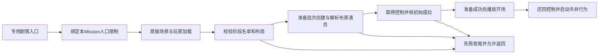
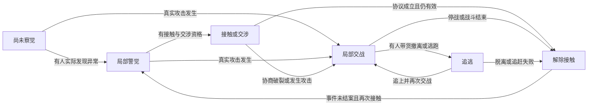

# 逆水寒511 · 总纲与实施计划

> **项目唯一总纲。** 更新：2026-11-15。玩法范围、技术裁定、分阶段实施和验收入口统一从本文件进入；已有源码接入仍待实机验收，S0～S9目标改造尚未实施。

| 文件 | 唯一职责 | 阅读时怎样使用 |
|---|---|---|
| [都市开放世界与NPC玩法核心](逆水寒511都市开放世界和npc优化玩法核心.md) | 原始需求、核心循环与NPC长期目标 | 读“为什么设计这些玩法”；原始目标尚未完全细化，具体关卡和阶段由下列文件承接 |
| [城池剧情任务需求](逆水寒511玩法验证-城池剧情任务.md) | 玩家体验、十种过门办法、四家委托、文本/数据维护 | 读“要玩到什么”；历史章节已折叠，不作为现行实施指令 |
| 本总纲与实施计划 | 已定原则、架构选择、当前缺口、P0～P7及技术验收 | 读“采用什么方案、先做什么”；S0～S8为第一阶段，S9为最终进阶 |
| [玩法演示](逆水寒511-玩法演示.html) | 当前数据与对白预览、规则模拟、目标架构说明 | 区分源码规则与待实施目标；生成页面不能证明实机可玩 |
| [玩法演示校验](逆水寒511-玩法演示校验.md) | 当前证据、已修源码问题、未实施项与待实机项 | 读“现在证实到哪”；旧审计留档，不能继续当作当前阻断 |

**共同口径：**复用`empire_town_m`真实场景；首遇目标为2名剧情守卫动态选1人质问，第二阶段为9名登记演员及最多1名已有玩家同伴；只允许本阶段名单人物。十种过门办法保留，静态布景从时间轴移到准备批次；第一阶段之后再完成每NPC自主闭环与玩法事件协调。上述新人口/布局/AI方案是待实施目标，当前数据仍为9演员、7道具、30拍旧布局。

**如何维护：**原始目标在玩法核心中保留，具体体验在城池剧情任务中细化，架构/交付由本总纲确定；改实际数据后重生成演示并更新校验。验收状态只凭对应证据推进；发现冲突要修正原条款，不能用“总纲优先”保留两份互相矛盾的现行规则。

**入口：**玩法测试见需求的T0～T10；技术选择与现状见§十一S0～S9；实施顺序见§九；未来NPC自治见§十二，玩法事件与个人闭环的接口见§十三；独立实施交接、文件入口、数据契约及可复现验收见§十四。

**交接要求：**本文须能由未参加本次对话的其他agent独立使用，不依赖GPT-6.1 Sol、DeepSeek或任何特定模型的会话记忆。执行者先读项目规则和现有源码，再按§十四逐步实施、验证并记录证据；不知道的API、字段或待定玩法不得自行猜成已定方案。

**当前完成情况：**以下状态截至2026-11-15，后续按对应证据更新，不能把本次补文档当作完成游戏改造。

| 内容 | 当前状态 | 能证明什么、还缺什么 |
|---|---|---|
| 现有单守卫剧情、Brain演出租约、对话/真实战斗/通行及财物Quest修复 | 已有源码实现；现有数据离线检查通过；最新实机复验未完成 | 可作为改造基础；具体范围见§二、需求的源码接入记录与校验文件，不代表全部流程可玩 |
| 五份文档归口、总纲更名与独立实施交接说明 | 文档已落盘；链接/生成同步以校验文件当次结果为准 | 只证明方案与入口整理，不改变游戏行为 |
| 高度图、城门城墙及演员道具投影工具 | 工具与旧布局复核图已交付；已登记轮子 | 已发现空间问题；新布局、身体接触与实机空间验收未完成 |
| P0～P6新舞台、人口隔离、双岗AI、工作点与严格版本发布 | 尚未实施 | 现有同名基础入口不等于已满足新版契约；全部新增命令仍按§十标为拟交付 |
| P7个人自治闭环与事件协调 | 尚未实施，属于进阶方案 | 第一阶段只验§12.8真实接点；完整进阶另验§12.9与§十三 |
| 首遇教学保命例外与两次难度解释 | 待定设计 | 保留现有验证设定；不能由执行agent擅自定为正式玩法，见§一第6条 |

> **状态：方案已按源码复核修订，舞台与AI改造未实施。** 初稿及空间复核：2026-11-14；NPC自主闭环与玩法事件协同方案补充：2026-11-15。S0～S9及§十三的新字段、新命令、新入口均为拟实施内容；§2.1～§2.7说明当前源码，不代表本次DLL或实机已验证。离线俯视图及工具已完成。
> **用户已明确的要求：复用现有 `.xscene` 城镇场景，不生成原版常规NPC，只生成本剧情名单中的演员，便于控制玩法与演出。**
> **首遇补充裁定：门口有两名剧情守卫站岗，质问属于岗位AI行为，实际质问者由运行时条件决定。** 两名守卫都能成为候选，同时只允许一人接手同一次拦问；不固定铁头或副卫。本次仍只更新计划。
> **底层原则：C#提供原子能力和通用执行，具体演出、行为组合与触发/分支由策划脚本或JSON控制。** 本原则已登记在 [CLAUDE.md](../../CLAUDE.md) 铁律42；动作、时间、人数、剧情逻辑均须能改数据后重载，不重编DLL。
> **审核方式：S0是用户已明确的底层约束，S1～S9是在该约束下待审核的技术选择。S9“每名NPC具备感知—决策—执行—复盘闭环”是用户已定的进阶目标，第一阶段可不具备完整能力，但须满足§12.8的架构接入要求。任何技术选择被否定，先修改相应方案、数据和验收，再实施该项。**
> **关联需求：**[城池剧情任务](逆水寒511玩法验证-城池剧情任务.md)。原文中“保留原生居民并额外添加演员”的做法是旧实现；本计划定义替换后的目标。

**本次复核后的关键决定：**

1. **先布设，再开演。** 阶段名单决定演员与道具；准备批次完成创建、落地和控制检查后，才启动镜头时间轴。不靠0.04秒的生成间隔保证就绪。
2. **同帧连续创建可以保留。** 默认一个准备批次连续发起；确有性能预算问题才分批，是否可开始由实际就绪结果决定。
3. **重播与重布设分开。** 普通重播只重放演出；改名单、道具位置、Prefab或工作点后，重新进入剧情Mission应用新布局。
4. **复用既有执行与控制轮子，补明确缺口。** 岗位选人、工作点占用、真实等待、严格校验和版本发布仍需实施；不另写完整Brain或搬整套旧Story引擎。
5. **修正两处现有控制语义。** 工作走位要允许禁止卡死瞬移，并返回真实到位结果；个人对话只让参与者及依赖他们的活动让位，需适配现有全场对话闸门。
6. **先重排并验空间，再做完整市井行为。** 现图是旧布局问题复核图；桌桶重叠、高程、工作朝向与门内终点尚未通过，不作为已合格的新布局。
7. **最终阶段让每名NPC形成自主闭环。** 本地感知、目标选择、确定性执行与结果复盘支撑日常智能；模型仅用于受限的低频增强。策划定义玩法边界、角色职责与允许的变化，NPC在其中依据实际情况行动，详见§十二（S9）。
8. **玩法事件与NPC用事实、职责请求和真实结果衔接。** 事件状态机管理流程规则与客观结果；NPC依据个人知识选择怎样履行职责；Brain执行身体动作。阶段变化不让全员同时获得秘密或强刷同一动作，玩家真实行为可从任何合法阶段接入，详见§十三。

## 零、S0：策划数据决定具体逻辑，C#执行通用原子

### 0.1 C#与策划数据的明确边界

**决定：日常、个人互动、群组配合和开场演出，都由数据组合通用能力。** `StreetLifeDirector`与 `StoryStageRunner`只能读取和执行定义，不能自己成为藏着角色安排的剧本。

| C#提供的底层能力 | 策划脚本/JSON决定的具体内容 |
|---|---|
| 演员/道具生成与查重、位置求解 | 哪个阶段有哪些演员、道具、岗位与布局 |
| 移动到点、朝向、动作、台词、相机 | 谁移动到哪里、播什么、说什么、何时切哪个镜头 |
| 通用感知查询、触发订阅、活动请求与求值 | 哪些岗位具备行为资格，满足哪些条件时请求哪段流程，如何选择候选者 |
| 顺序、分支、等待、有限循环与并发配合执行 | 哪些步骤串行/同时执行、等什么结果、成功或失败进哪段 |
| Brain控制权申请、拒绝与释放 | 哪些演员参加一组、哪些成员必须到齐、打断后暂停/取消/改走哪段 |
| 原版对话、战斗、资源事务的受控调用 | 选哪棵对话树、何时交战、给谁哪些奖励、采用哪条剧情结果 |
| 生命周期、安全取消、真实状态限制 | 结束后回哪个岗位、恢复哪个日常流程、是否结束本场剧情 |

**禁止：**C#按 `blocker`、`pawnbroker`、某个事件编号或某个阶段写具体编排；禁止新增“铁头质问并让副卫观望”这样的整段专用复合原子。可以提供“请求一次拦问”的通用原子；自动质问由AI规则产生当前执行者，对象、对话入口和后续分支由数据与真实运行上下文绑定。

**自主AI规则与定时台本分开：**数据定义“哪些岗位可以做这件事、什么情况下做、候选者怎样竞争”，AI依据实际感知和状态决定谁发起。开场台本负责摆位、镜头等明确编排；正常质问不写成“第几秒某人必须开口”。把固定质问者搬进JSON仍不满足这项AI要求。

**边界说明：**条件和等待的通用解释器本身需要C#；“这段剧情采用什么条件、等待哪个事件”不写进C#。控制权失效、角色死亡、资源不足等底层结果真实返回，脚本决定合法的后续剧情；安全层始终不能被脚本绕过。

### 0.2 数据必须能表达流程，不能只有动作名与数字

1. **静态定义：**角色、阶段名单、位置、道具、岗位、工作点、台词键与机位引用。
2. **行为定义：**日常步骤、岗位AI规则、玩家/NPC交互入口、群组成员及角色绑定、触发条件、允许启动的状态、候选选择与冲突处理规则。
3. **流程定义：**顺序、条件分支、等待真实完成/事件、并发配合、带退出条件的循环、成功/失败/打断后的转向。
4. **运行状态：**流程实例编号、数据版本、当前步骤、等待对象、结果和参与者控制令牌只属当前Mission；存档只保留身份、剧情事实与已提交收据。Agent/GameEntity、控制令牌和动作游标不入存档。
5. **执行回执：**原子返回完成、失败、拒绝、取消或中断。移动要等实际到位，玩家对话要等实际结束，战斗要等现有真实胜负回执，不能用“等2秒”代替这些事实。
6. **原子注册：**名字、参数类型、适用对象、完成条件、可取消方式与真实失败结果有唯一注册表；新增字段/命令不允许写进正式数据后靠执行器猜意思。

先使用现有JSON体系，不引入需要编译的C#内容脚本。若后续采用其他策划脚本语言，也必须调用同一原子、查询与事件接口，不另写AI和资源结算。

### 0.3 先核已有执行能力，再补最小缺口

**决定：沿用现有Stage、Brain、相机与对话管线；通用条件优先适配已有求值器，流程推进扩展现有Stage。** 已核源码能力如下；“复用”指沿用能力和实现，不等于接口未经适配即可直接接上。

| 能力 | 已有接点 | 本计划怎么用、还缺什么 |
|---|---|---|
| 短时间轴与单发原子 | `StoryStageRunner.Begin/Tick/RunAtom` | 沿用Stage入口；把名单创建移入准备阶段，补原子注册、结果与严格校验 |
| 身体控制权 | `PerformanceAction.TryAcquire(Agent, ownerToken, onStopped)`；`CanControl/Release` | 直接复用租约；返回非null仍要等CanControl，不在持租约时再排同Brain移动 |
| 坐标走位与生命周期 | `MoveToPositionAction`；Brain现有动作入口 | 复用移动与避障；补禁止卡死瞬移的参数和到位/超时/中断结果，不复制移动系统 |
| 条件与位置引用 | `RuntimeWorldState.Evaluate(Condition, Agent)`、`RoleAgents/NamedPositions` | 薄适配阶段登记与流程上下文；`time_since/player_action`等依赖原执行器的查询逐项适配，未支持则拒绝。每个演员的规则计时独立，不能共享“连续成立”记录 |
| 顺序、等待、事件与多角色步进 | `PlanExecutor.Create(ownerAgent, plan, intentType, roleAgents)`、`WaitInlineState`、`NotifyDecisionEvent` | 已有按角色推进的游标和Brain生命周期；不等于已支持Stage原子、开场全员就绪或任意事件回执。抽取可共享的等待/事件能力接到Stage，不在同一身体上同时启动两套执行器；原Wait含偷窃犹豫独白，不能整体搬入演出等待 |
| 注册与分发 | `ActionRegistry.FindByCode`；`CommandManager.Register` | 既有动作继续走原登记和执行入口；Stage新增原子元数据在现有Stage定义处归口，诊断/校验从它派生。旧Story的handler和UI不搬进511 |
| 拦问、对话、战斗、资源与Quest | `event_story_intercept`、既有对话入口、胜负回执与资源/委托管线 | 复用真实行为；薄适配实际参与者、请求令牌与完成结果。不能把开窗和结算另写一份 |
| 岗位候选、工作点、准备与版本 | 当前没有满足本计划的完整实现 | 在现有宿主/Director/Stage接缝补小型通用机制，不创建第二套场景控制器或完整AI |

- P0以此表为起点核每个接口的参数、结果与取消方式；未核接口标为缺失，不能仅凭“已有Planner”承诺整套流程可用。沿用此前Stage接缝裁定，不整体迁移到旧领主大厅演出系统。
- Director降为按数据调度活动的服务，Stage降为按数据执行流程的服务；二者都不能写角色专属触发、加入、恢复分支。
- 不新增完整NPC大脑。执行器只推进步骤，角色身体仍由现有Brain和演出租约控制；外部不得直接操作私有动作队列。
- 当前 `At`时间轴适合短镜头，保留；行为、群组与交互需要真实条件/事件等待。需补齐这些通用语义，不能把复杂流程重新塞回C#。
- 字段和原子完成注册、实现及负面校验后才允许进入运行数据；文档中的能力要求不代表当前解释器已经具备。

发布后的定义只读；计时、条件曾成立记录、跳转与角色绑定放在运行实例中。复用Planner时，不能让其修改步骤条件的旧路径改写多个流程共用的发布定义。

### 0.4 同一份DLL必须能承受的内容修改

| 策划修改 | 只改哪类数据 | 不允许发生的事 |
|---|---|---|
| 让质问由视线、岗位、距离与可用状态决定 | 守卫AI规则、候选范围与选择规则 | 固定一个质问者，或按角色ID排除其他合格守卫 |
| 首遇增加第三名守卫 | Cast角色、阶段名单、岗位布局 | 改C#生成数量或循环名单 |
| 老周由擦桌改为候客/走动 | 日常流程、工作点和动作引用 | 为老周新增专用Tick分支 |
| 争吵从A先说改为B先说，加入第三人 | 群组角色和步骤 | 改C#交替台词逻辑或限定人数 |
| 玩家靠近才开演，换成办完委托才开演 | 触发条件和状态查询引用 | 改导演中的具体触发if |
| 被打断后回岗，改为结束纠纷 | 中断/结束分支与恢复目标 | 改C#事件编号专用收尾 |
| 镜头、站位、布景、动作、等待时间调整 | Stage、布局、Camera及台词动作数据 | 修改程序集才能观察新效果 |

这张表是验收要求，不是当前实现状态。基础能力已经存在时，任何一项还需要改C#才算该项未完成；确实新增底层能力才扩展代码。

### 0.5 重载与重播要可控

1. 编辑策划源文件；本地化等生成物仍通过既有生成器更新，不能为了重载绕过唯一源头。
2. 重载先解析并校验完整相关数据，再一次性发布新版本。失败保留当前有效版本，显示具体文件、流程、步骤与错误。
3. 当前Mission固定使用准备时的布局与演员身份版本；每个运行流程固定使用启动时的内容版本。重载后，只有与当前布局兼容的新流程能用新内容；正在执行的流程不混用新旧数据。
4. 兼容布局的台词、动作、镜头、顺序与行为规则修改，可在停止本方旧流程后用新版本重播或重新求值。奖励/财物收据按剧情运行编号保留，不能用新的演出实例编号绕过已提交记录。
5. 名单、模板、道具位置/Prefab/缩放、岗位或工作点几何改变，首版统一要求退出并重新进入剧情Mission；仅`reload`或`stage begin`不重布设。重进先按已有规则收尾，复用身份和本轮进度；不等于`reset`重开剧情。暂不增加同场删除重建命令。
6. 必须能查询原子/条件/事件支持表、数据版本、角色绑定、当前步骤、等待原因与结果。策划不用读C#来猜某字段究竟有没有效果。

**重新进场的安全边界：**旧Mission在native实体有效时归还控制，场景销毁本场新建道具；新Mission再按新版名单创建。原场景已有实体始终只引用，不由重播移动或删除。暂停并固定旧版本的日常活动需要显式停止再启动，不能让一次活动中途换规则。

## 一、先定玩家实际看到什么

1. **决定：沿用现有城镇场景。** 建筑、地形、城门、导航网格、光照和已有静态物件继续使用；按引擎场景名加载，不复制或修改原版 `scene.xscene`。
2. **决定：剧情入口进入的这一场Mission（一次场景运行），只有玩家与本阶段允许的演员。** 原版居民、商贩、守卫、贵族、自动跟班和自动生成的动物不进入。以后需要群众或牲畜，也必须在剧情名单中明确登记。
3. **决定：普通“在城里逛逛”保持正常城镇人口。** 限制只属于511专用入口创建的Mission，不清空战役人物、不删除城镇人口名单。
4. **决定：首遇生成两名剧情守卫，铁头与副卫分站门口两侧，两人都执行门岗AI，运行时由符合条件并取得拦问权的一人质问。** 副卫也是登记演员，不来自原版常规守卫生成。此次新增副卫只安排在首遇阶段；第二阶段仍沿用现有9名演员，可另带1名明确选中的玩家同伴。以后若第二阶段也需要副卫，调整阶段名单与验收人数。
5. **决定：地牢仍走现有原版地牢流程。** 本计划的城镇人口限制不套用到地牢；本轮不重新设计牢房人物与演出。
6. **决定：恢复控制后，演员可以正常对话、受击、被绑、倒地和参加真实战斗。** 演出让位于这些行为；角色不能为了保持舞台完整而无敌。
   **首遇验证设定的边界：**现有首遇临时强化与守卫保命保护单独记录在需求的源码接入/复验章节，本次整理不删除该教学设定，也不将其当作普通演员规则。双守卫改造时，强化与恢复账目绑定实际质问者；正式玩法是否保留保护例外、两次难度差异怎样解释，仍属待定内容。无论采用何种设定，都只能根据真实战斗结果判败，不能由台本伪造落败。
7. **决定：场景内容准备好后才展示完整市井镜头。** 必需演员或布局失败时，恢复玩家控制、说明无法开始并允许返回；不展示半套舞台、不自动放回普通居民。

## 二、现状与要修正的具体问题

| 项目 | 当前源码行为 | 本计划目标 |
|---|---|---|
| 城镇人口 | 原版生成居民，再额外生成剧情演员 | 原版场景保留，常规人物在生成前被拦住 |
| 首遇守门 | 当前剧情只添加铁头1人 | 两名登记守卫共享岗位AI规则，运行时选择一名质问者 |
| 演员身份 | 创建真实Hero，角色ID映射存于可重置状态 | 保留真实Hero，身份登记与本轮进度分开 |
| 演员身体 | 当前Mission生成Agent，同Hero先查重 | 统一由演员登记与生成入口管理，同Hero最多1个身体 |
| 随从 | 无保存对象时自动招募本城流浪者，直接生成Agent | 选择已有玩家同伴，登记后查重生成，不自动招新人 |
| 站位 | Cast默认偏移与Stage台本各写一套 | 场景布局是唯一位置来源 |
| 道具 | 台本按相对坐标实例化7件桌、桶、地毯 | 道具登记与时间轴分开，可引用原场景已有物件 |
| 日常动作 | 动作名与台词列表，没有工作对象 | 动作需要工作对象时，引用具体道具和交互站位 |
| 演出控制 | 已使用Brain演出租约、共用相机服务 | 继续复用，补齐准备检查与离场处理 |
| 不支持的字段 | 存在读入但不生效的字段 | 明示支持范围；不支持的配置报错 |

**结论：保留现有演员、台本、导演、Brain、对话和委托管线，在入口和数据职责上修正；本轮不另写一套AI、任务系统或大型演出引擎。**

### 2.1 当前关卡生成的实际顺序（源码说明，不是待实施方案）

**结论：目前是“原城镇场景与普通人口 → 剧情宿主定位 → 按阶段添加演员 → 开场台本 → 市井导演”。** 当前没有一次指令就生成空白演员专用关卡的机制。首遇和第二阶段走不同路径；本次俯视图画的是第二阶段现有布局。

1. **开场入口：**城镇菜单项`lwn_story_probe_enter`调用`MenuConsequence`。首遇先显示背景询问，选择进入后调用`EnterTownCenter`；第二阶段直接调用该方法。它取得本城`center`，设置`EnterViaOption=true`，再调用`LocationEncounter.CreateAndOpenMissionController(location, null, null, "sp_outside_near_town_main_gate")`打开原版城镇Mission。场景建筑、地形与静态物件由原场景加载，不是这30拍重新建城墙。
2. **挂载与判定：**`MySubModule.OnMissionBehaviorInitialize`挂载既有`AgentAIController`和`StoryProbeMissionBehavior`。后者`AfterStart → Setup`消费入口标记，检查开关、目标城、`center`与阶段。当前没有在原版人口生成前进行S1所要求的拦截，所以常规居民/守卫等仍可能在场；下表不是全部城镇人口表。
3. **解算门区：**`ResolveAnchors`按实际`SceneName`查`StoryProbeTuning.json`的`Gate.Layouts`，读取门外出生与门中心，计算朝城门的单位方向、门外岗位与门内目标，然后把玩家传送到门外出生点。没有已登记布局会停止，不猜坐标。
4. **按阶段分路：**首遇`SetupFirstAttempt`只创建/复用铁头、恢复并设置首遇增强、站定并朝玩家，不自动运行这份市井台本。第二阶段`SetupSecondPhase`调用`StoryStageRunner.Begin("StoryStage")`进入下节的创建与演出流程。
5. **初始化日常与同伴：**第二阶段在`Begin`返回后检查Cast中的代表、守卫与委托目标；台本已安排摆位的角色跳过旧偏移补生。台本启动失败或名单未覆盖时仍走Cast旧偏移。随后`StreetLifeDirector.Begin`初始化日常/事件计时，`EnsureCompanion`另外生成同伴，再显示旁白。
6. **按帧执行与归还：**宿主先`_stage.Tick(dt)`推进台本，再`TickSecondPhase(dt)`。台本仍Active时，第二阶段不推进识破、战斗、通关与导演Tick；正常结束后释放演员演出租约、归还相机/玩家，才继续导演日常、事件、玩家接入和委托检测。布景保留到本次Mission结束。

**当前同伴的具体行为：**先找保存的`CompanionHeroId`；没有时找本城可用流浪者并自动招募，再直接`SpawnAgent`到玩家左后（后1.2米、左1.5米）。没有对象走旁白。它不在9名台本演员中，且这条生成链没有与演员一样的同Hero身体查重；K5只标请求点，不能承诺每次有人，也不能认为这9人就是全场人数。S3将替换这套选择/生成办法。

### 2.2 先创建演员，再执行摆位拍

**结论：0.5秒的`actor_place`主要是摆位、设朝向；演员早在`Begin`阶段就已经创建/复用。** 目前没有独立的`actor_spawn`时间拍。

| 连续步骤 | 当前执行内容 | 是否计入下面30拍 |
|---|---|---|
| B1 停旧演出 | `Stop("restart")`归还旧控制；保留本Mission道具字典 | 否 |
| B2 读台本与锚点 | `StoryStageDefs.Load("StoryStage")`读取/缓存`StoryStage.json`，稳定按At排序；解算player/gate/gate_inner及标签锚点 | 否 |
| B3 提前切镜头 | 找At≤0的第一条camera_cut，先执行`story_intro_back`，遮住首次创建演员；此时尚未冻结玩家 | 否；第1拍随后还会正式执行一次 |
| B4 确保演员存在 | `AcquireActors`扫描全部actor_*指令，按角色首次出现顺序去重；取各自第一条actor_place作为新身体初始请求位置 | 否 |
| B5 创建/查重 | `EnsureStageActor → SpawnNpc → EnsureStoryHero`先复用保存Hero，再查本Mission同Character的活Agent；没有才用AgentBuildData调用Mission.SpawnAgent；已有身体此时不挪位 | 否 |
| B6 申请身体控制 | 每人`PerformanceAction.TryAcquire`，由已有Brain决定接受/拒绝，整组失败就撤销本方已申请控制 | 否 |
| B7 等全员可控 | Tick等待每人CanControl，等待期间不推进台本、不冻结玩家；当前准备超时为3秒，超时Stop | 否 |
| B8 正式播放 | 全员可控后累加台本时间，逐条执行到期拍，摆位/播动作前再次核控制权 | 是 |

创建时新身体方向先用宿主Forward；0.5秒再执行台本Facing。图上箭头表达0.5秒摆位后的请求朝向，不保证引擎身体、动作根位移和实际落地完全一致。

### 2.3 当前30拍逐条清单

**时间含义：**At是全组准备好后的台本相对秒数，不是玩家刚进场景后的墙钟时间。到期指令在当前帧依次执行；同At按文件先后逐条执行，不是异步并行，也不等上一条动画播完。`Async=true`当前被读入但不参与调度。

**同帧的具体含义：**一条指令不是一帧。当前执行器在一次`Tick`（一次逻辑更新）里用循环执行所有到期指令，前一条调用返回就接下一条；正常路径不主动切帧。帧内仍有先后，后面的调用可以看到前面已经登记的演员/道具，不能把“同帧”理解成多个线程同时生成。

| 当前操作 | 连续调用的范围 | 需要分清的事实 |
|---|---|---|
| 9名演员创建/复用 | 同一次`Begin → AcquireActors`循环中连续发起 | 调用之间没有逐人等下一帧；Brain开始控制可能要后续更新，仍须等全组CanControl |
| 7件道具生成 | 0.20秒2件、0.24秒3件、0.28秒2件；每组在到期的同一次Tick内执行 | 目前有三组时间点，不能说7件必在同一帧生成 |
| 9名演员摆位 | 0.5秒到期时，在同一次Tick连续执行9条actor_place | 不为每个演员分别等待一帧 |
| 9名演员发起动作 | 0.7秒到期时，在同一次Tick连续发出9条actor_action | 发出动作调用同帧，不保证动画、原生资源与各角色全部就绪同帧 |
| 多个时间组到期 | 当前一次Tick跨过多个At时，按排序在该次Tick全部执行 | 例如台本时间从0.19到0.29秒，三组道具会在这一帧连续生成；不是精确时钟回调 |

**布设方案口径：**纯静态布设可以在一个准备批次中连续生成，不需要为了“顺序执行”给每件物体留一帧。后续只有测得单帧预算过大，或演出确实要求分时出现，才按数据分批；准备成功仍看真实回执，不靠0.04秒间隔或“调用完了”推定身体、资源、支撑面全部就绪。本节解释现有行为，本次绘图调整没有修改正式台本的三个生成时间点。

清单来源：[StoryStage.json](../../ModuleData/DesignData/StoryStage.json)。编号与`custom.story_probe stage list`一致，以下是2026-11-14核对的现有数据；修改台本后须重新核对。

| 索引 | At（秒） | 原子指令 | 对象、参数与实际作用 |
|---|---|---|---|
| 0 | 0 | `player_freeze` | 申请冻结玩家，按住原地 |
| 1 | 0 | `camera_cut` | 机位`story_intro_back`，锚点`player` |
| 2 | 0.2 | `prop_spawn` | `pawnbroker_desk` / `bd_table_a`；player，前6.8 / 右-5 / 上0米；Yaw=0° |
| 3 | 0.2 | `prop_spawn` | `pawnbroker_scale` / `bd_barrel_a`；player，前6.2 / 右-6.2 / 上0米；Yaw=0° |
| 4 | 0.24 | `prop_spawn` | `widow_stage_a` / `bd_table_c`；player，前8.6 / 右5 / 上0米；Yaw=90° |
| 5 | 0.24 | `prop_spawn` | `widow_stage_b` / `bd_table_c`；player，前8.6 / 右7.4 / 上0米；Yaw=90° |
| 6 | 0.24 | `prop_spawn` | `widow_carpet` / `carpet_empire_a`；player，前7.4 / 右6.5 / 上0米；Yaw=0° |
| 7 | 0.28 | `prop_spawn` | `butcher_block` / `bd_table_c`；player，前5.4 / 右8.5 / 上0米；Yaw=0° |
| 8 | 0.28 | `prop_spawn` | `butcher_barrel` / `bd_barrel_b`；player，前4.6 / 右9.8 / 上0米；Yaw=0° |
| 9 | 0.5 | `actor_place` | `pawnbroker`；player，前5.9 / 右-5 / 上0米；Facing=-1 |
| 10 | 0.5 | `actor_place` | `widow`；player，前9.4 / 右6.2 / 上0米；Facing=-1 |
| 11 | 0.5 | `actor_place` | `son`；player，前3 / 右-8 / 上0米；Facing=-1 |
| 12 | 0.5 | `actor_place` | `butcher`；player，前4.4 / 右8.5 / 上0米；Facing=-1 |
| 13 | 0.5 | `actor_place` | `blocker`；gate，前0 / 右0 / 上0米；Facing=-1 |
| 14 | 0.5 | `actor_place` | `thug`；player，前6.5 / 右-1.5 / 上0米；Facing=-1 |
| 15 | 0.5 | `actor_place` | `debtor`；player，前1 / 右-12 / 上0米；Facing=-1 |
| 16 | 0.5 | `actor_place` | `rival`；player，前9 / 右11 / 上0米；Facing=-1 |
| 17 | 0.5 | `actor_place` | `outlaw`；player，前-2 / 右-16 / 上0米；Facing=-1 |
| 18 | 0.7 | `actor_action` | `pawnbroker` → `act_bartender_wipe`；发起动作，不等待播完 |
| 19 | 0.7 | `actor_action` | `widow` → `act_play_celtic_harp_stand`；发起动作，不等待播完 |
| 20 | 0.7 | `actor_action` | `son` → `act_beggar_idle`；发起动作，不等待播完 |
| 21 | 0.7 | `actor_action` | `butcher` → `act_bartender_meat`；发起动作，不等待播完 |
| 22 | 0.7 | `actor_action` | `blocker` → `act_stealth_mission_guard_look_around_patrolling_cautious_1`；发起动作，不等待播完 |
| 23 | 0.7 | `actor_action` | `thug` → `act_bully`；发起动作，不等待播完 |
| 24 | 0.7 | `actor_action` | `debtor` → `act_bar_talk_to_2`；发起动作，不等待播完 |
| 25 | 0.7 | `actor_action` | `rival` → `act_argue`；发起动作，不等待播完 |
| 26 | 0.7 | `actor_action` | `outlaw` → `act_argue_soft_1`；发起动作，不等待播完 |
| 27 | 1.6 | `camera_cut` | 机位`story_intro_wide`，锚点`player` |
| 28 | 4 | `camera_return` | 归还演出相机 |
| 29 | 4.2 | `player_release` | 恢复本演出拿走的玩家控制 |

第29拍执行后，执行器`Stop("script end")`释放9名演员的本方演出租约并做安全归还。动作最终是否可播放仍以真实动作注册与游戏画面为准，清单代表发起调用。

### 2.4 每条指令实际能做什么

| 指令/机制 | 当前真实语义 | 当前限制 |
|---|---|---|
| `prop_spawn` | 按Id查本Mission道具字典；没有时检查Prefab并实例化 | 同Id重播只复用，不重新摆位/换Prefab；缺Prefab或实例化失败只记日志继续，因此“播完”不证明7件齐全 |
| `actor_place` | 要求持有CanControl；TeleportToPosition并写LookDirectionAsAngle | 是请求摆位；Z、实际身体朝向与动画影响仍须实机核对 |
| `actor_action` | 通过既有ForcePlayAction发起动作，restoreAfter=false | 不等待动作播完；演出租约收尾负责还姿态，不在未来用延迟回调抢回动作集 |
| `actor_say` | 持有控制后，通过SpeechChannel输出本地化文本 | 现有开场30拍没有此指令 |
| `camera_cut / camera_return` | 通过现有CameraService申请机位/归还 | 镜头失败会Stop；B3与第1拍同机位会调用两次 |
| `player_freeze / player_release` | 记录和归还本演出拿走的玩家控制 | 被绑、倒地等后来取得的真实控制优先，不能由台本擅自解锁 |
| `wait` | 仅打印Seconds日志 | **现在没有阻塞语义**；当前只通过后拍At安排间隔，不能写wait后宣称等动作/对话完成 |
| 未知Cmd | 打UNKNOWN日志并跳过 | 不是严格脚本校验，不能据此承诺分支、循环、完成事件或并发已支持 |

**位置公式：**`请求位置 = 锚点世界坐标 + Forward×Fwd + Right×Right参数 + (0,0,Up)`。Forward从门外出生指向门中心；右向量为`(Forward.y, -Forward.x, 0)`。player锚点固定为开场布局基准，玩家后来走动不带着道具走。

**锚点对应主图：**player=K1；配置门中心=K2；gate=K3=A5守卫岗位，已从门中心向外退3米；gate_inner=K4，门中心向内8米。idle/market标签锚点本台本没有消费。道具Yaw按执行代码是从世界+X向+Y计的角度，**不与布局Forward相加**；不能照字段注释把Yaw=0理解成面向城门。

### 2.5 首遇质问与演出台本的关系（当前实现）

**结论：首遇质问当前经Brain执行，但宿主固定选择blocker；尚不具备两名岗位候选的动态选择。** 靠近铁头3.5米内或尝试越门，宿主在非对话、Brain非演出/非战斗且拦问已重新允许时，发送`event_story_intercept(player, "blocker_first", onReady)`；Brain复用跟随、朝向与现有互斥，实际到位回执后宿主打开原版对话。失败会重新允许请求，离开8米可重新触发。

首遇不是“台本在第N秒让铁头说话”，也不是“门口两人中已由AI自行挑一个”。双守卫共享职责/候选/遭遇规则是S6后续方案；第二阶段识破目前也由宿主针对blocker检查。

### 2.6 演出之后谁安排NPC行为

**结论：Stage负责短开场，Director随后安排日常/市井事件；二者申请同一Brain的PerformanceAction，没有第二个NPC大脑。** Director.Begin在开场准备时已调用，但正常第二阶段Director.Tick要等Stage结束才开始计时；当前日常首次延迟2～10秒、事件首次延迟12秒、随机桥段首次延迟90秒，这些是导演自身时间，不能直接当成进场墙钟时间。

常驻动作/台词读取`StoryProbeCast.StreetLife`，事件演员与台词读取Events数据，数字读取Tuning。具体触发、轮转、玩家接入、反应及部分恢复流程仍写在Director/宿主C#中。**当前只有开场编排的一部分已经在JSON里，不符合S0要求的全部行为编排数据化；不能把本计划当成已经兑现。**

### 2.7 当前已有的查看与重播指令

先通过剧情入口进入相应城镇Mission；以下命令只用于当前舞台，`stage begin`不会自动重建首遇/第二阶段全部剧情，也不会完成S1人口隔离。

| 完整控制台命令 | 能看到/执行什么 |
|---|---|
| `custom.story_probe stage list` | 强制重新加载并列出0～29索引、时间与对象；当前运行实例不会随之整体换版 |
| `custom.story_probe stage status` | Active、拍数、下个索引、台本时间、锚点名 |
| `custom.story_probe stage anchor` | 提示从日志查看已解算锚点；日志含`[StoryStage] anchor`与XYZ |
| `custom.story_probe stage reload` | 清Stage缓存并重读；成功后下一次begin使用新台本 |
| `custom.story_probe stage begin` | 停旧演出后从B1重新执行开场；已存在道具按Id复用，不自动应用新道具位置/Prefab |
| `custom.story_probe stage only 9` | 单独请求第9拍；actor原子会停旧演出并申请短时控制，**不是从第9拍接着播完整台本** |
| `custom.story_probe stage skip` | 跳到末尾并归还演出控制；不会补执行未到期的道具/摆位拍 |

**验收边界：**本节是当前源码与配置核对，尚未用本次编译DLL跑完整游戏链。实际执行查`[StoryStage]`与`[StoryProbe]`日志及游戏画面，源码清单不代替实机回执；S0要求的原子支持表、严格校验、事务重载/固定数据版本与布局快照仍未实施。

## 三、S1：复用城镇Mission，在人物生成前限制人口

### 3.1 采用的入口

**决定：保留 `LocationEncounter.CreateAndOpenMissionController` → 原版TownCenter Mission的打开流程。** 它继续加载该城现有场景，同时保留战役位置、玩家生成、城镇对话、任务界面和离场返回所需上下文。

**决定：在原生人物生成入口，按本次Mission的剧情标记阻止常规生成。** 不采用“居民先出生，再逐个删除”；也不清空 `Location.GetCharacterList()`，避免修改战役层人口和任务引用。

取舍：独立裸场景更容易获得空场，但需要重新接回城镇、对话、离场等行为。原版城镇工厂在1.2.12组装了27个Mission行为，复制整份列表会产生新的版本维护责任。本方案保留这套组装，只限制人口来源。

### 3.2 标记必须早于原版生成

1. 专用入口先记录待开场请求：目标城、地点、阶段和本次运行编号。
2. 在 `MySubModule.OnMissionBehaviorInitialize` 中，在原版 `AfterStart` 生成前，把请求绑定到实际Mission实例。
3. 校验开关、目标城、`center`、实际场景名、阶段名单，以及LWN互动管线是否允许运行。原版入口不能取得该标记。
4. 所有生成限制只认“这个Mission实例持有演员专用标记”；不依赖尚未执行的 `StoryProbeMissionBehavior.AfterStart`，不依赖很快会被消费的 `EnterViaOption`。
5. 打开失败、目标不符或离场，废止待开场请求。取消/暂停后，当前Mission的人口策略仍保持到离场，不能突然补进居民。

**请求只绑定一次。** 记录打开中的城镇/地点与唯一请求编号，绑定完成即消费待请求；普通逛城、地牢或下一次Mission不能继承。打开前能完成的数据/场景检查先做；请求已经绑定但后续准备失败，则保留本场人口限制、在安全更新点收尾返回，不改为普通人口模式继续剧情。

### 3.3 必须覆盖的原生入口

| 来源 | 处理决定 | 已核实的入口与版本差异 |
|---|---|---|
| 初始居民、商贩、守卫等 | 阻止整批常规生成 | `MissionAgentHandler.SpawnLocationCharacters`，三份参考版本均存在 |
| 从其他区域走入的人 | 在排入生成流程前阻止 | `MissionAgentHandler.SpawnEnteringLocationCharacter`，三份参考版本均存在 |
| 原版自动同伴 | 阻止自动名单生成，交给本场演员入口 | 1.2.12的 `SpawnPlayer` 内调用 `SpawnCharactersAccompanyingPlayer`；1.3+需另查同伴行为，不能照搬旧方法名 |
| 打手或额外城镇人物 | 检查并限制补生入口 | 1.2.12有 `SpawnThugs`；新版本职责已经变化，按实际调用点接线 |
| 延迟生成 | 禁止常规人物进入延迟队列 | 1.3+有 `SpawnWanderingAgentWithDelay`；已有队列的执行路径也必须核对 |
| 马与家禽家畜 | 阻止自动生成 | 1.2.12在 `MissionAgentHandler`；1.3+迁到 `SandBoxHelpers.MissionHelper` 的对应方法 |
| 其他Quest/Mod直接生成的人 | 登记并诊断，不按外观猜身份 | `OnAgentCreated`仅登记待核对象；生成完成后核名单，异常在安全更新点停止剧情并返回，不在创建回调中退出Mission |

**实施纪律：**

- 保留原版玩家生成、原版控制器的其余生命周期。1.5.1还有 `OnAfterMissionLoadingFinished → OnInitialSpawnCompleted`，不能因跳过整个控制器而遗漏。
- 优先限制返回 `void` 的批量/排队入口。返回Agent的底层方法不能随便改为null；须核对调用者是否判空，避免上层解引用崩溃。
- 本剧情演员通过现有 `Mission.SpawnAgent` 生成，不依赖被拦住的常规居民生成器。
- 演员生成前先登记“本Mission、角色、预期Character/Hero、本次创建请求”；生成中的Agent匹配该请求，生成返回后确认唯一身体。1.2.12源码链是`CreateAgent → OnAgentCreated → BuildAgent → OnAgentBuild → SpawnAgent返回`；`OnAgentCreated`时Character已赋值，但身体、控制器和宿主字典尚未完整就绪。不能仅因字典中暂时没有它就判为名单外。玩家同样在生成完成后核身份；新版本逐项核回调顺序。
- 待核对象在`OnAgentBuild`及生成返回后完成登记，再于安全更新点检查。未登记/重复身体导致失败时先停本方活动、保留诊断，再收尾返回；不在原生生成栈内释放Mission，也不删除第三方人物。
- 停用批量生成会跳过其中的原版准备/模拟通知；实施前列出相关订阅者，检查现有剧情、活动Quest与城镇系统的依赖。需要的初始化只做针对性适配，不伪造“居民已经生成/模拟”的事件。
- 保留建筑中的静态人物雕像、装饰网格；若选定 `.xscene` 附带自动生成人物的场景脚本，需单独核查并在本Mission停用该生成来源，不能声称只拦上述方法就覆盖所有内容包。
- 原版区域通道若会绕开剧情门判定，入口接到现有剧情进度检查；玩家能正常退出本场，不用封死退出换取空场。

**入口方案的失败条件：**无法证明标记早于生成、存在无法拦住的人物来源，或保持原版上下文会强制补生常规NPC时，S1不算通过。改为专用Mission组装前，先重写本节并列清需复用的原版行为，不临时复制一整套框架。

## 四、S2～S4：人物身份、同伴与布局分别归口

### S2：真实Hero保留，但不能随剧情重置丢失

**决定：现有9名演员继续使用真实Hero；新增副卫也沿用同一身份登记和查重机制。** 理由：现有财物、关系、原生Issue → Quest和存档引用已经依赖这些身份，改成纯临时模板Agent会扩大改造范围。阶段名单决定谁在当前Mission出现，不能把“本阶段2人/9人”误解为战役身份登记总数。

**决定：在现有 `lwn_story_probe` JSON存档中分成两个职责块，沿用 `MyBehavior.SyncData`。**

| 块 | 保存什么 | 重开剧情时怎么处理 |
|---|---|---|
| 演员身份登记 | 剧情ID、角色ID、Hero.StringId、身份来源、登记状态 | 保留；继续复用可用Hero |
| 本轮进度 | 运行编号、阶段、问答、委托、奖励收据、财物托管、完成事件等 | 先安全收尾，再按现有重开语义重置 |
| 当前Mission登记 | Agent、GameEntity、演员控制权、工作点占用、演出时间、启动检查结果 | 只在内存中存在，离场清理，不进存档 |

1. 用“剧情ID＋角色ID”查身份，用真实 `Hero.StringId` 查战役对象；不按中文名认人。
2. 重开前先停止演出、归还财物、取消本轮活动委托、恢复首遇技能；失败保留待收尾状态，不能先清账。
3. 重开复用Hero时，不能覆盖其全部钱和装备。若新轮需要债务人活动资金，按运行编号记一次实际发放收据，走现有资源入口；不能靠重复造Hero得到资金。
4. 换目标城也复用已登记演员，先结束旧轮及其Quest引用，再校验新城布局；不为每个城另建9人。
5. 身份失效时检查活动Quest、尚欠财物与相关引用。允许重建的角色才补建并更新登记；不能静默把活跃Quest指向一个新Hero。
6. 通关/放弃只结束本轮，保留演员登记。演员不再进场；不杀死或删除可能仍被存档引用的Hero。其战役内继续活动的实际情况纳入验收，不能把“未生成Agent”当成“Hero已退场”。
7. 旧档有 `SpawnedHeroIds` 时原样迁入登记，不创建新Hero。旧版已经丢掉的映射无法可靠恢复；不按名字扫全世界强行认领旧人物。
8. 当前`ResetAll()`会替换整个状态对象并丢掉`SpawnedHeroIds`。实施时明确拆分“新战役清全部”和“重开本轮保留身份”；`reset/abort`调用点逐一迁移，不能只增加登记字段而仍沿用旧清空方法。

### S3：同伴也进入统一演员登记

**决定：优先复用本剧情已经选定、仍属于玩家队伍且可用的同伴；否则从玩家现有成年、未受伤、非俘虏同伴中确定选1人。** 没有可用对象时走现有旁白，不自动招募本城流浪者。

- 同伴使用已有Hero，身份来源标为“借用玩家同伴”；剧情结束不会把他移出队伍。
- 同伴与普通演员共用Agent查重及登记，最多1个场景身体。
- 日常跟随优先复用原版 `FollowAgentBehavior`；演出期间由Brain申请控制，结束后恢复跟随。两套控制不能同时写身体。
- 原版自动同伴生成被限制后，只由本场登记生成选中的同伴；不偷偷带入其他队友。

### S4：每个场景只有一份布局

**决定：扩展现有 `StoryStage.json`，集中保存按实际SceneName区分的布局；台本只引用布局ID。** 人物表不再保存站位，时间轴不再重复保存道具与演员坐标。

| 现有文件 | 拟保留职责 | 拟调整内容 |
|---|---|---|
| `StoryProbeCast.json` | 角色身份、模板、能力、委托、日常表现、事件 | 移出 `OffsetForward/OffsetRight`；行为增加工作点引用 |
| `StoryStage.json` | 场景布局、阶段演员/道具名单、准备要求、开场时间轴 | 名单驱动生成；`actor_place`只摆已登记演员，开场静态`prop_spawn`迁入准备批次 |
| `StoryProbeTuning.json` | 等待、距离、节奏、检定等机制参数 | 场景专属门中心、出生点、宽度等移入布局；不保留第二份几何 |
| 对话JSON、语言XML | 当前对话流程和文本 | 保留演员身份ID；共用质问流程引用运行时发起者，不固定铁头；所需文本同步调整 |
| `Camera.csv` | 机位参数 | 继续作为唯一相机数据来源 |

**拟新增的布局结构，均须实施解析器与校验器后才有效：**

| 数据项 | 必填信息 | 规则 |
|---|---|---|
| 场景布局 | SceneName、布局版本、适用阶段、场景层/墙级适用范围 | 场景名与实际层必须匹配；墙级改变后不能沿用旧层的空间验收 |
| 锚点 | ID、来源、方向、是否必需 | 复用现有标签/实体；多候选须有明确选取依据；player布局基准固定为准备时出生点，不追随玩家移动 |
| 门区 | 门几何中心、内外方向、宽度、门内目标、门外出生点 | 门几何中心与各守卫岗位分开，供既有通行判定使用 |
| 演员站位 | 角色ID、锚点、局部偏移、朝向 | 普通站位和工作站位引用同一布局，不从玩家当前位置重新推 |
| 道具登记 | ID、已有实体引用或Prefab、位置/变换、支撑模式、占地依据、是否必需 | 两种来源二选一；已有实体按实际变换登记，不复制、不挪动；新增道具才消费布设变换 |
| 工作点 | ID、关联道具、道具局部站位、接触点、朝向、到达容差、占用人数 | 从道具最终变换解算，供开场与行为共同引用；不另存世界坐标副本 |
| 阶段名单 | 阶段、ActorIds、PropIds、必需/可选项、准备要求、台本选择 | 当前阶段的唯一创建来源；首遇/第二阶段均走它，台本和Director不能暗中补人 |

**生成与台本原子的职责：**

| 操作 | 新版语义与迁移要求 |
|---|---|
| 准备演员 | 宿主按阶段名单调用既有身份/查重入口；移除`AcquireActors`扫描actor_*创建名单和`SetupSecondPhase`的Cast偏移补生。台本删动作不影响谁在场 |
| `actor_place` | 只对当前名单中已存在、已获控制的演员摆位，引用布局站位/工作点；对象缺失直接返回失败，不隐式创建。开场初始站位由准备阶段完成；之后只有需要的演出摆位保留在台本 |
| 准备道具 | 原场景实体先解析引用；需要的新道具按PropIds连续创建，每ID每Mission一件。旧开场7条静态`prop_spawn`移入此步骤 |
| `prop_spawn` | 保留为受控的演出动态生成原子，但只能引用阶段已登记且声明为延后出现的道具；已经存在返回复用结果，不负责改坐标/换Prefab。不能再在时间轴内复制一份布局参数 |
| 日常与群组启动 | 只绑定已登记的演员、岗位与工作点；缺必需成员等待有限时间或失败，不走Cast旧偏移补生 |

当前基准是首遇2守卫、第二阶段9演员及7道具；这是内容验收基准，不是C#中的生成上限。可选项缺失按数据走旁白或省略相应表现；必需项缺失不开始依赖它的流程。

**首遇门岗拟配置：** `blocker`为铁头，新增守卫角色ID为 `gate_sentry`；两人分别引用两个独立岗位，同时绑定通用门岗AI规则。配置保存职责、感知/触发条件、候选选择规则与共用质问对话，不保存固定“主质问者”角色ID。

单人限制作用于一次拦问的执行槽位，不作用于守卫的永久资格。实际质问者由视线、负责区域、当前状态与数据定义的候选规则决定；另一人继续岗位活动，仍可在下一次合法遭遇或本次发起失败后的重选中接手。

例：`pawnbroker`引用布局中的老周站位；`pawnbroker_desk`登记桌子；`pawnbroker_work`引用该桌子的交互站位。开场摆人和日常回岗读取同一个工作点，修改桌子布局后不会有第二份旧坐标。

**场景名核对（2026-11-15）：**本机`SandBox/ModuleData/settlements.xml`中`town_ES4`的center四种墙级均为`empire_town_m`，与当前`Gate.Layouts`一致；旧需求引用的`town_comp_EN1/empire_town_g`属于另一座城，已更正文档。运行时仍核实际SceneName/墙级和布局版本，其他城或被内容包替换的场景缺布局则明确拒绝开始；配置匹配不等于空间验收通过。

## 五、S5：布景要落在正确位置，演员要对着工作对象

1. **决定：先计算整份布局，再生成实体。** 缺角色、缺工作点、缺必需锚点、重复ID、引用成环均在开演前报错；不全部回落到玩家脚下。
2. **决定：按用途校验支撑面、导航与保留通路。** 复用 `V.GroundHeight`、`V.RayCastForClosestEntityOrTerrain`、`V.NavMeshFaceIndex`；演员脚下、工作站位和行走路径检查有效支撑与可达导航。静态桌桶/地毯按落地、叠放及占地要求检查，不要求每件道具原点都有NavMesh；一个点有导航面也不证明整段路径可走。
3. **决定：桥面、台面与多层结构按实际支撑面验证。** 道具须记录落地/明确高程模式、模型底部偏移与占地范围；不把所有模型原点直接放在地形高度。
4. **决定：检查演员间距、道具占地与玩家通行走廊。** 这是本场布局的轻量校验，不能宣称已有完整物理碰撞或自动导航烘焙能力。最终仍须实机走路与观察。
5. **决定：只在准备批次或明确的延后出现步骤生成新道具。** 沿用 `GameEntity.PrefabExists`和`Instantiate`；同ID重播复用当前Mission实体。改位置/Prefab按§0.5重新进场，不能把旧实体复用称为新布局已生效。
6. **决定：动态桌桶不会自动重建NavMesh。** 工作路线与通路必须绕开这些占地；有模型碰撞也要检查AI是否仍试图直走穿桌。
7. **决定：日常动作需要接触道具时，先走到工作点、转向，取得演出控制权后再播放。** 移动复用Brain的坐标移动行为；到达后重新验证对象和距离。未到位不播“擦桌”“切肉”等动作。
8. **决定：不适配当前道具的动作换成能成立的现有动作。** 不为掩盖对不齐无限传送人物，不承诺本轮制作专用动画或新模型。
9. **决定：工作点占用只存在于当前Mission。** 对话、受击、绑缚、倒地、事件起演、离场和生成失败均释放；多人不得争抢同一个工作点。

**工作流程的执行顺序：**申请工作点占用 → 释放本方日常姿态 → 通过Brain走到目标 → 核真实到位与道具有效 → 等本方移动动作退场/命令意图归还 → 申请Performance并等CanControl → 核距离/朝向后播工作动作。占用工作点只是保留站位，不代表已经控制身体；工作点与租约分别按运行令牌释放。

**移动轮子的必要适配：**现有`MoveToPositionAction.IsFinished`会在超时或中断时结束，动态卡死还可能在`OnEnd`瞬移。工作走位采用新增的“禁止卡死瞬移”参数，并将到位、超时、拒绝与中断分别返回；结束不等于成功到位。参数默认保持其他现有消费者语义，不能为511全局删除旧兜底。移动未完成或租约申请被拒时，释放本方工作点并按数据重试/退出，不在Performance占位后再等待同Brain移动。

### 5.1 本次已做的离线空间复核：现有布局不能判合格

**决定：关卡俯视图以目标场景的真实高度图为基准，按米制世界坐标绘制。** 不用示意地形代替真实地形，不用几个点的间距证明人物与道具不相交。

**本次产物：**一张[关卡俯视图](../../Debug/offline/511-关卡俯视图.png)，附同版[可放大打印的PDF](../../Debug/offline/511-关卡俯视图.pdf)与[空间复核数据及源文件校验值](../../Debug/offline/511-空间复核数据.json)。只有一个地图视口，城门、城墙、门洞、道路、建筑与全部点位在同一张图里；不再分三张图或三块地图。

**点位标注：**A1～A9为现有第二阶段演员，P1～P7为道具，K1～K5为玩家/门中心/岗位/目标/条件同伴。编号与姓名直接标在图形上或紧邻对应图形；只有拥挤的三处小道具保留短引线，不把名称拉到远处。同张图的资料区列出ID、请求XYZ、锚点与偏移、地形Z、朝向、开场动作/时刻或Prefab/尺寸/生成拍，以及已知问题；K3与A5是同一点。图中另外写明开场执行顺序及同帧执行规则。首遇双守卫尚未配置站位，不虚构第二守卫；原版居民与额外同伴的运行身份未取得，不能把图中名单当作全场人物快照。具体生成链见§2.1～§2.7。

| 本次核对项 | 实际结果 | 证据边界 |
|---|---|---|
| 地形来源 | `empire_town_m/terrain.bin`的HGHT高度段，16张129×129原始高度块 | 读取1.2.12参考场景；其他版本、内容包覆盖与实际运行来源须分别核对，不能凭同名保证相同 |
| 世界尺寸与分辨率 | 4×4节点，每节点200米；拼成513×513，覆盖800×800米，间距1.5625米 | 来自同目录`scene.xscene`；局部画面放大不增加地形采样精度 |
| 拼接与方向 | PNG校验通过，共享边高度差为0；282个源场景出生点作独立对照，高度差中位约0.020米 | 少数出生点位于铺装/平台或高处，不能要求它们都等于地形；这不是实机脚下高度验收 |
| 原场景主要建筑 | 叠加门楼、城墙、城内铺装道路、庭院围墙、房屋、粮仓与围栏；图内92种网格、201个网格实例 | 选定`civilian / level_1`作为明确的参考层；实际战役墙级尚未取得，不能称与当次实机完全相同 |
| 建筑变换与门洞 | 展开原版Prefab，合入场景`_index_`子节点覆盖，计算完整父子旋转/缩放；建筑上部投影与人物高度处截面分开绘制 | 截面取建筑根高程+0.3/+0.9/+1.6米；保留门洞，不把整楼凸包当阻挡。模型截面不能代替真实碰撞体或导航网格 |
| 道具形状与方向 | 用已有tpaccli导出的同名LOD0真实网格投影；旋转按当前C#实际矩阵算法计算 | 编译Prefab的子节点、根变换与碰撞挂接尚未取得运行快照，投影仍需核对 |
| NPC占地 | 图中标初始位置、朝向及半径0.45米的设计预留 | 预留不是实测Agent身体；角色实际身型、缩放、碰撞胶囊及动作空间尚未测量 |

**已发现必须重排的疑点：**

1. 老周的`bd_table_a`实测长约7.059米、宽1.521米、高0.804米；现有当铺桶的模型投影落进长桌范围。肉案与旁桶也存在投影重叠候选，不能按“小桌＋相邻桶”的想象审批。
2. 当前老周与屠户初始朝向都朝玩家，桌案原点却在其后侧；角度分别约139.7°、117.4°。工作朝向必须改为面向工作接触点，不能用“朝玩家”统一代替。
3. 7件道具当前请求的Z都为69.35米。真实地形在肉案处约70.127米、旁桶处约70.363米，分别相差约0.777米、1.013米；现有代码没有逐点校正支撑面。不能将成功实例化当成落地正确。
4. 地毯与桌案的俯视投影重叠不自动等于错误：铺在桌下可以成立。必须结合Z、实体形状与用途区分合理叠放、穿模和堵路，不能把所有投影交叉都报成碰撞。
5. 债务人、恶霸的当前站位与原场景`empire_castle_barn_a_l1`粮仓模型截面重叠，图中已用红圈标出。分别约为世界XY `(462.161,409.365)`、`(465.063,405.293)`；须核实际身体与碰撞后重排，不以“演员中心点与其他演员不重叠”判为合格。
6. 当前“门内目标”约为世界XY `(420.002,422.395)`，仍在参考门楼投影范围内；它只是现有配置判定点，不能据名称就认定已经进入城内街道。入城完成点应在实际门洞、内门开合与导航路径核实后确定。

**结论：此前只有配表/引用/动作接入检查，没有完成真实场景的三维离线预演或游戏画面对照。本次已补真实高度图、主要建筑/道路、结构截面和演员道具投影的离线复核，并实际检查出图；仍不能称空间位置已准确。** 不在审核阶段静默修改正式坐标掩盖这些问题。

### 5.2 高度图作底图，建筑与可站立面另行叠加

1. **来源先锁定。** 每份图记录场景名、游戏版本、原场景文件与高度数据校验值、配置版本；实际运行时再记录加载模块与场景来源。不同版本和内容包覆盖不能混用。
2. **坐标有固定解释。** 保存世界原点、X/Y轴、像素间距、高度单位与缩放；用场景多个已知点验证翻转/转置。绘图保持横纵等比例，展示坐标网格、尺度与等高线；不将世界+Y随意标为地理北。
3. **底图不冒充完整场景。** 真实高度图提供地形基准；墙、门、石板路、台阶、桥面等通过现有xscene/Prefab展开与真实网格叠加。父子变换、旋转、缩放和本场实际启用的civilian/城墙等级必须一致，不能把攻城专用层混进和平关卡。
4. **支撑面决定落地。** 使用现有地面/射线查询核对演员脚下及道具支撑点。台阶、桥面和多层平台保留实际高程；不能将地形高度强行覆盖到铺装之下。高度块采样不足以确认小台阶与桌面。
5. **静态地形离线读取优先复用已有工具。** 本次脚本读取已核实的Native容器格式；不支持的容器明确失败，改用已有`custom.export_heightmap 1`取得场景高度与元数据，不重新尝试已禁用的`GetTerrainHeightData`。

### 5.3 道具和演员按真实占地与动作空间摆放

1. **道具不是一个点。** 登记模型原点、完整父子变换、底部与顶部高度、视觉投影、物理体范围及朝向。包围盒只能做保守筛查；有孔洞、L形或复杂结构时检查实际形状，不用包围盒填死通路。
2. **视觉与物理分别核对。** 复用tpaccli网格/PhysicsShape导出；已有轮子确认视觉缩放不保证物理体同步缩放。记录真正挂载的物理体与变换，不能从网格名称猜它一定有碰撞，也不能把缩小后的外观当成缩小后的障碍。
3. **人物同样有体积。** 记录实际Agent身型、缩放及可取得的身体/碰撞尺寸；为站岗、转身、走位保留空间。未开放的运行接口写明未取得，用既有模型/骨骼工具和实机画面补验；离线临时设计预留显式标为假设，不能以假设通过最终间距验收。
4. **工作站位放在道具外侧。** 工作点相对真实道具坐标系定义：站在哪一侧、面向哪个接触点、脚下高度、伸手或工具应接触的范围。人物原点不能直接等于桌子原点；桌案、桶、墙与人员之间有明确净空要求。
5. **检查整段动作。** 待机不穿模不等于擦桌/切肉/转身不穿模。复用现有动画查看与骨骼测量工具核对关键帧、根位移、手/工具接触和身体扫过范围；动作、工作点与对象不匹配则改数据换动作/站位，不能靠瞬移或强制改身型遮掩。
6. **通路包括行走时的身体。** 不仅检查目标点，还检查到工作点及门口的路径、转弯和会车净空；动态物体没有自动NavMesh重烘焙，仍要核物理堵路与AI寻路差异。
7. **空间约束由数据定义，C#只执行查询和校验。** 接触点、工作侧、允许叠放、净空和动作选择写入策划数据；未知模型尺寸、物理体来源或身体参数保留“未核实”状态，不能默认通过。首版自动检查引用、支撑、导航、保守占地与距离；完整动画扫过范围、手/工具接触和复杂碰撞依靠已有工具及人工实机复核，不承诺一个命令自动证明全部三维空间正确。

### 5.4 怎样保证审核图与玩家肉眼观察能对上

**决定：用同一份布局数据、真实运行快照与游戏截图闭合验证。** 同源JSON只能保证内容定义一致，不能保证引擎实际摆出的身体与模型一致。

- **离线图：**读取真实场景、高度、模型、布局与动作，标出占地、方向、支撑高程和未核实项。本次已交付一张包含主要建筑/道路、门洞截面、全部点位编号及资料的关卡俯视图；实际碰撞/可站立面、人物身体和整段动画空间仍待核实。
- **运行快照：**拟新增`custom.story_probe layout snapshot`，记录实际Agent/GameEntity世界坐标与完整变换、可取得的身体/模型/物理体数据、支撑查询结果、场景层与数据版本；无法直接取得的项明确标记，禁止填入估计值冒充测量。沿用现有诊断入口，不另造场景控制系统。
- **差异图：**生成器叠加“数据要求的位置”和“引擎实际的位置”，检查地面修正、Prefab子节点偏移、动画根位移和朝向差异。不得重新手工抄一份坐标来制作通过图。
- **肉眼验收：**用现有相机服务取得同一机位的俯视、侧视和玩家视角，确认脚不陷地、道具不悬空、身体不穿模、手或工具碰得到对象、玩家/AI能走通。离线投影或包围盒不能替代这些画面。
- **版本有效期：**场景、Prefab、布局、演员模板/身型、动作或碰撞体改变，相关空间验收失效，重新生成图与对照；不沿用旧截图宣称新布局通过。

### 5.5 关卡设计图的交付标准

**决定：只有高度图和摆位点的图不予交付为关卡设计图。** 建筑与道路是判断岗位、视线、堵路和玩家体验的基础，必须在同一米制坐标下可读。

| 必须看得见的内容 | 本次交付状态 | 后续验收要求 |
|---|---|---|
| 城门、城墙、门洞、道路、相邻房屋和阻挡结构 | 已绘真实主要建筑、道路与门洞截面，全部在同一张主图 | 核实实际运行墙级、场景覆盖与门扇姿态；不能混画三套墙级或全部破损状态 |
| 高程、世界坐标、比例和方向 | 已绘真实地形、等高线、坐标轴与米制比例尺 | 补铺装/台阶实际支撑面；世界+Y不冒称地理北 |
| 可走与不可走的空间关系 | 已分开上部轮廓、结构截面、地形候选和设计入城路线 | 候选不等于可达；须核NavMesh、碰撞、人物净空与动态门。不得用全屋顶投影填死门洞 |
| 出生、岗位、工作区、演员/道具朝向和占地 | 已叠现有台本摆位、道具实测投影、人物设计预留与活动审核区 | 活动审核区仅供设计讨论，未写入AI规则；双守卫站位、演员身体和完整动作范围仍需落实 |
| 问题与未知项 | 已标粮仓重叠候选及布局、Z、朝向问题 | 不把未知项默认通过；审核后再改正式布局并复验 |

**本次来源选择：**1.2.12 Native的`empire_town_m`；主要建筑取世界X 396～482米、Y 390～460米范围，并给根实体筛选留30米边界。复用现有tpaccli导出和场景重建的Prefab→网格、父子矩阵流程，薄适配实例覆盖/场景层；不另造资产读取器，也不整城无预算重建。普通城镇入口的层选择已反编译核实为`GetCivilianUpgradeLevelTag(townUpgradeLevel)`，故本图明确写参考墙级，不能替玩家当前存档决定墙级。

**完成口径：**本次完成关卡基础空间图补绘及离线问题标记；舞台/AI实施、布局重排、实际身体/动作空间和实机可玩验收仍未完成。

## 六、S6：演员行为继续走一个Brain

**决定：策划数据定义“什么时候安排哪场表现”，`StreetLifeDirector`只通用调度这些定义，`AgentBrain`负责“现在谁有权控制这个人”。** 角色、触发、步骤和恢复逻辑都读取数据，不另建角色AI控制器，也不在Director中硬编码具体剧情。

这是第一阶段的行为组织。S9进一步增加每名NPC的本地目标选择与结果反馈；届时Director仍管理场景活动与共享岗位/工作点，自主选择归演员个人，二者通过同一活动请求与真实回执接入Brain，不能演变成两个身体控制器。

### 6.1 三类活动，加一类会限制活动的真实状态

**决定：按日常、个人互动、群组协作组织行为。** 战斗、受伤、被绑、倒地等另外记录为真实状态，它们决定哪些活动还能执行。演出台本是一种安排活动的方式，不是与上述行为并行争夺身体的第四套AI。

| 类别 | 回答的问题 | 511例子 | 安排者与执行者 |
|---|---|---|---|
| 日常活动 | 没有别的事情时，这个人做什么 | 站岗、擦桌、切肉、候客、回工作点、同伴跟随 | 数据定义默认职责与步骤，Director调度；复用Brain移动、朝向、动作及原版跟随 |
| 个人互动 | 玩家或另一个人正在直接与他做什么 | 主动对话、自动质问、递钱、偷窃、绑缚操作 | 现有互动/对话/资源管线；需要动作时仍由Brain仲裁 |
| 群组协作 | 几个人共同完成什么，谁承担哪一步 | 两名守卫同岗、两人争吵、多人桥段 | 数据定义成员与配合，Director或Stage解释执行；每个参与者仍只有自己的Brain |
| 真实状态与危急反应 | 这个人当前还能做哪些事 | 战斗、被攻击、被绑、击晕、倒地、死亡 | 既有状态与战斗管线；阻止或中断不再适用的活动 |

**互动范围：**个人互动既包括玩家与NPC，也包括NPC与NPC的直接交涉。NPC之间的台词走既有SpeechChannel，不打开玩家专属原版对话面板；玩家接入时才进入现有玩家对话流程。

### 6.2 演出台本与这些行为的关系

1. **日常定义决定默认做什么。** 例如老周默认回到桌前工作，铁头默认守住岗位。
2. **群组定义决定参与者和配合方式。** 例如争吵由谁先说、谁回应、站在哪里、玩家靠近后跟谁谈。群组并不必然按秒执行；可以由到位、上一句完成或玩家介入等事件推动。
3. **台本决定剧情安排的顺序。** 它可以安排一个人的动作，也可以调度群组表现、镜头及明确的道具延后出现；初始静态布景由准备阶段完成。开场台本结束，不代表演员失去日常行为。
4. **实际身体控制仍交给Brain。** 台本或导演通过现有事件申请 `PerformanceAction`，取得 `CanControl`后才写站位和姿态。不得绕过Brain写身体。
5. **舞台数据与行为数据分开。** Stage保存阶段名单、布局和开场安排；Cast的StreetLife/Events保存日常和现有纠纷配合；对话数据保存选项、回答、条件和结算。它们引用同一个角色ID和工作点ID。
6. **台本涉及玩家对话时，交给现有对话系统并等待实际结果。** 将现有Director → 对话接入封装为通用请求与真实结束回执，供数据组合；未完成注册与实现前不得把新指令写进运行台本，不能用固定等待秒数假装对话已经结束。

### 6.3 同一个NPC如何让位

**决定：同一身体同一时刻只有一个有效控制者。** 不是日常、互动、群组和台本各自每帧都写一次动作。

| 冲突 | 处理决定 | 恢复方式 |
|---|---|---|
| 日常工作遇到个人对话/质问 | 释放本方日常姿态与工作点占用，由现有互动接手 | 对话结束后检查新状态，再选择回岗或参加后续事件 |
| 日常工作被安排入组/开演 | 导演先撤销自己持有的日常控制，再申请该组控制 | 演出结束后恢复默认职责；拒绝时不能释放别人的控制 |
| 群组表演期间玩家接入 | 暂停或结束本组表演，释放参与对话者；同组其他人转等待/合理日常 | 对话解决纠纷则结束本组；未解决且人员可用时重新申请，不盲目续播 |
| 台本/群组期间有人受击、被绑或倒地 | 按现有Brain机制中断；依赖此人的组不能继续假装完整 | 重新核对参与资格、剧情进度和工作点，允许恢复的才再申请 |
| 日常或演出期间开真实战斗 | 战斗管线接手，不为保住演出把人变无敌 | 战斗收尾后按真实结果选择回岗、散场、结算或离场 |
| 普通NPC对话期间其他演员无事 | 只暂停参与者和依赖他们的组，不冻结全场 | 其他演员继续自己的工作/站岗 |

**约束：**“真实状态限制 → 当前互动/战斗 → 已取得控制权的剧情或群组活动 → 日常”是设计上的让位关系；互动与战斗的切换继续由现有管线处理，不新增一张简单优先级表去强行覆盖对话、战斗和绑缚。

### 6.4 群组行为不等于同时锁住所有人

1. 群组登记参与者、各自职责、需要同步的步骤、结束/中断条件；只申请实际需要控制的成员。
2. 两人争吵属于强配合：双方都可参加才起演。一人不可用时等待有限时间或取消，不能让另一人对空气争吵。
3. 两人站岗属于松配合：共用门岗职责，但各自在自己的岗位执行日常。任一守卫取得质问权时，另一人按数据规则站岗或观察，不必持续申请双人演出租约。
4. 只有明确的共同表演片段才做整组起演确认。普通站岗、围观或候客不能长期占住全组Brain。
5. 不把任何一名成员的旧结束回调当作整个新组的释放指令；组运行编号、成员控制令牌与回执一起校验。
6. 群组进度与演员个人状态分别记录。完成的纠纷由现有 `ResolvedStreetEvents`保存，站岗/动作播放进度只属于当前Mission，不把完整Brain队列存进存档。

### 6.5 质问是岗位AI，发起者在运行时产生

**决定：两名守卫加载相同的质问行为规则，各自依据感知与职责提出活动请求。** 默认候选条件包括：负责当前门区、能看到玩家、通行条件触发拦问、本人存活可用且没有正在对话/战斗/被绑等状态；具体触发组合与候选排序由JSON定义。

1. **资格与时机由AI规则决定。** 原版视线/感知查询提供事实；通用规则求值器产生请求，不由台本按时间点名某个演员。
2. **同次请求只产生一名执行者。** 候选按数据规则选择，沿用 `ConfrontingBrain`与现有拦问接口保证身体和对话互斥。同帧多个候选的排序规则也必须明确，不能把字典遍历顺序当作智能选择。
3. **选择之后仍须实际接管成功。** 先撤销候选者由本调度持有的日常控制，再发送现有 `event_story_intercept`；到位回执与实际开窗结果分别确认。被拒绝、走不到、取消或状态变化时只释放本次请求，按数据规则重新评估可用候选；遭遇编号与请求令牌校验旧回调，不能让失败候选的迟到回执清掉新发起者。
4. **失败不记“已质问”。** 共享遭遇记录以实际开窗/对话结果更新，不以某个守卫提出请求更新。
5. **防重复属于一次遭遇，不属于一个人的永久开关。** 门岗组与玩家共享当前遭遇编号、持有者和是否已接入对话；质问结束后另一人不能下一帧对同一次遭遇再问一遍。何时可重新质问、冷却和重入条件由数据定义。
6. **对话绑定实际发起者。** 两名候选引用同一守卫质问定义；发起者作为运行时 `questioner`角色绑定，台词、动作、金钱接收和后续战斗都使用实际Agent/Hero。不能副卫开口却让铁头收钱或交战。
7. **剧情胜负绑定本次交战参与者与回执。** 首遇临时技能/血量、恢复备份与结果记录绑定实际执行者的Hero身份。玩家攻击另一名守卫仍有正常反应，但不能伪造当前质问者的剧情胜负。
8. **所有守门分支共用同一职责与绑定。** 第二阶段识破、通行、收钱、硬闯及Quest目标如需门岗角色，都从当次规则/事实取得参与者，不保留宿主或对话里固定`blocker`的隐藏分支。剧情要求某位实名角色时可以显式引用；“负责质问的守卫”必须使用实际执行者。

**数据职责如下；这些是拟实施契约，尚未新增正式JSON字段：**

| 数据/状态 | 保存什么 | 由谁决定 |
|---|---|---|
| 演员登记 | 两名守卫的身份、阶段出场资格 | Cast与阶段名单 |
| 岗位配置 | 各自站位、负责门区、引用的行为规则 | 场景布局与岗位数据 |
| AI行为规则 | 感知/触发条件、候选排序、重试与冷却、请求的共用流程 | 策划JSON，通用求值器执行 |
| 共享遭遇状态 | 玩家、门岗组、遭遇编号、当前请求令牌、持有者、实际开窗和结果 | 运行时记录真实回执 |
| 流程角色绑定 | 本次实际质问者 `questioner`及玩家，供台词、结算和镜头引用 | 候选仲裁成功后绑定 |

现有锁和拦问动作已经提供互斥执行入口；通用岗位规则、候选求值与共享遭遇登记仍属拟实施内容，不能宣称当前代码已经会动态选择两名守卫。

| 时机 | 取得本次质问权的守卫 | 另一名守卫 | 谁推进 |
|---|---|---|---|
| 进场准备 | 两名候选均按各自岗位生成，不预选质问者 | 同左 | 阶段名单与布局 |
| 开场完成 | 执行岗位日常与AI规则 | 执行岗位日常与AI规则 | 各自Brain与通用规则求值 |
| 玩家触发门岗条件 | 经候选选择和真实接管后转向/追近、开口 | 继续岗位活动，不抢同一次拦问 | 数据规则、现有互斥与拦问管线 |
| 玩家正在回答 | 原版对话及对应台词动作接管 | 按规则站岗/观察，不被冻结 | 对话管线与共享遭遇记录 |
| 玩家退让 | 根据实际结果恢复自己的岗位 | 继续岗位活动 | 数据定义的结果分支与Brain |
| 玩家选硬闯 | 本次实际发起者进入既有首遇战斗，绑定真实胜负回执 | 是否参战由群组反应规则决定，不能按名字写死 | 数据规则与现有战斗管线 |

上表的“取得质问权的守卫”可能是铁头，也可能是副卫。台本可以引用运行时产生的 `questioner`执行后续镜头或表现，不能在脚本里重新把该角色替换成固定铁头。增加第三名守卫只扩展名单、岗位和相同AI规则，不新增角色专用质问函数。

### 6.6 运行时登记与诊断

**决定：在现有宿主/导演的运行时登记中补充活动信息，不新建第二个脑。** 至少能查看角色当前日常职责、活动类型、来源、组ID、工作点、现有身体控制者、让位原因和恢复目标；这些是可检查的活动记录，不能反向覆盖Brain实际状态。

对话结束、演出结束、战斗结束都先重新读角色状态和剧情进度，再恢复合理职责。不把受击前的坐标、动画和工作点占用原样强制写回。

1. 不增加一套遍历所有NPC的控制循环；只处理当前阶段登记的演员。
2. 只有租约 `CanControl`为真才摆位、写动作与限速；旧租约不能释放新持有者。
3. 日常工作恢复通过正常走位回岗；开场遮挡布置之外不瞬移演员回桌前。
4. 动作必须存在于NPC实际使用的动作集。继续复用现有动作检查器和 `custom.story_probe action`，不以“配置里有名字”判定可播放。
5. 本轮补齐“站岗、回工作点、到位播放、让位、恢复”这条行为链。完整昼夜作息、经济经营和跨城自主生活另行设计，不能把动作表称为完整生活AI。

### 6.7 个人对话期间，现有全场停演闸门需要适配

**当前缺口：**`PerformanceAction.CanControl/OnStart/OnTick`及Brain申请入口都检查全局`IsConversationActive()`；Director也在任何玩家对话期间跳过全部日常Tick。仅改Director的数据不能兑现§6.3“无关演员继续日常”。

**决定：在既有对话管线提供通用参与者查询，身体让位按参与者及活动依赖判断。** 参与者从真实对话Agent/接入登记取得；对话者停止自己的日常，其依赖组暂停或取消；无关演员不因这个全局布尔值失去租约。拦问开窗仍保留“同一玩家同时只有一场对话”的全局互斥，不能为了继续日常而允许两人同时开窗。

该适配同时核Brain、Performance和Director，角色ID不参与判定。原生对话模式是否限制无关Agent更新须实机核对；参与者无法确定时保守让位并明确诊断，不宣称已实现局部暂停。首轮验“玩家与老周对话时，门岗/屠户仍正常活动”，不能只看Director仍在计时。

## 七、S7：进场准备、异常与重播必须有确定结果



**决定：准备与时间轴是两个阶段，首遇和第二阶段共用准备管线。** C#执行通用步骤；该阶段要创建谁、哪些对象必需、是否有开场、如何失败和起演后交给哪些行为均读数据。

| 顺序 | 连续执行的动作 | 进入下一步的条件 |
|---|---|---|
| R1 固定数据 | 校验阶段名单、布局/墙级、原子与引用，固定本场布局版本 | 角色、工作点、Prefab和机位引用合法；不能回落Cast旧偏移 |
| R2 遮挡准备 | 玩家身体就绪后，通过既有相机/玩家控制入口进入有限时长的准备表现 | 本方接管成功；失败不开始可见生成，安全归还 |
| R3 布景 | 解算固定锚点；绑定原实体；按名单连续创建新道具，解算支撑、完整变换与工作点 | 必需实体实际存在，支撑/空间检查通过；复用实体不换位置 |
| R4 演员 | 复用Hero/同伴身份，先登记创建请求，再查重生成Agent | 必需角色身体唯一且构建完成；请求返回不等于Brain已就绪 |
| R5 取得控制 | 对初始摆位/开场确实需要控制的演员整组申请Performance | 所需成员全部CanControl；拒绝/超时撤销本方申请 |
| R6 初始摆位 | 在遮挡准备中，按同一布局站位设位置/朝向，核实际落地、距离和依赖对象，记录准备结果 | 必需演员/道具均通过本轮准备检查；未知空间项保留待验，不能写最终验收通过 |
| R7 开演或交还 | 需要开场时才把时间轴置0；没有开场或已请求跳过则归还并启动岗位/日常 | 只给开场参与者保留演出租约，其余归还；Director不在准备成功前独立起演 |

**同帧规则：**R3/R4默认在各自同一次调用中连续发起生成；同步前置条件满足时可在同一Tick推进多步。Brain接管、物理/资源或实际摆位检查需要后续更新时停在等待态，不能假定“刚创建完”就是就绪。只有实测超预算才按数据限制批次数量/预算；不按每对象固定等一帧分割，也不保留三组微间隔作为准备保障。

1. **准备结果明确区分“加载中、可开始、失败”。** 记录步骤、配置版本、各对象结果和失败原因，等待均有超时/取消出口；不以某个固定秒数视为全部成功。
2. **准备时请求跳过只记意图，仍完成布设。** R6成功后直接交还并启动行为；准备失败仍失败，跳过不能绕过必需检查。开演后跳过仅停止本方表现，不补执行未到期的结算或依赖生成。
3. **普通重播复用同一布局、Agent和道具。** 撤销本方日常/旧演出，再核角色状态、重新申请开场控制和摆位；不重招同伴、不重建Hero、不复制布景。当前角色正战斗/被绑则拒绝，不强行还原开场。新布局按§0.5重进生效。
4. **准备失败不激活旧兜底。** 不启动Director或补生Cast人物；已创建的本场对象留待安全离场销毁，不在失败回调中删除别的系统实体。
5. **离场先收尾，后清托管引用。** 在Mission与native实体仍有效时释放本方演出、工作点和相机；销毁后只清内存，不再访问旧身体。
6. **加载或布景失败不清剧情债务。** 财物归还和Quest取消仍走已有安全收尾；补偿未完成时保留记录，不以返回地图掩盖半截结算。
7. **运行时人口检查覆盖整场。** 初始化完成、等待超过原版30秒通道检查周期、剧情事件、开关/暂停/通关之后，均不得出现名单外人物。

## 八、S8：配置要有明确支持范围，旧数据一次迁移

1. **决定：新增配置版本。** 现有配置完整迁移到新版后运行；不长期保留两套位置优先级。
2. **决定：迁移以当前Stage请求站位为对照基准。** Cast旧偏移只交叉对照，差异列入报告；先保留旧请求的来源，再按§5.1问题重排形成待验新版布局。不能把已知错误坐标原样迁入后就判合格，也不能静默换成Cast旧兜底。
3. **决定：移除人物表的死字段 `Female`。** 性别继续由已验证模板决定；校验模板与角色要求，不新增一个无效“性别开关”。
4. **决定：简单开场保留 `At`时间轴，日常/互动/群组流程补齐通用顺序、条件、真实等待、并发配合与可退出循环。** 具体分支写入数据；`Async`、`group/sync`等旧无效字段不能假装生效，正式使用前须有注册、实现和检查。新未知字段直接校验失败。
5. **决定：等待必须产生真实等待语义。** 当前 `wait`只打印日志的实现不满足新流程要求；迁移时区分时间轴标记与等待动作，等待时间/原子完成/对话结束/战斗结果按对应事实推进并有超时出口。不能仅改文档就把当前 `Seconds`说成已经会阻塞。
6. **决定：布局和行为关系先离线检查，实际位置与接触效果再实机验。** 扩展现有 `Scripts/check_story_probe.py`；HTML生成器读同一份布局数据，但预览通过不等于游戏通过。
7. **决定：旧存档沿现有JSON入口兼容迁移。** 保存新版本号、迁移原角色ID映射、保留财物和奖励收据；反序列化失败不能用空状态覆盖尚欠账。

**时序契约：**短`At`轨道仍按到期时间和文件顺序执行立即原子，不能混入阻塞等待后又追赶所有过期拍。真实移动/对话/战斗等待放入顺序流程；步骤完成才推进其后续。并行分支明确参与者、全部/部分完成要求、超时和取消规则；同一身体两分支同时争控制时拒绝冲突。即时跳转/循环限制每Tick步数，无退出条件或超预算须报错，不能卡死主线程。上述语义注册后才迁入正式数据。

**存档边界：**`questioner`的Agent、候选请求、锁、工作点占用与当前台本游标不保存；实际参与者的HeroID、剧情阶段/门通行事实、对话与战斗结果、强化恢复备份和结算收据按运行编号保存。读档/重进先完成未归还强化与财物处理，再按当前合法阶段重新准备、重新求值AI，不续用旧Agent或旧租约。已完成的质问/纠纷不能因临时遭遇状态清空而重新扣款或领奖；旧固定blocker结果可迁为已发生事实，不能伪造另一名守卫参与。

## 九、实施顺序与交付文件

| 步骤 | 改动范围 | 当步必须交付与通过的检查 |
|---|---|---|
| P0：确定最小数据与执行契约 | §0.3能力表、阶段名单/布局版本、原子与结果/取消定义、现有校验器 | 先满足两守卫/一个工作点的完整链，不等待所有流程能力一次写完；未知token拒绝，具体内容不进C# |
| P1：入口与人口 | `StoryProbeBehavior`、`MySubModule`及少量原生入口补丁；接上新版准备入口 | 先核正常玩家生成与名单过滤；此步不让旧Setup/Stage/Director补生路径继续运行。普通逛城/地牢正常，等待30秒无补生；完整开场验收依赖P2/P3 |
| P2：身份与阶段名单 | `StoryProbeState`、`EnsureStoryHero`、统一演员/同伴生成登记 | 首遇2守卫与第二阶段名单都从数据生成；创建回调不误判本方Agent；重进/重播/重开不增生Hero，不自动招募 |
| P3：统一布局、准备批次与空间重排 | `StoryStageDefs/Runner`、Cast/Tuning/Stage、现有绘图/HTML生成器与诊断 | 实施R1～R7；先验证双岗，再验证一人一桌工作点与全部市井布局。修§5.1疑点、导实际快照、同源出图并走通门区；跳过仍完整，改布局按重进生效 |
| P4：岗位、工作与群组行为 | Director数据调度、条件/等待适配、工作点占用、移动结果、对话参与者查询和活动登记 | 动态选择质问者；正常走位不瞬移；对话只影响相关活动；改变成员/步骤/触发/恢复分支不改C#，再迁全套既有事件 |
| P5：异常与迁移 | 现有取消、离场、读档及检查器 | 缺演员/缺Prefab/缺锚点/超时均安全恢复；旧账与Quest引用保留 |
| P6：实机验收 | 下表命令、镜头、空间、互动与返回流程 | 逐项记录实际结果；离线通过不能替代实机 |
| P7：最终进阶——NPC自主闭环（S9） | 复用感知、NPCProfile/记忆、ReactiveAgent、Planner与Brain，补本地目标选择、结果复盘、演出及玩法事件协调 | 按§12.9逐步接入；所有登记NPC均有个人闭环，无模型也能运行；§十三的事件接口先用511既有群组活动验证 |

**阶段边界：**P0～P6是第一阶段可玩验收；P7是用户新增的最终进阶目标。第一阶段不要求完成P7，但§12.8的身份、事实、活动来源、回执和控制接点必须成立，避免进阶时重写舞台与演员系统。

**逐步实施的约束：**P1～P3可在同一开发批次完成，但每步单独记录检查结果；入口尚未完整时明确拒绝开始玩法，不能展示空场并挂着旧剧情。两守卫开场、动态质问与安全退出先跑通，再扩展全套日常/群组。奖励、财物、Quest及关键离场收尾在首次接入相应原子前就做防重与取消检查，不等到P5才补。

实现继续归LWN，数据继续放现有 `ModuleData/DesignData/`。需要新增小型职责类时放现有 `Interaction/StoryProbe/`，命令仍放 `CampaignMode/Tools/StoryProbeCommands.cs`，不新建目录。补丁只做必要的生成限制，不复制TownCenter的27个行为。

**更新关联文档的时机：**本次已将主需求中的人口、同伴与布局目标同步到总纲，并在HTML明确标为待实施；现有源码说明和当前配表保留各自状态。后续技术选择变更时同步修正文档；实施后更新正式数据、生成器和校验，并凭证据标记新命令与功能状态，不能把文档一致当作实施完成。

## 十、验收命令与通过标准

**下表新增子命令是拟交付要求，目前不能执行。** 返回文本纯英文；诊断命令支持首参占位。沿用 `custom.story_probe`命令族，每一步提供中间结果。

| 命令 | 状态 | 输出与通过标准 |
|---|---|---|
| `custom.story_probe reload` | 已有，拟增强 | 解析/校验后一次发布数据版本；失败保留有效版本并列错误，不把旧缓存半清空 |
| `custom.story_probe script validate` | 拟新增 | 原子、条件、事件、参数、流程和角色引用检查；未知token或无效等待直接报错 |
| `custom.story_probe script list` | 拟新增 | 当前注册的原子/条件/事件及参数、结果、取消语义，不把拟实现指令列为已支持 |
| `custom.story_probe script status` | 拟新增 | 当前Mission布局版本、发布内容版本、运行流程版本/实例、步骤、角色绑定、等待原因、结果与中断分支 |
| `custom.story_probe atom actor_action pawnbroker act_bartender_wipe` | 已有原子入口，拟补统一登记诊断 | 单发原子可观察实际结果；动作仍须通过实际动作集校验，不能以命令接受参数判定可播 |
| `custom.story_probe enter` | 已有，拟接新入口 | 专用场景加载原城地图，阶段演员名单准确 |
| `custom.story_probe population status` | 拟新增 | Mission标记、阶段、允许名单、实际Agent、未登记名单与各入口拦截计数；未登记人数为0 |
| `custom.story_probe population verify` | 拟新增 | 核对玩家、演员、同伴、动物；普通逛城说明本限制未启用，不改变人口 |
| `custom.story_probe actors status` | 拟新增 | 角色ID → HeroID → AgentIndex、身份来源、所属运行；同Hero活动Agent最多1个 |
| `custom.story_probe actors verify` | 拟新增 | 登记缺失/失效、当前重复身体、重开前后身份变化；不修改Hero |
| `custom.story_probe behavior status blocker` | 拟新增 | 日常职责、当前活动、来源、控制者、组ID、让位原因与恢复目标；实际控制者与Brain一致 |
| `custom.story_probe intercept status` | 拟新增 | 候选者、触发事实、资格拒绝原因、排序依据、遭遇编号、请求持有者、实际开窗与结果；能解释为何由这一名守卫质问 |
| `custom.story_probe group status` | 拟新增 | 每组参与者、职责、配合步骤、就绪/暂停/结束原因；普通双人站岗不能显示为长期锁住双方的演出 |
| `custom.story_probe layout list` | 拟新增 | 实际SceneName/墙级、当前及待应用布局版本、锚点/站位/道具/工作点最终坐标与来源；几何修改提示重新进场 |
| `custom.story_probe layout verify` | 拟新增 | 自动检查引用、支撑/导航、可取得尺寸的占地/净空、距离和朝向；分别列失败、未知、待人工接触/动作/通路复核。自动通过不标完整空间验收通过 |
| `custom.story_probe layout snapshot` | 拟新增 | 导出实际变换、可取得的身体/模型/物理体、支撑查询、场景层和版本；未取得项写明，供俯视差异图复核 |
| `custom.story_probe work status pawnbroker` | 拟新增 | 工作对象、目标站位、到达距离、当前占用者、Brain控制状态 |
| `custom.story_probe work force pawnbroker` | 拟新增 | 固定观察“去工作点→转向→播动作”；演员正战斗/被绑时明确拒绝，不覆盖现有状态 |
| `custom.story_probe stage begin`、`custom.story_probe stage skip`、`custom.story_probe stage status` | 已有，拟补准备结果 | status列R1～R7、逐对象结果、控制就绪和等待原因；begin只重播兼容本场布局的内容，不重复创建；skip不跳过准备；失败恢复玩家控制 |
| `custom.story_probe life force pawnbroker 0` | 已有 | 固定一档日常动作，配合工作点观察接触效果 |
| `custom.story_probe action pawnbroker act_bartender_wipe` | 已有 | 检查实际动作集可播；仍须肉眼检查动作与桌子对齐 |
| `custom.story_probe status`、`custom.story_probe reset`、`custom.story_probe abort` | 已有，拟补登记摘要 | 重开/取消先结清财物与委托；身份登记保留；旧回调无效 |

### 必须覆盖的场景

- [ ] 首遇：玩家＋铁头＋副卫，两人分站门口两侧；无其他常规人物、自动同伴和动物。
- [ ] 从两侧靠近、改变视线/距离或使一名守卫不可用，两名守卫均有机会按相同AI规则取得质问权；不存在固定主质问者。
- [ ] 两人同帧符合条件时只一人取得拦问；失败可重选，实际开窗后另一人不会对同一次遭遇重复质问；对话期间无关演员继续日常。
- [ ] 对话、台词、递钱、硬闯战斗、临时强化与恢复都绑定实际发起者；攻击另一人不伪造本次剧情胜负，群组是否参战读数据规则。
- [ ] 第二阶段当前基准：玩家＋9名剧情演员＋至多1名登记同伴，7件新增道具各1份；修改名单后按配置数验，不把9/7写死在C#。
- [ ] 日间/夜间进入、停留超过30秒、触发区域通道和剧情事件，均无常规人物补生。
- [ ] 首遇败退仍进入真实地牢；牢房原版NPC与转场不受城镇人口限制影响。
- [ ] 普通逛城、酒馆、领主大厅、其他城镇正常生成原生人物；返回剧情入口重新限制。
- [ ] 已有同伴在场、无同伴、选中同伴受伤/被俘/离队，均不重复生成、不招新人、不崩溃。
- [ ] 连续重播3次、退出再入、重开3轮、保存读档，角色HeroID保持可追踪，身体与道具不叠加。
- [ ] 准备期间立即跳过、低帧率一次跨多个时间点、演员延迟获得Brain、必需道具创建失败：均按真实准备结果推进，不因跳过/到时显示半套场景。
- [ ] 删除一条actor_action仍保留名单演员；名单外actor_place失败不补人；Stage启动失败不走Cast旧偏移或Director旧补生。
- [ ] 调整道具位置/Prefab/缩放或工作点后，reload报告待重进；普通重播不移动原场景实体，重进应用新版且保留本轮账目与身份。
- [ ] 工作点与道具对齐，人物不踩桌、不堵门；玩家和AI能绕过布景正常移动。
- [ ] 真实高度底图与场景建筑/支撑面同源；模型占地、Prefab子变换、演员身体/朝向和整段动作空间已核实，未知尺寸不能当作通过。
- [ ] 导出的实际位置/方向与布局要求可对照；俯视、侧视、玩家视角均无陷地、悬空、穿模和接触错位，版本变更后重验。
- [ ] 纠纷中一人正对话/战斗/被绑；工作时受击、对话；解除后恢复合理行为，旧回调不夺回控制。
- [ ] 走向工作点途中被打断、路径堵住或工作点被占：返回中断/超时/拒绝，无卡死瞬移、不播未到位的工作动作；移动与Performance没有同Brain互等。
- [ ] 玩家接入NPC双人纠纷时，仅相关组让位；其他人物继续日常；已解决的组不从旧台本时间点自动续播。
- [ ] 缺布局、缺必需Prefab、缺锚点、演员创建失败、Brain准备超时、镜头失败，均停止开演并安全恢复。
- [ ] 收账、赎镯、奖励、开门、通关、放弃、财物归还失败重试继续符合原有结算规则。
- [ ] 活动原版Quest与第三方生成人物的冲突可诊断；不偷偷删除它们，不把空场兼容性写成已通过。
- [ ] 本方创建Agent的OnAgentCreated回调不被误判；第三方/重复身体登记后在安全更新点失败退出，原生生成回调栈中不销毁Mission。
- [ ] 同一份DLL，只改岗位AI的候选/触发规则、首遇增至3人、日常换步骤、群组换成员与台词顺序，重载后实际生效；原2人版本的数据随时可恢复。无需逐个指定质问者。
- [ ] 同一份DLL，只改触发条件与打断分支，能改成委托完成才开演、被打断后结束而非回岗；C#没有角色ID/事件编号专属编排分支。
- [ ] 无效JSON/未知原子/缺引用重载失败，原有效流程继续使用旧版本；有效重载不把正在执行的流程拼成新旧混合。
- [ ] 重播与数据版本切换不重复发奖励、不重扣钱、不接走其他系统控制；实际等待未完成时不能进入下一步。
- [ ] 保存读档发生在副卫质问/交战/临时强化之后：实际HeroID和恢复账目保留，旧Agent/租约不续用；已结算事实不重复。不同守卫的条件持续时间不串用。

### 离线与版本验证

1. 扩展现有检查器，检查阶段名单、布局引用、字段支持范围、工作对象、动作可播和旧档迁移。负面样例须抓住名单外演员、双位置来源、无效工作点、未知原子/结果、无退出循环、等待混入At轨道、旧身份映射被重置等问题；生命周期与迁移用对应行为检查，不能仅靠JSON引用校验。
2. 继续跑原有剧情检查，保证对话、财物和Quest管线没有因本次布局改造失去引用。
3. 原生补丁目标必须核对1.2.12、1.3.15和1.5.x的实际宿主及方法。只存在于某一版本的方法按版本挂载；找不到目标不能让 `PatchAll`中断。
4. 编译交付归用户VS2022。必要的隔离语法验证沿项目既有规范执行，不写游戏bin。最终测试报告明确区分源码、离线、编译、实机状态。

## 十一、审核重点与证据

| 编号 | 当前建议 | 源码现状与待实施部分 | 需要重做时改哪一部分 |
|---|---|---|---|
| S0 | 已定原则：数据编排、通用原子 | Stage部分内容已数据化；完整规则/等待/版本发布未实现，能力表见§0.3 | 不能退回内容硬编码；同步流程、重载与同DLL验收 |
| S1 | 原版城镇上下文＋本Mission生成限制 | 当前未隔离人口；需提前绑定、拦生成与安全点诊断 | 是否改专用Mission组装；人口和版本检查一起改 |
| S2 | 真实Hero＋独立身份登记 | Hero与查重已有；身份仍会随ResetAll丢失，需拆重置/迁移 | 临时模板替换的财物/关系/Quest/存档影响 |
| S3 | 借用已有玩家同伴，无人则旁白 | 当前会自动招流浪者且直接生成；需改来源与统一查重 | 同伴来源、入队、生成及离场规则 |
| S4 | Stage唯一布局与阶段名单 | 当前台本扫描演员、Cast/Tuning/Stage多源；需迁移及移除补生 | 布局归属、准备与原子语义，避免双源 |
| S5 | 工作对象、站位与分层空间验证 | 旧布局问题图已交付；重排、支撑、身体/动画与实机未通过 | 道具/动作表达、自动与人工验证范围 |
| S6 | 数据规则选人，单Brain执行活动 | Brain/拦问/租约已有；岗位选人、工作点及局部对话让位缺失 | 活动规则、参与者绑定、移动结果与恢复 |
| S7 | R1～R7准备完成才开演 | 当前Begin只做部分准备；完整批次、跳过与版本兼容检查未实现 | 准备表现、重播/重进、失败与离场 |
| S8 | 严格语义与一次迁移 | 当前读无效字段并跳未知指令；需注册校验、版本与事实迁移 | 配置契约、弃用字段、旧账/强化与验收 |
| S9 | 最终进阶：每名NPC的感知—决策—执行—复盘闭环 | 感知/人格反应/执行/记忆接点已有；持续个人目标、无模型的本地选择和行为反馈尚未闭合 | §十二的个人状态与闭环、§十三的事件流转/职责/认知/玩家介入；首版最低接点仍须保留 |

**已查的项目依据：**[轮子索引](../rules/wheels.md)、[Brain及演出演员轮子](../rules/wheels.d/agent.md)、[相机轮子](../rules/wheels.d/camera.md)、[计划执行轮子](../rules/wheels.d/planner.md)、[既有Story命令轮子](../rules/wheels.d/story.md)、[记忆轮子](../rules/wheels.d/memory.md)、[模型调用轮子](../rules/wheels.d/llm.md)、[模型可选规则](../rules/llm-optional.md)、[叙事认知边界](../rules/narrative-design.md)、[AI接管分析](../../Knowledge/Agent_AI冲突解决与接管策略.md)、[原版同伴跟随](../../Knowledge/原版场景跟随系统分析.md)、[存档机制](../../Knowledge/存档机制深度解析.md)、[设计哲学](../rules/design-philosophy.md)。

**玩法事件补充依据：**[世界事件轮子](../rules/wheels.d/worldevent.md)、[存档安全轮子](../rules/wheels.d/save.md)、[原版任务系统分析](../../Knowledge/原版骑砍2任务系统分析.md)。已核`WorldEvent/EventStage/WorldEventPhase`、`WorldEventStore`的阶段/存储入口及`StoryProbeState.ResolvedStreetEvents`、`StreetLifeDirector`活动与中断入口；现有能力不能等同于通用押镖事件已实现。

**已核实的源码：** `StoryProbeBehavior.EnterTownCenter`、`StoryProbeMissionBehavior.SetupSecondPhase/EnsureStoryHero/SpawnNpc/EnsureCompanion`、`StoryProbeState.ResetAll/Deserialize`、`StoryStageRunner.Begin/AcquireActors/SpawnProp/PlaceVec`、`StreetLifeDirector`、`PerformanceAction`、`MoveToPositionAction`、Brain的演出/拦问入口、`RuntimeWorldState.Evaluate`、`PlanExecutor.Create/TickCursor/TryCreateSubAction`、`CommandManager.Register`及`VersionCompat`的地面/导航/射线封装。

**原版反编译证据：**1.2.12的`SandBox.dll`与`TaleWorlds.MountAndBlade.Mission`反编译，以及项目参考`Modules/1.3.15DLL/SandBox.dll`、`Modules/1.5.1DLL/SandBox.dll`。核实了TownCenter开场、人口方法迁移及1.2.12生成回调顺序；新版本同伴生成、回调顺序与全部补生调用点的完整追踪留在P1检查，不能当作已覆盖。实际目标版本从注册表MB2_PATH与对应Version.xml现查，不把某次激活值固定在计划中。

**四原则对照：**布置失败有明确反馈；恢复控制后保留玩家多种解法；所有在场人物都登记并接入现有互动；剧情方向仍由演员对话/事件与现有目标提示表达。演员减少后的空旷感通过站位、镜头和现有事件节奏调校；不自动补回不受控群众。

**舞台与AI技术方案仍待审核、未实施。**附加的离线俯视复核工具已交付，并于2026-11-14经用户同意登记到[地形轮子分卷](../rules/wheels.d/terrain.md)；不能据此把舞台方案或游戏空间验收标为完成。

## 十二、S9：最终进阶——每名NPC都有感知、决策、执行与复盘

**目标：NPC能依据自己知道的情况和自身职责选择行动，遇到变化会调整，执行结果会影响下一次选择。** 第一阶段可以先完成受控玩法与演出；最终阶段必须让这种智能落实到行为，而不只是多说几句模型生成的台词。本节为架构方案，尚未实施。

### 12.1 每名NPC是自主个体，仍只有一个Brain

1. **决定：本玩法所有登记NPC都具有个人闭环。** 首批覆盖守卫、商贩、母子、债务人、恶霸等演员及借用同伴；以后加入的群众继承同一机制。当前范围是511场景，不在本计划中直接扩展全世界跨城模拟。
2. **决定：区分“身体”和“自主个体”。** Bannerlord的`Agent`是本场身体；自主个体由稳定身份、个人认知、当前目标、可用能力和结果反馈组成。重进场更换身体，不能丢失该保留的经历；模板群众可用临时身份，也不必为自治强造Hero。
3. **决定：Brain继续拥有身体和动作生命周期。** 个人决策提供活动请求，Planner把选定任务展开并推进，AtomicAction执行；感知、Planner、Director与记忆均不绕过Brain直接写身体。原生战斗、移动和跟随能力继续复用。
4. **决定：个人差异来自人设与数据。** 职责、关系、风险偏好、近期经历及当前处境影响可选行为；不为每个角色写独立C#思考循环，不用随机切动作冒充智能。

### 12.2 现有框架复用什么，闭环还缺什么

| 职责 | 已有依据 | 进阶需补齐的部分 |
|---|---|---|
| 感知现场 | `NpcSightSystem.CanAgentSeeTarget`、Brain事件/警戒、`RuntimeWorldState`查询 | NPC各自可见/可听/已获知的事实、来源和有效期；人物之间的局部感知目标不能只限玩家与同伴 |
| 个人差异与记忆 | `NPCProfile`、`AllNpcMemoryManager`、`SingNpcMemorySystem` | 将职责偏好、近期行为结果等接入可查询的结构化状态；人设文字不是现成的决策程序 |
| 本地反应 | `ReactiveAgent`已有事件→人格权重→反应动作 | 适配数据定义的目标/候选及持续活动，让即时反应与主动计划同源；现有职业默认表不等于完整自治 |
| 计划执行 | `PlanExecutor`、`ActionRegistry`、条件/等待及Brain生命周期 | 接入无需模型生成的本地计划模板；区别自主任务、玩家命令与演出，适配报告、暂停及结束语义 |
| 结果反馈 | 原子真实回执、`OnStepCompleted/OnFinished/OnAborted`、已有经历/记忆入口 | 统一结果和原因，核实际目标是否达成，再更新事实、冷却/失败记录并触发再决策 |
| 可选模型增强 | `LLMService`、`PlanReplan`、`AutonomyProposal` | 沿用调用与异步投递；原Replan偏随从命令，AutonomyProposal是需玩家批准的提议，不能直接当作所有NPC的自治循环 |

**决定：在既有接点补闭环，不另造完整AI引擎。** 本地计划模板与目标定义进入现有策划数据体系；不让现有C#职业表或`GoalTemplates`成为511具体生活逻辑的另一份源。新增条件、评分因子或原子能力仍按S0注册、实现、校验后才可用。

**执行器适配必须具体：**现有`order_execute_plan`默认进入玩家命令意图，并接随从报告/护栏与模型Replan。增加通用任务来源和执行上下文，区分玩家命令、自主任务、群组和受控演出；按来源选择已经登记的报告、暂停、归还和重规划策略。自主工作的完成不逐次向玩家报告，不因玩家离远就被叫回，也不默认触发模型；战斗、绑缚、离场与资源安全限制始终保留。同一活动只由一个执行器推进，Stage与Planner互相调用时明确移交，不重复驱动相同原子。

### 12.3 闭环怎样运行


1. **感知：只更新本人有渠道知道的事实。** 自己受击、看见玩家接近、听见附近争吵、收到别人转告、发现工作点被占，来源不同，可信程度和有效期分别记录。离开视线后的目标位置是“最后看见的位置”，不是持续读取全场坐标。
2. **决策：先排除不合法行为，再比较可行目标。** 按职责、紧迫程度、关系、风险、行动成本与近期失败选择；有硬性身体限制、前置事实缺失或资源不足时，不靠高分绕过。目标分数、拒绝原因可查。
3. **执行：选中方案后交给现有确定性管线。** 绑定实际对象、工作点及同伴；请求被接受后才运行，步骤完成看真实回执。自主计划、群组与台本仍只能有一方控制同一身体。
4. **复盘：把预期与实际结果相比。** 区分完成、拒绝、走不到、对象消失、被打断与失败；任务正常结束也须核目标是否达成。没有发生的动作不写成亲身经历，超时不能写成成功。
5. **反馈：复盘必须改变后续行为。** 路线暂时不通则暂避该方案，岗位/对象变化后重新考虑；被拒绝后冷却或换合法对象；威胁解除再评估回岗。默认都是本地规则，不向模型询问每次“接下来怎么办”。

**个人状态归口：**人设继续归`NPCProfile`；已知事实与重要行为结果在现有`SingNpcMemorySystem`扩展结构化记录，按稳定身份管理，不新建平行记忆库。当前目标、计划、候选排序、工作点/组绑定与短期重试状态挂在既有Brain/活动登记中，只属当前Mission。

**结构化记录至少表达：**事实或结果类型、涉及对象ID、获知渠道、时间/失效条件、可信程度、对应活动实例、实际结果与原因；目标表达完成条件、候选方案、允许中断/重试及最大等待。这里是拟实施契约，不是已经支持的新JSON字段。

**客观状态与个人认知分开。** 引擎真值供安全与结算校验，个人事实供目标选择和回应；“NPC以为成功”不能提交虚假完成，也不能把系统知道的全部剧情/玩家队伍信息注入NPC。现有SceneSnapshot的全场索引只作对象解析与安全检查，给决策和模型的视图必须先按本人知识过滤；缺渠道的消息不能靠读全局状态补齐。

### 12.4 本地决策为主，模型调用可选且有预算

1. **决定：日常闭环不依赖模型API。** 站岗、质问候选、走位、候客、回工作点、让位、受击反应、群组加入与常见失败恢复，使用本地条件和数据模板；完全关闭模型仍能完成进阶验收。
2. **决定：优先采用“选目标→选已有方案→绑定现场对象”。** 策划提供可执行方案及其前置/完成条件，通用机制按现场求值；先覆盖511可见行为，不先实现无限开放的行动搜索器。没有可行方案时等待、求助或退出，均有数据定义的合理结果。
3. **决定：保留当前目标，避免每次评分就换事做。** 配置最短持续时间、切换门槛、冷却与有界重试；危险/真实控制变化立即中断，普通小幅评分变化不让NPC来回走动或交替抢动作。相同输入、数据版本与随机种子可复现选择。
4. **决定：模型只增强复杂交谈、少见处境的候选方案建议及重要经历的语言总结。** 每NPC与场景整体分别限制触发频率、并发、请求量和token；决策请求与现有台词润色/记忆总结分别统计，预算耗尽继续本地行为，不让排队请求越积越多。
5. **决定：模型结果只是建议。** 必须经过原子词表、个人知识、阶段允许行为、对象/资源及计划严格校验；不能新增事实、改变通关规则或直接结算奖励。无配置、超时或无效结果均走已有本地方案；不自动给自主任务接上必调模型的Replan路径。
6. **决定：异步结果过期就丢弃。** 请求携带身份、Mission/活动实例、数据及事实版本；后台只用主线程已取得的快照，不访问native对象。回到主线程重新核有效性和控制权，离场、目标改变或已选新方案后，旧回复不能拉回NPC继续旧行为。等模型时继续安全的本地行为，不停住整个场景等回复。

### 12.5 策划塑造体验，NPC在允许范围内自主行动

**决定：策划控制职责、机会、约束与结果边界，NPC决定当前可行的行动。** 所有具体目标、评分规则、触发、候选与失败转向仍在脚本/JSON中。策划可以制作确定的开场，也可以制作允许不同演员、走位和回应的活动。

| 内容类型 | 策划定义什么 | NPC怎样参与 |
|---|---|---|
| 开场、关键受控片段 | 参与资格、步骤、时间、允许打断及失败转向 | 合法取得租约后按台本执行；仍接收真实状态变化，结束后重新评估个人目标 |
| 日常生活 | 职责、候选目标、工作对象、活动区、偏好及反馈 | 根据个人事实选时机、对象和方案，遇到变化调整 |
| 争吵、帮忙、守门等活动机会 | 触发事实、可承担的角色、加入条件、组规模与结束结果 | 本人提出/接受合法活动请求；共享资源与候选仲裁成功后配合，不预先点死所有人 |
| 玩家介入 | 现有互动入口、可用分支、资源/检定/结果规则 | 根据本人认知、关系和处境回应，执行后更新实际结果；不能绕过玩家选择强替玩家行动 |

**导演与个人决策的边界：**Director负责提出场景机会、协调岗位/工作点/群组并管理有限的演出窗口；个人决策负责自己的目标和活动请求。共享资源仲裁可统一调度，但不能从调度器给所有人广播同一份全知认知。双方使用同一活动来源、请求令牌与完成结果，身体由Brain最终仲裁。

**受控片段不切断闭环。** NPC在合法演出占用期间停止提出冲突行动，感知与重要结果继续登记；危急状态仍按既有管线打断。演出结束重新核事实、目标和参加资格，不强行续上旧坐标/动作；本场全部普通NPC不能为了演出一直保持占用。

**玩法不能被自主行为随机破坏。** 数据限定活动区域、离岗条件、可用财物与群组影响；不擅自离场、转移任务物件或消费剧情托管款。关键演员不可用时走既有失败/替代/稍后再来分支，并给玩家可理解的反馈；不无敌、不复活、不传送补齐，也不伪造任务完成。替代方案须符合真实Quest与身份引用，不能把别人的任务静默转给新演员。

### 12.6 复盘和记忆必须在无模型时仍能生效

1. **决定：行为反馈用结构化事实，本地立即消费。** 成功/失败次数、上次原因、对象与短期避让期限影响下一次选择；数据定义更新规则及上限。不存在“写了日志，但下次仍无条件重复”的假复盘。
2. **决定：长期叙事沿用现有记忆纪律。** `RecordDynamicMemory`当前实际写入历史，短期叙事记忆由既有模型总结管线提炼；不直接塞裸事件进`DynamicMemories`。本地反馈不等待该总结，也不从模型生成的概括中读取金钱、任务或胜负真值。
3. **决定：只保留值得记住的结果。** 动作每Tick、每次看见同一个人、普通姿态轮换不写一条永久记忆；按事件ID/收据去重、容量上限和有效期清理，复用已有经历记录，避免重复记两份。
4. **决定：保存稳定经历，重建临时行动。** Hero相关重要事实按现有记忆/存档入口保存；模板群众的临时状态随Mission释放。计划/租约/Agent/路径不入存档，读档后重新观察与选择。剧情重开清本轮遭遇与目标，角色长期记忆是否保留由数据明确，不能以丢身份实现“失忆”。
5. **决定：复盘是有界行为调整。** 本轮不做在线训练，不自动修改策划脚本，也不让经历无限抬高/降低角色属性。所有影响可解释、可诊断，影响玩法结算的事实仍以既有事务和Quest为准。

### 12.7 性能与感知范围

**决定：沿用AgentAIController的统一调度，NPC各有状态，不各建线程/每帧调模型。** 急危事件即时走现有Brain；普通决策事件驱动并辅以错开时刻的低频检查，动画/移动按既有Tick执行。重规划只在目标变化、方案失效或实际结果产生时发生，不能每帧重建计划。

人物之间感知按本场登记、距离/区域先筛，再复用视线查询；不建立全场每对NPC每帧射线矩阵。规划模板缓存只存不可变定义，个人计时/经历/候选不能共享；结果与日志均有容量限制。远处演员降低普通思考频率，但关键岗位与玩法事件不漏判；首轮记录单帧耗时、查询/规划次数、队列长度和模型请求，实际预算在测量后定值。

### 12.8 第一阶段必须留下的架构接点

**第一阶段可没有完整自主目标和复盘策略，但必须通过以下结构检查：**

- [ ] 身份、场景身体、个人记忆与临时活动分开；演员换Agent仍能绑定自己的身份，不新建平行人设/记忆库。
- [ ] 活动请求登记来源、参与者、目标/流程引用、运行令牌与结果；开场、日常、玩家互动、群组及后续自主活动都能使用同一入口。
- [ ] 玩法事件的流程事实与演员执行状态分开；活动能追溯事件实例和职责请求，阶段变化可只取消本方失效请求，真实互动/回执有因果关联并能防重，见§13.4～§13.6。
- [ ] 查询、事件、真实回执和释放机制可复用；完成/拒绝/超时/取消/中断有明确区别，可由后续决策消费。
- [ ] 剧情进度和NPC个人已知事实分开；局部感知可带对象、来源与时间，不能把全场剧情状态当作人人都知道。
- [ ] 明确当前控制者与下一次重新评估的时机；演出/对话/战斗结束后有归还通知，不强写一个永久日常动作覆盖未来目标。
- [ ] 现有行为数据与接口可以接入本地计划模板；关键玩法的正确性不依赖LLM，未来新增自治不会重新复制财物、Quest和身体控制管线。

只保留上述真实接口与记录，不往首版正式JSON添加尚无消费方的空“自治字段”。完整目标评分、行为反馈策略、群组自主协商与模型增强在P7实施；S6的岗位AI是最先验证这条方向的局部行为。

### 12.9 P7的实施顺序与进阶验收

| 子步骤 | 做什么 | 通过标准 |
|---|---|---|
| P7.1 个人事实与结果 | 接入局部观察、已知事实、统一结果和个人活动记录 | 能查每名NPC知道什么、从哪知道、刚才实际做了什么；无模型时结果立即更新 |
| P7.2 本地目标选择 | 先接门岗与一个工作岗位，再让所有登记NPC具有职责/目标与候选模板 | 可解释目标分数和拒绝原因；相同岗位也因实际处境作不同选择，陌生NPC默认定义可运行 |
| P7.3 执行与复盘闭合 | 将本地方案接到已有Planner/Stage与Brain，适配自主任务生命周期 | 执行失败能换合法方案、等待或退出；复盘实际影响下一次决策，无重复结算或卡死瞬移 |
| P7.4 群组、导演与玩法事件协调 | 接入活动提议、成员资格、共享资源、演出让位与恢复；按§十三接事件事实、职责请求、知识渠道和结果回传 | 先用511既有群组活动验证玩家提前/中途介入、成员失效、认知差异和重复回执；押镖作为架构例子，不自动增列新玩法交付 |
| P7.5 可选模型与完整验收 | 接入低频增强、预算/过期校验，验证所有演员和性能 | 模型关闭/断网/超时均不破坏闭环；语言建议不覆盖事实、剧情或真实控制 |

**拟新增诊断命令，均沿用现有命令族，当前不能执行：**

| 完整命令 | 要看到或验证什么 |
|---|---|
| `custom.story_probe behavior mind blocker` | 身份、人设/职责、本人已知事实及来源、当前目标、活动来源与实际控制者 |
| `custom.story_probe behavior decision blocker` | 候选目标/方案、评分依据、前置事实、拒绝/切换原因及下一次评估时间 |
| `custom.story_probe behavior trace blocker` | 最近一次感知→选择→请求→真实结果→反馈更新→下一次选择，含实例和数据版本 |
| `custom.story_probe behavior verify` | 全部登记演员闭环接入、重复控制、失效事实、重试/队列上限与待人工观察项 |
| `custom.story_probe behavior budget` | 本地查询/决策/规划次数与耗时；模型决策、润色、记忆总结请求分别计数及拒绝/过期原因 |

**进阶必须看到的真实行为：**

- [ ] 全部演员都能给出个人职责、认知、目标及结果反馈；不限于守卫或随从，NPC之间也能产生合资格活动。
- [ ] 完全关闭模型，连续运行与完成一轮511玩法；感知、决策、执行和反馈均生效，模型请求为0。
- [ ] 守卫只依据自己的可见范围/岗位事实选择质问或继续站岗；未目击者不能凭全局账目知道玩家秘密，转告后才获得对应认知。
- [ ] 工作点被占、道路阻塞或对象失效时，NPC选择合法等待/替代/退出；环境恢复后再评估，不永远重复失败或每次瞬移回岗。
- [ ] 同一遭遇重复失败会产生有界冷却/方案变化；结果可从trace对照，不能只有日志“我反思了”而行为不变。
- [ ] 玩家介入争吵、与一人对话、攻击或绑住一人后，相关活动按真实结果变化，无关人物继续合理生活；解脱后重新选择目标。
- [ ] 受控开场与关键片段仍按策划定义成立；自主活动不私自转移任务物件/托管款、不夺玩家控制、不使既有任务无反馈地永久卡住。
- [ ] 模型预算耗尽、网络失败、迟到回复、保存读档、重载和重进后，无旧计划夺身体、虚构成功、重复记忆或重复结算。
- [ ] 人数增加后感知/决策预算受控；演员不在同一帧集体重规划，闲置状态不产生无限日志/内存/模型请求。

**完成口径：**第一阶段验收只代表受控玩法可玩；只有P7覆盖所有登记NPC、无模型闭环和玩家体验检查均通过，才可称本玩法的NPC自主进阶完成。本次仅补架构方案，无新轮子实现。

## 十三、S9补充：玩法事件状态机怎样与NPC自主闭环结合

**结论：押镖／劫镖适合用事件状态机，但它管世界流程与规则，不逐帧指挥每个NPC。** 事件保存“实际发生什么”；NPC保存“我知道什么、想做什么”；Brain负责“身体实际做成什么”。用职责请求、信息渠道和真实回执连接三者，不能靠进入某阶段给全员强刷动作和认知。

**范围：本节是进阶架构方案，尚未实施。** 押镖用来检验接口是否合理，不代表本计划新增一个完整的大地图押镖项目。P7.4先接511已有群组活动；完整押镖内容、跨场景模拟和对应验收另按实际需求排期。

### 13.1 事件、NPC、执行器与玩家任务各管什么

| 层 | 唯一负责的内容 | 押镖例子 |
|---|---|---|
| 事件实例 | 当前流程、参与关系、实际结果、合法跳转与结算记录 | 镖队已出发；一批货被搬走；交付已确认；协商是否仍有效 |
| NPC个人认知与目标 | 本人所知、人设/职责、当前选择和经验反馈 | 我看见前方有人拔刀；我负责护货；先报警还是掩护车队撤离 |
| 群组协调 | 分工请求、候选资格、共享对象与配合条件 | 谁有能力守货，谁能传警报；两人不能同时占用同一搬运位置 |
| Planner／Stage与Brain | 展开被接受的方案、仲裁控制权、执行及返回结果 | 走到掩护点、说话、交战；走不到或被打断须返回真实原因 |
| Issue／Quest及界面 | 向玩家呈现机会、已知进展、承诺及结算资格 | 接受劫镖约定、获得报酬条件；未接任务也能实际攻击或救援 |

1. **决定：同一事件只有一份权威进度。** Director、Quest和NPC通过已有入口提交操作/事实，由事件运行机制校验并更新；不各自维护一份能改胜负的阶段。
2. **决定：事件发生不依赖玩家先接Quest。** 玩家任务记录承诺和奖惩资格，不作为世界开始运转的唯一开关；拒绝或未接任务仍允许实际介入。
3. **决定：货物、战斗和人物状态以现有权威管线为准。** 事件引用实际库存、身体及事务结果，不另造一份可独立增减的货物账或生命值。
4. **决定：玩法事实与个人知识分别更新。** 事件实际进入交战，不代表后队已经知道，更不代表旁观者知道幕后势力；对外台词与提示都须经过知识筛选。

### 13.2 押镖用分层状态和并行活动，避免只有一条固定路线

**决定：主流程管生命周期，局部遭遇管接触过程，货物管实际结果。** 不把“有人交涉、另有人偷货、半数镖师掩护撤退”展开成几十个互斥大阶段。

| 维度 | 可由数据定义的状态/事实 | 为什么分开 |
|---|---|---|
| 主生命周期 | 筹备、进行、收尾、结案 | 整体是否还接受职责请求、是否仍有待处理结果 |
| 运送活动 | 待出发、行进、受阻、改道、已交付、放弃运送 | 交战时部分队伍仍可护送；不能全员被“战斗阶段”冻结 |
| 每次局部遭遇 | 未察觉、警觉、接触/交涉、交战、追逃、脱离 | 可以直接开战、交涉后反悔或脱离后再次接触；不同小组可处于不同状态 |
| 货物记录 | 原归属、实际保管者、位置/库存引用、数量、交付/损失/追回收据 | 暂时抢到不等于已经脱身或交差；部分损失不等于整批完成 |
| 参与关系 | 势力归属、事件职责、承诺、实际敌对/援助行为及其知情者 | 属于某势力、站在哪一方、谁知道这件事，不能合成一个全局“玩家阵营”开关 |

**下图是允许的遭遇路径示意，不是已经支持的状态名或正式JSON：**



- **决定：允许跳过阶段。** 筹备时偷货或行进中提前攻击，直接按真实事实进入适用分支，不等预定伏击点或完整播放谈判。
- **决定：胜负按目标事实判断。** 押运方可部分交付、追回后继续或弃货保命；劫镖方可带货脱身后交差、只抢到部分或空手撤退。队长倒地、台词播完、攻击原子结束均不自动判劫镖成功。
- **决定：一次脱离不自动结案。** 是否继续追回、超时、终止或另起后续事件由数据定义；已不可逆交付、消耗或结算的事实不能靠回到旧阶段恢复。
- **决定：结果可按各方分别成立。** 押运损失一部分、劫镖拿到一部分、玩家违约等同时记录；不只有一个全局“玩家胜利”布尔值。

### 13.3 策划数据定义流程，C#只提供通用机制

| 脚本／JSON要能定义 | C#提供什么 |
|---|---|
| 阶段与子流程、进入/退出、合法跳转、条件、冲突裁定顺序 | 通用状态求值、事件订阅、条件查询、主线程安全更新 |
| 每个阶段可提出哪些职责、候选者、加入/拒绝/退出及替代规则 | 活动登记、候选资格检查、群组/对象占用和取消 |
| 个人可用目标、计划模板、优先级因素、危险/失败转向 | 现有本地决策、Planner／Stage与Brain的通用适配 |
| 信息来源、发话对象、视听范围、命令渠道、转述与失效规则 | 真实观察/通信能力、知识过滤和记忆入口 |
| 玩家可用解法、检定、资源代价、结果与报酬条件 | 既有互动、检定、资源事务、Quest更新与本地化 |
| 超时、有界重试、离场处理、终态及待收尾事项 | 生命周期、回执防重、版本管理、保存恢复 |

**决定：不新增“执行整场押镖”或“某势力自动劫镖”的专用复合原子。** 先查已有原子、条件、事件和任务接点，缺通用能力才扩展；具体运输、伏击、分工、交涉与追回组合留在数据。也不把现有犯罪`EventStage`枚举硬加满运输阶段。

**决定：运行实例绑定有效定义版本。** 重载采用§0.5的发布规则；已有实例继续原版本，或显式安全停止后迁移。未知能力、无效引用、无出口等待/循环或两分支争同一身体，校验阶段拒绝；不能跳过缺步骤后宣称成功。

### 13.4 事件实例至少需要表达哪些数据

**以下是拟实施的数据职责，不是现有字段清单；正式字段与token在P0／P7对应能力注册后确定。**

| 内容 | 要保存/引用的信息 | 边界 |
|---|---|---|
| 身份与版本 | 事件实例ID、定义引用与版本、运行编号、当前修订号 | 定义是“这种玩法怎么运转”，实例是“这一次实际发生什么” |
| 当前流程 | 主阶段、各运送/遭遇子流程、进入时间与明确时钟 | 不用台本游标充当事件阶段；时间使用Mission或Campaign口径，不用真实墙钟混算 |
| 参与者与职责 | 稳定人物/组/势力ID、职责与承诺、退出/失效事实 | 同模板多人使用各自身份键，不能只用模板ID代表同一个人；不为每人强造Hero |
| 目标与物件 | 目的地、货物/库存/批次引用、真实交付/损失收据 | 布景箱子不因被播放搬运动作就自动变成真实货物；外观与库存绑定必须明确 |
| 因果与结果 | 来源操作/活动ID、回执ID、发生次序、分方结果、结算收据、待收尾项 | 只存必要事实与有界记录；完整逐Tick日志不进存档 |
| 场内外推进权 | 当前由实演或模拟推进、交接编号 | 每个活动只有一个推进者；与既有原版Party/战斗模拟也要明确责任 |

**决定：临时动作状态另归现有活动登记。** Agent、路径、身体租约、队列及Planner游标不入事件存档。事件可保存“某人已答应护货”的稳定事实，重进后重新建立当前合法职责请求，不续用旧身体控制。

**决定：在既有WorldEvent存储架构扩展通用玩法执行进度。** 犯罪发现/调查阶段与玩法内部阶段分别有明确入口和消费者；玩法进度仍绑定同一事件ID，不新建平行事件数据库。511只保存关联事件ID与本剧情确需的进度，Quest只保存玩家承诺/任务视图。

**实施前必须审计旧消费点：**现有`WorldEvent.IsActive`、`TransitionStage`、日更/过期、Director、序列化裁剪等均依赖旧阶段语义。通用玩法必须明确适用机制，不能被犯罪过期逻辑提前结案，也不能与模拟器重复施加后果；“能反序列化”不能代替这项接入检查。

### 13.5 阶段如何安全流转，怎样处理同帧变化

1. **决定：输入来自真实操作和结果。** 角色受击、货物事务提交、到达/交付确认、观察/传话、对话选择、活动失败等进入现有事件管线；发布了“去护送”的请求不等于护送已经完成。
2. **决定：回调先入队，在主线程安全更新点处理。** 核对事件/运行编号、来源活动、回执ID、发生次序和当前条件；后台模型只提供建议，不能改事件真值或在回调里访问native身体。
3. **决定：事实与流程先提交，再发外部任务。** 完成条件复核后更新阶段与必要收尾记录，标记本方旧请求是否失效；随后取消失效请求、释放本方占用，再发布合法新请求。外部动作回调仍入队，不递归推进整张图；每Tick限定求值/跳转次数。
4. **决定：取消只影响相关任务。** 镖队从交涉转交战，要撤销失效交涉/表现；仍合法的护货/撤离目标可继续。不能清所有NPC队列，也不能用整个事件每次修订号变化就推翻所有个人计划。
5. **决定：失效许可与个人知识分开。** 安全层可阻止旧请求继续操作已失效对象，但不会把隐藏原因灌进NPC脑中。NPC通过自身失败、观察、命令或转告重新评估；不能因全局暗中丢货便立刻跑向未见过的偷货者精确位置。
6. **决定：财物先以真实事务收据为准。** 走`AgentControlHelper`等既有资源管线；事务提交成功才记交付/抢得/报酬，失败保留未完成或待收尾。复用防重收据，不能先写成功再尝试扣款；也不能假定native动作和库存事务能够整体回滚。
7. **决定：同帧裁定尊重已经发生的事实。** 操作实际次序与收据先确定因果，数据再裁定同时成立的可选跳转。谈判成功回执与袭击同时到达，承诺生效前须重核停战条件；已实际交付的货不能因随后遭袭被回滚。优先级不能抹去真实攻击、死亡或转移。
8. **决定：过期计划回执不能推进旧阶段，真实副作用仍须对账。** 被取消任务的“步骤完成”通知不复活任务；取消前已经发生的伤害/财物转移须从权威管线补记，不能一并丢弃造成漏账。重入阶段、重复通知、读档重建均不重复领奖。
9. **决定：无法完成也有正常出口。** 角色拒绝、到不了、失去对象或超过等待上限，按数据选择替代、求助、延后或失败，并给玩家有来源的反馈；不靠瞬移、复活或补造货物维持预定结局。

### 13.6 事件发职责目标，NPC决定具体怎么做

**决定：事件提出“需要有人做什么”，个人闭环选择“我是否承担、现在怎样完成”。** 命令/承诺影响职责和代价，不能绕过真实身体限制；重要受控片段仍按§12.5申请有限演出控制。

| 职责请求例子 | 目标与完成条件 | NPC可根据个人事实选择的方案 |
|---|---|---|
| 押运护货 | 指定货物仍在本方保管并按条件到达/交付 | 随队护送、警戒、呼援、掩护撤离、请求改道；危险时按职责/风险决定是否弃货 |
| 劫镖夺货 | 实际取得允许的货物，完成脱身/交差条件 | 隐蔽接近、谈判威胁、偷取、战斗夺取；对方过强则求助或撤退 |
| 掩护同伙 | 指定伙伴或撤离活动达到安全条件 | 牵制已知威胁、守出口、报警；不能凭全知索引找到未发现敌人 |
| 追索失货 | 按合法范围追回对应批次，或确认追索失败 | 沿最后目击方向追、询问目击者、搜索/等待消息；不直接导航到隐藏保管者 |

**职责请求至少有：**来源事件/职责/请求ID、候选或实际参与者、本人获知的目标、适用阶段与前置、完成条件、允许方案、退出/失败结果、等待/重试界限及取消令牌。请求版本只在相关约束变动时失效，不因无关货物或旁观者更新而重建。

**请求必须经实际渠道被NPC知道。** 原本就受命押运的人知道职责和本方路线；临时呼援需有人喊话/传令，接收者可听见或接到对应信息才响应。群组协调器可统一仲裁名额和身体资源，不能借“发布目标”偷偷给每个人补入未获知的敌人、货物或秘密。

**完整闭环：**事件提出职责 → NPC获得相关信息并本地选择目标/方案 → 群组与Brain接受或拒绝 → Planner／Stage执行原子 → 返回真实结果 → NPC复盘更新个人事实/下次选择；事件同时据权威结果复核流程条件。一次原子结束与整个职责完成分别判断。

**危急反应与多事件冲突：**受击、绑缚、危险按现有Brain即时处理；日常、玩家命令、事件职责和演出竞争同一入口。通用安全限制不能被内容优先级覆盖，其他切换门槛由数据定义；暂不承担的职责返回原因并可有界等待/换人，不能让NPC同时护两批货或强抢其身体。

### 13.7 不同阶段NPC怎样既合理，又不全知

**决定：“表现正常”是行为符合本人信息与职责，不是全员同一帧知道同一件事。** 未知、误判、晚获知都可以是正常状态；系统须能解释其信息来源，并允许新证据修正。

| 真实发生的事 | 谁通过什么渠道知道 | 合理的知识与表现 |
|---|---|---|
| 劫镖同伙准备伏击 | 参加约定/接到命令的人 | 同伙知道约定与自己分工；镖师不知道，也不能自动提前规避准确伏击点 |
| 前方出现持械人员 | 有视线的前哨，或收到其提醒的人 | 前哨警觉/询问/报警；后队先护货，收到警报才获得相应风险认知 |
| 前哨被玩家攻击 | 被攻击者、实际目击者、听到喊声者 | 被攻击者知道攻击者；只听喊声者知道附近有危险，未必能确认谁动手 |
| 一批货被悄悄取走 | 偷取当事人、看见转移者；镖师之后点货发现缺失 | 劫镖者知道自己拿到什么；未见者暂不知道；盘点只证明缺货，不凭系统记录锁定玩家 |
| 同伙带货脱离后被截回 | 实际追回/目击者及收到其消息的人 | 已离远的劫镖者可能暂以为成功；再次交差须核实际货物，不能凭个人信念发奖 |
| 有人倒地、叛变或停战 | 自己经历/目击、收到可信通知的人 | 已知成员按职责调整；其他人到下一次观察/收到消息时再改，不强刷全场关系和台词 |

1. **决定：事实记录区分发生时间、获知时间、渠道、来源和可信度。** 转告可能迟到；最后看见的位置不会自动跟踪移动。本人认知版本改变触发再决策，与事件修订号不是同一个版本。
2. **决定：消息发送也有真实结果。** 报警者被打断、接收者听不见、信使没到，不能仍算全员获知；消息能否传到、怎样失效由数据定义并受真实能力约束。
3. **决定：现场安全与结算仍查真值。** 知识可过时，但移交前要核实身体/对象/库存；安全拒绝不会附赠秘密。亲自失败或查验后，更新自己能确认的事实。
4. **决定：对话、附近说话和可选模型读取同一份个人知识。** 按角色身份、已知事实、关系、职责与当前可用能力组装回应；无模型模板也接同一输入，不能说词还停留在上一阶段。
5. **决定：重要反馈立即本地生效。** 沿用§12.3／§12.6的结构化事实与记忆归口，不等模型总结才知道刚才失败；叙事历史仍按原记忆管线写入。

**交互也要复核，不能只在打开对话时查一次。** 每次实际选项/移交/停战提交前，重新核相关阶段、对象、本人可知内容和资源；等待选择期间发生袭击或缺货，原选项可失败、改为新的合法回应或被真实战斗中断。反馈只说明本人能知道的变化，不因为内部复核失败泄漏幕后信息。

### 13.8 玩家怎样随时介入

**决定：互动入口持续可用，流程观察玩家实际行为后选择合法分支。** “随时”不等于任意距离能对话、战斗中强开所有菜单，或任何操作无条件成功；资格、物理范围、检定、资源和后果仍真实成立。

| 玩家介入时机/做法 | 事件怎样接住 |
|---|---|
| 不接任务就靠近、搭话或抢货 | 正常入口查当前可用对象与知识；真实取货更新事实，奖励另查承诺/资格，不要求先点“开始劫镖” |
| 在伏击点之前动手 | 直接记录真实袭击和局部交战；取消失效伏击/交涉任务，其他组继续合法活动 |
| 跟镖队谈判时同伙动手，或玩家自己反悔 | 重核交涉条件，相关角色让位/战斗；已发生的承诺与攻击都有记录，不返回旧对白假装无事发生 |
| 潜偷一部分后离开，或后来归还/帮追回 | 按真实数量与渠道记录缺货/归还/追回；尚无证据者不能自动认人；允许补救但按数据保留应有代价 |
| 临时救镖师、攻击劫镖者、背叛原同伙 | 更新实际援助/敌对与知情者；NPC据本人信息及关系调整，承诺/违约经既有Quest规则处理 |
| 只与一名镖师对话 | 仅暂停该人及依赖他的本方活动；其余人物应继续合法行为，不能靠导演全场暂停实现方便的解法 |
| 离开、迟到或结案后返回 | 按明确时钟/离场规则推进；通过当事人、目击者或传闻获知变化；已结算事件不再重复奖励，普通互动仍可用 |

**局部对话须验证引擎边界：**现有Director／Performance的全场对话闸门要按参与者改造；原版对话模式自身对Mission、战斗与时钟的影响须实机核实，不能只删一个判断就宣称所有无关角色继续运行。若所用模式确实暂停整场，持续运行的交涉应优先复用已有附近说话/互动能力；不后台偷跑native场景来假装局部继续。

**玩家反馈要有渠道。** 报警呼喊、护货/撤离动作、当事人对话和现有任务日志共同说明局势；已知重要变化通过至少两种适用渠道可回顾，并复用事件通知冷却。玩家未获知的伏击计划、幕后势力和精确结果不能直接弹全知提示。

### 13.9 场内实演、场外模拟与存档如何衔接

1. **决定：同一事件实例可以换表现方式，不能双重推进。** 大地图与Mission切换时明确哪个机制负责运送、战斗和货物；复用原版Party/战斗模拟的部分不能由事件又算一次。此处是未来接缝要求，511当前不因此具备跨城押镖能力。
2. **决定：切换前先收拢事实，安全移交推进权。** 旧活动停止本方请求，核货物/人员/战斗收据并记交接编号，再绑定新场景身体或恢复合法模拟；同一批货不重发，同一人物不双生。交接失败保留可诊断的待恢复状态，不假定每次都能一帧完成。
3. **决定：离场不默认等于失败或永远暂停。** 策划定义继续模拟、有限等待、放弃/违约等规则和对应时钟；场内外交接不能跳过玩家仍在处理的库存事务或有效原版战斗。玩家重新进入仍有符合实际事实的介入窗口。
4. **决定：只保存稳定事实并重建临时执行。** 事件身份/版本、阶段/时钟、承诺、货物引用、已发生结果与收据保留；Agent、租约、动作队列、路径、请求取消令牌不存。读档重新核对象和职责，未完成补偿/财物收尾先处理，不能重演已付过的钱。
5. **决定：扩展现有存档入口与容量保护。** 遵守UTF-8字节预算、`SaveStringGuard`、有界记录及分池方案；活事件、Quest/扣押引用及待结算收据不可为裁剪而丢弃。新档/读档清理按已有生命周期接入，不新建另一套保存系统。

### 13.10 复用范围、实施顺序与验收

| 已有机制 | 本方案怎样复用 | 必须补的缺口 |
|---|---|---|
| `WorldEventStore`、Simulator、Director及通知/后果 | 同一事件身份、存储、发现/传播、后果与通知纪律 | 数据定义的玩法内部状态、子流程、多活动关联及单一推进入口；审计旧阶段消费点 |
| `StoryProbeState`、`StreetLifeDirector` | 511进度关联、群组机会、玩家加入及中断接点 | 当前已解决事件编号和单个活动标志不等于通用事件状态机；接统一职责/结果接口 |
| 原版Issue／`CommissionQuest` | 玩家接受机会、承诺、日志、交差及奖惩 | 从事件事实更新玩家任务，不用Quest状态替代世界真值 |
| Brain、Planner／Stage、原子与活动登记 | 同一身体入口、模板执行、真实回执、取消/释放 | 事件职责上下文、阶段许可及相关任务的失效/结果回传，沿用§12.2适配 |
| `NPCProfile`、`SingNpcMemorySystem`及感知 | 人设、个人事实/经历、目击与消息渠道 | 事件事实过滤、结构化即时反馈与认知版本，沿用§十二，不建平行记忆库 |
| 资源事务、犯罪事实/目击、现有存档防线 | 货物/金钱真实变动、责任与损失记录、保存安全 | 收据与事件关联；抢劫真值和谁知道嫌犯分开，不能按客观作案者给所有NPC定罪 |

**决定：按最小闭环实施，避免先造全套新事件引擎。** 第一阶段在§12.8保留实例关联、职责来源、真实事实/回执与取消接点；P7.1～P7.3完成个人闭环后，P7.4先选一个已有511群组活动，接“未接触→接触/协商→实际解决/中断”的数据流程与成员职责。验证通过再扩展并行遭遇；不得用一张文档把完整押镖、全部原版Quest或Campaign模拟都标成完成。

**拟新增诊断，沿用`custom.story_probe event`命令族；当前仅`list`／`force`已有，以下命令尚不能执行。** `escort_demo_01`是未来验收实例的示例ID，不是已经存在的事件；`knowledge`需扩展现有参数转发。命令返回纯英文，首参占位容忍沿用已有规则。

| 完整命令 | 应能检查什么 |
|---|---|
| `custom.story_probe event state escort_demo_01` | 数据版本、主/子流程、修订、推进者、货物权威引用、分方结果及待收尾项 |
| `custom.story_probe event trace escort_demo_01` | 操作/观察/回执→条件复核→阶段提交→取消/新请求→结果；含因果、重复/迟到处理原因 |
| `custom.story_probe event roles escort_demo_01` | 职责候选/承诺、已接受请求、实际控制者、拒绝/等待原因和完成条件 |
| `custom.story_probe event knowledge escort_demo_01 blocker` | 指定NPC确知、听闻、未知及其来源/时间；对照事件真值时可查认知越界 |
| `custom.story_probe event verify escort_demo_01` | 进度唯一源、许可失效、重复控制/结算、无出口等待、库存/收据对账与队列预算 |

**真实验收必须覆盖：**

- [ ] 玩家未接任务、提前动手、协商中反悔、潜偷、救援/背叛、离开再返回，均有合法行为与结果；不能只支持按提示顺序操作。
- [ ] 一组交涉时另一组可继续护货/隐蔽接近；同一身体和同一工作对象没有两个执行者，普通对话的局部继续须实机验证。
- [ ] 个人知识与行为可逐人核对；前哨目击、后队只听警报、不知情旁观者及失准消息各有合理表现；隐藏目标不被全知导航发现。
- [ ] 成员倒地、拒绝、走不到或控制权被合法占用，事件按数据恢复/替代/退出；无永久等待、复活、瞬移或伪造完成。
- [ ] 同帧攻击/交涉完成、取消前真实转移、迟到/重复回执和重入阶段，不漏记真实副作用，不复活旧计划或重复结算。
- [ ] 完全关闭模型，本地感知→目标/方案→执行→复盘与事件流转均成立；模型迟到不能改变货物、胜负或个人知识边界。
- [ ] 同一DLL改阶段条件、职责候选、传播与失败规则后可校验/重载；事件实例的生效版本清楚，C#无专属势力/角色/押镖分支。
- [ ] 完整押镖正式列入实施时，另实测部分抢得/交付、追回、双方退出、真实库存守恒、Campaign／Mission交接、存档恢复与重复交差；不能以511局部验证替代。

**审核结论：**事件管规则与结果、NPC管个人判断、Brain管真实执行；三者共享因果与回执，但不共享全知认知。这是架构成立的验收依据，不承诺未经实施验证的“完美结合”。本次仅修订计划，无新轮子实现。

## 十四、独立实施交接与可复现验收

**决定：任何执行agent都按本节交接，不靠前一会话记忆补规则。** 本节把前述方案落实为实施入口、前置检查、作业顺序和验收用例，不另立一份技术方案。架构冲突须修改相应原条款及本节，不能只在交接记录里私改。

### 14.1 开工前读什么，怎样识别已经做过的内容

1. **先读规则。** 读项目根`AGENTS.md → CLAUDE.md`、轮子索引及本任务命中的分卷；读本总纲开头、§零、§九、§十、§十一和本节。P7还须完整读§十二／§十三。源码路径见§14.2，可点击跳转；不必从全部历史草稿重新推导。
2. **再核现状。** 读校验文件最新正文及需求的源码接入记录，查看工作区改动，并打开本步相关源码/正式JSON。§二和2026-11-14记录是基准；若源码已变，以实际代码/数据更新现状描述，不把旧缺口重复实现一遍。
3. **分别记四类证据。** 每步记录“源码实现、离线检查、用户编译、游戏实机”四栏。缺证据填`未验证`，条件不足填`阻塞：具体原因`；某一栏通过不能自动填满其余三栏。
4. **认清本轮边界。** 总纲更名、文档补齐和旧布局工具属于已完成的文档/工具工作；P0～P7改造均未实施。现有Stage、Brain、Quest、对话和财物功能须复用。新增诊断尚不可用时先实施诊断，不拿旧命令返回`OK`冒充新版通过。
5. **处理待定项。** 首遇保护及叙事难度解释未定，不自行删保护或新增无敌。先完成不依赖该决定的人口、身份、准备和岗位工作；正式首遇验收保留待定项。新版本原生生成入口、对话模式是否暂停整场、实际支撑/墙级等属于技术实测项，执行者应查源码/反编译/实机并回填证据，不能当成已证实结论。
6. **完成可继续接手的记录。** 每次交接在校验文件中写明本步改了什么、验证到哪、剩余缺口和下一步；主任务未要求实施时只维护计划，不把下面步骤自动当成本轮代码授权。

### 14.2 改动落在哪些已有入口

**决定：先沿下表定位代码，再补小型通用适配。** 路径是现有源文件；新增小型职责类仍放已有`Interaction/StoryProbe/`目录，不能因换执行agent另建Brain、任务、事件或记忆框架。

| 工作 | 现有文件入口 | 实施时必须找到的接缝 |
|---|---|---|
| P1专用请求、早绑定与人口限制 | [StoryProbeBehavior.cs](../../ExampleModVS/ExampleMod/ExampleMod/Interaction/StoryProbe/StoryProbeBehavior.cs)、[MySubModule.cs](../../ExampleModVS/ExampleMod/ExampleMod/Core/MySubModule.cs) | `EnterTownCenter`发起请求；`OnMissionBehaviorInitialize`绑定实际Mission；按§3.3逐版本核原生生成入口及订阅者 |
| P2身份/身体/同伴 | [StoryProbeMissionBehavior.cs](../../ExampleModVS/ExampleMod/ExampleMod/Interaction/StoryProbe/StoryProbeMissionBehavior.cs)、[StoryProbeState.cs](../../ExampleModVS/ExampleMod/ExampleMod/Interaction/StoryProbe/StoryProbeState.cs)、[MyBehavior.cs](../../ExampleModVS/ExampleMod/ExampleMod/Core/MyBehavior.cs) | `EnsureStoryHero/SpawnNpc/EnsureCompanion`归统一登记；迁移`ResetAll/Deserialize`及`lwn_story_probe`保存，区分新战役与重开本轮 |
| P0/P3定义、准备与开场 | [StoryStageDefs.cs](../../ExampleModVS/ExampleMod/ExampleMod/Interaction/StoryProbe/StoryStageDefs.cs)、[StoryStageRunner.cs](../../ExampleModVS/ExampleMod/ExampleMod/Interaction/StoryProbe/StoryStageRunner.cs) | 扩定义与注册校验；`Begin/AcquireActors/SpawnProp`拆到R1～R7，移除扫描台本创建演员及旧补生 |
| P4岗位、工作与群组 | [StreetLifeDirector.cs](../../ExampleModVS/ExampleMod/ExampleMod/Interaction/StoryProbe/StreetLifeDirector.cs)、[StoryProbeDefs.cs](../../ExampleModVS/ExampleMod/ExampleMod/Interaction/StoryProbe/StoryProbeDefs.cs) | 数据规则求值、共享遭遇、工作点占用、日常/群组的实际参加及结果；计时按演员/实例独立 |
| P4身体控制与走位结果 | [AgentBrain.cs](../../ExampleModVS/ExampleMod/ExampleMod/AI/AgentBrain.cs)、[AtomicAction.cs](../../ExampleModVS/ExampleMod/ExampleMod/AI/Actions/AtomicAction.cs) | `PerformanceAction.TryAcquire/CanControl`、`MoveToPositionAction`及拦问事件；补真实结果和禁止卡死瞬移参数，不读写私有队列 |
| P4对话参与者与实际质问者 | [StoryProbeDialogue.cs](../../ExampleModVS/ExampleMod/ExampleMod/Interaction/StoryProbe/StoryProbeDialogue.cs)、[DialogueInjector.cs](../../ExampleModVS/ExampleMod/ExampleMod/Interaction/Dialogue/DialogueInjector.cs) | `PickEntryNode`及交互上下文；对话参与者查询、实际`questioner`绑定；收钱/战斗/强化备份同步该身份 |
| P4/P7查询与计划 | [RuntimeWorldState.cs](../../ExampleModVS/ExampleMod/ExampleMod/Planner/RuntimeWorldState.cs)、[PlanExecutor.cs](../../ExampleModVS/ExampleMod/ExampleMod/Planner/PlanExecutor.cs)、[ReactiveAgent.cs](../../ExampleModVS/ExampleMod/ExampleMod/Planner/ReactiveAgent.cs)、[NpcSightSystem.cs](../../ExampleModVS/ExampleMod/ExampleMod/AI/NpcSightSystem.cs) | 薄适配条件/角色/位置/真实等待；一个活动只由一个执行器推进；自主任务不接默认玩家报告与必调模型Replan |
| P7个人事实与事件 | [SingNpcMemorySystem.cs](../../ExampleModVS/ExampleMod/ExampleMod/Memory/SingNpcMemorySystem.cs)、[NPCProfile.cs](../../ExampleModVS/ExampleMod/ExampleMod/Memory/NPCProfile.cs)、[WorldEvent.cs](../../ExampleModVS/ExampleMod/ExampleMod/WorldEvent/WorldEvent.cs) | 结构化本人知识/反馈；在既有`WorldEventStore`扩玩法进度，审计旧阶段/过期消费点，不复制库存和记忆库 |
| 每步诊断、版本与校验 | [StoryProbeCommands.cs](../../ExampleModVS/ExampleMod/ExampleMod/CampaignMode/Tools/StoryProbeCommands.cs)、[VersionCompat.cs](../../ExampleModVS/ExampleMod/ExampleMod/Core/VersionCompat.cs)、[check_story_probe.py](../../Scripts/check_story_probe.py) | 命令转发全部参数，诊断派生自真实登记；版本能力核实；扩已有检查器及负面自检 |

**正式数据入口：**`ModuleData/DesignData/StoryProbeCast.json`、`StoryStage.json`、`StoryProbeTuning.json`及`Dialogues/story_probe_*.json`；相机仍由`Camera.csv`维护。具体职责沿§S4，不因新增C#职责类复制一份人物/几何数据。生成页面仍改已有生成器重跑。

### 14.3 P0必须交付的最小契约

**决定：先把字段和接口写成可校验契约，再让P1～P4消费。** 下表固定必需语义，当前正式JSON尚不支持这些新增结构。执行者在P0把精确JSON键、类型、默认值、单位、合法范围、未知字段处理及正/负样例回填本节；没有完成该项不能凭文档里的自然语言往运行数据塞字段。具体名称可沿现有类型统一，含义和单一归属不能变。

| 契约 | 必须明确的输入/输出 | 必须拒绝或限制的情况 |
|---|---|---|
| 数据定义与发布 | 结构版本、内容版本、布局版本；解析候选→全量校验→一次发布；定义只读 | 不支持结构版本、未知键/token、缺引用、重名、引用成环；失败保留旧有效版本，不先清缓存 |
| 阶段与出场 | 现有阶段ID→演员/道具ID、必需/可选、布局及开场引用；首遇`blocker/gate_sentry`，第二阶段现有9演员 | 演员ID无Cast定义、名单外台本对象、可选对象被必需步骤隐式依赖；无同伴只能走明确旁白分支 |
| 布局与工作 | 实际场景/墙级、锚点、完整局部变换、支撑模式、工作对象/接触/容差/占用上限 | 两份几何同时生效、落地未知却判通过、工作对象不存在、到达容差或占用上限非法 |
| 行为规则 | 岗位资格、本人感知、阶段条件、候选排序、触发/重入/冷却、结果转向；最终并列用稳定身份键确定次序 | 字典顺序选人、共享持续成立计时、固定“主质问者”、数据优先级覆盖死亡/战斗/绑缚限制 |
| 流程步骤 | 步骤ID、原子/条件/事件引用、参与者绑定、成功/失败/拒绝/取消/中断/超时分支；每个等待须写时钟与上限 | `At`轨道混阻塞等待、无出口循环、即时跳转无限递归、两分支同时驱动同身体 |
| 活动请求 | 剧情运行ID、Mission绑定、活动ID/来源、内容版本、参与者、目标/流程、事件职责引用、取消所有者 | 字符串角色名代替实际参与者、同活动Stage/Planner双推进、离场旧请求继续写身体 |
| 执行结果 | 请求/步骤/参与者/版本、终止类型、原因、实际结果及相关事务收据；执行者到安全更新点消费 | 非null租约视为可控、`IsFinished`视为到位、开窗请求视为对话已结束、原子结束视为Quest完成 |
| 取消与收尾 | 所有者令牌、幂等释放、待归还清单；终态只提交一次 | 释放新活动或其他系统控制、超时写成功、清账后才归还、丢弃取消前已发生的真实财物/伤害 |
| 身份与保存 | 持久身份、剧情事实/收据、强化恢复备份；临时Agent/租约/工作点/游标另放Mission内存 | 重开丢Hero映射、借用同伴被招募/移队、存native对象、读档失败以空状态覆盖尚欠账 |

**原子结果的最低解释：**完成表示该原子的真实完成条件已成立；失败表示已经尝试但条件未达；拒绝表示资格/资源/控制不足，尚未开始；取消表示本方主动结束；中断表示真实状态或其他合法控制使动作无法继续。超时必须有独立原因及数据出口，不能映射为完成。是否成功完成整项职责另核目标事实。

**角色绑定的具体要求：**岗位选择得到的实际守卫保存为本活动`questioner`；其Agent/Hero、台词说话人、金钱收款人、战斗参与者与强化恢复对象必须一致。`blocker`只是已有实名演员ID，不再表示“任何当次质问者”。所有旧`GetAgent("blocker")`或固定Hero派发消费点逐一列入迁移表，保留确实要求实名角色的引用。

**P0最小样例：**一份两守卫名单与两个独立岗位、一份共用候选规则/质问流程、一份老周桌子与工作点/回岗流程；附未知token、名单外对象、双几何、无超时等待四类错误样例。正样例须能被新解析器读取并给出解算结果，不能只给伪代码。样例和自检夹具由已有检查器管理；负面用例在隔离副本中运行，不破坏正式数据或玩家存档。

### 14.4 按什么顺序实际改

**决定：排期仍以§九P0～P7为准，下面只写每步作业与退出条件。** 不等待P5才补取消和财物安全；每次首次接某个原子时就验真实结果、防重和释放。

| 步骤与依赖 | 实施作业 | 本步结束前必须看到的证据 |
|---|---|---|
| P0，无前置代码改造 | 完成§14.3字段/接口、原子支持表及最小正负样例；扩现有检查器 | 对同一缺陷，运行校验与离线校验都拒绝；错误定位到文件/字段/流程/步骤；正式未支持项仍拒绝 |
| P1，消费P0的阶段/入口契约 | 先记录专用请求，绑定Mission后再限制原生批量/排队生成；废止请求所有出口；旧Setup尚未迁完时明确拒绝启动 | 专用入口标记早于第一个常规生成入口；玩家构建正常；普通逛城/地牢未持标记；补生来源计数可查 |
| P2，依赖P0；与P1接通 | 拆身份/本轮/本场；迁旧Hero映射；创建前登记请求、生成后认领Agent；同伴借用并查重 | 首遇3个允许身体含玩家，第二阶段10或11个；Hero复用，身份来源可查，创建回调无误报 |
| P3，依赖P1/P2 | 几何只读Stage布局，迁出7条静态生成拍，接R1～R7；先双岗再一人一桌、最后全部演员 | 正常、准备期跳过、重播、重进和必需项失败均有逐对象准备结果；新布局空间问题通过真实快照/画面逐一消除 |
| P4，依赖P3及所用通用原子 | 门岗规则/共享遭遇→工作走位/占用→个人对话让位→最小群组→迁全部6起已有纠纷；消费实际参与者与回执 | 两名守卫轮流符合资格时各可开口；没有双开窗；工作不瞬移；无关演员继续；内容修改只改数据 |
| P5，随P1～P4持续完成 | 逐入口验取消/离场/坏数据/旧回调；旧存档迁移；财物、强化备份与Quest待收尾保存 | 错误重载留旧版本；取消不抹债务；新旧存档读入不增生身份/不重发；坏旧档明确报能力边界 |
| P6，依赖P0～P5 | 用户编译的对应版本DLL上执行§14.6、需求T0～T10及§十检查 | 用例逐项有版本、数据、操作和结果证据；失败/未验证保持未完成；第一阶段接点检查成立 |
| P7，第一阶段成立后 | 按P7.1～P7.5逐级接个人事实、目标、执行反馈、既有群组事件、可选模型 | §14.7及§12.9验全部登记NPC；现有511事件先验证，不把押镖示例新增成已交付内容 |

**实施前先核两条易漏路径：**停掉`AcquireActors`扫描后，`SetupSecondPhase`与Director不能兜底补生；改动态守卫后，通行/识破/钱路/战斗/强化及恢复不能仍偷偷用固定铁头。完成前在校验文件记录所有消费点及迁移结果。

### 14.5 如何跑离线校验与生成同步

**以下是当前已有的完整PowerShell命令；两条检查应独立记录退出码，0才通过。** 首条检查现有正式数据，第二条验证既有负面检查能力。新版字段、生命周期和迁移规则必须随P0～P5补入现有检查器/行为检查；当前通过不证明这些新能力已经实现。

```powershell
python -B -X utf8 "H:\SteamLibrary\steamapps\common\Mount & Blade II Bannerlord\Modules\LivingWorldNpcs\Scripts\check_story_probe.py" --module "H:\SteamLibrary\steamapps\common\Mount & Blade II Bannerlord\Modules\LivingWorldNpcs" --scene empire_town_m
python -B -X utf8 "H:\SteamLibrary\steamapps\common\Mount & Blade II Bannerlord\Modules\LivingWorldNpcs\Scripts\check_story_probe.py" --selftest
```

**改数据或生成器后，按下列顺序生成预览。** 两条是写页面的命令；生成后核本地链接、页面内ID/跳转、脚本语法和脚本内HTML注释字面量，再做生成块对照；连续重生内容不变。只改说明文档也要核总纲入口链接。

```powershell
python -B -X utf8 "H:\SteamLibrary\steamapps\common\Mount & Blade II Bannerlord\Modules\LivingWorldNpcs\plans\逆水寒511\tools\insert_dialogue_html.py"
python -B -X utf8 "H:\SteamLibrary\steamapps\common\Mount & Blade II Bannerlord\Modules\LivingWorldNpcs\plans\逆水寒511\tools\gen_cast_html.py"
```

**负面校验必须覆盖：**未知字段/原子、缺角色/工作点/Prefab、重复ID、引用成环、名单外步骤、双位置来源、At混等待、无退出循环、同身体并发；行为检查另外覆盖拒绝/超时冒充成功、重复/迟到回执、取消后旧控制释放新活动、重开丢身份及坏档覆盖债务。每例说明故意改坏什么、预期拒绝/保留什么、实际错误或行为结果；不能只有“加了断言”没有执行证据。

**版本验证：**按§3.3分别核1.2.12／1.3.15／1.5.x生成入口和补丁挂载；实际目标现查注册表及`Version.xml`。用户VS2022编译的DLL才作为实机交付。隔离语法检查须遵守CLAUDE的输出/obj隔离及显式目标路径规则，不能覆盖游戏bin。某版本无运行环境则记“源码/编译已核、该版本实机未验证”，不借其他版本结果代替。

### 14.6 第一阶段实机用例：操作、通过和失败怎么判断

**决定：每条用例都单独记录，不能以“一轮基本正常”代替。** 开始前保存可恢复的验收存档，记录实际游戏版本、DLL校验值、数据/布局版本、场景/墙级及本次运行ID；如核模块来源，直接读最新引擎日志`Command Args:`。不得拿正式玩家存档做破坏性注入。

**命令状态：**`enable/goto/stage begin/stage skip/status/reset`等现有入口可用；`population/actors/layout/work/intercept/group/script`诊断属于拟新增，只有对应代码已交付才执行。现有`reload`也须完成严格发布增强才能用于V10。新增诊断缺失，本用例记未完成，不能换成手工猜测通过。

| 用例及依赖 | 可重复的操作 | 通过标准／失败信号与证据 |
|---|---|---|
| V01人口，P1～P3 | 从首遇存档执行`custom.story_probe enable`、`custom.story_probe goto`，从专用菜单入场；执行`custom.story_probe population status`与`custom.story_probe population verify`；观察至少60秒，跨一次区域通道 | 玩家＋两守卫；名单外0，无自动同伴/动物；阶段/来源与拦截计数可查。若某来源检查周期更长则覆盖其周期后复查，不能刚进门就通过 |
| V02身份/同伴，P2/P3 | 第二阶段分别用有/无合格同伴存档进场；执行`custom.story_probe actors status`与`custom.story_probe actors verify`；重播3次、退出重进、`custom.story_probe reset`重开3轮，再存读档 | 第二阶段玩家＋9演员＋0或1同伴；同Hero最多1活Agent，映射可追踪；不招流浪者、不移出借用同伴、不覆盖原装备钱；重进后7件道具不重复 |
| V03真实选人，P4 | 用门岗数据使一侧岗位对当前玩家位置合格，另一侧不合格；安全重进，观察`custom.story_probe intercept status`；再交换两侧实际视线/职责条件重试 | 两名守卫都能成为实际质问者，诊断给资格/排序/持有者；让两人同帧合格仍只一窗。同一次已开窗遭遇不连续重复问；不能用强制指定角色命令代替AI选人 |
| V04钱/战斗绑定，P4/P5 | 在验收副本第二阶段名单中加入副卫及岗位，让副卫实际取得质问；走现有收买链核收款Hero，再恢复首遇档由副卫质问并硬闯/退让 | 对话、收款、交战和首遇强化/恢复均指实际参与者；另一人受击不能伪造本次败退。双岗第二阶段仅作绑定测试，恢复正式第二阶段9演员基准；保护正式取舍仍待定 |
| V05准备/重播，P3 | 分别正常进入、准备未结束时`custom.story_probe stage skip`、准备完成后连续3次`custom.story_probe stage begin`；观察`custom.story_probe stage status` | R1～R7真实结果可查；跳过仍完整布设；只有就绪才开演/交还；身体/道具/财物不重建重结算。延迟Brain或超时用隔离的生命周期样例验证，不凭固定等待判成功 |
| V06空间，P3/P4 | 执行`custom.story_probe layout list`、`custom.story_probe layout verify`、`custom.story_probe layout snapshot`；工作前执行`custom.story_probe work force pawnbroker`与`custom.story_probe work status pawnbroker`，观察完整动作；玩家走出生→门洞→门内及工作点周围 | 同源俯视图/实际快照/俯侧玩家视角相符；桌桶墙人物不穿叠，脚下支撑有效，工作手部接触合理，玩家及AI能走通；未知尺寸/支撑和仅自动检查通过不能填最终空间通过 |
| V07工作中断，P4/P5 | 工作途中搭话、攻击或绑住演员；让工作点被合法占用或实际路径受阻，再解除；查`custom.story_probe behavior status pawnbroker`与`custom.story_probe work status pawnbroker` | 返回拒绝/超时/中断真实原因；未到位不播工作动作，无卡死瞬移；占用和本方租约释放，恢复后重新选择；不解他人绑缚或锁，不等同Brain互等 |
| V08局部对话/群组，P4 | 与老周交谈，观察无关门岗与屠户；用`custom.story_probe event force 1`起已有群组，接入其中一人，再在未解决/已解决两种状态结束对话；查`custom.story_probe group status` | 只有参与者及依赖组让位；无关者身体/动作实际继续；未解决时核资格后恢复，已解决不重起。原生模式若停整场，记录失败并按§6.7/§13.8适配，不能只凭Director计时通过 |
| V09失败/取消，P1～P5 | 在隔离数据副本逐一制造必需Prefab/锚点/演员缺失、控制超时、镜头失败；在准备/演出/工作期间分别`custom.story_probe abort`或安全离场 | 对应层拒绝/失败可定位；不开半套舞台、不走旧补生；本方相机/控制/占用释放；待财物/Quest收尾保留。第三方/重复Agent通过隔离回调用例核安全更新点退出，不在原生栈销毁Mission |
| V10版本发布，P0/P5 | 改兼容动作/台词/顺序后`custom.story_probe reload`并查`custom.story_probe script status`；原运行实例继续旧版本，安全停旧再启动；再注入无效JSON重载；最后改几何 | 内容只在明确的新实例生效；错误候选不替换旧版本；几何报告待重进，普通重播不改原实体，重进新布局并保留本轮账目/身份；半清缓存或混版本即失败 |
| V11内容数据化，P0～P5 | 同一DLL仅改数据：首遇3守卫、规则条件/候选、老周日常步骤、群组人数/接话顺序、触发及中断出口；先校验，再按内容重启/几何重进规则分别观察 | 每项实际生效，C#无新增角色/事件专属分支；角色/对象注册合法。完成后恢复正式2守卫/9演员/7道具基准并复查，三守卫只是验收变体 |
| V12迁移/复归，P2/P5 | 在有合法旧映射、尚欠财物、活动Quest、实际副卫强化恢复备份的存档分别重开/读档/归还失败后重试；离场后再启动新活动并模拟旧回执到达 | 旧HeroID及事实保留；未结清不假完成；奖励/款项/债款不重复；旧回执不能释放新活动，取消前真实副作用不漏账；坏旧档无法恢复项明确标记 |
| V13原版边界，P1/P6 | 普通逛城、酒馆、领主大厅、其他城、真实地牢分别进入/返回，再从专用入口入场 | 普通入口人口/对话/返回正常；地牢转场不受城镇过滤；专用标记不串场。不具备第三方兼容测试条件则保留未验证，不声明全部Mod兼容 |
| V14玩法回归与进阶接点，P6 | 完整执行需求T0～T10和§十清单；按§12.8逐项检查身份、请求来源/因果、本人知识、真实回执及控制释放 | 十路、四家委托、原生日志、钱/装备归还、受击/取消/读档继续正确；接点有真实消费方。P7未实现可第一阶段通过，但不能称全部NPC已自治 |

**迟到/重复/同帧用例的方式：**采用已有隔离开发夹具或行为检查，在真实“发请求→撤销/新请求→投递旧回执”路径重现；报告原/新请求ID、所有者、事实及收据前后值。涉及native动作的部分仍补实机。不得新增可任意伪造胜负或财物的正式玩家命令来制造通过证据。

### 14.7 P7进阶怎样另行验收

**决定：P7另记完成，不与第一阶段混在一个勾选框。** 沿§12.9推进，先门岗/一处工作，再覆盖全部登记NPC，最后用已有511群组检验事件协调。

| 用例 | 操作与证据 | 必须成立的结果 |
|---|---|---|
| A01无模型闭环 | 完全关闭模型，从新进场连续运行至少10分钟并完成一轮玩法；查`custom.story_probe behavior verify`、`custom.story_probe behavior budget`和逐人`mind/decision/trace` | 全部登记NPC有感知→选择→执行→反馈→下一次选择的真实链；模型请求0，关键玩法不中断 |
| A02反馈与知识边界 | 让同一工作/请求真实失败，解除障碍再观察下一选择；分别设置目击者、只听喊声者及不知情者 | 失败产生有界冷却/替代，恢复后再评估；本人知情来源可查，无准确隐藏目标或全知台词；个人状态不相互串用 |
| A03事件协同 | 选一个实际已有511群组活动接事件实例，记录真实实例ID；分别提前攻击、中途搭话、成员不可用、重复/迟到回执；用§13.10命令替换其中示例ID查询 | 唯一事件进度、合法职责/取消、局部本人知识与真实回执一致；无双身体控制/结算或永久等人；只证明此活动，不证明完整押镖 |
| A04模型建议与预算 | 开启受限增强，核超时/断网/预算用尽；请求未返回即切目标/离场，再接迟到回复；分别统计决策/润色/总结 | 本地闭环继续；建议不能改真值/收据/隐藏知识；过期回复丢弃，无无限队列。只在可配置验收环境中测试，不修改玩家凭据 |
| A05保存/扩员/性能 | 保存读档、重载重进；仅以数据增加演员，记录帧耗时、查询/规划次数及队列/记忆容量 | 稳定经历保留，临时计划重建；不每帧/全员同时重规划，预算与队列有界；测量后在数据写明采用阈值及测试人数，不能无测量宣称性能通过 |

### 14.8 怎样写验收报告，什么情况下才算完成

**决定：校验文件维护结果，总纲维护要求。** 每条记录至少包含下列信息；本次均未执行新增舞台用例，不能预填`通过`。

| 字段 | 必填内容 |
|---|---|
| 对应要求与状态 | P步骤、S裁定、V/A用例ID；源码/离线/编译/实机分别写通过、失败、未验证或阻塞 |
| 本次版本 | 游戏实际版本、DLL校验值、数据/布局版本、场景/墙级、剧情/Mission/活动实例ID；模型关闭/开启及预算状态 |
| 如何复现 | 前置存档/阶段、完整操作与命令、验收变体及恢复正式数据步骤 |
| 预期和实际 | 人数/身份/控制/位置/回执/资源前后值或具体观察；失败原因，不能只写“OK” |
| 证据 | 对应日志区段、检查输出及退出码、快照、同版画面；产物放已有`Debug/offline/`，文档用可点击链接 |
| 未完成与下一步 | 明确缺功能、待定选择或缺环境；恢复/清理已执行到哪，下一步应修改哪个入口并重验哪些用例 |

1. **源码完成：**相关通用能力与数据消费已落盘，旧路径已迁移/停用；新增命令能读真实中间状态，非空壳；§零的同DLL内容修改成立。编译/实机未验仍保留未验证。
2. **第一阶段完成：**P0～P5改造、V01～V14、需求T0～T10与§十适用项有对应证据，关键空间/身份/财物/控制没有未解决失败；待定首遇正式保护若仍阻碍正式验收须明确保留，不能宣称全部定稿。每个版本独立记录通过范围。
3. **进阶完成：**P7.1～P7.5与A01～A05覆盖全部登记NPC，§十三在实际接入的事件上成立；完整押镖未排期部分继续写未实施。
4. **改动使旧证据失效：**布局/模型/身体/动作变更重验空间；原生入口/对话模式/控制变更重验人口与局部让位；身份/存档/奖励变更重验迁移和结算；只重验受影响范围及必要回归，不机械重跑所有无关测试。
5. **交付最后更新状态：**更新本总纲开头完成情况、§十一现状、校验文件的逐步记录及需求对应条款，重生HTML并核链接。旧事实保留日期和历史标识，不能改写旧记录伪装早已实施。
