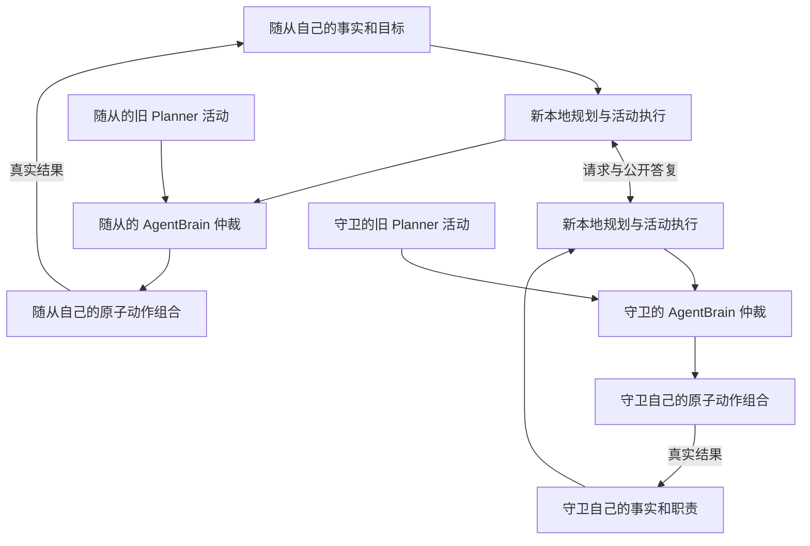

# 随从协助破局 · 实施计划

> **状态：2026-11-19“小六引开两卫，玩家通过城门”的核心玩法已获用户实机确认。新增人情自然链、合法过门检测／任务提示等仍按各自记录待验；统一原子行为库、自由请求及其他业务迁移均为后续TODO，本轮只完善方案。** 主要审查缺口的正式数据／离线回归及三版本隔离编译已通过。建立：2026-11-18；算法核查与比较记录：2026-11-17。来源：[问题32原始反馈与处理记录](#feedback-32-record)；项目入口：[511总纲](逆水寒511-总纲与实施计划.md#feedback-32-design)。当前缺口、实际测试证据和验收顺序见[测试与日志说明中的审查与修复状态](随从协助破局-测试与日志说明.md#implementation-audit-status)。

**建议：GOAP（从目标反推可用动作）选手段，HTN（把任务逐层拆成步骤）安排配合，由既有Brain（每名NPC自己的行为控制器）执行。** 随从和守卫各自根据本人掌握的情况选目标、规划和应变。当前固定入城入口的LLM（语言模型）仅润色；后续自由委托入口按[自然语言请求方案](#natural-language-request)用LLM解析玩家意图和目标，再经本地核验、规划与玩家批准。首条落地路线是“先展示计划并批准→小六逐个说服两卫→亲自带离→观察真实空当并发手势→小六留在诱离点牵制，玩家亲自越门→确认过门后收尾，失败则明确报告”。

**现行完成条件（2026-11-19用户纠正）：**小六帮你打开入城机会，不必再到你身边。两卫实际到点、真实空当与可见信号仍要逐项确认；发信号后保持牵制，看到你实际过门才成功。正式内容为`coop-511-8`；答话与守卫执行连续交接，最新掉队日志及复验见[测试与日志说明](随从协助破局-测试与日志说明.md#handoff-crossing-fix)。

**人情规则（2026-11-19用户裁定，源码已落实、实机待验）：**工具委托真正交差记 +2，成功平息小六与老周的争执记 +3；临时协作需 5 点，实际开始请求检定时使用。余额和每笔来源复用通用 NPC 记忆及其存档，探查可回看。查看／批准计划不扣，两卫和有限改法只扣一次；失败的真实尝试也使用人情。旧档不凭已解决剧情自动补发奖励。完整步骤见[正式人情验收](随从协助破局-测试与日志说明.md#favor-acceptance)。

<a id="current-progress-todo"></a>

## 当前进展与待办（2026-11-19现行）

**结论：进展与待办统一以本节为准；设计合同和附录中的旧日期、旧版本、旧验收数字是历史记录。** 当前内容为`coop-511-8`。源码完成、离线通过、用户实机确认分开记录。

**本轮范围：只完善后续方案与TODO，不实施代码迁移。** 已验证通过的“小六引开两卫，让玩家通过城门”继续作为现有成果；统一库和自由请求的待办不追加为该成果的完成条件。本轮不修改运行代码、城门JSON、费用、触发或执行流程；新增人情链／任务提示及异常专项仍保留原待验状态。

| 范围 | 已完成 | 仍需完成／验证 |
|---|---|---|
| 本地规划与执行 | GOAP、HTN、组合模式；本人Brain控制权；独立守卫答复；真实结果驱动有限重规划；取消、暂停与迟到回执处理 | 原生控制权竞争、异常恢复、完整新旧入口回归及120秒性能验收 |
| 小六帮入城 | 先展示计划再批准；逐个交涉并亲自带离两卫；可见手势提醒；小六留在诱离点牵制，玩家亲自过门；失败报告。**用户已确认两卫带离后能够通过城门** | 后补的合法过门检测、右上角完成卡与原版任务归档仍待实机；分别验收，不因后续统一库TODO重置已通过的核心玩法 |
| 现场演出与计划说明 | 本地可读初卡、可选LLM润色；每句上屏至少3秒再换人；职责质疑与补充说辞；答话到跟随连续交接 | 新版节奏、职责张力、两卫持续跟随／核查／回岗、手势收到、无LLM画面与按钮、真实LLM过期／失败回落须实机 |
| 人情串联与探查 | 工具交差 +2、平息争执 +3；真实尝试使用5；通用NPC记忆存余额与来源；探查面板、只读命令、防重奖励、账目分页存档、诊断副本隔离 | 自然完成两事→探查5点及两笔来源→批准计划→实际使用→余额0及三笔来源；取消／拒绝／重复互动／真实保存读档与新档复验 |
| 正式招募与身份 | 临时约定、正式招募报价与检定、资源入口、原Hero与主队身份接线 | 真实付款／异常补偿、原身份唯一、主队名单、原剧情衔接及读档；人情测试不替代正式招募验收 |
| 扩展到其他委托 | 共用搜索、数据模型、活动、结果协议与能力目录过滤；当前运行合同有9类能力 | **非门岗委托尚未实现**；[花人情请NPC偷窃](#favor-theft-request)及[LLM解析自然语言请求](#natural-language-request)已补方案，未接通；线索核实夹具、旧能力迁移、非门岗事实／完成回执适配仍未完成 |
| 统一原子行为库 | 已核旧动作主表、Brain、内联步骤、新协作、剧情效果及部分法术／钩索入口；[统一方案与源码映射](#unified-atoms)已写入 | **本轮为架构核查与方案，未实施迁移**；先补共用参数／结果／事实适配，再开放自由请求，不能把9类协作能力称为全游戏动作库 |
| 交付证据 | 正式数据、离线回归与三安装隔离构建已有记录 | T01～T45及自然玩法逐项实机；自动创建／返回的原生隔离场景尚未提供；实机通过后才更新通关攻略与归档问题32 |

**当前离线证据：**人情记账／存档／奖励／消费／探查35项，2个变异与5个无效奖励定义被拒绝；授权／诊断Debug 99项、Release 45项；两卫运行102项及3个变异；过门／HUD 42项及3个变异；演出62项、走位13项。正式checker通过，1.2.12／1.3.15／1.5.7隔离构建通过。数字来自既有测试记录，本节整理未重新运行游戏或这些测试；步骤及替身边界统一见[测试与日志说明](随从协助破局-测试与日志说明.md#favor-acceptance)。

**后续TODO顺序（本轮仅完善方案，不执行）：**

1. 实机验人情自然链、余额与来源、扣一次及读档；同步验合法过门、任务归档和下文提示。
2. 补全门岗路线的失败／取消／抢占／暂停／回岗、正式招募、双入口及计划卡验收；保留未通过项。
3. 按[统一原子行为库](#unified-atoms)先完成共用合同、移动／朝向／发声与真实结果；把门岗调用接回共用适配，旧密令和剧情同期回归。此项是自由委托的前置，尚未实施。
4. 在现有轮子内补指定物品、真实下手者／去向／犯罪归属，接偷窃与击晕；用“找到指定人→尝试偷指定刀→按约定交付”验证组合。再补“核实已知线索并回报”的非门岗事实与完成证据，分别验同意、拒绝、受阻；两项都不能只靠走位和说话宣告完成。
5. 在已接通的业务上接NPC先回应、本人擅长候选、LLM整句／多轮请求解析、歧义澄清及原生弹窗批准；参数／对象／费用与实际提交使用同一请求。完成内容增删和性能验收。未迁移能力不进入新规划器或正式候选菜单。
6. 按域继续迁移其他可复用能力，保留旧消费者；相同核心与结果完成回归后再退役旧适配，具体顺序和门槛见[5.9](#unified-atoms)。

<a id="current-request-scope"></a>

## 当前能请求什么，规划能推算到哪里

**结论：当前新协作玩法只有“帮玩家进城”这一项完整业务目标；可扩展，但不是无限委托。** 人情决定NPC是否愿意接受已支持的请求，不能让尚未实现的能力凭空可用；本轮只为小六这一业务配置了5点费用，未制定所有委托的通用价目。

| 层次 | 当前实际范围 | 不能由此推导的能力 |
|---|---|---|
| 玩家在新协作中提出的目标 | 小六帮玩家进城；另有成为正式同伴的招募入口 | 尚无“任意NPC＋任意目标”的通用委托菜单／自然语言目标接入 |
| 进城目标内部的交涉手段 | 岗位内交谈、报信诱离、有人真实接替时请求调查；按人数、岗位、授权和结果筛选 | 三种内部请求不等于三种独立玩家委托；临时约定仅授权口头牵制及诱饵报信，不自动允许调查或动武 |
| 新协作执行基础 | 到人／点、跟人到点、转向、留守／等待、说话、发信号、等待事实、观察门岗空当、提交交涉请求，共9类运行合同 | 9类不是9种成品玩法；观察空当目前读取门岗事实，不能称为通用调查／线索搜集 |
| 已有旧密令／闲聊系统 | 有走位、跟随／停止跟随、带路、传话／发信号、攻击／击晕、扒窃／偷装备、给钱、等待和同伴配合等执行路径；另有按身份开放的部队命令 | 这些尚未全部迁入新协作，也未统一接人情；旧计划生成仍依赖LLM。送物虽有注册和类名，实际执行明确失败；箱子战利品是模拟记账，不能宣称已经能取得任意指定实物 |
| 后续业务方向 | 线索核实回报、交易、作证、取物、救援等须逐项建模、接真实执行并验收 | 当前不能把“有移动和说话”当成“已经能完成交易／救援”；注册名称也不等于完成实现 |

**怎样实时推算：**GOAP在已登记且实际可执行的动作中，依据NPC此刻掌握的事实反推达到目标的办法；HTN按已登记的方法拆分任务。收到拒绝、移动失败或条件变化后，在授权和预算内重新求解。角色、动作、目标和方法都有限，搜索还有节点、时间、尝试次数限制；不能穷举任意世界行为，也不能保证每次都有解或成功。

**计划不会预测成败当作事实：**守卫是否答应、能否走到点、玩家是否收到信号、是否真正越门，都须等真实结果。两卫诱离是JSON登记的办法，算法能选择／展开该办法，不能声称它自行发明了新的骗局。LLM可以润色说明和对白，不能新增执行能力、改检定或兑现结果。

**通用性当前到哪一步：**GOAP／HTN搜索和活动执行机制可复用；目前能力目录由协作JSON动作模型及运行适配生成，未自动导入所有旧`ActionRegistry`、剧情原子或其他域的能力。场景身份和门岗事实仍接511宿主，跨业务／跨场景适配没有完整验证。因此当前应称“通用规划底座＋首条门岗业务”，须完成上面的非门岗委托及迁移验收，才有证据证明其他业务也可接通。

<a id="favor-theft-request"></a>

### 扩展方案：花人情请NPC帮忙偷东西（待实施）

**需求：玩家可请欠自己人情的NPC帮忙偷东西，不以先成为正式随从为必要条件。** 当前人情账目可复用，旧密令有人物扒窃／偷装备基础；新协作尚无此委托入口、目标、费用提交和执行适配，本节是方案，不表示已可用。

**范围：首个真实验收采用“从指定人物偷钱”或“偷取其真实装备”，先接通一个完整业务。** 指定物品须确认有实际库存及唯一物品身份；物件／箱子须另接真实容器库存。玩家只可指定现场可见对象或已知情报支持的目标，不能由菜单暴露未知库存。旧箱子模拟战利品与尚未实施的送物步骤不能充当指定物品到手证据。

| 玩家经历 | 方案要求 |
|---|---|
| 提出请求 | 从NPC互动提出帮忙，明确偷谁／什么、数量和允许风险；探查展示本人欠玩家的人情及来源。不把门岗Candidate、工具任务或老周争执当所有NPC通用前置 |
| NPC答应或拒绝 | 按该请求的资格、本人能力、职责、人物倾向及风险受理，说明愿意尝试／做不了／不愿意；欠人情不自动等于愿意犯罪。规则与费用由数据配置，偷窃费用尚未定，不能沿用入城5点作为默认价 |
| 展示计划 | 写清目标、人情费用、接近／等待机会／动手／结果报告、玩家分工和受阻处理；技能依据取真实执行者，风险不预告结果。玩家看完选择开始、取消或改变请求；目标已通过核验后，基础计划说明不依赖LLM |
| 实际执行 | 本人Brain控制接近、绕背和等待；复用已有偷窃判定、资源结算与目击后果，提供新规划器的通用开始／结果／取消适配，不复制另一套扒窃公式或按角色ID写流程 |
| 使用人情 | 先核余额与有效授权，在首个合法偷窃尝试真正提交时使用约定费用一次；查看、NPC拒绝、走位受阻、动手前取消不扣。真实尝试失败仍使用人情；同一活动的回执、重规划和重复点击不得重复扣费，也不得以反复掷骰代替等待机会 |
| 结束与后果 | 成功须核真实钱物从来源扣除并到达约定去向，玩家实际获知结果后更新委托；失败／目标离场／被发现明确报告，取消释放本人控制。受害者和目击者走现有认知与后果管线；默认不因失败擅自升级为击晕、攻击或其他未授权手段 |

**规划边界：**目标应为约定钱物真实取得并完成告知，而不是“执行一次偷窃动作”。GOAP可组合已建模的接近、等机会、扒窃和报告；HTN提供对应方法。愿不愿接、库存是否真实存在、走位是否成功、是否被发现和是否到手均接真实结果。仅把旧动作名加入JSON不能完成此扩展。

**TODO与验收：**补通用委托身份／授权及按请求费用，解除请求入口对门岗角色和511任务前置的耦合；补共享偷窃能力适配、自然语言目标解析、完成证据和计划表现。用至少两名不同NPC、不同目标验真实成功／拒绝／等待无机会／被发现／取消；核钱物守恒、人情只扣一次、来源正确、暂停与旧回执不重复、读档不重复结算；通过结构化开发夹具独立验无LLM的规划、执行与基础说明，不把夹具当玩家自由委托入口。实施后再把本节更新为完成项；原“核实线索并回报”夹具保留待办，当前不宣称两项都已实现。

<a id="natural-language-request"></a>

### 自由委托怎样指定目标：LLM解析请求，本地规划执行（待实施）

**决定（2026-11-19用户裁定）：自由表达的委托由LLM解析语义，不让玩家从全场NPC下拉列表逐个查找。** 玩家对请求对象说“帮我从门口那个拿长枪的守卫身上偷点钱”，系统结合当前可见人物、交谈对象和已知情报理解偷什么、目标是谁、由谁尝试；含糊时接着问清楚。此入口尚未接通新协作规划器，不能把旧密令已有语义解析称为本轮新功能已完成。

**入口决定：玩家点击“请他帮个忙”后，NPC先回答“要我帮你什么？”，再按本人擅长能力展示候选事项，最后保留“其他请求……”。** 选明确事项后用系统输入框描述目标；“其他请求……”可自由描述整件事。入口同时要求已配置LLM、该NPC欠当前玩家的人情达到门槛、本人可受理且当前人物事件已收尾。门槛沿用此前“工具 +2、争执 +3，凑够5点解锁”的约定，采用余额≥5；达到5点即可，不要求额外第6点。阈值放通用委托数据，不按小六角色写判断。打开时固定本次请求对象，标题／说明显示其姓名及欠玩家的人情余额；无需先招募，也不跳IM私聊或附近频道。开场是NPC真实回应，不只是系统标题；先实际展示，再开放事项选择，台词与人物口吻由数据提供，沿用现场发声和阅读节奏，不依赖LLM才能开口。

<a id="request-kind-menu"></a>

**事项菜单必须体现人物差异：**从已接通业务中，按该NPC真实技能／属性、当前能力、职责、愿意承担的风险和玩家已知依据筛选，优先推荐本人擅长的2～3项，最后保留“其他请求……”；能力不足时可少于2项，不用相同菜单或随机换选项制造差异。每种业务的能力依据复用真实执行／检定所用数据，筛选规则与推荐门槛由JSON维护，C#只提供通用查询／排序，不按角色ID写选项。若人物技能数据没有差异，须补人物数据，不能用LLM虚构擅长项。以下为接入后的示例，不代表新业务已经可用。

| 本人实际能力依据 | 优先候选示例 | 仍需复核 |
|---|---|---|
| 魅力较强 | “帮我把人引开。”等已接通交涉事项 | 本人职责、可受理目的、玩家已知对象及真实交涉条件 |
| 流氓技能较强 | “帮我偷点东西。” | 对象／物品来源、本人意愿、目击风险及真实财物结算 |
| 活力与控制较强，符合现有击晕依据 | “帮我打晕一个人。” | 与攻击分开登记，核真实击晕资格和风险；不能承诺检定成功 |

**推荐不等于全部权限：**技能高不等于愿意接，候选不保证成功；未被推荐的已支持事项可以从“其他请求……”提出，再核可做性／意愿并说明限制。未实施、未建模或无真实执行的业务不进入正式可执行候选。菜单不原样列动作注册表，不列全场NPC或未知物品；保留取消出口，选择具体事项后NPC有对应追问／回应，不用同一句话应付所有选择。

| 第一层事项 | 第二层输入／提示 | 怎样理解 |
|---|---|---|
| “帮我引开守卫。” | “想让他引开谁？说说位置或样貌。”若当前入城任务已明确对象则显示已知目标，不强迫重输 | 事项已由选项确定，LLM只解析目标和必要补充；引开不自动授权动武 |
| “帮我偷点东西。” | “从谁或哪里偷？想拿什么？”例如“门口那个拿长枪的守卫，偷他的钱” | 一句话可同时描述人物／物件、钱物及数量；缺信息时问清；不能由LLM猜未知库存 |
| “其他请求……” | “想请他帮什么忙？把事情和目标说清楚。” | 玩家可直接输入完整请求，由LLM识别事项及目标；仍只能接已支持、可规划的业务 |

**确定选项保持确定：**玩家先选偷窃，模型只能补目标／钱物等参数；不能将请求悄悄改成攻击、击晕或另一种事项。补充文字与所选事项冲突时说明并让玩家改输入／返回重选；改变事项令旧解析及旧预览失效。“其他请求……”识别出未支持业务时回应当前做不了，不扣人情，不凭名称生成新执行能力。费用、授权和计划都采用最后核验成立的同一事项。

**弹窗流程：NPC回应→按本人能力提供事项→输入目标或完整请求→必要时弹窗追问→系统弹窗展示核验后的事项、目标、费用、风险和计划→开始／取消。** 事项选择、输入、澄清、批准均走独立请求流程，复用原生系统事项选择／文字输入／批准弹窗及现有目标指认、控制权和本地规划机制；不恢复废弃`StoryDialogVM`／`DialogChoice`或旧密令退役流程。正文是玩家能读懂的行动交代，内部编号只用于绑定；实际演出和进展沿既有现场发声与HUD反馈，不因提交请求强开IM。

**费用决定：开输入框、提交文字、澄清及查看计划不使用人情。** 5点是入口解锁门槛；实际费用仍由对应委托配置，本地核出并在批准弹窗明示，不能让模型报价。余额不足以承担该请求时说明并允许改请求／退出，未获批准不行动；沿既有约定，首个合法实际尝试才使用一次人情。打开、提交、批准和实际提交都复核人物身份／场景、余额及授权，取消后旧解析回包不再弹窗或执行。

**分工：**明确事项路径由本地选项确定委托类型，LLM解析目标、钱物范围／数量及缺少的信息；“其他请求……”路径由LLM同时识别已支持的委托类型和这些参数。两路径都整理成同一种待核验请求，执行人始终是本次交谈并已选定的NPC；本地机制核身份、能力、知识来源、授权、余额和费用，GOAP／HTN求步骤，Brain执行。LLM不能直接返回动作链作为新协作的执行计划，不能凭文字新增能力、报出权威费用、扣人情或判定偷窃成功。受理意愿依本地业务政策决定，LLM负责表达和理解。

<a id="request-required-details"></a>

**请求须解析到本事项必要的主谓宾和参数完整，不能拿一句模糊描述启动。** 玩家不必逐字段填表；一次输入能明确的信息一起提取，缺少或歧义部分再问。字段结构和必填规则按已注册业务维护，未适用字段标“不适用”，未知字段保留未知；不能为了填满字段编造目标、库存、数量、意愿或风险授权。

**每次输入都按整句接收信息，不只读取NPC当前问的那一项。** NPC即使只问“找谁？”，玩家答“门口红衣守卫，偷他腰上那把短刀，一把，拿来给我，别动手”，也须同时提取人物、物品、数量、去向和禁止攻击的限制，结合已选偷窃事项核验。问句只帮助玩家补信息，不限制可输入内容；本次必要信息已齐全且无歧义时，跳过其余提问，进入受理／计划与批准，不能再问“偷什么？”或要求把刚说过的内容重填一次。

**补充按同一请求草稿合并：**解析包含当前事项、已明确信息、此前指代上下文和最新整句输入。新补充不丢掉之前明确的人物／物品／约束，未提到的字段不当作清空；明确纠正如“不是那把刀，改拿他的剑”更新对应信息并使旧预览失效，不明确或自相矛盾的修改先追问。换目标人物后重新核物品归属及其他关联条件，不能把旧物品引用直接挂到新人身上；改变已选事项仍须按前述返回重选规则处理。各值保留玩家原话及来源，合并后由本地逐项核验，不能把模型补齐当成玩家授权。

**下一句只问真正缺少或冲突的信息。** 完整回答直接进入计划；只给人物且物品未知则只问物品；给了人物和物品但人物重名则只确认是哪一人；完整请求但目标实物不存在时说明问题，不反复索要同一描述。失败解析不能擦掉已核验草稿，取消／返回重选／换场使该请求与旧回包失效；未来位置、走位步骤等由规划机制计算，不以“所有字段都要玩家填”延长交谈。

| 内容 | 必须明确什么 | 权威来源 |
|---|---|---|
| 谁做 | 本次求助NPC，不能被模型改成玩家或另一角色 | 当前互动已绑定的人物身份 |
| 做什么 | 已支持的具体行为及目的；偷窃、攻击、击晕分开 | 玩家所选事项，或完整请求经LLM识别后核准的业务 |
| 对谁／从哪里 | 具体目标角色，或明确来源容器／物件；不能只有同名或“某个人” | 可见／已知且核验唯一的对象引用 |
| 取什么 | 涉及钱物时明确钱、物品类别或具体物品；指定刀须绑定该来源的真实装备槽／库存条目 | 玩家可知依据和来源实际库存，物品显示名用于说明，执行用稳定身份 |
| 数量及约束 | 所需数量、已表达的时机／地点、允许风险、禁止手段、必要的收尾与去向 | 玩家明确表达或本地业务默认规则；影响代价或风险的默认须在批准前说明 |
| 怎样算完成 | 与请求一致的真实结果；取得约定钱物并报告、指定交涉结果或已明确的战斗收尾 | 业务完成合同和真实回执，不以模型一句“完成了”代替 |

**两个例子：**

| 玩家请求 | 解析成立的请求 |
|---|---|
| “偷某人腰上那把刀。” | 执行人＝求助NPC；行为＝偷窃；来源角色＝唯一的某人；物品＝该角色可见且真实存在的那把刀及具体来源槽；数量＝1；去向／失败处理／费用按业务核出并在计划说明；刀或人物不唯一则追问 |
| “揍某人。” | 执行人＝求助NPC；行为＝攻击；目标角色＝唯一的某人；物品＝不适用。攻击的目的、结束条件及伤亡风险按业务说明；若玩家表达“打晕／只打一拳／不能伤命”等限制，须分别核匹配能力，不能将攻击默认为击晕或杀死；含义不清则追问，机制做不到则说明 |

**“偷指定刀”另有实际适配缺口：**当前旧`StealEquipmentForNpc`按武器槽优先挑第一件装备，并不接指定物品引用。新委托须复用`StealSpecificItem`等真实结算，补“指定来源＋指定装备／库存条目”的通用查询与提交适配；提交前重核该槽仍是获批物品。刀已换走／不存在则报告条件变化，不能改偷另一把或别人的东西。真实容器库存及未支持的钱物类型继续明确待实施，不能靠LLM字段填齐冒充到手能力。

**可以求计划与可以执行分开：**必要字段明确且本地校验通过后，才生成待批准计划；还须NPC受理、费用／授权成立、玩家批准且实际提交前资格仍有效，才能行动。仅JSON语法正确或模型声称高置信度不能替代目标唯一、物品存在及授权完整。路线、接近点和机会由规划／执行机制计算，不要求玩家把世界未来状态和每个动作参数都说出来。

**目标怎样落到真人：**复用既有场景个体编号、目标指认及澄清机制；给LLM的候选来自玩家可见对象及有来源的已知情报，带本次场景身份和引用，限量提供相关描述。玩家不需要知道编号；LLM选择候选引用，本地核对应真人和来源，卡片展示实际目标及可辨认描述。模型没见到的候选、无来源的库存、虚构物品、歧义名字及不支持请求不能直接执行。目标编号只在本次场景内使用，离场／取消／新请求令旧回包失效；失效引用不得按同名、最近人物或玩家本人重新顶替。

**玩家经历：**与NPC互动→点击“请他帮个忙”→NPC回应“要我帮你什么？”→按本人擅长能力提供候选→选明确事项并输入目标，或选最后的“其他请求……”输入整件事→补齐本事项必要信息并核实际对象→NPC受理及本地核可做性、代价并计算办法→系统弹窗展示事项／目标／钱物与必要约束／人情费用／风险／计划→玩家批准→执行。目标澄清可以让玩家补一句话或只确认少量匹配对象，不列全场人物；“那个守卫”同时对应两人时必须问清，不能自动挑最近的一人。选事项、解析和澄清阶段不掷行动骰、不使用人情、不申请动作控制。

**批准与再次核验：**批准弹窗明确“谁帮忙、对谁、取什么、用多少人情”，批准时再核实际引用和状态。目标离开、换场或发生影响委托含义的变化时，说明原因并重新解析／确认，不能让批准的A变成实际执行的B。旧密令仍按原入口运行；新委托只复用它的目标指认和澄清机制，界面独立走原生弹窗，不将旧LLM计划执行器伪装为本地规划。

**无LLM的边界：**保留已有固定对白／明确对象入口，例如小六帮入城及其完整本地执行；不要求用菜单实现同等的任意自然语言委托，也不猜测玩家原话。自由委托入口检查`IsLLMConfigured`；未配置、超时或坏回复时说明本次请求未能理解，允许重说／退出，不扣人情、不控制身体。已经核验、批准并启动的活动不因后续LLM掉线停住，基础计划、固定对白和结果反馈照常可用。

**验收：**LLM未配置或余额4时不开放入口，余额5及以上且资格有效时打开事项菜单，选项只含已接通且有来源的业务，最后保留“其他请求……”，全程无需IM；两种输入路径对同一事项／目标产生相同核验与计划，明确事项不能被模型改写，返回重选后旧回包失效。中文输入法选字回车不误提交、空输入／取消不扣人情。再验同义说法指向同一真人、指代依当前交谈／可见事实解析、两名同类人物会追问；未知人物／虚构物品／未支持能力明确不执行；取消、换场及目标离开后旧回包不生效。批准弹窗对象与实际执行一致，玩家本人不被当默认目标，解析／澄清／失败重试不扣人情，实际费用不够则不启动；启动后断开LLM仍能完成本地执行或真实失败收尾。控制台与日志使用英文编号，玩家界面按标准本地化，不要求玩家输入中文控制台参数。

**新增验收：**NPC先实际回应再出候选，选择偷窃／引开等各有对应追问；更换同一场景中技能不同的NPC，菜单与推荐依据确实不同，改变真实技能／职责数据后相应变化，旧请求版本不被改写。高技能但不愿接可拒绝，低技能未推荐事项可经“其他请求……”再核；必要字段缺失不生成可批准计划，不适用物品字段不阻塞攻击请求。“某刀＋某人”核同一来源、同物品多槽歧义追问、提交前换刀不偷错；明确攻击／击晕不互换，无法保证的非致命限制明确说明；缺字段、空集合、坏JSON、取消与迟到解析均不扣人情或行动。

**整句补全验收：**固定NPC当前只问人物，分别提交完整请求、只给人物、人物／物品齐全但重名、补充数量／约束、明确纠正物品及改目标。完整回答不再逐项追问，部分回答只问缺项，重名只澄清人物；分多轮输入与一次说全的同义请求得到同一核验结果、费用与计划。新回复未提到的既有字段保留，纠正后旧预览不能启动，换人后旧物品归属重核；冲突／坏回复／取消不扣人情，不把误解析的禁止条件丢掉。

**决定：本文件统一维护问题32的用户原话、设计、处理状态与实施交接，[测试与日志说明](随从协助破局-测试与日志说明.md)维护复现步骤和证据标准。** 总纲保留入口摘要、与其他511路线的关系和整体进度；[原始反馈与历史答复](#feedback-32-record)集中保留在本文件附录，反馈清单不再保留问题32条目。两份专项文件一起交付，不能只实现后台规划而遗漏诊断、演出和验收。

**设计裁定（2026-11-18；当前落实情况见末尾实施记录）：**

- **保留旧Planner（规划系统），为本玩法新建本地规划与活动执行层。** 新旧并存，按能力逐步迁移；达到替代与回归标准后才废弃对应旧入口，详见[1.1](#planner-coexistence)。
- **保留AgentBrain与AtomicAction（原子动作）。** 每名NPC仍由自己的Brain执行原子动作组合；新规划层不直接操纵身体，不新增一整段城门玩法专用动作。
- **把玩家看得懂的分工、现场演出和进展反馈列为首版交付。** 出发前展示同一结构化计划的基础功能说明及可选LLM润色版，行动中看见交涉，变化时听到原因，随时可回问或叫停；详见[5.4](#player-presentation)与[5.5](#pre-execution-plan)。
- **持续增删JSON和新增C#机制属于首版接入合同。** 规划层从现有注册与有效内容派生能力目录，按版本和依赖变化调整；新能力补齐通用适配，不改玩法专用搜索分支，详见[5.8](#evolving-content)。
- **首版招募对象确定为已有角色许小六（`son`）。** 工具交差与老周争执分别积累 2、3 点人情，凑够 5 点可请求一次临时协作；正式招募另行报价。优先复用已在队伍的合法同伴，现有人选不凭空替换为新流浪者。身份、动机、对白和验收见[4.3](#xiaoliu-recruitment)。


<a id="core-contracts"></a>

## 五个核心约定

| 用户关心的问题 | 明确约定 | 详细位置 |
|---|---|---|
| 双方怎样独立思考 | 每名NPC有自己的事实、职责、目标和计划；发起者只能提交交涉，对方自己决定并执行 | [2.1](#independent-decisions) |
| 失败和变数怎样继续 | 交涉有真实结果分支；一次尝试只掷一次；收到失败后重新计算剩余目标或撤回 | [2.2](#uncertain-results) |
| 言行怎样跟上现场 | 本人的真实步骤变化和结果决定台词与动作；不提前播后续成功，不让迟到润色改变现况 | [5.1](#situated-speech-actions) |
| 怎样接新玩法 | 共用决策、交互、执行与结果契约；玩法注册能力及数据，内容不进入专用C#分支 | [5.2](#generic-extension) |
| 玩家与随从两种模式怎样兼容 | 共用守卫决策与交涉裁定；玩家亲自选下一步，随从由自己的规划器选下一步 | [5.3](#player-npc-modes) |

**状态说明：以下保留正式接入设计与验收门槛，不能作为已完成清单；现行完成项与TODO见[当前进展与待办](#current-progress-todo)，范围边界见[当前请求范围](#current-request-scope)，末尾保留实施证据。** 既有离线原型证明第3节列出的有限案例，不代表已经覆盖这里全部的双方交互、随机结果、阶段言行和两种玩法模式。

## 范围与当前进度

| 项目 | 本计划处理 |
|---|---|
| 玩家可感知的能力 | 现场招募、交代分工、随从自主尝试、守卫自主应对、机会提醒、玩家越门、牵制收尾／失败补救 |
| 算法边界 | 分别构造GOAP反算、HTN正算并公平比较，共用新的活动执行层，再向本人Brain申请原子动作 |
| 首版场景 | 511二次场景两卫诱离主线；保留单卫交谈、有接替调查作为条件备选 |
| 通用机制归属 | 新规划层放在现有`Planner/`源码目录；保留旧Planner，复用AgentBrain、原子动作、会话、岗位组、资源与存档管线 |
| 已有证据 | 原型12／64／6项是历史比较；正式三算法、运行／人情／过门回归及用户物理进城反馈见[现行进展](#current-progress-todo) |
| 待完成 | 原生引擎实机、真实招募／经济／身份读档、业务迁移／扩展与性能验收；隔离场景夹具未提供 |
| 问题32状态 | **未解决**；独立立项与离线通过不代表游戏能力已经完成 |

**决定：保留现有独自过关路线和真实门岗规则。** 协助是可选补充；先完成当前人物事件并收尾，再开放后续互动。进入场景不自动免费招募，也不因聊天直接获得通行许可。方案遵守[用户设计原则](用户设计原则.md)及[项目规则](../../CLAUDE.md)，用户原则原文由用户维护。

## 1. 接入前核查：历史缺口与需要防回退的路径

**本节保留接入前的源码核查和前置合同，不代表所有缺口仍存在。** 2026-11-19实际修复范围、证据和未验项目见末尾实施记录；验收继续核这些路径，不能据历史描述恢复旧实现。

| 源码核查 | 对本问题的影响 |
|---|---|
| `StoryProbeMissionBehavior.EnsureCompanion`只借已有队友 | 当前没有现场自愿招募入口；代码注释中的旧“自动招流浪者”不能当成现行功能 |
| `SayInlineState.BroadcastSpokenTo`先发`asked_to_follow`，随后`DialogueComponent.HandleDialogue`再发`spoken_to` | 若第一条反应已排好跟走，第二条选择`consider/listen`就会通过`RunReactiveAction.ClearAllActions`覆盖它；这是可达的源码冲突路径，尚未用历史实机失败日志确认 |
| `PlanExecutor.OnExternalClear`将未完成动作的外部清除视为计划中止 | 普通搭话和真正的战斗／捆缚缺少对本次活动的区别仲裁；不能用删除中止检查来掩盖，因为真正失去身体控制必须停 |
| `follow_for_a_bit`在入队时立即广播`followed`；`ReactiveAgent.PostPos`首个事件时取当前位置 | “同意跟走”不代表已经离岗，当前位置也未必是真岗位；要等真实位置／行动回执，并复用正式职责点 |
| 旧`FollowAgentAction/MoveToPositionAction`有卡死瞬移兜底 | 此路线要明确禁止瞬移；寻路失败必须报告、换合法路线或退出，不用瞬移制造诱导成功 |
| `PersuadeSlot`虽本地计算倾向，润色结果仍可带`ActionCode`进入`ActionHandler` | 只关闭计划生成不够；本次活动的台词结果必须禁止带动作／目标／效果，续话和完成不靠模型文本或记忆轮询判真 |
| `PlanExecutor.BuildCursors`可按`subjects`直接为多名演员建立动作链 | 该能力不能用于给敌对守卫派随从子步骤；自主交互必须绑定各人的独立计划与控制权 |
| `SingleRollResolver.SimpleCompute`读取`Hero.MainHero`，511对话预览也明确读取玩家能力 | NPC对NPC不能直接套此入口；先解析实际发起者／接受者能力，再复用共享概率与掷点判据，避免随从借玩家属性 |
| `MissionSessionOutcome.OnAgree`直接排跟随／折返，`PersuadeSlot`按倾向累积兑现 | 需要接成“本地接受结果→接受者自己的决策”，并明确单次掷骰的接入；旧倾向公式与跟随兑现不能当作新协议已经完成 |
| 过门仍由`CheckHandsOnGate/EnforceGateBarrier`执行 | 现有潜行要求实际穿门、蹲行、未被发现和技巧检定；牵制不能只设一个“门已开”标记，更不能让远处看不见玩家的守卫照样隔空推回 |

### 1.2 接入前必须补齐的源码合同

**决定：下表是接入前必须满足的公共合同，修复后仍逐项验收。** 已有改造满足要求时复用并附证据；具体落盘状态见末尾，不把这张历史缺口表当作当前未实现清单。

| 现行入口 | 本次明确缺口 | 必须交付的处理 |
|---|---|---|
| `IsBlockerWatching`及潜行／翻墙调用 | 当前只检查`blocker`，并非所有实际守门人 | 共用当前岗位组中的真实观察者查询；所有合资格观察者中任一真实看见就不满足未被发现，不能把被聊天对象当唯一守卫 |
| `EnforceGateBarrier/NearestGateGuard` | 推回分支按门区和最近守卫选择，缺真实视线／可及条件；甚至无推人者时也能传送玩家 | 改为真实发现→合法拦截申请→实际接近／接触回执；无人发现不得隔空推回。近身推退若保留，须有明确接触距离、同层及回执；不是补一个牵制布尔值 |
| `EnsureCompanion` | 可重复生成已有Hero的场景身体；保存对象仅存活不足以证明可参加 | 查主队归属、死亡／拘捕／分兵／已有场景Agent，身份和身体分别去重；借用同伴与正式招募分开 |
| `RecruitWandererIntent` | 已有资格与`AddCompanionAction`成功入口，但未在此形成报价、付款、容量及场景绑定的完整事务 | 复用资格、能力与入队后果；补现场招募结算和状态核验，不能把现有`OnSuccess`当成完整付费招募流程 |
| `StoryMoveAction` | 现有内层设置固定20秒超时，走固定超时分支时不瞬移，可作为复用候选；仍仅回`bool`，`OnEnd`也不是完整终止原因协议 | 接真实结果与终止原因，实测受阻、提前清队列、排队取消及Agent销毁；不得仅据代码注释宣布通用移动已满足新合同 |
| `IAtomicAction.IsFinished/IsActionAlive` | 中断、失能和超时也可返回完成，移出队列也不证明到达 | Brain在唯一生命周期出口提交开始／终止回执；适配器核物理结果，只终结一次，不从轮询`IsFinished`推成功 |
| `SpeechChannel/AgentHudMissionView.AgentSay` | 已有并联说话与`[Say]`日志，但没有新活动全过程的版本关联与送达证据 | 排队和播放前核阶段版本；在真实展示出口记录输出渠道与接收资格，无法证明听到时不自动更新玩家知识 |

**前置验收：**保留[归档问题14](用户反馈的问题清单-已解决归档.md#feedback-14)的门锚点、职责区、动态候选、Brain申请与实际开窗回执。新的潜行观察、拦截、岗位AI和诊断必须读同一查询来源；旧钱路、武力、技巧、魅力和令牌放行一并回归，避免修协作后破坏现有门禁。

2026-11-17核查已先核[归档问题14](用户反馈的问题清单-已解决归档.md#feedback-14)：保留岗位组、真实门锚点、运行时选质问者、Brain申请和真实开窗回执；不恢复固定质问者、双份岗位坐标或导演强抢身体。当前日志未检出旧计划失败样本，以上不能宣称已经定位全部历史失败原因。

<a id="planner-coexistence"></a>

### 1.1 新旧规划怎样并存，哪些框架必须保留

**决定：本玩法新增“算下一段”和“推进活动”两部分，GOAP与HTN共用它们的输入、结果与执行契约。** 新规划产出本人下一段动作、等待结果和中断条件，不强制转换成旧Plan语法或交给旧PlanExecutor推进。已验证的能力查询与交互结算通过适配复用；旧规则中“丢弃未知步骤后继续成功”等行为不能继承。正式类名与数据字段在实施时核定，本节不是已存在的API。

| 层次 | 本玩法新增或调整 | 继续保留的职责 |
|---|---|---|
| 个人规划 | 每人用本地GOAP／HTN选择本人目标、手段和下一段；接真实结果重规划 | 旧命令、闲聊等入口继续使用旧Planner，未迁移能力维持现行路径 |
| 活动执行 | 管步骤、依赖、等待、预算、一次结算与版本；每人的活动独立 | 旧PlanExecutor管理旧活动；新旧均不能直接调另一个人的身体 |
| Brain仲裁 | 共用活动来源、持有编号、申请／暂停／中断／结束回执 | 每NPC唯一AgentBrain，负责何时允许动作、如何接管和归还引擎AI |
| 原子动作 | 组合已有移动、跟随、朝向、动画、等待等能力；缺基础能力才补原子 | `IAtomicAction`的开始、逐帧推进、完成与收尾生命周期；实际结果由动作和共享结算管线确认 |
| 对白与呈现 | 从真实阶段生成模板、有限润色、可读摘要和变化说明 | SpeechChannel、原版正式对话、现有HUD／任务卡／IM卡片结构 |

**决定：同一NPC的身体在同一时刻只由一个获准活动驱动。** 可以有等待的目标和请求，不能有新旧两条动作链同时推进。新活动申请时，Brain按真实状态和优先级受理、暂停或拒绝；旧命令、闲聊动作、ReactiveAgent反应、PersuadeSlot兑现也必须经过同一边界，普通接话只更新事实／发声。战斗、拘捕、捆缚等安全接管继续优先，不为保护计划屏蔽它们。

**决定：取消、结束和迟到回执只处理本次持有的动作。** 旧PlanExecutor不能凭新动作出现或消失而清新活动；新活动停止不能无条件清旧队列。移交必须先通知原活动并完成安全收尾，再授予新持有编号；晚到的旧LLM计划、Replan或台词动作携带旧来源时丢弃。被安全中断后，根据最新事实重新评估，不能复活旧成功分支。守卫自己的拦截／回岗不属于随从活动，随从叫停不撤销它。

**决定：原子动作组合是表现的实际落点。** 例如随从“接近→面向守卫→提出请求→等待公开答复→观察→示意／撤回”，守卫另行“留岗回答→请求接替→等真实到岗→调查→回岗／拦截”。发声走并联通道；需要朝向或手势时向本人Brain申请原子动作，不能为说一句话清整条移动。等待由新活动执行层管理，确需站定才申请已有等待动作，不拿演出占位强抢正在执勤的人。



**决定：逐项替代旧Planner，首轮只迁移本玩法及其必要公共仲裁。** 先证明新路线可靠，再按能力列出旧消费者与迁移状态；闲聊、IM命令、停止入口、执行摘要等分别接新契约并回归。尚有消费者、存档兼容或验收缺口时保留旧入口。复用现有动作注册主表；新规划所需前提／结果模型引用同一能力标识，不另维护一份含同义实现的动作库。兼容新旧所需的Brain公共修复也要验旧功能，本轮不承诺全面迁移完成。

## 2. 两个算法分别怎样构造

**共同输入：**本人已知事实及来源／有效期，已登记动作的开始条件、必须持续成立的条件、预期效果、真实完成条件、成本和取消规则。场景几何、移动、会话、技能检定及资源仍走已有轮子。守卫不读取玩家的秘密计划；同伴不读取守卫隐藏心思。未知的同意／拒绝保留为未知，运行中等对方回执。

| 项目 | GOAP反算：从想要的结果往回找 | HTN正算：从任务往下拆 |
|---|---|---|
| 同伴目标 | 看到玩家真实越门；小六留在诱离点牵制，不必会合 | “协助玩家越门”这个总任务 |
| 构造 | 越门需要未被发现的机会；机会需要有人实际牵制；牵制需要接近、谈妥或申请调查；再补同伴招募和交代 | 招募／复用同伴→交代分工→接近→选择牵制的方法→观察机会→发信号→在原处等待真实过门结果→收尾 |
| 搜索 | 用动作效果消去待满足条件，加上前置条件；拒绝互相矛盾的条件，用A*及忽略删除效果的成本下界估价 | 根据当前事实展开合资格的任务方法，正向模拟每个原子效果；比较完整候选成本，不是碰到第一个方法就定案 |
| 场景变化 | 真实结果改变相关事实后，对尚未完成的目标重新反算；可发现没有整段写过的新组合 | 当前方法失效后从实际进度改选另一个方法；已付款／已入队／已过门不重复执行 |
| 守卫侧 | 从“岗位仍有人看守／眼前威胁已制止／报告已核实”反算本人合法动作 | “履行门岗职责”分解成留岗回答、有接替才调查、警告拦截、结束后回岗 |
| 主要成本 | 动作前提／效果要准确，必须控制组合搜索与不确定结果 | 要维护任务方法；有新动作却没写新方法时，不能自己发现新组合 |

**中断条件不能只靠动作名或开始条件自动猜。** 例如“起步时站在门外”不是移动全过程都要成立；“同伴还活着且能行动”才是持续条件。动作定义必须区分开始条件、持续条件、完成回执和超时。两算法都可从产出计划的因果关系提取监视项：先前哪一步提供了后面哪一步需要的事实；该事实被观察到失效，依赖它的未执行步骤就失效。GOAP检查前提与效果之间的支持关系，HTN同时检查当前方法的持续条件；安全、职责和控制权规则由共享执行机制处理。

**预期效果与真实事实分开。** 规划中的“调查请求可能获准”用于选择尝试，不能直接把守卫写成离岗；收到拒绝、移动失败、时限到或真实回岗，才更新个人事实和失败反馈。每次开始及提交动作再次核资格，搜索节点／耗时预算耗尽报告“本次未找到”，不能冒充已证明无解。技能检定按一次尝试记账，拒绝和失败有冷却，不能重规划就无限重掷。


<a id="independent-decisions"></a>

### 2.1 每名NPC怎样决定自己的下一步

**决定：复用每人唯一的Brain，在其内部接个人决策状态；不另造一个能直接驱动身体的“大脑”。** 共用的是算法与执行机制，保存的事实、目标、当前步骤、尝试结果和记忆按人物隔离。规划器算“想做什么”，Brain裁定“现在能不能做”并驱动本人的动作。

| 个人决策需要的东西 | 随从示例 | 守卫示例 |
|---|---|---|
| 本人知道的事 | 听到玩家约定、亲眼所见的岗位情况、本人交涉结果 | 本人的岗位命令、听到的请求、看见的闯入与收到的同僚回执 |
| 当前目标与限制 | 协助创造机会、保护自身、完成约定；遵守玩家授权的风险范围 | 保持区域受守护、处理可见威胁、核实本人收到的报告；按本岗位规则决定是否离开 |
| 可用能力 | 接近、交谈、请求、提供已知证据、观察、示意、撤回 | 回答、拒绝、请求接替、调查、警告、拦截、回岗 |
| 自己的下一步 | 拒绝后换合资格手段，或说明做不到并撤回 | 继续留岗、等接替、出发调查；看见威胁时中止交谈并处理 |
| 不可获知的信息 | 守卫隐藏倾向、尚未掷出的结果、视野外另一卫的情况 | 玩家秘密过门计划、随从后续方案、未目击的玩家位置 |

**决定：每个人都按“感知→更新自己的事实→选目标→算下一段→申请本人的控制权→执行→收本人的真实结果”循环。** 不每帧重算整段计划；只有新请求、有关事实变化、动作结果、超时或安全中断才触发评估。安全与状态禁令先检查，岗位及承诺约束再检查，其余合资格目标按JSON配置的优先级、实际代价和人物倾向选择；稳定平局顺序与切换门槛避免两个目标来回争抢。真正威胁可立即打断，普通搭话不能清掉已接受的行动。

**决定：发起者没有写接受者计划的权限。** 随从提交的是“请调查这件事”及本人能提供的内容；守卫独立核职责与资格、参与交涉裁定、选择自己的后续计划。共享交互机制只关联双方请求与结果，不替任何一方入队动作；岗位组可以分配共同职责、预留接替请求，但接替者也须自行受理并真实到岗，组协调不直接抢身体。

**决定：至少分清四种回执。** 请求已收到、对方愿意尝试、本人行动实际完成、共同目标实际达成。守卫说“我去看看”只意味着意向成立；仍可能等不到接替、走不过去或途中发现威胁。随从只能收到已公开答复或感知可见结果，不能直接读取守卫完整计划、隐瞒的拒绝理由或随机内部状态。正式能力与财物裁定查询世界真实状态，但查询结果不会自动成为所有NPC的知识。

### 独立攻防怎样实际发生

| 现场顺序 | 随从自己的决定 | 守卫自己的决定／执行 | 真实结果 |
|---|---|---|---|
| 玩家交代协作 | 同意承担约定风险，规划接近与交涉 | 继续执勤，还不知道秘密分工 | 没有牵制机会 |
| 随从提出调查请求 | 等待答复，不先跑“守卫已离岗”的后续 | 核资格、交涉；同意后先请求合法接替 | 同意仍不等于离岗 |
| 接替迟迟未到 | 按约定继续等待或换办法 | 到等待期限后取消出发，解释仍须留岗 | 原候选方案失效 |
| 出现另一合法手段 | 提出新内容，等待新的明确结果 | 重新核当前职责与这次请求 | 可能受理，也可能拒绝 |
| 守卫已真实行动 | 观察本人看得见的空当，给有限信号 | 调查期间继续感知；见闯入可放弃调查并拦截 | 玩家仍须亲自过门 |
| 机会消失 | 停止原信号，提醒玩家或撤回 | 回岗／拦截，从自己的实际位置继续执行 | 保留既有财物、伤害与进度 |

<a id="uncertain-results"></a>

### 2.2 计划怎样面对失败骰子和其他变数

**决定：普通GOAP或HTN都不会自动解决随机结果。** 动作定义必须列出可能结果、观察／回执方式及再尝试条件。规划时可按“这次尝试成功后能达成什么”评估候选，执行时只推进到下一个未知结果处，等真实裁定再算后续；未实现的成功分支始终是假设，不能写进现场事实。

**决定：资格拒绝与掷骰失败分开。** 被绑、无权放行、当前岗位禁止离开等是事实约束，直接报告不合资格，不通过成功骰子绕过。对合资格的说服尝试，先解析实际双方的能力、已提供筹码与本次目的，按共享检定规则计算并一次掷点；失败表示这次没说服，成功表示对方愿意接受该目的，具体怎样合法执行仍由接受者决定。人物倾向能影响合法选择或已登记的实际检定因素，不另叠一个隐蔽“失败骰子”推翻已提交结果。

**决定：每次逻辑尝试有唯一编号，检定和资源提交只发生一次。** 同一人物、目的、手段和有效筹码下，续说、重复事件、算法切换、关窗重开、重进及载入已有该记录的存档均取已记结果；只换一句话不能重掷。新增证据、实质改价或改变局势可构成新尝试，但必须由已登记规则核对，仍受尝试次数、时限、成本与冷却约束；冷却结束本身不清除既有失败。载入尝试发生前的旧存档会回退整个世界，本方案不另写跨存档全局账本保留“未来结果”。保留必要尝试记录与资源回执，离场后重建实际状态，不保存失效的Agent引用。

| 真实结果 | 继续推进／调整的规则 |
|---|---|
| 这次说服失败，守卫坚持拒绝 | 把本次手段记为已失败，结束该交涉步骤；有已知新证据／合资格另一手段就再规划，否则报告无办法并撤回 |
| 同意交谈，仍留在岗位 | 完成交谈不等于获得机会；继续观察，不能把“在聊天”写成“看不到玩家” |
| 同意调查，但没有接替 | 保留有期限的等待；收到拒绝或到期后重选手段，一般调查不能强令最后一卫离岗；诱饵核查按独立请求与守卫短暂离岗规则执行 |
| 同意且出发，但寻路受阻 | 失败是移动结果；由行走者自己的规划换合法落点或回岗，发起者根据可知反馈调整 |
| 调查途中看见闯入／受攻击 | 守卫优先处理本人感知的威胁；随从收到公开中止或看见折返才更新，原机会不能继续承诺 |
| 世界已变但结果未回 | 在提交前重新核状态；取消旧活动的迟到回执不得推进新活动，同一次结算不得重复 |
| 预算用尽／没有合资格新办法 | 区分“本次搜索没找到”和“已核明确无解”，对玩家解释已知限制，转报告／安全收尾 |
| 目标已经达成 | 消费真实完成记录，结束剩余无关步骤；不为完成旧计划而继续交涉、再招募或再付款 |

**两算法怎样接这些结果：**GOAP从更新后的本人事实重新反算尚未完成的目标，剔除本次已失败且不允许重试的动作；HTN保留已完成任务，从失败的未完成任务改选满足当前条件的方法。两者都生成依赖监视项，交涉结果、接替、到达等未知处必须等待。成功率可参与候选的风险与预算评价，但不是现场承诺；第3节的最短成本一致性只适用于离线确定性动作域，不能外推成随机对抗的最优保证。

**失败骰子的完整例子：**随从第一次劝守卫去查看动静失败，守卫说“我得守着这里”，并继续留岗。随从没有已知新线索，就向玩家说明“他不肯走，我先回来”；有已登记且本人确知的新线索，才可在授权范围内改提调查请求。若调查也被拒绝或代价超出约定，停止牵制并让玩家选择原有路线。失败不自动升级为贿赂、袭击或捏造事故；这些只能来自已实现能力、真实条件和明确风险授权。

**首版决定：采用有限重规划，不预先搜索整场双方所有随机分支。** 同伴和守卫都只执行各自当前确定的一段，再依据结果调整；后续可增加短程结果树的评估，但需另有性能与效果证据。台词轮次用于表述当前交涉进展，不能同时叠用旧倾向累积和新单次掷骰，让同一请求得到两套冲突判定。

### 2.3 正式算法与组合方式的实施合同

**决定：先交付可单独运行的GOAP和HTN，再启用组合模式；三种模式共用事实、能力、结果与成本。** 不把HTN选方法改名为GOAP，也不把原型Python直接当成正式C#规划器。类型／字段命名可按仓库风格调整，以下语义和测试必须保留。

| 模型内容 | 必须明确的信息 |
|---|---|
| 事实 | 值为真／假／未知，实际对象、来源、观察时间、有效期与版本；未知不能当假，更不能当真 |
| 能力 | 参数类型、开始条件、持续条件、可能结果、完成提交者、实际原子适配器、代价、取消／超时、再尝试条件、玩家说明模板 |
| 目标 | 本人的目标条件、职责限制、风险授权、优先级、已完成业务记录；守卫目标不依赖玩家秘密任务 |
| 计划 | 算法、配置版本、事实版本、本人、计划修订号、阶段／步骤号、依赖与监视项、下一未知结果边界、公开说明 |
| 求解结果 | 已找到、已穷尽有限模型仍无解、预算耗尽、输入非法、计算取消／版本过期；后四项不冒充无解 |

**GOAP反算：**以目标条件集合为搜索节点，对能支持至少一个待满足条件的动作反向回归，移除它支持的条件、加入开始条件；动作必然删除仍需要的条件则拒绝。封闭集合以规范化条件集及相关资源状态去重，只接受更低代价的重复节点；使用非负成本和忽略删除效果的`h-max`下界，稳定平局次序。找到当前事实支持的起点后正向重放校验参数、资源与持续限制，再交执行层。真假条件分别要求对应已知值，未知不满足任一；并行动作和其他人自主变化不是确定性效果。下界和最低成本结论仅用于确定性模型；概率／风险另作明确的候选评价，不能把加权启发式或随机成功假设称为保证最优。

**HTN正算：**以“当前状态＋剩余任务列＋已完成记录”为节点，合资格方法替换复合任务，原子任务正向核条件并模拟效果；比较完整候选总成本。递归深度、节点与展开数有上限；循环方法、缺引用、无任何终止分支的数据拒收。当前方法失败时只替换未执行部分，已提交的招募、财物、检定和玩家过门记录是硬边界，不能重新跑。

**未知结果：**两算法均可列出条件性后续用于说明，但可执行部分截止到当前未知结果。请求动作的确定效果最多是“已提交请求”；“对方同意”“接替到岗”“玩家过门”分别由对方结果、真实移动、玩家实际操作产生。条件性后续不能进入确定事实或让后续动作提前入队。面对尚未获知的事实，可以选择已注册观察／询问能力，不能查询守卫内部计划补成全知答案。

**不确定手段怎样参与搜索：**候选评估可在只读预测状态中分别试算已登记的可能结果，所有结果假设带明确标记；GOAP回归边携带所假设的结果及等待边界，HTN方法的条件性分支使用同样标记。输出拆成“现在可执行段＋未知结果等待＋条件性说明”，绝不把假设复制到真实个人事实。实际回执不符就从真实状态重规划；缺失败／未知处理的候选拒收。首版允许只评估小量结果和当前成功可能性，不穷举双方所有后续变化，性能／最优结论仍限定确定性测试域。

**外部步骤的边界：**正式招募或临时协作约定属于玩家发起的前置业务，尚无入队关系或有效协作约定时不给人物派随从活动；概述表中的“招募→配合”是玩法流程，不是NPC能自行把自己加入玩家队伍的能力。临时协作按本人明确接受的目的／风险授予有限活动资格，不能取得正式同伴的全部命令权。“等待玩家越门／获知结果”是有期限的观察或消息等待，不能作为NPC可提交越门效果的动作。自己的牵制任务与共同结果分别求解／等待，玩家不行动时仍能回问、叫停、超时报告并安全收尾。

**组合模式：**GOAP在已登记的手段模型中选择候选；HTN只展开本人所选手段的执行细节，例如接近、面向、请求、等回执、观察和报告。方法参数绑定同一个实际对象，展开后验证其可实现的效果、资源与成本；若展开失败，排除该候选并在剩余预算内重新选，不能悄悄删失败步骤继续。随从与守卫各自运行这个循环，组合模式不含替另一人展开身体任务的多游标。宏观能力的成本与实际展开成本一致或标明估计，组合模式不作全局最优保证。

**比较合同：**纯算法先在有限确定性模型中对比可达性与成本，并用独立前向搜索核对；再用相同随机输入、职责和执行时序比较现场完成／诚实失败。组合模式加入相同执行案例，报告预算耗尽、职责违规、错误完成、重复提交和恢复次数；不能只比较正常路线速度。发布默认拟用组合模式，若正式结果不优于纯模式，按证据选首版默认，三种模式仍保留只读诊断和隔离测试入口。

**建议初始预算（待测量，不是性能证据）：**每人每次求解最多4096节点、HTN深度16、64个执行步骤；全场新规划共享每帧2毫秒CPU预算，每次求解累计CPU最多64毫秒，分帧推进，相关事实的含义改变则取消旧计算。位置等连续输入按条件边界更新，不因每帧厘米位移全量递增相关版本；安全事件立即处理，普通同类事件可合并但不能丢提交结果。交互、移动、观察与玩家等待使用各自的游戏时间期限；建议每活动最多3次实质交涉尝试、每移动目标最多2个合法替代落点、最多3次恢复重规划，任何一项耗尽就报告并收尾。角色必须保持原本合法行为，不能等待算计划时冻住守卫。数值由校验数据维护，有限正数，上限可调但不得无界；测试记录实测耗时、节点、触限原因和使用配置，不把搜索CPU预算显示成游戏倒计时。

## 3. 实际运行的比较结果与边界

离线原型：[算法与共同动作域](../../Debug/offline/_problem32_planner_probe.py)，[完整结果](../../Debug/offline/_problem32_comparison.json)。这是忽略目录中的分析产物，不进入发布包；正式实施再把数据契约与必要验证迁到既有源目录。

- **12个执行场景均得到预期结果：**正常配合、付费招募、魅力招募、交谈拒绝后改申请调查、穿门前守卫回岗、主路受阻改走侧路、最后一卫拒绝、另一守卫仍在看、同伴倒下、玩家叫停、无招募对象、普通接话。该成功的7个通过；应失败／取消的5个诚实结束。不能把它们统称“12次通关成功”。
- **64组初始条件通过独立前向搜索核对：**两者在当前完备方法集合内，是否可达与最低规划成本都相同；GOAP含负效果冲突检查、不可达检查和可采纳的成本估价。另验预算耗尽与无解的区别。
- **6个守卫独立决策案例通过：**留岗回答、没有接替不调查、有接替才调查并回岗、发现闯入优先拦截、打断后回岗、倒下不行动。目标选择读守卫自身感知，未读玩家计划。
- **新组合反例：**加入“出示本人已知证据→允许继续交谈”的符号动作，两算法共享同一动作定义。GOAP直接找到新组合；HTN未加方法时无计划，补方法后得到同成本计划。证据动作仅为算法扩展反例，不是已发布剧情能力。
- **性能只作原型记录：**12种初始输入各重复规划30次，本次Python平均约GOAP 0.104毫秒／HTN 0.097毫秒；这个差距不足以裁定性能优劣。正常路线GOAP访问8个回归条件集，HTN访问21个状态／任务节点，节点含义不同，不能据此声称前者快数倍。

**证据边界：**共同执行器和守卫是符号模拟，接受资格是测试设定，不是游戏中的“读心”；没有接真实NavMesh、Brain、NPC会话、多人并发或帧间时序，未验证拒绝概率与玩法平衡。模拟由`cross_gate`执行者推进越门；正式游戏该步只能等玩家亲自行动，不能自动操纵玩家。上述检查是两算法构造和一致性证据，不能当作旧C#问题已修好或游戏通关已验收。

**比较结论：**511单独用HTN容易把已知配合做稳，但每加一种办法都要维护对应方法；单独用GOAP更能组合新手段，但动作效果若写粗，会出现“最终条件成立，过程违背职责／叙事”的计划。采用GOAP在已登记能力中选手段、HTN落实该手段的配合次序。两算法共用新的活动执行层，旧PlanExecutor保留；新旧实际身体执行统一交给本人Brain与原子动作。小范围选择和展开即可，不先承诺全场无限搜索。成本、风险与剧情约束须来自数据和实际测量，原型整数成本不是正式价格／秒数。

## 4. 玩家实际怎么玩

1. **先获得小六自愿协作或正式招募。** 二次场景复用已经出场的许小六，先完成杜野工具委托并向他交差，保留工具／经验等原有报酬；当前参与事件收尾后再谈合作。可请他按约帮忙一次，或报价后正式招募；魅力劝说依据实际双方检定。直接复用原Hero及场景身体，正式招募不把他复制成“流浪者小六”。已有队伍同伴可按同一资格参与，详细价格、授权、对白及失败处理见[4.3](#xiaoliu-recruitment)。
2. **当面对话约定分工。** 提供“你去和守门人聊聊，我从旁边试试过去”“他肯跟你走的话，带他到那边”“算了，先回来”等明确指令，NPC先开场、一句一节点，每条有专属回答。玩家先知道同伴愿意承担的风险；计划选择不必经过自然语言模型分类。无可行办法时明确说明并允许换原有路线。
3. **同伴先尝试，守卫自己答复。** 同伴按真实能力选择搭话、提供自己知道的线索／请求调查。守卫可留岗回答、拒绝、要求同僚接替后再查；一般调查须等接替；诱饵核查可各自接受并短暂离岗，两人都答应后小六才带路。首版不把制造罪案或主动攻击当作普通搭话失败后的自动备用。
4. **观察到机会才提示，过门再核真实条件。** 同伴根据本人看得见的守卫转向／离岗与门区情况发约定信号；不能读取守卫内部感知表来保证安全，看不到另一卫就不能保证他不在看。信号不是通行许可，机会会消失。玩家用已有潜行／翻墙规则亲自过门，执行时仍核真实视线、门区、技巧和失败后果；单纯聊天中的守卫仍能看见从面前经过的人。
5. **失败能收尾。** 守卫拒绝或回头，同伴改合法手段或撤回；寻路失败换可走点，超出重试预算说明失败。同伴陷入战斗／拘捕时，停止原诱导，不伪造归队，玩家可按真实管线迎战、投降、交涉或稍后救援。武力可承担救援，魅力影响交涉，技巧承担实际越门，三大能力各有作用。
6. **确认过门后收尾。** 小六发信号后仍留在诱离点，看到玩家真正过门才结束这次协助，不再追到玩家身边；普通牵制解除，人物归还自己的合法职责。被拘捕／失能时保留未了结状态与补救入口，不把本章完成当成他自动脱困。该路线不自动发永久令牌；奖励／隐患从真实行动结算，同一回执只结算一次。

S3原“不开场自动招募”仍有效：本方案只新增玩家主动交谈并完成招募的入口，不恢复进入场景就免费收人的旧逻辑。第一版先验二次场景两卫逐人诱离全链；任一未接受／未到位仍不能白送过门，不通过固定清空守卫组来制造路线。

### 4.1 帮助玩家入城：逐人交涉、亲自带路与真实机会

**决定（2026-11-19用户纠正）：首版必须提供小六尝试引开两名守卫的完整路线。** 目标是玩家实际入城；小六在诱离点牵制到确认过门，不要求会合。不能把“跟一人搭话后等空当”当作两卫场景的交付。以下新口径替代本文旧的一卫打样限制；旧日志与验收记录只保留当时状态。

**决定：小六用一个明确的口头诱饵逐人交涉。** 示例借口是“外面巷口有人藏着没交税的货，一人看人、一人查货，我带路”；这是小六说的谎，不创建真实货物、犯罪或调查完成事实。守卫分别按真实魅力检定作出答复，可以拒绝，不能因另一人接受就被自动拉走。诱饵、筹码、对象、等待、时限、回岗和失败台词由JSON定义。

**决定：一般调查保留接替规则，受理诱饵的守卫可以自主短暂离岗核查。** 后者有独立请求目的和职责目标，不能借此全局关闭最后一卫的职责；每人仍能发现闯入、被战斗打断，到期或失去引路者后恢复原岗位。

**决定：规划模型逐人记录障碍。** 从数据声明的守卫角色展开各人的接近／交涉动作，记录各自是否在场、是否已接受；小六带路的前提是所有本次对象已处理。观察只确认真实几何，不再模拟消除未处理守卫；新到场、拒绝、控制权丢失或道路不通时停止旧安排并报告。

**决定：小六和守卫各自走路。** 小六走向已解析的场景点，守卫用自身Brain跟随实际人物；跟随到位、离岗、视线空当分别核实。一人答应、一人离岗或只走了几步都不能提前发成功信号。玩家仍亲自通过门线，保留潜行／技巧判定和真实后果。

**决定：快捷测试只跳任务前置，不能跳过计划说明。** 先主动展示同一份基础计划卡，玩家点“开始执行”后才动；无LLM也可查看。自然正式对白也先答复并退出对话，再展示待批准卡片；点开始才执行。卡片入消息列表不等于已展示，等待／失败要有现场报告与可回看的进展。

**验收：**逐人拒绝、只一人接受、两人接受但尚未离岗、答话到跟随的连续交接、真实跟随受阻、两人实际离开形成机会、玩家过门、小六留在诱离点而不追玩家、玩家叫停分别检查。固定检定只用于隔离链路；正常随机、实际寻路与视线仍须实机验证。控制台指令与观察步骤统一维护在《随从协助破局-测试与日志说明》。

**决定：保留一卫交谈作为低成本备选，调查用于有合法接替的条件场景。** 两卫优先使用逐人诱离方法，不保证检定或寻路必成。

| 路线 | 真实可尝试条件 | 必须继续成立／完成的条件 |
|---|---|---|
| 一卫交谈牵制 | 守卫能受理普通交涉；随从能走到职责区内的合法交谈位置 | 守卫自己决定是否转向、在哪里回应；随从实际到位，正常感知持续运行。玩家从真实视野外过门并满足现有潜行／翻墙条件才算成功 |
| 有接替的调查 | 本人已知可调查内容；岗位数据允许申请接替，对方合资格受理 | 原守卫等接替者自主受理并真实到岗后才移动；接替者仍守门，门口不因此默认安全。调查者看见威胁仍可中断 |
| 两卫诱离 | 小六有口头牵制授权，借口、引路点与守卫响应已建模 | 各自答复且真实移动；任一仍看门不得发安全信号，不能关闭真实感知 |
| 无合法空当 | 朝向、岗位、视野或路线让玩家始终可被发现 | 报告未观察到机会，超时撤回；保留原有独自过关路线，不改骰子／职责来凑成功 |

**策划必须交付点位组：**随从交谈候选、守卫允许回应范围、玩家可自行走的门线／侧路、观察位置、诱离点与可行撤回位置。全部引用已有点位和真实职责区，不另存硬编码坐标；新增点位由源生成。候选经NavMesh、距离、同层和障碍检查；位置只是邀请／候选，守卫按自己的目标选择，不接受随从直接写朝向或位置。NPC观察器不能从“对方正在交谈”推断看不见玩家。

**机会状态分两层：**世界内只有当前真实几何／感知状态和合法通行权；随从持有带来源与有效期的“观察到可能空当”，玩家只在收到合法信号／目击后获知。机会消失先失效旧信号与相关依赖，不抹掉已发生的交涉；玩家跨线当时重新核全部真实观察者。跨线无目击仅表示可以按现有技巧规则判定，不等于不需要检定；成功的潜行记录不发永久令牌，也不永久关闭所有后续门岗职责。共享过程可据权威业务记录汇总结果，玩家卡片和NPC自己获知完成仍经各自渠道，过程汇总不变成传心消息。

**首版完成门槛：**无LLM也先展示两人姓名、办法、步骤、玩家分工和失败去向；批准后实际演示“逐人接受→答话控制连续交接→小六带路→两卫各自到点→观察真实空当→可见手势→小六原处牵制，玩家亲自跨线→确认过门即收尾”。另验第一人接受第二人拒绝时，原活动失败、撤回邀请、小六回来报告；报告成功不得冒充入城成功。固定检定只证明条件链，另交无注入正常试玩；所有位置、视线和玩家门禁技巧均核真实结果。

### 4.2 身份、招募、财物与读档

**决定：Hero身份长期保存，Agent身体仅在当前场景绑定。** 首版小六复用既有Cast创建／登记的`son`身份，临时协作或正式招募都不另造Hero。后续通用流浪者招募再由自身内容提供合法模板及一次创建记录；不是首版新增演员。再次进入优先找同一存活且可用的本地对象，已有身体就绑定，不重复生成；死亡不复活、被拘捕不释放、远方／分兵人物不瞬移，身份缺失或模板不可用则诚实提示，不临时造同名替身。

**招募分为报价、玩家选择、提交和核验。** 展示明确报价及入队结果，预览不扣钱／占身体／掷骰；提交前再次核钱、家族同伴上限、当前队伍容量、归属和可用性。付费招募与魅力说服是两种已登记方法，后者按实际双方共享检定；已入队同伴复用无需再次付费。正式成功必须核家族归属、队伍状态及场景控制适配，不能只打“已招募”标记或重复调用`AddCompanionAction`。

**结算使用持久业务收据。** 每次逻辑尝试以稳定人物、目的、方法、实质筹码和剧情有效时期关联；请求、活动、算法、文字、配置hash或时间戳变化本身不生成新掷骰资格。新条件由已登记规则确认并记录与前次的差别。付款／入队采取现有事务管线中的预留、提交、核验与一次收据；若不能原子完成，记录待核对阶段并按实际账目／归属恢复，不在无法判断时盲目再扣。取消不撤销已成功招募，也不能吞掉尚未兑现的预留钱；提交失败按明确补偿回执返还，不给已兑现交易重复退款。

**保存业务，不保存执行栈。** 身份、已提交检定／财物／招募收据、玩家约定与未了结后果随既有SyncData保存；不保存Agent、Brain、委托、相机、NavMesh句柄或完整搜索树。离场取消旧场景活动与控制租约，读档清运行注册表、增加场景代次，再根据存档事实和真实对象重建；首版不自动续执行，显示可知未了事项，玩家重新下令后规划剩余目标。需要迁移的旧数据设版本并有缺字段回落，旧档不崩。

**容量与保留规则：**活动中的收据和未了后果不淘汰；已结案历史按有限数量／日期清理，按UTF-8字节计预算，接既有`SaveStringGuard`与存档诊断。不要把全部逐帧日志、LLM全文或整个计划塞进一个持久字符串。游戏不允许场景内保存时，在可保存的战役时点验业务记录；不要以不存在的场景内存档功能设计验收。

<a id="xiaoliu-recruitment"></a>

### 4.3 许小六怎样成为首版协作人／正式随从

**决定：首版复用许小六，新增流浪者不再作为这条路线的交付前提。** 小六目前是18岁的街头小贼、替夜行会看街且手指受伤；既有委托是请玩家让杜野不再抢他的东西。合作动机是感谢实际帮助、眼下做不了攀爬重活，以及愿意寻找比受人欺负更稳定的生计。接受合作仍是本人选择，不把工具谢礼自动换成卖身入队，也不虚构他母亲已经同意或已完成治疗。

#### 4.3.1 解锁和两种关系

**解锁顺序：**向小六了解工具差事→按既有合法路线处理杜野→返回交差，原奖励全部成功提交且`IsQuestTurnedIn("son")`成立→当前人物事件和正式对话合法收尾→再次与小六谈合作。只听说事情、只使杜野口头表态、只关对话窗或只收到工具中的一部分都不足以解锁。小六与老周的事件4是丢钱误会，不能替代杜野委托完成；涉及小六的当前群戏仍在进行时先处理它，不用招募抢走参与者。未发生的其他事件不强制先触发；已发生未结案的事情保留独立记录和合法补救，不能通过取消演出伪造已解决。

| 关系 | 玩家得到什么 | 小六承担什么／如何结束 |
|---|---|---|
| 一次临时帮忙 | 一个限当前场景、约定目的与风险的协作资格，不占家族／队伍名额，不扣招募费 | 在允许范围内搭话、观察、示意和撤回；一次真实牵制尝试后报告收尾，回合法原驻点／约定点，不自动变同伴 |
| 正式付费招募 | 原Hero正式成为家族同伴并按原生合法管线加入主队，可继续使用既有同伴功能 | 成功入队核验后按玩家约定参与协作；同伴关系跨场景／存档保留，叫停牵制不解散同伴 |
| 正式说服招募 | 与付费招募相同的正式关系，是否愿意免收本次招募费由共享魅力检定裁定 | 合资格才检定，单attempt一次；成功再入队，失败独立回应并保留临时帮忙／已报价付费等合法选择 |

**首版价格裁定：**工具交差 +2，成功平息与老周的争执 +3；临时帮忙使用 5 点人情，不扣金币、不扣好感。数值和来源在剧情 JSON 及协作配置维护。每个 NPC 复用通用记忆里的结构化账目，记录玩家身份、业务来源、增减值与时间，余额由明细计算，原 `DebtOfGraditude` 字段显示当前玩家余额。人情不进入 LLM 总结／热度裁剪；存档完整分页保存，零余额仍保留来源与防重收据。正式付费招募初始报价为30第纳尔，说服成功免本次招募费；正式同伴协作不扣临时人情。原Cast的`MoneyPrice=40`不是招募费，各业务不能串账。

**临时人情的提交点：**先生成约定和基础计划，再由本人Brain执行；走到现场、完成开场与职责质疑／澄清后，首个正式请求检定前扣 5 点，记录“请小六设法引开城门守卫”。守卫同意／拒绝都算实际尝试。预览、批准计划、尚未真正尝试便叫停、走位受阻或会话无法开始，不消耗人情；两卫、有限改法和重复回执只扣一次。活动内已经扣过后可继续完成约定；新活动仍须核剩余余额。离场结束临时活动，余额及来源随通用 NPC 记忆保存，读档不自动续跑、不重发奖励。快速测试使用独立记忆副本，准备和消费均不污染真实余额。

**硬资格：**稳定小六Hero与可用身体存在、本人自愿、当前事件收尾、非死亡／倒下／绑缚／拘捕／战斗／他人控制；正式招募另核家族归属、主队及容量、报价／资金，临时合作核足够的人情余额和当前约定。其他家族同伴、分兵／远方人物和不可用对象不能靠话题强行加入。已正式入队按实际关系显示“协作／进展”，不再显示重复招募；已经有临时活动先安全收尾再正式入队，不能同时推进两种关系的身体链。

#### 4.3.2 正式对白话题和实际选择

**决定：接在既有`story_son`的交差后入口与话题网，不重写原委托。** 保留`son_turnin/son_turnin_ok`的原奖励节点及收据，新增“合作”话题入口／资格条件；`son_chat`目前已有3项，加入合作后最多4项，其他菜单按条件分批放出，不一屏塞下所有招募／技巧／闲聊。以下是策划定稿要求和白话示例，节点ID／本地化key由实际源核定；不是可直接落正式JSON的未注册token。

| 阶段 | 小六的独立开口示例（每行一个节点） | 玩家选项与独立回应／实际结果 |
|---|---|---|
| 合作话题开场 | “你帮我把工具拿回来了，还有什么要我帮的？” | 临时帮忙、谈正式同行、返回原话题三条；每条接独立回答，均可收尾 |
| 临时帮忙边界 | “你帮我讨回工具，又替我挡了老周，这两件事我都记着，替你跑这一趟就算还上了。” | 玩家明确目的：“你去跟守门的聊聊，我自己找机会过去。”；悬停说明需 5 点及使用时机，回应说明会尝试、机会不保证，再退出正式对话并发布计划 |
| 临时暂不执行 | “想好了再来找我，我先顾着这只手。” | 玩家“先不用，咱们说点别的。”返回原话题；不消费人情／身体控制 |
| 正式同行意向 | “我不想一直替人看街，但伤着手，总得有口饭吃。” | 玩家询问条件；独立回答报价，不能此时先扣款或入队 |
| 正式报价 | “给我三十第纳尔添点路上的东西，我就跟你走。” | 报价后显示“这三十第纳尔你拿着，跟我走。”、免费说服、返回；价格动态插值，不复用旧40价码 |
| 请求免费说服 | “你倒说说，跟着你，我这只伤手能做什么？” | 玩家说明暂做看路／搭话，尝试真实魅力检定；悬停显示实际双方值／概率与招募目的，不预告成功 |
| 正式受理 | 付费：“钱收下了，我跟你走。”；说服：“那我跟你走，先做些不伤手的活。” | 两个来源分别有回答；钱已实收才播收钱，入队核验完成才显示正式加入；真实回应展示和对话结束后接协作，不抢当前原生对话 |
| 说服拒绝 | “你说得好听，我还是得先顾着自己的日子。” | 结束本次检定，允许回报价／临时合作／其他话题；无新条件同法不重掷，不默认转付费 |
| 已入队或有约定 | 按实际状态谈下一步／已知进展 | 查看基础计划、出发、回问、叫停；玩家选择对应当前关系，不能重新收费 |

**回应的真实提交：**付费接受阶段先向玩家回应愿意加入，实际转账与入队走现有机制的预检／提交和唯一收据；“钱收下了”只在转账核实后展示。若不能在这一阶段安全提交，应先播“我跟你走”的意向，结束后实际结算，再用SpeechChannel确认，不写假已付台词。钱不足、上限满、对话中资金／人物失效各有独立本地化回应，保留临时帮助和原有其他玩法；查看悬停／计划不触发任何招募后果。

#### 4.3.3 原身份复用与原剧情如何继续

**接入必须解决模板资格。** 现行小六用`townsman_empire`等城镇模板，`RecruitWandererIntent`只认`IsWanderer`；不能仅加选项就假定能入队。以通用“内容声明可招募＋实际Hero资格＋自愿结果”适配共享招募／入队管线，旧流浪者入口保持；新增资格不能放宽到所有城镇NPC。是否需要原生职业转换由实际API核查和支持版本测试决定，若需要必须使用合法转换并保存兼容数据，复用同一Hero／名字／经历，不偷偷造Wanderer副本。

**出场与命令按实际关系解析。** `son`仍引用原`SpawnedHeroIds`中的Hero；正式招募后队伍／场景入口共享同一身份绑定，`EnsureCompanion`与Cast生成不能各造一个身体。已在主队的原Hero进当前场景只绑定合法身体；远方／分兵／拘捕就显示实际不可用，Cast不能把他拉回来。被解散后按真实位置／归属／本人意愿处理重逢，保留旧招募／付款历史，不因`IsPlayerCompanion=false`自动再生或自动再收30。

**事件／日常资格写数据。** 临时协作期间小六让位给本人活动，结束后在合法地点恢复现状；正式同伴不继续被原墙头工作／群戏按固定演员拉回。角色的“可参加当前事件、可站原点、可交谈入口”须使用同一实际关系查询；已解决杜野纠纷不再抱怨正在被抢。老周事件4仍按自身状态管理，不因招募自动结案，原委托奖励／已知线索／技巧教学不被清除；尚可合法交谈时从相同进度继续。

**受伤与授权：**不写招募自动治愈，不靠抬高能力让牵制必成。首版小六当前可做交谈、正常可用的走位、观察和报告；攀爬、负重或其他使用伤手的玩法须有已注册的真实能力／限制，不能在计划里安排他翻墙。若当前伤只是剧情描述而无通用伤势查询，先在JSON方法资格中排除相应任务，不伪造全局医疗系统。临时人物仍按既有非队伍成员认知，不因有限协作获得L1队伍私事或全部命令入口；只注入玩家向本人公开的分工及其合法观察。

**牵制和收尾：**事前选择小六与守卫真实可达的诱离点，保留失败时的门外报告点。小六发信号后留在诱离点，确认玩家实际过门后成功，归还人物控制；守卫按真实职责回岗。临时帮忙完成后归还原身份／地点职责，正式同伴保留正式关系。看不到玩家结果就继续有限等待，不凭章完成宣称亲眼确认；不新增追玩家或传送动作。战斗／拘捕保留后果与救援，纯话术失败不自动承诺保护玩家开战。

**内容归口与验收：**人物／招募声明在现有Cast维护源，剧情和话题在`Dialogues/story_son.dialog.json`，点位／事件／资格在原场景源，金额／方法／恢复在校验数据，语言和预览从对应源同步生成。先实现并登记必要条件、招募效果和临时协作合同消费者，后写正式字段；C#不写`if (npcId == "son")`专用招募。新增T38～T43验前置、两种关系、模板入队、旧剧情、受伤与收尾；源码已接线，真实招募与两卫协作尚未实机验收，攻略不能写成已验可玩。

## 5. 执行和中断共用同一套规则

| 现场变化 | 应有处理 |
|---|---|
| 普通接话、台词润色完成 | 仅发声／更新相关个人事实，不清当前动作，不调用模型动作接口 |
| 拒绝、没有走到位、守卫折返、机会消失 | 原因和对象写入本次反馈；释放本次控制，核实际状态后只重规划剩余目标，有界重试 |
| 当前岗位需要拦截真正看见的闯入者 | 守卫的职责请求按优先级参与Brain仲裁，暂停／结束当前会话；不因为“正在聊天”免除守门职责 |
| 战斗、倒下、捆缚、死亡、离场 | 按已有安全管线立即打断，停止相关请求和信号；不强行续戏或等LLM才能收尾 |
| 玩家叫停 | 取消本次协作，恢复合法跟随／守岗；已经发生的付款、伤害、拘捕不会撤销 |
| 玩家普通对话／模态界面 | 依活动来源暂停需要玩家输入的步骤；不把全场NPC永久停住，也不盲目去掉旧安全闸 |

**每个角色仍只有一个Brain。** 新规划通过适配复用已验证的条件查询与共享能力，原子动作仍由本人Brain执行；复用SpeechChannel、NPC会话容器、正式职责点／岗位组及实际回执。同伴和守卫各有活动来源、请求编号和状态，没有“同伴计划顺便直接控制守卫”的多游标捷径。新旧活动让位按[1.1](#planner-coexistence)的优先级和资格处理，导演只协调共享岗位与会话，不统一灌入全知认知。

**当前固定入城路线的LLM只是文字出口；自由委托可在启动前用LLM解析玩家请求。** 固定路线禁用模型计划生成、执行阶段语义决策和模型Replan；结构化指令、本地目标选择、规划、会话倾向、兑现和重试全部本地。[自由委托入口](#natural-language-request)将解析结果核验为请求后，仍由同一本地管线规划和执行，不放开模型动作接口。现场润色只接已经决定的意图与有限事实，输出一句台词，无动作字段；执行前计划说明按[5.5](#pre-execution-plan)读取同一份公开阶段说明润色，不改控制数据。润色失败、超时、429或过期直接用策划模板，不影响行为时序。无LLM的固定路线完整可玩；不能用“模型说答应了”或历史里多了一句台词替代会话结果。

**策划内容在JSON，C#只补通用机制。** 目标／动作契约、可选手段、HTN方法、岗位人数限制、持续条件、等待／超时／恢复、招募规则、台词与牵制点都由数据定义并校验。新增条件和原子先登记实现，再进入正式数据；本计划中的原型动作名不是现行JSON token。坏配置不得覆盖已发布版本，运行活动固定数据版本。


<a id="situated-speech-actions"></a>

### 5.1 每个阶段怎样生成符合现场的说话与动作

**决定：台词与动作读取本人已提交的步骤状态和交互结果，不按预写整段成功戏顺序播放。** 实际开始、公开答复、真实到达、失败、中断和结束各自产生带活动编号与步骤版本的记录；台词选择只读当前阶段、本人可知原因、实际人物与既有结果。每次进入同一步骤版本只触发一次对应表现，轮询不重复冒泡。

| 本人真实阶段 | 可说的白话示例（仅方案示意） | 此刻实际动作 |
|---|---|---|
| 随从接受约定，尚未开始 | “我去试试，成不成得看他。” | 按本人计划接近；不先发成功信号 |
| 守卫正核对请求 | “你说的是哪儿？” | 留岗问话，保留真实视线与威胁感知 |
| 守卫拒绝这次请求 | “我得守着这里。” | 留岗或按本人目标结束交涉；不接随从安排的跟走 |
| 守卫愿意调查，接替未到 | “等有人替我，我再过去。” | 自己请求接替并等回执，不假装已出发 |
| 守卫实际开始调查 | “带我去看看。” | 本人Brain开始合法移动；仍可能被威胁打断 |
| 随从亲眼看到空当 | “他往那边去了，你自己看着点。” | 发约定信号并观察；不保证看不见的另一卫也离开 |
| 同伴走不过去／守卫折返 | “这边走不通。”“他回来了，先别过去。” | 本人的失败／撤回步骤，停止旧信号 |
| 同伴被拘捕／玩家仍未过去 | 按真实处境求助或等待，不说“我们都进来了” | 进入实际拘捕／等待状态，保留救援与取消入口 |

**决定：NPC对NPC用会话与SpeechChannel，玩家当面对话用原版对话流。** 两种表现都消费同一个交互结果。需表示意向的台词可以先说，再申请本人的动作；需声明到达、支付、放行等既成事实的台词必须等真实提交后说。玩家正式分支仍按“独立回应实际展示→对话结束→执行已选择结果”；说出意向不提前写成行动完成。安全事件随时中止原表态和动作，不能为播完台词拖延真实拦截／战斗。

**决定：说话可与动作并行，身体姿态仍归本人Brain。** 移动、警戒、战斗等状态选择各自能共存的表现；朝向、注视、动作必须向当前身体控制者申请，纯发声不另清动作。若动作依赖已播放的台词，使用既有实际发声回执确认；动作必须已注册在人物可用动作集中。缺表现可用合法中性姿态，缺核心能力须报告失败，不能用一段台词替代行为。

**决定：润色只替换表达，阶段过期就丢弃。** 发出润色时固定本人阶段、已决定语义、可知事实、实际听话者和活动版本；回来及实际排队播放前都复核，原请求已拒绝、人物已回岗、会话已结束时不再播旧“我愿意跟你去”。重要机会信号、取消和紧急警告即时用模板，不等LLM。润色不能添加承诺、目标、财物结果或动作字段；关键意图与条件始终保留本地模板／固定字段，无法确认自由文本符合含义时拒收。关闭LLM仍有完整对白与阶段表现。

<a id="generic-extension"></a>

### 5.2 怎样成为后续玩法共用的体系

**决定：通用化的是“个人决策＋交互裁定＋真实执行＋表现”，城门只是首个使用场景。** 以下是拟补的接入职责，不表示已有全部类型或JSON字段；正式实施先对照现有注册表和调用链复用，只有缺少基础能力才扩展。

| 共用部分 | 负责什么 | 新玩法提供什么 |
|---|---|---|
| 人物与事实 | 按实际身份保存个人知识、记忆、当前能力与状态；过滤可感知内容 | 参与者资格、角色关系、情报来源和失效规则 |
| 目标与职责 | 选本人可执行目标、禁止条件、风险范围与中断优先级 | 目标完成条件、守护对象／责任区、人物倾向与承诺 |
| 动作注册 | 共用开始条件、持续条件、可能结果、实际完成、代价及取消 | 组合已注册能力；缺基础能力时登记实现及适配器 |
| 交互裁定 | 实际双方、请求关联、资格、共享检定、一次结算与公开结果 | 交互目的、手段、筹码、双方能力依据、受理／拒绝规则 |
| GOAP／HTN | 个人选手段、分解任务、等待未知结果、局部重规划 | 可用动作模型、任务方法、依赖、预算与失败后的合资格选择 |
| Brain与执行 | 本人身体唯一控制、实际动作生命周期与中断回执 | 向本人发请求；遵守现有控制权，不直接驱动其他人物 |
| 阶段表现 | 台词／姿态／提示接真实阶段，迟到结果过滤与模板兜底 | 人物口吻、对应阶段的台词、合法动作与输出渠道 |
| 保存与诊断 | 防重复结果与财物、场景退出清理、版本与原因记录 | 必要持久身份／业务收据；扩展本域校验与复验用例 |

**新玩法的接入顺序：**登记参与者与对象→定义各自目标／限制→复用能力和共享交互目的→定义可能结果及再尝试规则→编写HTN方法与阶段台词→通过字段、引用、能力、控制权和结果闭合检查→用相同执行契约验证。每个可能结果都须有继续、等待或终止处理；未注册能力、无结果提交者、失败却跳成功等配置拒收，不静默删步骤后宣称完成。

**例如：**商人交涉使用双方出价与交易回执；目击者劝说使用本人掌握的证词与是否愿意作证的答复；救援使用被救者真实状态与守护对象。这些是扩展方向，尚未实现，不能宣称注册一个名称就全部可玩。GOAP能发现已建模动作的新组合，不能发明新能力；HTN需为新复合办法登记方法。需要新底层能力时在通用框架补实现，不新增“城门专用复合原子”或按角色ID写整段流程。

**决定：首版实现场景内真人／模板NPC交互；跨场景玩法保留适配边界。** 纯战役层没有Agent时，应接Hero／部队能力与消息渠道，不能要求身体移动或场景冒泡。本计划不把“有扩展接口”写成战役层、多内容包或所有玩法已经支持。通用注册、条件解释、目标与结果字段中不嵌入511角色、固定守卫或城门；门岗人数等业务规则由该岗位数据提供。

<a id="player-npc-modes"></a>

### 5.3 怎样兼容随从对守卫与玩家对守卫

**决定：两种模式共用接受者决策和交互裁定，区别只在发起者怎样选下一步及怎样表现。** 交互携带实际发起者、接受者、目的、筹码、尝试编号和当前状态；不能因发起者是玩家而切到另一份“守卫照着选项做”的结果逻辑。

| 项目 | 随从AI对守卫AI | 玩家自己对守卫AI |
|---|---|---|
| 谁选发起方下一步 | 随从按玩家约定与本人事实用GOAP／HTN选择 | 玩家通过正式选项和亲自操作选择；不替玩家排Brain动作链 |
| 守卫怎样选下一步 | 自己核职责、受理请求、规划并执行 | 同一套个人职责、受理、规划与执行 |
| 资格／检定／代价 | 实际随从与守卫的能力、筹码和财物 | 实际玩家与守卫的能力、筹码和财物 |
| 随机失败后谁改方案 | 随从在授权范围内重新规划或报告；重大风险交还玩家决定 | 展示守卫真实答复与当前可选办法，玩家决定是否改变手段 |
| 说话表现 | NPC对NPC会话＋现场冒泡，不打开玩家专属对话窗 | 原版对话流，一句一节点、每项独立回应 |
| 移动与越门 | 随从、守卫各自移动；玩家越门只观察实际结果 | 玩家亲自移动，守卫自主响应；关闭正式对话后仍核实际机会 |
| 抢占／并发 | 同一守卫的交涉互斥与活动优先级 | 同一互斥规则；玩家插话可触发暂停／取消，不另外复制正在进行的交涉 |
| 成败与后果 | 本人真实动作结果和业务收据 | 同样的真实结果；玩家受拘捕／动武分支仍有真实回应选择 |

**决定：给共享能力计算补“实际双方”的参数边界。** 当前SimpleCompute和511对话预览把发起方写成玩家，NPC模式不能直接调用后声称已平权；应解析随从／玩家的实际属性，再复用既有SimpleChance或该能力的共享公式和SingleRollResolver.Roll，掷点仍为大于等于门槛成功。无Hero的模板角色按已有能力估算规则接入；显示、资格与实际掷点取同一组值，不能随从用玩家属性、守卫用另一套常数。人物关系和能力不同可造成合理差异，玩家身份本身不免除职责限制。

**决定：同一能力共用预览、提交和结果接入，玩家UI仅留表现差异。** 玩家选项先说明实际能力与重要风险；提交后守卫受理并形成真实答复，不能一条选项直接调用跟随替代守卫决策。随从无需弹出玩家UI，按授权范围调用同一能力。默认日常、旧ReactiveAgent、岗位拦截与新本地规划一起服从Brain仲裁；新活动范围内不能再叠旧固定跟随兑现或LLM重规划。

**暂停与时间：**原版对话、菜单或模态界面触发的引擎暂停与输入限制照常保留，两种表现遵守相同游戏时钟，暂停期间不凭墙钟让检定／移动超时。恢复时复核最新状态；原版对话本身不提供永久失明，玩家仍须关窗并亲自寻找机会。NPC之间现场交涉也不应额外冻结玩家或整场NPC。AI失败可自行换办法，玩家失败后保留真实选择，不自动替玩家升级风险。

<a id="player-presentation"></a>

### 5.4 玩家怎样看懂计划、看到推进与临场变化

**决定：可读呈现与现场演出随首条可玩路线一起交付。** 玩家至少能回答“约好谁做什么、同伴现在到哪一步、我此刻能做什么、为什么停下或换办法”。不能只交后台规划日志，也不能用一条“执行中”覆盖整场协作。

| 呈现层 | 玩家实际看到什么 | 复用入口与边界 |
|---|---|---|
| 出发前的分工与计划 | 先展示结构化计划的基础说明，可选同伴口吻润色；明确对象、分工、步骤、继续／中断条件与失败打算 | 原版对话交代＋复用IM卡片展示，见[5.5](#pre-execution-plan)；目标是实际解析的人／点，不靠LLM描述猜 |
| 常驻简要进展 | 当前阶段一行、玩家此刻可做的事一行，例如“同伴正在搭话”“先观察门口，等约定信号” | 复用511目标任务卡，保留主目标；协作显示为附加进展，不以进度百分比承诺成功 |
| 现场人物表现 | 看得到接近、留岗问话、拒绝、等接替、调查、示意、折返和报告 | 原子动作组合＋SpeechChannel；现有NPC头顶单行只显示可观察的当前行为，遵守原开关、距离与视野规则 |
| 按需查看详情 | 已约定分工、已知进展、正在尝试／等待什么、条件成立后准备做什么、最近变化原因 | 复用现有IM卡片结构，增加本地协作数据来源；当前可操作卡提供“查看进展／叫停”，不调用旧LLM计划批准链 |
| 回问和错过反馈 | 玩家问进展时，同伴按本人已知实际状态回答；已听到／看到的关键报告可回看 | 原版对话话题＋现有消息／记录渠道；只保留已获知信息，离得远没听见就不把报告当即时传心 |

**决定：界面是玩家已知进展的摘要，不是NPC脑内调试器。** 约定步骤先写“准备尝试”，开始后写“正在尝试”，真实完成且玩家获知后才写“已完成”。“若他愿意调查，再等机会”始终是条件性下一步；未经感知的状态写“尚未收到消息”。守卫隐藏目标、态度分数、未来骰子、未观察到的接替与精确机会倒计时不显示。参与者事实变化不自动广播给玩家，卡片沿用真实目击、听见或合法消息渠道；开发trace与玩家详情严格分开。

**决定：计划用短步骤列或阶段图呈现，未知结果处保留分支。** 默认折叠，只突出当前阶段、等待原因和玩家动作；详情保留已完成记录，计划调整后替换未执行段并注明已知原因。取消旧安排不会把已发生的付款、拒绝或拘捕擦掉；不堆搜索节点、动作token与整棵双方决策树。一个来自同伴已公开分工的示例：

```text
已约定：同伴去牵制，你看见信号后亲自过门；他留在诱离点，确认你过去后收尾。
已完成：同伴已靠近守卫。（亲眼看见）
正在尝试：请守卫查看动静。（听见交谈）
条件性下一步：若守卫行动，再观察门口；有机会时同伴示意。
你现在：先别急着靠近，留意守卫和约定信号。
```

**决定：每个关键变化都有现场言行与可回顾的已知记录，失败也要演完整。** 正式两卫诱饵、拒绝、手势与失败报告已在数据定义；下表为其他通用情境的验收示意，正式内容在策划数据和语言维护源中定义；每句正式台词最多配一个合法动作，不能只写文字里的动作描写。

| 真实变化 | 现场对白示意 | 演出与玩家反馈 |
|---|---|---|
| 同伴开始尝试 | “我去问问，你先别跟过来。” | 本人走向守卫；玩家能看到起步，任务卡只在玩家获知后更新 |
| 守卫这次拒绝 | 守卫：“这里离不开人。” | 守卫留岗，随从结束本次请求；玩家听见才看到“这次没说动”，不只弹失败字样 |
| 守卫愿意但接替未到 | 守卫：“等有人替我，我再过去。” | 本人等接替并保持警戒；进展说明在等人，不提前显示“门口安全” |
| 随从有合资格的新办法 | 随从：“我再问问他肯不肯听这条线索。” | 本人提出已知新内容；向玩家说明换的办法，超出授权风险则先回报，让玩家选择 |
| 随从亲眼看到机会 | 随从：“他往那边去了，你自己看着点。” | 播合法示意动作，即时模板发声；提示是观察所得，玩家仍亲自核门口情况并操作 |
| 守卫折返／发现闯入 | 随从：“他回来了，先别过去。” | 停旧信号；守卫按本人职责折返／拦截，警告不等润色；不为演完成功戏拖住守卫 |
| 尝试耗尽／被打断 | 随从：“他不肯走，我先回来。”或按实际处境求助 | 走可行撤回路线或保留真实受困状态，更新已知未了事项，保留原有路线／补救入口 |
| 玩家已越门并被小六实际看到 | 按本人所见回应约定结果 | 结束牵制并归还控制，保留结果记录；看不到玩家时不凭章完成标记宣称已经确认 |

**决定：对白有推进功能，后台重算不逐次播报。** 台词负责提请求、回应、说明等待、协商改法、发信号和报告结果；只改变搜索排序而未改变玩家已知安排时不刷屏。按活动与阶段版本去重，使用已有语音优先级／间隔，紧急警告优先于闲聊；任务卡值未变不刷新布局。错过短气泡可回问，关键已获知报告有摘要；不能靠重复喊话保证看见，也不让NPC旁观者无来源知道秘密分工。

**决定：演出保持玩家操作权，关闭辅助显示仍能通过现场完成协作。** 首版用站位、朝向、已注册手势与对白加强表现，NPC对NPC交涉不弹玩家对话窗，不强制镜头接管。玩家亲自对守卫时沿用正式对话的真实说话者与回应，失败后的下一步由玩家选择；协助模式由同伴报告再尝试或撤回。可选镜头若后续增加，只走CameraService与机位数据，必须可让位和正确归还；不能因“强化演出”把潜行中的玩家冻住。关闭LLM仍完整播放所有关键阶段模板，润色延迟不能拖住信号与动作。

**呈现接入：**`CoopView`提供玩家已知摘要，`StoryGoalHud`和IM本地卡已消费新活动；普通旧计划显示仍保留。完整卡必须成功挂载并选“附近”后才记录已展示，排队不算；无LLM本地协作入口已放开，普通IM仍有原配置闸门。动作说明按实际计划收集，单卫备选不显示两卫诱饵。原生画面、按钮、语言切换、进展认知和玩家理解须实机验，不能只据日志认定呈现完成。

**决定：正式玩家文本全部接标准本地化。** 阶段对白、分工、摘要、详情、按钮和变化原因通过既有`LWNTextHelper`与语言维护源提供，英文回落、中文翻译及策划审阅字段同步；上表中文是方案示意，不直接硬编码进C#。控制台诊断仍纯英文，玩家界面不显示内部token或日志原文。

<a id="pre-execution-plan"></a>

### 5.5 执行前怎样展示结构化计划：基础功能版与LLM润色版

**决定：执行前先展示同一份结构化基础计划，玩家批准后才执行。** 自然对白、start、preview和Debug test begin都创建待批准活动；结束正式对话／关闭控制台后实际打开IM完整本地卡并选“附近”。两卫对象、诱饵办法、逐人请求、带路、观察、可见手势、玩家自行越门、原处牵制与确认过门后的收尾、失败撤回都在同一张卡交代；不能只在后台写计划。点“开始”批准当前已展示版本并关闭面板，才申请本人Brain。仅查看不掷骰／扣款／消费人情／控制守卫；不等待可选润色。

**决定：润色只改受控的说明文字，控制字段不可回写。** 请求只发送可公开的计划说明、人物口吻和对应阶段编号，不发送守卫隐藏计划、未来骰子或未经授权的财物信息。返回只接收对应阶段的文本，不接动作、目标、金额、条件或跳转；本地核阶段对应、缺项、字数、越权字段及明显错误，发现漏掉条件、捏造承诺或成功保证就拒收并回落模板。任意自然语言的语义一致性不能仅靠字段校验保证，因此关键事实与条件仍固定显示基础文本，不能只给玩家一段自由润色作为行动依据；绝不让第二次LLM“自审”成为执行前提。

**决定：说明、出发与润色都绑定计划版本，变化后只执行有效版本。** 启动时再次核对象、状态、筹码和资格；旧卡片不能启动已经失效的安排。无需改变分工／代价／授权的局部调整按既有约定继续，更新基础说明并说明玩家可知原因；需要新增风险、增加支出或改变玩家分工时，先停在安全阶段并重新说明，让玩家作真实选择。旧润色回来时核活动、计划版本、人物和语言；计划已变、已取消或语言已切换就丢弃，已经出发后不播放旧“现在准备出发”的话。

**决定：首版两种算法、无LLM和新能力都能生成基础版。** 完整信息保留在只读计划说明中，长计划按阶段折叠并有界展示，不能用截断丢掉当前步骤所需的风险或取消信息。润色可以改善口吻，基础版负责让玩家准确看懂实际安排；已由CoopView接入同版基础卡和可选润色；原生展示、按钮和玩家理解仍待验。

<a id="execution-contract"></a>

### 5.6 活动状态、动作结果与控制权的实施合同

**决定：活动、动作、交互和玩家任务四种状态分开记录。** 以下是完整目标合同；现行协作已实现部分活动／步骤状态及租约回执，全库原子和各入口尚未统一，源码差距见[5.9](#unified-atoms)，不能把本节视为全部已有API。已提交结果不能被重新规划改写，所有状态转移只能通过一个明确提交出口，并可从日志追到原因。

| 对象 | 状态与允许的转移 |
|---|---|
| 本人活动 | 候选→申请→执行；执行可进入等待结果／暂停／恢复规划；结束为成功／失败／取消／被打断之一。终态不可复活，重新启动产生新活动，但复用业务收据 |
| 原子步骤 | 待入队→已受理→真正开始→终止。终止原因区分完成、失败、取消、抢占、对象失效／身体销毁；未出队的动作不得记录开始 |
| 双方交互 | 已收到→不合资格拒绝，或受理→一次裁定→公开答复→各人自己执行。答复尚未送达发起者时，他仍等待／未知，不偷读内部裁定 |
| 玩家协作目标 | 约定已接受、牵制尝试、可能机会、玩家实际越门、同伴牵制收尾／未了后果；本人活动成功不代替共同目标完成 |

**关联编号：**一次玩法过程编号关联双方；每人另有活动编号、来源与身体持有编号；每次计划调整有修订号，阶段／步骤号保持可映射。请求编号关联公开交互，逻辑尝试编号关联掷骰，结算收据关联实际业务效果，场景代次防Agent索引复用。步骤参数保存稳定身份，在使用前解析当前身体，不能只凭旧`Agent.Index`回执匹配。

**Brain是唯一生命周期驱动者。** 入队只有受理回执；`OnStart`真正调用后才记开始，结束出口汇总中断原因和实际完成检测，只提交一次终止。新活动执行层消费这个回执，不调用原子的`OnStart/OnEnd`，不在外侧反复调用有副作用的`IsFinished`；移动完成必须核实际距离／同层／目标仍有效，取消和超时不是到达。固定超时、不瞬移的`StoryMoveAction`可适配，持续跟随动作不得用旧瞬移兜底制造到达。排队中取消也有终止回执但没有开始回执；Owner销毁与全队列清理必须通知所有受影响步骤。

**回执收口顺序：**捕获结束原因与必要物理证据→由Brain调用本次原子的收尾→提交唯一终止回执→释放或推进本持有者；收尾失败记录异常并安全释放，不能报正常完成。原子内部的业务结果可先提交，但不能直接从回调启动另一个人的身体；活动消费结果在主线程统一推进，避免`OnEnd`还未结束就开启新owner造成解锁覆盖。已死亡／卸载时使用已捕获数据，不访问失效原生对象。

**移交按“通知旧持有者→终止它的动作并收尾→释放→批准新持有者”执行。** 安全抢占可当帧触发，但不能先启动新动作，再由旧`OnEnd`解锁／改姿态覆盖新动作。旧动作回调、LLM回包和旧停止命令只核本人来源与持有编号，不清新链。暂停后动作若已中断就构造新原子，不能重用旧`RequestInterrupt`过的对象；未执行提交重新核资格。等待NPC结果不持有接受者身体，也不形成双方互等控制权的死锁。

**空窗也受仲裁：**本人活动等待／分帧求解时，若仍持有身体，默认日常不能因队列为空另起动作；使用活动状态与owner作为哨兵，确需站定才排原子。若主动让出身体，恢复须重新申请并复核，不沿旧owner直接入队。对同一接受者的交涉使用独立短期互斥和游戏时间期限，拒绝／取消／死亡／离场释放；持有交涉会话不等于持有接受者身体。

**优先级：**死亡／倒下／绑缚／拘捕等禁令和真实战斗先执行；岗位看见的真实威胁优先于普通交谈与牵制；合法玩家命令与自主活动按既有授权仲裁；日常闲演、普通接话让位。普通搭话可发声、提供信息或提出申请，不能调用无来源的`ClearAllActions`覆盖已接受动作。门岗、旧Planner、ReactiveAgent、演出和新活动的可抢占条件必须共用实际边界；这不要求重写所有旧能力，但相关入口必须适配并回归。

**线程与时钟：**世界查询、身体、状态和业务提交在游戏主线程；后台只做纯快照计算／文字服务，结果带版本排队回主线程核验。规划CPU预算可用计时器；移动、会话、玩家等待和职责期限用实际推进的游戏时间，暂停不累计。润色用墙钟超时只影响模板回落；重进／取消立即使旧回包失效。恢复后先核真实世界，再推进，不能因打开菜单制造失明或超时假成功。

**成功、失败与安全收尾：**真实目标已完成且本人约定义务已处理才报成功；无解／预算触限／无新条件分别有原因。取消或失败立刻停止本次信号、交互和旧表现，释放本次身体租约，合法撤回另交本人Brain；撤回未到／遇战斗仍保留实际状态。关掉协作显示只改UI，不取消身体活动。随从的叫停不取消守卫已产生的独立拦截／调查／回岗，双方对请求已结束的认知仍须经公开渠道更新。

### 5.7 数据校验、热重载与扩展门槛

**决定：注册定义、策划内容和活动快照有明确版本。** 能力名称引用现有原子注册主表，本次增加规划元数据和结果协议适配；缺机制先登记实现再进入正式JSON，不能仅写一个尚无消费者的新字段。具体文件在既有DesignData及生成源中归口，实施第一步提交字段／注册清单，列明每字段的读取者与校验位置。

**必须拒收：**重复ID／键、未知能力／条件／结果／文本key、参数类型错误、引用失效、无限等待／递归、负成本／非有限数、结果无人提交、失败跳成功、跨人物身体步骤、岗位条件缺失、模型与展开效果矛盾、玩家说明缺关键字段、不可播放的核心动作。选择不合资格对象可以作为运行失败，不能从配置静默删步骤继续成功。仅装饰动作可明确回落中性姿态，仍保留日志与实际结果。

**重载先校验完整候选，再整体发布。** 坏配置保留旧有效版本并返回字段路径／原因；进行中活动固定原版本，新版本默认下一场景生效，与511现行重载规则一致。若将来增加立即应用，须先安全结束旧活动，不重复结算；首版不要求该模式。测试必须同一DLL只改JSON就能改变方法选择、职责人数、参与者、点位、超时和失败分支，重载后显示版本／hash与生效时点，生成源重新生成不丢修改。

**扩展验收最少有一个非门岗夹具。** 建议使用“请求另一名NPC核实已知线索并回报”，复用接近、交涉、观察和报告，不新造专用动作；分别让对方同意／拒绝／途中受阻，验证双脑、同一结果协议和基础计划说明。该夹具隔离测试，不宣称正式商人／救援玩法已经完成。扩展需要新原子时，登记通用能力及相同结果／表现／测试合同。

<a id="evolving-content"></a>

### 5.8 施工期间及后续玩法持续增删，怎样接JSON和新C#机制

**决定：新规划器读取当前有效的“可规划能力目录”，不写死一份511路线和固定动作名单。** 目录由现有各域注册表、已发布JSON与通用适配器共同生成，只是可用能力的只读汇总，不是第二套动作／效果执行器。JSON控制玩法组合，C#核心机制提供查询、提交、结果和取消；AgentBrain仍执行本人AtomicAction组合。以下是完整扩展合同；本轮已接有限能力目录与数据校验，跨域迁移和新机制端到端仍待验。

#### 5.8.1 与现有JSON／C#机制的归口

| 现有权威来源 | 新规划层从它获取什么 | 必须保留的执行边界 |
|---|---|---|
| `Planner/ActionRegistry.cs` | 动作身份、参数／空间／资格；补对应规划模型与实际结果适配 | 现行`Execute`部分会转旧PlanExecutor，不能直接调用并称已走新执行层；复用底层能力、另接新活动适配，执行结果归原机制 |
| `StoryDialogueDefs.cs`的`StoryPredicateRegistry/StoryEffectRegistry` | 已注册条件／效果、参数与实现状态；补发起者适用范围和规划可用说明 | 当前不少谓词／效果读玩家状态；必须参数化实际人物或明确限玩家，不能让NPC自动消费`give_item/detain_player`等玩家效果 |
| `StoryDialogueFacts/StoryDialogueRuntime` | 合法条件查询、实际提交和会话结果／业务回执 | 查询只读；效果仍走实际提交管线，一句台词或进入节点不等于结果；未知／未实现／错误不能被取反成真 |
| 已发布的对白、事件、岗位、点位、Cast等JSON | 可尝试方法、触发／职责、对象选择、分支、等待与表现引用 | 用各域加载器和生成源；不旁路读一份旧JSON，不复制角色／价格／点位，不自动运行整棵玩家对话或演出台本 |
| 后续新C#核心机制 | 该机制登记的能力合同和通用调用／结果适配 | 登记一次后由目录汇总，不为每个事件加planner分支；本体负责真实效果，规划器不能自己模拟成已经发生 |

**新增能力不等于自动可以规划。** 普通文本变化自动进入既有表现来源；引用已支持语义的内容组合可以只改JSON。尚无前提／结果模型的C#动作或新效果，先在目录标“可执行但尚不可规划”，不向GOAP／HTN开放；对已有正式方案的必需能力缺模型则拒绝发布该候选，不能悄悄删掉它。通用化保证接入途径固定，不承诺从任意程序或对白文字自动推导行为含义。

**已有剧情怎样提供AI入口：**在内容自己的维护源声明可供NPC请求的业务入口、实际角色绑定、授权与结果说明，引用稳定的对白／事件入口及已注册条件、检定、效果与分支；该域适配器把它编译成上述能力合同。声明的元数据须先实现读取／校验再写正式JSON；已有价格、点位和效果参数直接从原定义读取，不抄进一份planner配置。只有具备实际双方、无玩家UI业务适配和有界结果的入口才开放NPC；玩家选项仍由玩家选择，纯镜头／冻结／旁白台本不能自动变成NPC可用动作。

#### 5.8.2 一项能力怎样让两算法认识

**决定：能力的实现和规划说明按同一稳定身份关联，各维护自己的权威信息。** 名称沿用所属域注册表，不要求把已有注册表全合并重写。目录引用“所属域＋能力ID＋合同版本”，同一能力重复／冲突定义拒收；同一个原子可以被多个JSON组合引用，不能在每份方法里复制它的C#实现或同义模型。

| 能力接入所需合同 | 谁提供／用途 |
|---|---|
| 参数类型、执行空间、实际发起者／接受者、授权、身体／资源占用 | C#能力注册与适配器提供，用于发布校验、提交资格和Brain仲裁；身份受限能力不能由JSON声明解禁 |
| 事实读取、开始／持续条件、预期结果与不确定边界、成本来源 | 已实现语义由机制提供，策划配置具体参数和业务条件；模型不复制技能公式、金币或职责事实 |
| 真实执行入口、完成提交者、失败／取消／中断／超时、幂等／补偿 | 原机制及活动适配器提供，异步机制必须能关联request／attempt／receipt，不能只给fire-and-forget调用 |
| 读取与改变的事实类别、观察／消息来源 | 机制登记依赖和变化通知，触发相关重规划；公开结果与本人知识分别过滤 |
| 本地阶段说明／对白与可播放动作引用、允许公开的参数 | 机制提供说明槽位，JSON及语言源配置内容；基础计划能显示该能力而不依赖LLM |
| 合同版本、最低支持版本、测试和兼容范围 | 注册者负责；版本变化可诊断，不能让旧模型静默绑定到新含义 |

**机制规则与策划条件分别核验。** JSON可以限制“只有证据齐全才请求调查”“最多等待多少秒”；不能放宽被绑禁止移动、角色是否有权支付、守卫真实发现等硬条件。JSON声明某个结果成立，必须有对应机制能验证／提交；自定义“已调查”旗标只表示该旗标，不自动等于人物实际走过、看见或完成调查。

**任意复杂核心机制可以作为一项通用能力接入。** 例如新增检查物品真伪的C#服务，可先作为“申请检查→等实际鉴定回执”的不透明业务能力；规划器只需要有界前提与结果，无需理解其内部算法。身体表现仍由本人Brain执行原子组合，服务不能额外控制NPC。若其结果不能可靠预测，就登记未知／可能结果并在回执处重规划，不伪造精确效果。

#### 5.8.3 JSON新增、修改、删除分别怎样处理

| 开发者的改动 | 接入与运行结果 | 需要改规划算法吗 |
|---|---|---|
| 改对白、人物称呼、演出动作／等待 | 从现有源生成并通过语言／动作／数据校验；下一有效版本展示新内容，等待参数仍核预算 | 不需要；不从文字猜新规则 |
| 增加已支持条件／效果组合的新办法 | 新JSON引用注册能力，提供方法／分支／阶段说明；目录发布后GOAP可组合其已建模效果，HTN按登记方法展开 | 不需要；HTN可能需要新增方法数据 |
| 修改价格、检定依据、触发、职责人数、点位 | 从同一权威数据查询，预览／规划／提交一致；当前运行固定版本，下一场景按新版本评估 | 不需要；若出现新语义，先扩机制合同 |
| 删除／关闭一个方法或互动入口 | 新目录不再选择它，强引用它的定义必须同步改；旧会话／活动按既定版本收尾，运行资格失效时立即安全停 | 不需要；不能把悬空引用当可选步骤跳过 |
| 删除人物／物件／事件，运行时对象也消失 | 对象绑定失效，取消相关未执行段与信号，按数据换合法对象／办法或报告；已发生后果保留 | 不需要；不复活／替身，不默认回落玩家 |
| 新增条件／效果／原子类型 | 原注册域先实现、登记、适配和测试，再发布引用它的JSON | 通常不需要改GOAP／HTN；新增求值／执行适配是必要C#工作 |
| 改JSON结构或C#能力的含义／参数／结果 | 递增对应合同版本并提供显式迁移或不兼容提示；旧活动／旧记录不能按新含义解释 | 需要更新该域适配器；只有搜索语义本身改变才改算法 |

**依赖必须可查。** 发布时建立从能力／条件／结果、人物选择器、方法到对白／事件／岗位／点位／文本的引用关系，记录源路径和稳定ID。删除时能列出受影响定义；缺必需引用拒收完整候选版本，旧有效版继续服务，不能因一份JSON先更新就发布半新半旧的计划。未启用的可选内容可不加载，但一旦被必需方法引用就须满足合同；不能把加载失败伪装成“可选”。

**人物和地点按资格绑定。** 优先引用现有角色／岗位组／点位的稳定身份和选择规则；计划阶段把实际选择结果固定为可追踪对象，提交前复核。列表人数和某个角色ID改变不要求改算法；当前对象失效时是否换对象由方法与授权规定，不默默把对守卫甲的承诺改成对乙的承诺。发布数据合法与场景对象暂不可用分别诊断。

#### 5.8.4 内容与运行世界分开变化

**决定：配置版本固定，不意味着世界停止变化。** 一次活动保存所用定义及能力合同的只读组合快照；金币、伤害、拘捕、岗位接替、物体存在、个人认知等仍读最新真实状态。事件JSON或另一机制提交真实效果后，通过既有提交出口发布变化通知，按能力声明的依赖只唤醒相关活动；不因全局剧情任一旗标变化让所有NPC全重算。

**版本至少区分四件事：**JSON结构版本、内容版本／hash、C#能力合同版本及构建标识、当前世界／个人事实版本。能力目录把参与该计划的全部来源版本合成可追踪快照，缓存同时绑定它们和实际对象；仅改文本也不能复用过期润色，改机制含义不能复用旧模型。检查前提／否定条件、候选资格与对象集合也登记依赖，避免只关注选中动作而漏掉新对象／新方法出现。

**通知不能代替最后复核。** 现有少数C#入口尚无变化事件时，先在权威提交出口加通用通知；确实只能查询的条件用有界轮询并在提交前重核，注明时效，不能全局监听所有字段。变化通知可以聚合普通同类变化，业务结果／安全事件不丢；通知只使事实待重核，不自动把世界真值灌进所有NPC知识。

**发布遵循现有场景边界。** 新JSON及相关目录先整体校验，再准备同一组合版本，默认下一场景生效；已有会话和活动持有可解析的旧定义直至合法收尾。运行中对象失效、能力被真实禁用或安全规则生效仍即时处理，不能以“固定旧版”为由继续非法行为。C#新增／删改需编译及重启加载，首版不做运行中替换DLL；重启先丢旧执行状态，再核保存业务，不能恢复旧委托／Brain引用。

**组合快照需要真实适配。** 现有对话发布已经固定开始版本，但这不证明Cast、Tuning、点位和所有注册域已整体绑定；目录不能拿旧计划引用却在执行时读取新的全局缓存。各域适配器须显式携带本次定义引用／版本，真实世界查询另外读取当前状态；尚不支持版本绑定的入口列为接入缺口并测试，不能只写一个总hash掩盖混用。

**业务收据不以JSON布局为身份。** 改文案、换文件、挪节点、调整顺序、切算法不构成新付款／奖励／掷骰资格。当前`StoryDialogueRuntime.ReceiptKey`含DialogueId、节点／选项归属、同类序号及参数，不能把它当作已经满足跨内容重排去重；本玩法的跨版本业务须有稳定操作身份，并适配原机制收据。已有记录需显式映射／迁移，别名只兼容身份改名而不能换行为含义；删方法也不删尚未了结的业务。新价格是否构成新交易／新尝试由原机制规则核定，不能凭hash变化重新扣款。

#### 5.8.5 开发中不断变化的协作方式

**决定：实施者每阶段开始和交付前都核当前生成源、注册表与接口，不依赖本计划核查时的静态副本。** 记录所用构建与数据hash，比较上轮基线：内容变化重新生成目录／引用检查并重验受影响案例，机制变化更新对应适配与合同测试。保留用户与其他开发者的新增删改，只在当前源上合并必要内容，不整份覆盖旧JSON，不要求用户暂停玩法开发。

**首个实施产出增加“接入覆盖表”。** 列每个被协作引用的现有能力／条件／效果：权威注册位置、实际消费者、是否限玩家、规划适配与结果是否具备、使用的JSON源、相关测试；新增未建模机制列为不可规划而非藏起来。拟补`custom.story_probe cooperate catalog`只读输出当前／活动快照的来源、合同版本、可规划／不可规划原因与引用，英文返回，无扫描创建对象或提交效果；增删后的差异同时记关键日志。

**扩展必须实测两条链：**同一DLL只增删JSON，让已支持的新办法出现、失效并改变真实步骤；再新增一个通用C#能力及适配，重新编译后只通过注册／JSON选择启用它，GOAP／HTN、活动执行和Brain不加玩法专用分支。详细复现见测试说明新增T31～T37；更新机制时这些也是回归门槛。

<a id="unified-atoms"></a>

### 5.9 统一原子行为库：复用现有轮子，让不同入口接同一套积木

**决定：先统一能力合同与执行适配，再扩自由委托。** 现有项目已有身体动作、业务结算、顺序编排和数据注册，不从零另造动作库。保留各域的权威注册与核心实现，让旧密令、新协作、剧情和自主行为逐批共用参数、提交、真实结果与取消规则；本节为2026-11-19源码核查和待实施方案。

**实施状态：本节全部迁移、新接口及U批次均为后续TODO，当前不执行。** 统一库是扩展自由委托的前置，不是现有城门协助继续运行的前置。未来迁移以已验证的城门玩法为回归基线，逐个能力对照通过后才切换对应消费者；未迁移部分继续现有路径，不一次性替换城门整条执行链。

**边界：能组合的是已经实现、能核验结果且符合角色资格的能力。** 编排可以组合走路、交谈、偷窃、交付等已有表现；没有真实库存、可播动画、职责受理或引擎接口的表现，须先补底层能力。GOAP不能从“走路＋说话”推导出“已经救人／调查／交易”，也不承诺组合出任意想象中的行为。

#### 5.9.1 当前源码已经共享什么，实际还缺什么

源码根为 `ExampleModVS/ExampleMod/ExampleMod/`，同格并列文件沿用已经列出的目录；这是本次接入范围的核查表，不能当作全游戏能力已经迁移。

| 当前来源／消费者 | 已有可复用内容 | 统一所需工作 |
|---|---|---|
| `AI/Actions/AtomicAction.cs`、`AI/AgentBrain.cs` | 移动、跟随、转向、注视、动画、战斗、状态占位；Brain驱动生命周期，现有PerformanceAction提供受理／开始／身体资格／释放 | `IAtomicAction`有结束、中断、旁白，没有统一成功结果；补一次操作的开始与终止回执。占位、交谈复合动作和业务动作分类，不能把所有类都当最小积木 |
| `Planner/ActionRegistry.cs`、`PlanExecutor.cs`、`InlineSteps.cs` | 旧计划／闲聊已共用动作主表；身体内联经InlinePlanAction入脑；已有顺序、跳转、等待、结果分支 | 主表仍主要面向旧消费者；许多内联依赖PlanExecutor／ActorCursor。补统一描述及创建／结果适配，提取共用操作状态，不把整个旧PlanExecutor套成新原子 |
| `Planner/Cooperation/CoopContent.cs`、`CoopFacts.cs`、`CoopMissionRuntime.cs` | 9类运行合同；CoopCatalog过滤；CoopStepOutcome结果；租约内走位与发声 | 目录目前只遍历协作JSON的Domain.Actions，没有自动汇总旧主表；能力参数表和运行分派仍分别维护。扩目录来源，改为按统一合同校验／提交；门岗事实从通用能力中拆成域查询 |
| `Interaction/StoryProbe/StoryDialogueDefs.cs`、`StoryDialogueRuntime.cs` | 条件／效果注册、参数校验、实际提交、奖励／财物收据 | 部分效果以玩家为对象，注册的give_item是给玩家奖励，不等于NPC把所持物交给某人。声明执行者与用途，适配共用核心；玩家任务／拘捕／奖励不得开放为自由委托 |
| `Interaction/StoryProbe/StoryStageRunner.cs`、`Story/CommandManager.cs` | 剧情时序、人物／道具／镜头、询问、等待等编排 | 台本指令、玩家UI、一次业务效果和NPC身体动作粒度不同；保留编排入口，身体／发声逐项调用共用能力，不能整棵脚本自动纳入GOAP |
| `Combat/KnockoutFlow.cs`、旧KnockoutInlineState | 已共享真实双方的击晕判定、起手和结算 | 复用核心；把NPC操作状态与旧排序器解耦，补唯一目标、真实结束和失败／取消适配。技能公式与目击后果不另抄 |
| `Stealth/StealManager.cs`、旧StealAttemptInlineState | 真实装备移除、视觉更新、失窃记录和资源入口；NPC偷装备复用现有结算 | 当前先取首个武器槽；StealSpecificItem仍用Hero.MainHero作为收货与账本发起者。须补指定槽／物品核验、真实下手者、受益者／保管／交付和犯罪归属；只加新动作名不足以接通 |
| `Core/AgentControlHelper.cs`、`SpeechChannel` | 财物转移与人情记账、姿态／导航、实际发声；协作发声已等onShown且至少3秒 | 所有入口复用；有开始／显示／完成的真实证据才推进。钱、物品、人情各守原账本，不由动作结果再扣一遍；NPC说话可与移动并行 |
| `Combat/SpellNpcCaster.cs`、`SpellCastFlow.cs`、`GrappleNpcKit.cs`、`PairActionLogic.cs` | 已有NPC施法、钩索及配对机制；施法共用玩家核心，钩索和平场景有脑侧占位，配对有控制租约 | 后续域适配：区分发射／命中／效果、施术身体与投射物寿命、双方控制及收尾。不能把“服务返回true”当目标完成；战斗里脑停跑的路径须明确运行模式，不能绕过仲裁强接 |
| 主表的Hero／Party动作 | 有身份和空间限定的部队／关系业务 | 保留战役层载体与身份限制，不能塞进场景移动队列；先补该域的状态查询、受理、真实完成／取消合同，再开放规划 |

**已发现的能力缺口必须明示：**deliver_item有注册，但DeliverInlineState构造直接Ok=false；shadow／negotiate／duel在旧计划执行器拒绝执行，其中duel闲聊另有实际核心；箱子chest_loot只是模拟记账。这些按“具体入口能否执行”登记，既不能统一算成已实现，也不能把有可用入口的能力整体判死。

#### 5.9.2 四种积木分工，注册仍各有唯一来源

| 层次 | 负责什么 | 组合方式 |
|---|---|---|
| 身体能力 | 一次到点／接近真实人物、转向、姿态、播动作；明确是否持续及完成判据 | 本人Brain仲裁；活动不直接调用OnStart／OnEnd。租约及内部动作仍服从Brain的生命周期 |
| 业务能力 | 偷指定物、击晕、付款、真实交付、提出交涉等一次合法操作 | 调已有共享核心；操作壳负责节奏，原机制负责检定、真实效果和后果，回执提供证据 |
| 编排 | 顺序、条件、等结果、限定重试、并行、请求另一人协助与收尾 | 旧执行器／新活动／剧情保留其入口，逐批接共用提交；HTN用数据拆任务，GOAP在已建模能力中求解 |
| 查询与表现 | 读取本人知道的事实、读真实资格、发声／信号、玩家UI及镜头 | 查询无副作用且区分未知；发声共用SpeechChannel；玩家UI、镜头不作为NPC身体指令 |

**动作说明登记在原域，共用目录只汇总。** 优先在现有ActionSpec补通用描述／适配关联，剧情、法术等由各自注册域提供；能力按“域＋稳定ID＋合同版本”引用。CoopCatalog扩为读取这些来源和有效内容的视图，不新建一张手抄全动作名单；校验、可规划目录和运行提交共读同一能力定义。业务方法与人物职责仍由JSON定义。

**旧码保留、语义明确。** 到静态点、接近一个移动人物、持续跟随是三个不同合同；旧move_to目标为玩家会挂原版持续跟随，不能与新“一次到达”偷偷互作别名。旧参数由入口适配明确转换，未能等价转换则留旧路径；不改旧存档中的动作码含义。移动新链禁用旧瞬移兜底。

**模型、可用性和推荐分开。** 目录分别记录“是否真实可执行”“是否有规划前提／结果模型”“这个NPC此刻能否并愿意做”，不是一个默认true布尔决定。正式菜单只推荐已接通业务目标，按本人真实能力／职责／认知筛选；LLM可请求清单由同一目录派生，但不暴露发奖励、改旗标、冻结玩家等内部能力。注册了原子不自动产生玩家委托菜单。

#### 5.9.3 串联每一步都要具备的最小合同

沿用[5.6](#execution-contract)和[5.8](#evolving-content)的完整要求，下表给实际迁移的最小交付物；字段含义为设计合同，新增API和JSON字段实施后才可用于正式数据。

| 合同 | 最低要求 |
|---|---|
| 输入 | 真实执行NPC、请求来源、行为、目标人物／位置／容器、适用的钱物与数量／去向、授权和约束；对象带场景代次、稳定身份及批准修订。不是所有动作都需要所有字段 |
| 只读核验 | 参数合法、真实资格、本人可知来源、开始／持续条件、占用和费用来源；无副作用，不掷骰、不扣钱、不申请身体。提交前再次核验当前对象 |
| 受理与开始 | 返回可追踪的一次操作；分清已排队和真正开始。本人身体持有编号关联Brain，另一NPC只收到请求并自行受理，不能被发起者直接派动作 |
| 结果 | 终止区分成功、业务失败／拒绝、取消、抢占、超时、对象失效；另有进行／等待状态。结束不等于成功，返回实际目标、钱物／数量／去向、业务收据和完成证据 |
| 取消与提交 | 未开始取消有终止回执且不记开始；所有回执只提交一次。已偷／已付款等真实后果不因取消或换计划回滚，撤销或归还另走真实操作；暂停重建动作不重掷或重扣 |
| 规划说明 | 前提／持续条件、读写哪些事实、可能结果、失败恢复、耗时与搜索代价；搜索代价和实际人情／金币费用分别取源，不把搜索节点当真实结算 |
| 知识与表现 | 世界完成证据和NPC获得情报分别提交；未看到／未收到答复保持未知。说明与实际目标一致，发声等真实显示回执，动画核实际动作集，重要结果可回看 |

**结果从现有CoopStepOutcome扩展归口，不再造一个只换名字的结果模型。** 补细分终止原因、对象和业务证据，再给旧Inline结果／StoryMove回调／剧情效果／外部服务做转换。IAtomicAction先保留现有生命周期，用附加结果能力和Brain的操作记录逐批接入；没有成功证据的动作只报告已结束，不能适配成成功。排队清除、OnEnd异常及迟到回包同样纳入一次回执。

**事实采用真／假／未知，不把读不到当否。** 复用CoopFactStore／CoopTruth承载规划事实，RuntimeWorldState、剧情条件和感知提供域查询适配；真实规则仍在原机制。分开“提交前检查的世界状态”与“NPC规划时知道的事实”；查询失败、场外库存、未听到的裁定不能用取反变成有利条件。门岗gap只由门岗的真实观察提供，不改名冒充通用调查。

**并行按占用而不是按功能名放行。** 身体、物品／付款、交涉会话等按实际占用声明与既有互斥仲裁；发声可以与移动并行，但走路与全身工作动画不能争同一控制权。双人动作由原配对机制获得双方合法控制，取消只收本次操作。法术投射物发出后可独立飞行，其命中回执和施法者身体释放分别结束，不在取消时伪造投射物消失或伤害回滚。

#### 5.9.4 用指定偷窃证明能组合，避免新增整段专用原子

**示例目标：请一个合资格NPC偷目标身上的指定短刀并按约定交给玩家。** 不是当前已可玩的新人情委托；偷窃费用、NPC受理规则及真实保管／交付接口仍待实施。

1. 玩家菜单或完整自由输入产生同一请求草稿，解析整句补齐人物、具体物品、数量、去向和约束；本地固定真实目标与原装备槽，NPC受理后展示待批准方案。
2. 接近真实人物→按既有潜行／背后点规则站位与等机会→一次指定偷窃尝试。找不到人、刀已换槽／不在、机会失效则失败或按授权重规划，不能改偷另一件。
3. 偷窃核心复核槽位、物品与实际双方，沿原判定／资源／装备／失窃管线提交一次。真实下手者、委托方、受害者、实际受益者分别记录；不能把委托人等同下手者，犯罪关联沿原规则处理。
4. 若约定亲手带回，原物品移入真实可核验的NPC保管来源，再接近交付对象并转移；途中被打断保留“已取物、未交付”。不能尚未带回就把东西塞进玩家背包，再用回报台词假演交付。NPC没有可用保管机制时先补共用能力或明确排除此种去向，不虚造chest_loot等代用品。
5. 已有真实指定物品／数量到达约定去向的收据才完成，并由NPC报告。只接受约定直送玩家背包的业务须先明确该去向，其步骤与成功条件不能冒充亲手交付。

**击晕和牵制使用同样分工。** “靠近→从背后尝试击晕→观察真实结果→回报”复用KnockoutFlow；门岗“逐人交涉→每人自主受理→带离→观察→信号→等玩家越门”复用现有方法与职责数据。守卫同意、发信号、某人的动作成功都不自动等于玩家目标完成。失败后的打法由授权／方法数据控制，禁止把“偷刀且别动手”改成开战。

#### 5.9.5 分批迁移与完成门槛

| 后续TODO批次（均未实施） | 修改归口／交付 | 通过才可进入下一批 |
|---|---|---|
| U1：共用合同 | 原ActionRegistry与各域描述、CoopCatalog来源、CoopStepOutcome证据、Brain操作回执；接移动／人物接近／转向／发声／等待 | 旧密令、剧情、新协作同语义调用同核心；真实到达、说完、取消／清队列和抢占可追踪，无第二个身体驱动者 |
| U2：业务原子 | 解耦必要Inline操作壳；原KnockoutFlow与StealManager补指定对象／角色／去向；AgentControlHelper统一真实保管／交付 | 指定刀不拿错、真实物品守恒、真实角色犯罪归属、一次掷骰／人情、部分完成可恢复；模板NPC也有明确支持范围 |
| U3：门岗与非门岗组合 | 门岗事实／职责请求提供域适配；现有方法引用共用积木；新增偷物交付和已知线索核实的数据方法 | 同一执行核心跑三种业务；换人物／点位／组合顺序不加角色专用C#分支；两卫、任务更新、取消与原入口实机回归 |
| U4：新人情弹窗 | 在已接通业务上接人物擅长候选、整句／多轮解析、澄清、费用、计划批准及提交复核 | 一次说全和分轮同义请求一致；菜单与其他请求执行对象相同；坏模型／LLM未配不猜、不扣，无LLM固定入城保留 |
| U5：其他域 | 法术、钩索／配对、动物／容器、交易／救援、战役Hero／Party逐域接入 | 每域补实际参数／前提／结果／取消及模式范围，原入口回归；未支持的路径继续明确排除，不因登记名称就宣布完成 |

**每批同时交付可验入口。** 扩现有 `custom.story_probe cooperate catalog` 输出能力来源、合同、可执行／可规划／此刻不可用原因；这是待扩展目标，当前输出只覆盖协作内容。复用 `custom.story_probe cooperate test` 增U01～U10用例，提供真实原生夹具准备／停止和分层日志；新用例尚未注册，不能现在照敲。命令及副作用按[统一验收](随从协助破局-测试与日志说明.md#unified-atoms-acceptance)一起交付。

**验收看相同核心和真实结果，不看类数。** 日志须关联入口、能力身份、实际对象、本人持有编号、开始／终止原因、真实证据及原业务收据；不能仅打印“用了统一库”。低层共享核验与原入口回归通过后才删旧适配；迁移期间双入口不得双执行。具体用例与当前能验到的边界见[测试与日志说明](随从协助破局-测试与日志说明.md#unified-atoms-acceptance)。

## 6. 实施顺序和验收

1. **先修公共执行契约与新旧仲裁。** 保留AgentBrain与原子动作，区分请求接受与行动完成，消除双事件覆盖跟走和普通接话抢身体；活动带来源／持有编号，旧命令与迟到回包也须守边界。修真实岗位与移动失败回执，保留战斗／特殊状态中止，并回归旧命令、闲聊、停止与HUD。
2. **新增本地规划与活动执行层。** 在既有`Planner/`源码目录接回归搜索、任务分解和共同能力模型；两算法产出新活动请求，由新活动执行层管理步骤和等待，经本人Brain执行原子动作组合。适配已验证查询，监视因果依赖和真实结果，不依赖旧Plan语法／PlanExecutor，不把模拟越门接成玩家移动指令。
3. **接现场招募、两卫诱离路线与玩家呈现。** 在现有Cast／开场源、正式对白、门岗源和点位源维护内容；补招募入队／查重、防重复付费、牵制与真实过门链，同时交付执行前基础计划说明／可选润色、分工对白、阶段动作、任务卡进展、按需详情、回问和失败报告。实机通过后同步生成器和[攻略维护源](tools/story_walkthrough.json)，方案本身不加入“当前可玩”列表。
4. **验双方独立行为、呈现与异常。** 全关LLM完成两种模式，再验拒绝、路线堵塞、回岗、被看见、多人留岗、战斗／拘捕、玩家叫停、重进／读档、坏配置及延迟润色。同时验玩家能看懂变化、关辅助显示仍可协作、界面不泄露未获知信息。按既有岗位／安全底座核两卫独立协作；离线算法通过不跳过真实执行与演出验收。
5. **逐步迁移旧消费者。** 按能力维护迁移清单与回归证据，满足[1.1](#planner-coexistence)的替代条件才废弃对应旧入口；本玩法完成不等于旧Planner已整体移除。

**诊断和复验是必交付内容，当前协作命令已落盘，副作用与待批准规则以测试说明为准。** 完整命令／副作用见[测试说明§1](随从协助破局-测试与日志说明.md#test-commands)，关键出口、编号和失败判据见[日志合同](随从协助破局-测试与日志说明.md#log-contract)。`status/trace/plan`只读，`view`只改显示，`stop`只取消本次活动；调试夹具隔离，不能修改正式剧情标记假验成功。每阶段从第一条真实出口开始写日志，不在最后补一条总成功；实际招募／保存、原生移动／视线和玩家理解分别验，不能仅交符号模拟。

**已有产出（2026-11-17）：**问题32的方案、反馈答复及模块根`Debug/offline`的算法原型／结果。2026-11-18独立立项，补齐独立决策、随机结果恢复、阶段言行、通用扩展与双玩法入口设计；同日按最新裁定补齐旧Planner保留与逐步迁移、Brain／原子动作继承、玩家可读进展及演出验收，追加执行前结构化计划的基础功能版／可选LLM润色版，并同步总纲与反馈。这是2026-11-18的历史立项记录；2026-11-19源码／内容／文本已修改，实际证据见末尾实施记录，未部署DLL、实机待验。

## 7. 分阶段交付与完成判据

**决定：先把活动执行与回执做可靠，再接规划和玩法。** 每阶段都以实际行为与结果验收；正式实现已落盘，各阶段实机证据和剩余限制按末尾记录更新。

| 阶段 | 交付内容 | 完成判据 | 当前状态 |
|---|---|---|---|
| 第一步：公共执行 | 实际双方交互／单次检定／结果协议；新旧活动仲裁；请求与完成分离；普通接话不覆盖跟走；真实岗位、移动失败、台词无动作出口 | 复现旧双事件覆盖并修复；原子仍归Brain；真实战斗、绑定、倒下仍打断；按持有编号清理，旧命令／闲聊／停止／HUD回归 | 源码落盘，实机待验 |
| 第二步：本地规划 | 新个人规划与活动执行层；共用能力模型；GOAP回归搜索、HTN任务分解；真实结果驱动有界重规划 | 同一输入比较两算法，区分无解与预算耗尽；不靠旧PlanExecutor推进；付款、入队、检定、过门不重复 | 正式三算法离线通过，性能待验 |
| 第三步：可玩路线与呈现 | 玩家／NPC双入口；现场招募、分工、牵制、守卫响应、真实越门与牵制收尾；执行前双版说明、阶段对白／动作、进展卡、详情和回问 | 无LLM两模式可玩且有基础计划；两版同源、润色不阻塞出发；玩家看懂步骤／变化原因；拒绝与等待有演出；另一卫仍拦截；同伴受困保留补救 | 源码落盘，实机待验 |
| 第四步：异常与交付 | 寻路受阻、折返、发现闯入、战斗／拘捕、取消、离场／读档、迟到回执、坏配置 | 无卡死、瞬移假成功、重复结算或过期信号；配置重载和数据版本可诊断；实机通过后更新当前可玩攻略 | 待验收 |
| 后续：旧能力迁移 | 按能力迁移旧消费者，维护兼容范围与回归记录 | 对应消费者和保存记录均有替代，旧能力回归通过后才废弃旧入口 | 尚未开始，首版不要求全部迁完 |

**决定：正式比较继续用共同输入、动作、成本与执行条件。** 除解是否正确，还记录计划生成耗时、现场完成率、失败原因、恢复次数、是否违反职责和新增玩法的维护量。算法切换仅用于受控比较；同一次游戏活动固定模式与数据版本，不能切换就重新付款或重掷检定。离线原型的微小耗时差不作为最终游戏选型依据。


### 7.1 独立决策、新旧共存与玩家呈现的验收用例（待实现后运行）

| 必须证实的能力 | 复验场景与应有结果 |
|---|---|
| 双方控制权独立 | 随从请求调查，守卫拒绝，守卫队列没有随从派发的移动；停止随从活动不清守卫拦截／回岗动作 |
| 同意后仍可变化 | 交涉成功但接替拒绝／未到，守卫留岗；调查途中看见闯入优先拦截，随从不沿旧成功分支继续 |
| 失败骰子只提交一次 | 固定失败骰子，续说／重复消息／重规划／重开窗／读档不重掷；没有新条件则报告失败，新有效证据才可登记另一尝试 |
| 代价不重复 | 延迟、取消、重进与两算法切换不会重复扣钱、招募、结算伤害／奖励；拒绝不伪造效果 |
| 言行与阶段一致 | 拒绝只留岗；等接替不先移动；真实到达才报告；阶段结束后迟到润色和排队旧台词被丢弃 |
| 两种模式平权 | 固定相同可见事实、职责、双方能力、关系、筹码与骰子，两入口得到同一交互裁定；人为改变随从能力只改变随从侧资格／概率 |
| 玩家身体不受规划接管 | 玩家对守卫全程自己选、自己走；随从协助时也不能自动让玩家越门或弹出NPC对NPC的玩家对话窗 |
| 并发与重入安全 | 玩家插话、两名NPC同时请求、场景退出后旧回执回来，依互斥与编号处理，不双开会话或旧请求控制新人物 |
| 扩展能力真实可接 | 至少用一项额外互动夹具更换对象与目的，复用同一框架；内容仅改JSON，缺原子另登记通用实现，不能藏专用流程 |
| 无LLM与暂停可玩 | 关闭LLM的两模式都有完整回应／动作／恢复；对话暂停不触发虚假超时，恢复后重核世界状态 |
| 新旧共存且不争身体 | 同一NPC先有旧命令再收新活动，按资格移交／拒绝；普通接话、旧Replan迟到、旧停止回调不能清新链；安全接管仍可中断 |
| 旧消费者保持可用 | 回归旧密令、闲聊单步动作、玩家停止、旧执行摘要；未迁移入口继续可用，不因新活动常驻全局封锁旧玩法 |
| 原子组合真实上屏 | 观察接近、面向、留岗、示意、撤回等动作；每项能追到本人Brain与已注册原子，拒绝／受阻时不靠台词假装完成 |
| 玩家能读懂推进 | 首次体验者仅看游戏内对白／动作／进展，能指出分工、当前在做什么、自己此刻可做什么；固定拒绝／等接替／折返时能说清已知变化原因 |
| 可读详情保留未知 | 远处守卫拒绝但玩家没听见时不显示结果；未知分支不标完成，不显示隐藏意图、未来骰子与假倒计时；报告送达后才更新 |
| 表现与更新不过载 | 同一阶段轮询／重复回执只演一次；相同摘要不每帧重排；临时多次重算不刷消息，紧急警告及时，迟到旧对白不播放 |
| 演出不妨碍玩家 | NPC对NPC交涉不开玩家窗、不冻结潜行和镜头；关闭意图行／协作详情仍可看现场、听信号、回问并叫停，关闭LLM仍有完整演出 |
| 执行前两版来自实际计划 | 固定一个GOAP或HTN计划，基础说明对应实际对象、阶段、条件与失败打算；切换润色不改变计划／身体／骰子／财物；不能只显示固定成功流程 |
| 无LLM立即可看可出发 | 关闭LLM、返回超时／失败，基础说明完整出现；出发沿已有选择生效，不等待润色、不重复确认；仅查看不掷骰／扣款／申请身体 |
| 润色错误与过期不误导 | 注入错目标、加价、保证成功、遗漏条件或额外动作字段的回包，回落基础文本；关键对象／分工／风险固定显示；计划改变／取消后旧润色丢弃 |
| 展示版本与实际启动一致 | 预览后守卫受控或筹码失效，旧卡不能启动旧安排；局部恢复依约继续，新增风险／支出／玩家分工须先重新说明并由玩家选择 |

**证据纪律：**上述用例与运行时类型、数据字段和诊断能力均待正式接入验证；本轮仅补设计，不将既有12／64／6项原型结果改写成这些验收已通过。

<a id="implementation-handoff"></a>

### 7.2 给执行Agent的接入清单与交付顺序

**决定：按下表完成必要公共改造、正式规划、可玩内容与证据，首版不全面删除旧Planner。** 源码根为`ExampleModVS/ExampleMod/ExampleMod/`；下表是源码归口，不授权改用户原则或手工改生成物。拟议新实现放已有`Planner/`源码目录，使用语义清楚的模型、GOAP、HTN、活动执行及适配类；不新建并行Brain、专用整段城门原子或重复注册库。

| 顺序／源码归口（相对源码根） | 必须改什么 | 交付与进入下一阶段的条件 |
|---|---|---|
| A：`AI/AgentBrain.cs`、`AI/Actions/AtomicAction.cs`、`Planner/PlanExecutor.cs`及旧Replan入口 | 来源／owner仲裁、唯一开始／终止回执、移交／清理顺序、无瞬移活动移动；旧轮询适配 | 源码合同测试抓到取消／超时误完成和旧回包抢身体；旧命令及正常安全打断回归；先交日志，不靠HUD猜进度 |
| B：`Planner/InlineSteps.cs`中的`SayInlineState`、`Planner/DialogueComponent.cs`、`Planner/PersuadeSlot.cs`及实际会话兑现入口 | 去双事件抢身体；新活动只读文字，禁ActionCode执行；统一请求／受理／裁定／公开答复 | 合资格一次检定、资格拒绝零掷骰、同意不直接派守卫移动；旧非协作会话明确保持适配范围 |
| C：`Interaction/Intents/IntentRegistry.cs`的共享能力计算、`Interaction/StoryProbe/StoryProbeDefs.cs`预览／提交适配 | 解析实际双方，Hero／无Hero取同源能力；结果提交及业务收据 | 边界骰子、双模式相同输入、重复提交与恢复测试通过；正文／悬停不提前泄露答复 |
| D：`Interaction/StoryProbe/StoryProbeMissionBehavior.cs`及既有岗位AI／组 | 全员真实门禁、近身拦截、职责与接替真实回执、身份／身体查重 | 一卫留岗与两卫观察、看不见不隔空推回、旧门锚点及四条独自路线回归；未通过不能进入协作通关宣称 |
| E：现有`Planner/`新增本地模型、GOAP、HTN与活动执行适配；现有各域注册／JSON加载入口 | §2.3、§5.6与[§5.8](#evolving-content)合同；派生能力目录、个人事实／目标、未知结果边界、有界重规划、业务记录复用 | 正式C#比较／独立oracle／交错结果及增删内容测试通过；三模式同执行契约，不拿Python替正式测试 |
| F：`Interaction/Intents/DiplomacyIntents.cs`与招募／身份／SyncData管线 | [小六招募](#xiaoliu-recruitment)的原Hero资格、临时约定／人情、报价／容量／付款／正式入队、读档去重与未了事项 | 城镇模板真实入队、有限临时权限、真经济与存档副本验证；不能仅验流浪者或隔离财物适配器 |
| G：Cast、岗位、点位、对白及语言生成源；`AI/SpeechChannel.cs`、HUD／目标卡／IM卡 | 两卫诱离内容闭合、阶段演出、同版基础／润色、版本与认知过滤、回问／叫停 | 无LLM正常可玩；实际展示日志与首次玩家理解证据；生成／本地化校验通过 |
| H：`CampaignMode/Tools/StoryProbeCommands.cs`、`Scripts/`现有测试域 | §1命令与隔离夹具、§3关键日志、能力目录诊断、正式测试入口、报告 | [T01～T45](随从协助破局-测试与日志说明.md#acceptance-cases)逐项记录通过／失败／未验；支持游戏安装隔离编译，无自动部署 |

**实施前第一份可审阅产出：**当前源码到上述职责的映射、能力／字段及消费者清单、[接入覆盖表](#evolving-content)、准备修改的生成源、旧消费者兼容清单、测试夹具和实际日志格式。具体文件不存在则查真实实现位置，不能新造一个同名薄壳绕过现有机制；例如会话兑现类可能与PersuadeSlot同文件。顺序可在不跳前置的条件下拆小提交，但本次交接不要求Git提交或部署。

**规则闭合检查：**通行技巧检定保留现行共享公式；门禁视线与检定对手分开。对手从当前实际、活跃且有该门岗职责的合资格人物按策划规则确定，建议取最高相关防守能力并稳定平局，不因为聊天而改用玩家／固定缺席blocker。无人承担职责时按现有合法无守卫分支处理，不虚构NPC掷骰；职责人物暂时失能、离区或调查中是否参与由真实资格规则规定并写诊断。玩家界面／提交／测试使用同一解析结果，所有对手变化都留记录。接近／调查／牵制的结束点及条件在数据中指定，不靠脚本时间结束推成功。

**本轮完善性判断（2026-11-18）：设计已达到可交接实施的标准，游戏效果仍待验证。** 单卫职责与成功方法、全员门禁、独立脑、算法组合、真实生命周期、招募／保存、双模式／双版说明、配置与有界失败处理均有明确合同；测试与日志是同等交付要求。实机点位、原生回执适配、实际性能和剧情平衡必须在各阶段取证，出现缺口回到本专项修订，不能自行删验收或扩大为整库重构。本轮仅文档审查，无C#运行／编译／游戏验收、无部署、无新增游戏轮子。

**前轮交接审查的文档验证：**当时专项两文件、总纲与反馈清单合计186个本地链接／锚点引用检查通过，专项9个编号章节、最初30个唯一验收案例及空白／编码检查通过，`git diff --check`通过。本次追加§5.8和T31～T37，最新验证在下方记录；用户设计原则原文未修改，文档检查不计作游戏测试证据。

**持续开发补充的文档验证（2026-11-18）：**上述四文件合计193个本地链接／锚点引用、9个编号章节、37个唯一案例和空白／编码检查通过，`git diff --check`通过。本次仅补设计与测试合同，未修改正式C#／JSON／语言或部署DLL；无新增游戏轮子。

**小六招募补全的文档验证（2026-11-18）：**上述四文件合计199个本地链接／锚点引用、9个编号章节、43个唯一案例和空白／编码检查通过，`git diff --check`通过。招募前置、临时约定与一次人情、正式招募、原Hero／Agent复用和原剧情衔接已补进实施与验收合同；这些检查只验证文档，正式玩法尚未实施，问题32仍为未解决。

## 8. 与511其他内容的衔接

| 衔接项 | 维护与验收要求 |
|---|---|
| 人物与事件顺序 | 小六原委托和当前事件先收尾，合作话题有明确结果；临时／正式关系驱动出场资格，后续事件不能抢正在协作的身体 |
| 武力／技巧／魅力 | 魅力参与自愿招募与交涉，技巧承担亲自潜行／翻墙，武力承担真实迎战或救援；依据实际能力检定 |
| 对话与认知 | NPC先开场、一句一节点、每项独立回答；按话题返回；悬停写实际能力依据与风险，保留未知答复 |
| 信息与反馈 | 按[5.4](#player-presentation)与[5.5](#pre-execution-plan)交付执行前双版说明、分工对白、现场阶段演出、任务卡及详情；看见／听见／收到消息才更新玩家摘要，变化能解释，错过可回问 |
| 多路线攻略 | 实机可玩后，维护已有攻略源，补本路线条件、操作、失败补救和结果；方案阶段只写计划 |
| 现有已解决反馈 | 按归档问题14沿用真实门锚点、岗位组、动态候选与Brain回执；不恢复固定质问者或双份岗位坐标 |

## 9. 维护入口

- **本计划：**方案、比较结果、分阶段交付与该路线验收证据。
- **[测试与日志说明](随从协助破局-测试与日志说明.md)：**现有／拟补命令、副作用、关键事件合同、45个验收案例与交付报告；与本计划一起交接。
- **持续增删接入：**本计划[§5.8](#evolving-content)维护JSON／C#扩展、能力目录、版本与依赖规则，不另建一份静态玩法名单。
- **[511总纲](逆水寒511-总纲与实施计划.md#feedback-32-design)：**入口摘要、整体进度和与现有路线的关系。
- **[问题32原始反馈与处理记录](#feedback-32-record)：**本文件附录保留用户原话与历史答复，当前进度在本文件维护；反馈清单不再重复占篇幅。
- **现有数据与生成器：**正式玩法内容落到已有Cast、岗位、点位和对话源；具体维护入口按实施阶段确认，生成物从源重新生成。
- **离线比较产物：**位置与证据边界见第3节；这些临时文件不作为正式运行配置或发布能力。


<a id="feedback-32-record"></a>

## 附录：问题32原始反馈与处理记录

**以下保留用户原话与当时答复；旧一卫限制、旧版本及测试数量不代表当前方案。当前规则见正文§4.1、§5.5，当前证据见末尾。**

**决定：按用户要求，将反馈清单中的问题32原话和处理记录完整合并到本计划，反馈清单不再保留该条目。** 当前进度仍为“未解决”；后续方案、实施证据和用户验证在本专项维护。以下是历史记录，原“新增流浪者”、30／37个案例等表述按记录当时保留；当前人选和验收以正文的小六方案及45个案例为准。

<details>
<summary>展开问题32的原始反馈与历史答复</summary>

问题32：
当前进度：未解决
用户问题：我们还有一个机制你没有用上，就是通过摇人帮忙的方式，引开守卫注意力，这个在之前的随从命令机制上有过功能，但是不完善而且经常执行了一半就失败了。当时我们的想法就是无论是随从和守卫本身都是独立思考的agent，但是只是理念，实际上并没有真的让他们像人一样“攻防”，你可以想想怎么在我们这里作为一个补充策略，即类似酒馆一样直接在这里招募一个流浪者成为随从，随后就可以和他配合一起过关。
此外，之前的很依赖LLM去制定计划，看看是否有办法通过其他的算法来直接算出行为控制链和中断条件，LLM只作为必要的文本润色，这样更稳定
请从GOAP反算，以及HTN正算两个思路分别去构造，看哪个效果更好

Agent回答（2026-11-17，本地算法对照与方案，未实施到游戏）：

**建议：GOAP选可行手段，HTN展开配合次序，同伴和守卫各自决策，由既有Brain执行。** 已分别构造GOAP反向回归搜索与HTN正向任务分解，用同一动作域、成本、执行与中断模拟比较；GOAP补不可达检查及A*成本估价，避免用朴素搜索的性能作算法结论。LLM在本路线仅润色已经决定的台词，无动作字段，不负责计划、会话兑现或重规划。

**实际比较：**12个执行场景得到预期结果（7个能完成，5个应失败／取消）；64组初始条件与独立前向最短成本搜索一致；6个守卫独立决策案例通过，包括无接替不离岗、发现闯入优先拦截、打断后回岗和失能不行动。新增“出示已知证据后继续交谈”的符号组合，GOAP直接找到；HTN补方法后找到同成本计划。优化后小域Python平均约0.104／0.097毫秒，不足以判断正式游戏性能优劣。搜索节点含义不同，不按节点数宣称谁快几倍。

**玩法方案：**二次场景门外自愿招募一位持久身份的流浪者，复用已有招募资格、检定和入队后果；报价后付款，或按真实魅力检定尝试劝说。玩家约定分工，同伴尝试拖住交谈／请求调查，守卫按职责决定留岗、拒绝或确认接替后调查。实际出现未被观察的机会才给信号；玩家仍亲自走已有潜行／翻墙路线，核真实越门、视线和技巧。还有一卫在看就不能白送过门，交谈不是永久通行许可。拒绝、回岗、寻路受阻按真实原因换方案或撤回；战斗／拘捕接真实补救，玩家叫停释放本次活动。

**先修的执行缺口：**`ask:follow`先发跟随请求后又发普通搭话，第二条反应存在清掉第一条跟走的源码路径；普通反应会清动作，执行器视为中止；`followed`在入队时就发，未等实际离岗；旧移动有卡死瞬移，旧说服润色还可触发ActionCode。当前日志没有旧计划失败样本，这些是已核源码风险，不能称为全部历史失败的实机根因。中断需区分开始条件和持续条件；两算法从前置／效果的依赖中提取监视项，配合真实回执、控制权仲裁、超时和有界重试，不能忽略真正安全打断。

**交付与边界：**完整构造、比较表、玩家流程、源码定位、实施顺序与拟补命令现见[随从协助破局·实施计划](随从协助破局-实施计划.md)，[总纲问题32入口](逆水寒511-总纲与实施计划.md#feedback-32-design)保留摘要与整体进度。原型及结果在模块根`Debug/offline/_problem32_planner_probe.py`、`_problem32_comparison.json`；这是符号模拟，没有接真实Brain、NavMesh、会话、并发和帧间时序，玩家越门也是模拟事件。未改正式C#／JSON／语言／攻略，未部署DLL；问题继续未解决，不归档。现有守卫组与真实门锚点修法保留，用户设计原则正文保持。本轮无新增游戏轮子。

补充记录（2026-11-18，独立立项）：按用户要求新增《随从协助破局·实施计划》，迁入上述详细方案与算法比较，补齐分阶段交付、完成判据和511内容衔接。后续方案与实施记录在独立计划维护；总纲保留入口，问题32继续未解决。

用户补充（2026-11-18）：
1、随从和守卫怎么都有各自独立的大脑来决定自己的下一步行为步骤，而不是让守卫成为随从攻方的提线木偶。
2、实际发生的情况不一定真的按照计划来，过程中充满变数，比如守卫坚持不松口（本质上是随机到一个失败骰子）那么怎么继续推进还是调整计划。
3、怎么让Npc过程中的说话和动作都符合当前计划阶段真实推进的每一个情景。
4、怎么让这套体系通用化，能接通任意后续扩展玩法。
5、怎么兼容 随从ai vs 守卫ai，以及玩家自己 vs 守卫ai的两种玩法模式。

Agent回答（2026-11-18，五项运行约定已补入计划，未实施）：
已在[独立决策与攻防](随从协助破局-实施计划.md#independent-decisions)、[随机结果与调整](随从协助破局-实施计划.md#uncertain-results)、[阶段言行](随从协助破局-实施计划.md#situated-speech-actions)、[通用扩展](随从协助破局-实施计划.md#generic-extension)、[两种玩法模式](随从协助破局-实施计划.md#player-npc-modes)逐项展开，并增加待运行验收用例。每人自己的事实、目标与计划各自保存，交涉结果不能直接派守卫动作；未知结果处先等待，失败记一次后换合资格办法或撤回；GOAP与HTN都需接真实结果，不能把成功假设写进现场。台词、动作与旧润色过滤跟本人真实阶段推进。两模式共用实际双方的资格、检定、资源和守卫决策，区别是随从自动选下一步、玩家自己选。源码已核部分检定入口写死玩家发起方、多演员执行器可直接控制角色、旧说服同意直接排跟随；这些是正式接入需修的边界，本轮仅更新文档，未增加算法／引擎运行验收，问题继续未解决，无新轮子。

用户补充（2026-11-18，规划框架与玩家呈现）：
1、你可以保留已有planner。然后本玩法里新起一个，之后逐渐废弃旧planner。
2、agentbrain和atomaction要保留，npc的表现本质上就是执行各种atomaction的组合。
3、要考虑到你做的这个复杂计划怎么可视化、可读呈现给玩家用户，避免后台算了一大堆东西玩家无察觉 功能白做了，要加强演出效果和对白。

Agent回答（2026-11-18，已落实到独立计划，未实施）：
已补[新旧规划共存与逐步迁移](随从协助破局-实施计划.md#planner-coexistence)及[玩家可读进展与演出](随从协助破局-实施计划.md#player-presentation)。本玩法新建本地规划／活动执行层，GOAP与HTN共用新执行契约，旧Planner保留；实际动作仍由各自AgentBrain执行AtomicAction组合。新旧活动通过同一身体仲裁，停止／迟到回执只处理本人本次持有动作，旧命令与闲聊也纳入回归。玩家出发前听清分工，现场看到请求、拒绝、等待、调查、示意和折返；任务卡简示当前进展，详情按需查看已知步骤、等待及变更原因，错过可回问并能叫停。隐藏意图与未来结果不显示，演出保留玩家操作权，关闭LLM仍有完整模板对白。实施顺序、阶段交付和待运行验收已同步；仅修改文档，既有算法原型结果不代表新旧共存或呈现已验收。问题32继续未解决，无新轮子。

用户补充（2026-11-18，执行前计划展示）：
随从在执行计划前，应该已经有了一个结构化的计划吧，怎么把这个计划呈现给玩家看？可以有一个基础功能描述版和LLM润色版？

Agent回答（2026-11-18，双版说明已补入计划，未实施）：
已补[执行前结构化计划的基础功能版与LLM润色版](随从协助破局-实施计划.md#pre-execution-plan)。随从先形成校验后的条件计划，本地把实际动作组合归纳成可读阶段，展示目标、对象、双方分工、继续／中断条件、失败打算及已知代价／风险；对方是否同意仍未知，不能写成必然成功。基础版立即可读，LLM只从同一份公开说明润色为随从口吻，固定事实字段仍由本地显示。两版共用一张卡片和计划版本，切换不重规划或结算；润色失败、过期或不合规则回落基础版，不阻塞已有出发选择。启动时核计划版本与真实资格，重大变更先说明再由玩家选择。已同步阶段交付和待运行验收；本轮仅更新文档，问题32继续未解决，无新轮子。

用户补充（2026-11-18，实施交接与验收）：
好，请你继续检查当前方案的完善性，你觉得足够的时候，我就交付给另一个agent去执行，所以一定要完善，并且要给出测试说明，因为关键步骤日志和测试说明是用户唯一可以检验效果的地方。

Agent回答（2026-11-18，交接审查已完善，未实施）：
已补正式GOAP／HTN／组合模式、有界等待／重规划、Brain唯一生命周期与新旧移交、招募／收据／读档和校验数据，并列出[源码接入与交付清单](随从协助破局-实施计划.md#implementation-handoff)。首版一卫采用岗位内交谈与真实转向机会，不允许最后一卫无接替离岗；核出当前潜行只查blocker、推回缺真实可及条件、同伴可重复生成等接入缺口，明确作为前置改造并保留归档问题14修法。

新增[测试与日志说明](随从协助破局-测试与日志说明.md)：区分现有诊断与尚未实现的新命令，给完整命令／副作用、关键事件字段及因果顺序、30个案例的准备／操作／现场预期／日志与失败判据、正式C#测试层及交付报告。受理不等于开始，完成不等于玩家获知，固定骰子／替身不替代真实经济、原生引擎和正常试玩；载入已有收据的存档复用结果，尝试前旧档属于世界回退。设计已达到交接实施标准，游戏效果待各阶段取证；本轮仅改文档，未运行新算法／C#／游戏验收、未部署DLL，问题32继续未解决，不归档，无新增游戏轮子。

用户补充（2026-11-18，持续开发兼容）：
此外，需要考虑，我们的玩法本身在你施工这个方案期间会有新增和删改，所以我的要求就是你的方案路径得通用化能接得住我不断开发的新机制。一方面，我们很多的事件和剧情对话流已经走向了json数据驱动，留在c#里面的已经是少数的核心机制。所以我不知道你这里怎么能考虑到json的变动，以及后续c#机制的新增

Agent回答（2026-11-18，JSON／C#持续扩展合同已补，未实施）：
已补[专项§5.8](随从协助破局-实施计划.md#evolving-content)：复用动作、条件／效果等现有注册域及有效JSON，派生只读可规划能力目录；支持已有语义的新内容组合只改数据，新增C#核心能力补参数／资格／结果／取消／收据／表现模型和通用适配，不在GOAP／HTN／Brain增加玩法分支。未建模机制明确不可规划，玩家专属效果不能直接开放NPC；复杂未知结果按真实回执重规划。

JSON删除有依赖定位与悬空引用拒收，结构／内容／机制合同版本分开；活动固定定义仍查询真实世界变化，按相关事实通知重核，默认下场景发布新内容，C#改动编译重启。核出现有对话收据含节点路径与序号，因此跨版本节点重排需稳定业务身份与显式收据适配，不能凭hash变化重复付款／奖励／掷骰。实施每阶段核最新源、不覆盖用户及其他开发改动，先交接入覆盖表；测试增至37例，补同DLL新JSON、新C#能力接入、删除／重排／合同迁移／未建模反例。本轮仅文档，新增目录及诊断尚未实现，问题32仍未解决，无新增游戏轮子。

用户补充（2026-11-18，招募人选）：
目前在场的角色中，哪一个是可以作为招募的随从的？

Agent核查答复：现行出场人物没有接通正式现场招募，EnsureCompanion只借已有队友；建议从现有人物选择许小六（`son`），先解决他与杜野的纠纷再增加合作／入队。用户随后要求：“那这部分也是需要补全的”。

Agent回答（2026-11-18，小六招募方案已补，未实施）：
已在[专项§4.3](随从协助破局-实施计划.md#xiaoliu-recruitment)确定首版复用小六，替代原未指定角色的新流浪者前提。杜野委托完成并向小六完整交差、当前参与事件收尾后，开放一次免费临时搭话帮助及正式招募；正式初始报价30第纳尔，可按实际魅力检定尝试免招募费。临时人情只在合法交涉真正开始后消费，预览／早停／走位受阻不消费，失败和读档不刷新；临时人物不入家族／主队、不获得全部随从权限或队伍私事。

正式招募复用原son Hero／身体，现行城镇模板不满足旧IsWanderer入口，需要通用资格及入队适配，不能造同名流浪者替身；原MoneyPrice=40不作招募费。话题、白话回应、实际提交时机、原委托奖励／老周事件4隔离、受伤限制、出场身份切换、容量／付款／读档和门外待接应均已写清，新增T38～T43，测试合计43例。当前只完善文档，未改正式C#／JSON／语言、未部署DLL或做游戏验收，问题32仍未解决，无新增游戏轮子。

</details>

**用户整理要求（2026-11-18）：**这个问题32的内容，请与 随从协助破局-实施计划.md 合并 不要占 用户反馈的问题清单.md 的空间

<a id="implementation-2026-11-18"></a>

## 实施记录（2026-11-19两卫诱离与先看计划）

**结论：用户已确认本轮两卫带离后能够物理进城，但合法过门与任务完成未记下。连续交接和取消强制会合的修复保留；本轮补过门检测及右上角结尾，离线验证通过，修复后实机待验，问题32继续未解决。** 不另建审查报告、不修改用户设计原则、不部署DLL；沿“先实机，暂不登记新轮子”的既有约定。

**入城完成后的呈现（2026-11-19）：**真实蹲行跨门、未被任一在岗守卫看见、技巧检定成功并到达门内安全区域后，完成财物归还与委托收尾，提交原版任务完成归档。本场右上角保留“入城已完成”，正文“你已进入城内，妹妹仍未找到。后续寻人内容尚未开放。”，重新闪原版高亮并清掉旧协作进度；屏幕和日记同步说明，退出本场后不把卡带到其他场景。妹妹未找到，不新建不可玩的后续任务，不提前暴露未知线索。

**检测修复：**玩家过门检测独立于守卫演出租约，沿用原实际跨线、门区、蹲姿、全员视线与技巧检定。已打开门路不能向协作层冒报玩家已通过；完成由本场真实收尾回执决定，不能用停止剧情、物理位置或HUD文本伪造。原完成存档、日记归档、暂停不取消与全重置取消规则保留。

**本轮证据与验收：**最新run的14:12:50机会失效，尚无`player.crossed`或完成记录，只能确认用户观察到物理进城。新增42项真实过门／完成／HUD回归及3个反例变异、既有日记／协作／演出检查和三安装隔离构建通过。完整指令、副作用、画面／原版任务页预期、日志及实机边界统一见[测试说明：进城后任务更新](随从协助破局-测试与日志说明.md#gate-completion-feedback)，不把离线检查写成实机已验。

| 已落盘范围 | 当前行为 | 验收边界 |
|---|---|---|
| 正式三算法与JSON | coop-511-8，逐人展开接近／诱饵请求，全部接受后带路，全部实际到点后观察，手势／实际越门分项完成，小六在诱离点牵制至确认过门 | GOAP／HTN／组合及改三人数据离线通过；真实寻路／视线待验 |
| 守卫自主执行 | 报信→职责质疑→补充说辞→一次检定的条件答复；每句真实上屏至少3秒、长句最多6秒，读完才换人／派守卫。跟到实际目的地后核查45秒、回岗；一般调查仍需接替 | 到点跟随使用现有持续动作，不以同行间距不缩小误判；双方真实到位才完成，有限超时、不瞬移；原生节奏和回岗时序待验 |
| 答话到行动交接 | 守卫答话读完后，将本人有效租约连续交给其独立活动，记录brain.handoff；保留原Brain凭据，旧请求不再释放 | 真实仲裁回归能复现先释放再申请的转身竞争并拒绝旧逻辑；取消／规划失败／退场收回控制；罗铁实机待复验 |
| 失败与取消 | 第二拒绝／受阻／引路者失能可失败，终态只撤本次诱离邀请；身体可用时独立返回报告并回原位 | reporter成功不是原协作成功；无关邀请不被撤销、reload仍用原版本，离线通过 |
| 执行前UI | 自然对白／start／preview／test begin都待批准；初卡本地按目标、办法及理由、玩家分工／时机、风险、牵制收尾与撤回编写，不重复算法阶段；按钮才调用可选LLM润色 | 两卫真实姓名与实际所选办法保留，实际完整卡展示后才可开始，无LLM也可打开；原生渲染、按钮和玩家理解待验 |
| 进城信号 | 实际看到小六的手势后，单独留下附近消息并立即屏幕提示催进城；不强开面板，不能背对／被遮挡仍收信号 | 日志`signal.received source=witnessed_gesture`；不是隔空私信，不代替真实空当、视线与玩家过门 |
| 身体与事实 | 本人PerformanceAction租约走路／跟随／转向，观察开始立即重核真实到位，可见手势才收信号；场景点投影地面 | 假到位、绑引路者、阻路、暂停、取消迟到回执等离线反例通过；Native未验 |
| 快捷诊断 | T03所有新合法协作检定成功，T04第一接受第二拒绝；quick跳工具前置，按场景真实身体／岗位准备参与者、免启动观察，仍先说明／批准 | 缺人／无岗位明确拒绝；普通入口不借用准备，执行真实视线／到位／门禁保留；不发奖励、招募、通行权、不移动玩家；真实跨门／伤害／拘捕不回滚 |
| 人情与来源 | 工具交差 +2、争执成功 +3；实际尝试 -5，单活动只扣一次；余额与逐笔来源在通用NPC记忆，探查与保存均接通 | 35项账目／保存等离线检查通过；诊断记忆副本不污染正式来源；自然链、面板及真实存档待实机 |

**验证：**正式规划／生命周期及两卫条件路线、实际授权／诊断／启动、自然对白接线、102项运行时／请求／卡片检查通过；含真实Brain仲裁的交接竞争、实际跟随时钟和四轮阅读时序，拒绝恢复先释放答话控制／旧跟随参数／上屏即接话的三种变异。三种算法分别跑完整双卫成功与第二卫拒绝流程，成功时不追玩家、单活动只使用一次人情；Native导航、射线、动作、渲染与调度为明确替身。最新人情数字见[测试说明开头](随从协助破局-测试与日志说明.md#favor-acceptance)，用户实机证据及既有审查见该文§7。

**剩余：**修复后的对白停顿与职责张力、两卫持续走位、NavMesh核查点、门口空当／手势提醒、玩家亲自过门、小六原处确认过门、失败报告及守卫回岗须实机；真实招募／财物／身份读档、跨域扩展／业务迁移、120秒性能及T01～T45完整验收未完成。窗口挂载和离线通过不代表玩家已理解，不更新为已验通关攻略。

**唯一验收入口：**[测试与日志说明§5.7](随从协助破局-测试与日志说明.md#quick-execution-test)提供可复制的T03／T04命令、逐条用途／副作用、卡片批准、现场顺序、日志与失败判据；[§7](随从协助破局-测试与日志说明.md#implementation-audit-status)保存实际证据和审查状态。
